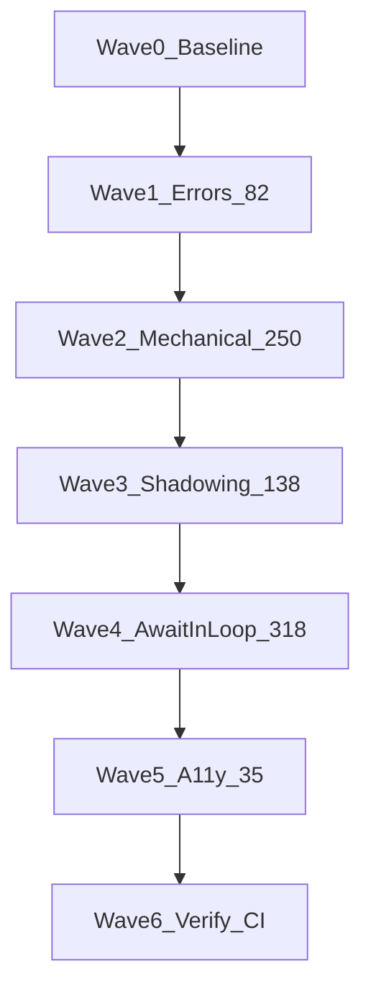

# Fix all `bun oxlint` issues (no rule disabling)

## Current baseline

Running `bun oxlint` today reports **870 findings across 383 files** and exits **1**:

| Severity | Count |
|----------|------:|
| Errors   | 82    |
| Warnings | 788   |

**By layer:**

| Directory   | Findings |
|-------------|--------:|
| `backend/`  | 587     |
| `frontend/` | 179     |
| `scripts/`  | 57      |
| `test/`     | 19      |
| `shared/`   | 15      |
| `app/`      | 8       |
| `.storybook/`| 5      |

Oxlint is **not** wired into [`scripts/quality-gate.ts`](../../scripts/quality-gate.ts) yet — only [`package.json`](../../package.json) script `"oxlint": "oxlint --ignore-path .gitignore"` and config [`.oxlintrc.json`](../../.oxlintrc.json).

**Constraint:** Fix code only. Do **not** add `oxlint-disable` comments, turn rules `"off"`, or weaken `.oxlintrc.json`. Existing overrides (`react/react-in-jsx-scope`, `no-console` in scripts/tests) stay as-is.

**Autofix:** `bun oxlint --fix --fix-suggestions` fixes almost nothing here — expect manual/refactor work.

---

## Success criteria

1. `bun oxlint` exits **0** with **zero** errors and warnings.
2. No rule disabling anywhere.
3. Targeted tests for behavior-sensitive areas (a11y focus, cron workers, parallel test runners, GraphQL schema registration).
4. Optional follow-up: add oxlint to quality-gate after clean pass.

---

## Execution model

Work in **6 waves**, highest-impact / lowest-risk first. Within each wave, fix **by rule** (same pattern across many files), then verify per file:

```bash
bun oxlint -f <file>   # or full bun oxlint after each wave
bun tsgo               # type safety after refactors
```

For backend/frontend files, read the applicable `AGENTS.md` before editing.



---

## Wave 0 — Baseline & inventory (~30 min)

1. Capture machine-readable inventory:
   ```bash
   bun oxlint -f json > .oxlint-baseline.json
   ```
2. Group findings by rule → assign owners (backend / frontend / scripts / test).
3. Confirm exit behavior: today exit **1** is driven by **82 category/plugin errors** (jsx-a11y, jsdoc, unicorn), not just warnings.

---

## Wave 1 — All 82 errors (quick wins)

### 1a. `unicorn/no-empty-file` (8 errors)

Delete unused empty files (grep shows no importers):

| File | Action |
|------|--------|
| [`shared/lib/index.ts`](../../shared/lib/index.ts) | Delete |
| [`frontend/common/views/dashboard/parents/lifecycle/components/__shared__/index.ts`](../../frontend/common/views/dashboard/parents/lifecycle/components/__shared__/index.ts) | Delete |
| 5× `*Labels.ts` under `frontend/common/views/dashboard/student/**/types/` | Delete (labels live in `*LabelsContext` / `.context` files) |
| [`backend/graphql/pothos/schema.types.ts`](../../backend/graphql/pothos/schema.types.ts) | Delete file **and** remove side-effect import from [`backend/graphql/gqlSchema.definitions.ts`](../../backend/graphql/gqlSchema.definitions.ts) (file is comment-only stub) |

### 1b. `jsdoc/check-tag-names` (39 errors)

Oxlint's jsdoc plugin rejects non-standard tags. Replace in place:

| Invalid tag | Replacement |
|-------------|-------------|
| `@typeParam T` | `@template T` (or drop tag, use TS generics) |
| `@remarks ...` | Plain block comment or `@description` |
| `@drizzle ...` | Plain comment (e.g. in [`backend/services/auth/demo-auth.service.ts`](../../backend/services/auth/demo-auth.service.ts)) |

**Hot files:** [`backend/types/storage/storage.types.ts`](../../backend/types/storage/storage.types.ts) (23 hits), WhatsApp request helpers, [`backend/lib/enum.ts`](../../backend/lib/enum.ts).

### 1c. `jsx-a11y/no-autofocus` (30 errors)

Replace `autoFocus={...}` with programmatic focus — already used elsewhere (e.g. [`frontend/common/components/ui/input/tagInput/useTagInputEditing.ts`](../../frontend/common/components/ui/input/tagInput/useTagInputEditing.ts)):

1. Add shared hook `useFocusOnMount(ref, enabled)` in `frontend/common/hooks/`.
2. Replace `autoFocus` in ~20 input/autocomplete components (common + mobile + desktop variants).
3. Preserve behavior: focus only when `autoFocus` prop is true (dialogs, edit mode).

### 1d. `jsx-a11y/prefer-tag-over-role` (5 errors)

| Location | Fix |
|----------|-----|
| [`localeAdornmentSwitch.*.tsx`](../../frontend/desktop/components/ui/input/localizedString/localeAdornmentSwitch.desktop.tsx) | Replace `Stack role="listbox"` / `role="option"` with `<ul>` / `<li>` (keep `aria-selected`, keyboard handling) |
| [`historyCalendar.desktop.tsx`](../../frontend/desktop/views/dashboard/student/history/components/historyCalendar.desktop.tsx) | Replace `role="button"` div with `<button type="button">` (styled via `sx` / `component` wrapper) |

---

## Wave 2 — Mechanical warnings (~250 findings)

### 2a. `unicorn/no-array-sort` + `no-array-reverse` (40)

Replace mutating calls with immutable equivalents:

```typescript
// Before
items.sort(compareFn)
items.reverse()

// After
items.toSorted(compareFn)
items.toReversed()
```

If the sorted array must be reused, assign: `const sorted = items.toSorted(...)`.

**Hot files:** [`scripts/run-test/run-test.ts`](../../scripts/run-test/run-test.ts), [`scripts/health/sonar/ts/results.ts`](../../scripts/health/sonar/ts/results.ts), [`scripts/dbActions/envFile.ts`](../../scripts/dbActions/envFile.ts).

### 2b. `unicorn/consistent-function-scoping` (54)

Move inner helpers that don't close over component state to **module scope**:

```typescript
// Before (inside component)
function flipSx(theme) { return { ... }; }

// After (module level)
function flipSx(theme: Theme) { return { ... }; }
```

**Examples:** `flipSx`, `isSchedulingModeValue`, `hasMain` in [`frontend/common/lib/server-theme-css.ts`](../../frontend/common/lib/server-theme-css.ts) (move `hasMain` outside `extractTokens`).

### 2c. `react/no-object-type-as-default-prop` (22)

Extract literals to module-level constants:

```typescript
const DEFAULT_FIELDS: FieldConfig[] = [];
function Component({ fields = DEFAULT_FIELDS }) { ... }
```

**Hot files:** payment method editors under `frontend/*/components/ui/input/paymentMethod*`.

### 2d. `oxc/no-map-spread` (31)

Replace spread-in-`map` with explicit object construction:

```typescript
// Before
rows.map(r => ({ ...r, status: "done" }))

// After
rows.map(r => Object.assign({}, r, { status: "done" }))
// or, if r is a fresh object: { id: r.id, status: "done", ...pick(r, keys) }
```

### 2e. Smaller rules (≤20 total)

| Rule | Fix |
|------|-----|
| `eslint/no-useless-concat` | Use template literal |
| `eslint/no-new` | Assign `new X()` to variable |
| `import/no-named-as-default-member` | Named import or namespace import |
| `unicorn/prefer-add-event-listener` | `addEventListener` instead of `.onload =` |
| `promise/always-return` | Ensure every `.then` branch returns |
| `eslint/no-unmodified-loop-condition` (9) | Refactor `while (running)` / date loops to `for (;;)` + `break`, or hoist mutating step into loop body (see [`scripts/cron-worker.ts`](../../scripts/cron-worker.ts), [`scripts/ondemand-instance-generator.ts`](../../scripts/ondemand-instance-generator.ts)) |

---

## Wave 3 — `eslint/no-shadow` (138)

Rename inner bindings that collide with imports/outer scope. **Do not** disable the rule.

**Patterns:**

| Pattern | Example fix |
|---------|-------------|
| Param shadows import | [`parent.repository.ts`](../../backend/db/repo/parents/parent.repository.ts): rename inner `queryDb` param → `dbConn` or `txHandle` (24 hits in this file alone) |
| Middleware param shadows outer | [`app/api/graphql/route.ts`](../../app/api/graphql/route.ts): rename `handler` param → `nextHandler` in `withRateLimit` / similar wrappers |
| E2E fixtures | [`test/ui/e2e/teacher_lesson_report.test.ts`](../../test/ui/e2e/teacher_lesson_report.test.ts): rename inner `page` → `testPage`, `context` → `browserContext` |
| Theme callback | [`.storybook/StoryWrapper.tsx`](../../.storybook/StoryWrapper.tsx): rename inner `theme` → `muiTheme` |

Apply consistently across **backend repos** (heavy concentration), **scripts**, **test/**, **app/**.

---

## Wave 4 — `eslint/no-await-in-loop` (318, largest wave)

Split into three buckets — **do not** blindly `Promise.all` everywhere.

### Bucket A — Safe to parallelize

Test runners, locale snapshot generation, icon generation, independent file I/O:

- Refactor to `Promise.all(batch.map(...))` with concurrency limit where needed.
- Existing worker pool in [`scripts/run-integration-tests-parallel.ts`](../../scripts/run-integration-tests-parallel.ts) already parallelizes workers; inner `while` still flags — replace with **recursive drain**:

```typescript
async function worker(): Promise<void> {
  const file = queue.shift();
  if (!file) return;
  await runSingleTestFile(file);
  return worker();
}
```

Same pattern for [`scripts/run-services-tests-parallel.ts`](../../scripts/run-services-tests-parallel.ts), [`scripts/run-db-tests-parallel.ts`](../../scripts/run-db-tests-parallel.ts).

### Bucket B — Must stay sequential (document via structure, not disable)

Seeds, cron drains, paginated API collection, rate-limited sweeps:

- Use **`reduce` chain** (preserves order, satisfies linter):

```typescript
await items.reduce(
  (prev, item) => prev.then(() => processItem(item)),
  Promise.resolve(),
);
```

- Or **`for await` over async generator** that yields work items one at a time.

**Files:** [`backend/db/seeds/`](../../backend/db/seeds/), [`scripts/cron-worker.ts`](../../scripts/cron-worker.ts), [`scripts/quota-expiry-sweeper.ts`](../../scripts/quota-expiry-sweeper.ts), [`scripts/health/sonar/ts/results.ts`](../../scripts/health/sonar/ts/results.ts), WhatsApp `collect-all-pages.ts`.

### Bucket C — E2E polling helpers

[`test/ui/e2e/helpers.ts`](../../test/ui/e2e/helpers.ts) (7 hits): sequential retries are intentional — use reduce/recursive retry helper extracted to module scope.

---

## Wave 5 — `import/no-unassigned-import` (98)

Side-effect barrels are intentional in GraphQL ([`backend/graphql/query/index.ts`](../../backend/graphql/query/index.ts), mutation/auth barrels, etc.) per [`backend/graphql/query/AGENTS.md`](../../backend/graphql/query/AGENTS.md).

**Fix without changing architecture:**

```typescript
// Before
import "./auth";

// After — satisfies no-unassigned-import, preserves side effects
import * as _authRegistration from "./auth";
void _authRegistration;
```

Apply to:

- All GraphQL query/mutation/pothos barrel `index.ts` files (~40 imports)
- CSS side-effect: [`app/layout.tsx`](../../app/layout.tsx) `import "@/app/index.css"`
- Storybook: [`.storybook/preview.tsx`](../../.storybook/preview.tsx)

**Alternative (long-term, out of scope unless needed):** explicit `registerXQueries()` functions instead of side-effect imports — much larger refactor; namespace import is the minimal fix.

---

## Wave 6 — Verification & CI hardening

1. **Full pass:** `bun oxlint` → 0 findings, exit 0.
2. **Typecheck:** `bun tsgo`.
3. **Targeted tests:**
   - GraphQL schema: `bun run generate:gqlSchema` + `bun run test:graphql` (after barrel import changes)
   - UI inputs with focus refactor: `bun run test:ui:components` (autocomplete/tag input stories)
   - Scripts: smoke-run parallel test scripts with `--help` or dry-run flags
   - Cron: verify [`scripts/cron-worker.ts`](../../scripts/cron-worker.ts) loop still drains correctly
4. **Optional CI integration:** add oxlint stage to [`scripts/quality-gate.ts`](../../scripts/quality-gate.ts) after `lint` in `BASIC_CHECKS`, or add a dedicated `bun run oxlint` step in CI.

---

## Suggested batch schedule

| Batch | Rules | ~Findings | ~Files | Risk |
|-------|-------|----------:|-------:|------|
| 1 | empty-file, jsdoc | 47 | ~15 | Low |
| 2 | no-array-sort/reverse, consistent-function-scoping, small rules | ~120 | ~80 | Low |
| 3 | no-object-type-as-default-prop, no-map-spread | 53 | ~40 | Low–medium |
| 4 | no-shadow | 138 | ~100 | Low (rename-only) |
| 5 | no-unassigned-import | 98 | ~30 | Low |
| 6 | no-await-in-loop | 318 | ~150 | Medium (behavior review) |
| 7 | jsx-a11y (autofocus, prefer-tag) | 35 | ~25 | Medium (UX/a11y) |

Parallelize batches 1–5 across subagents (one file per agent, same rule family). Batch 6 needs per-file behavior review. Batch 7 should share the `useFocusOnMount` hook to avoid drift.

---

## Findings by rule (full inventory)

| Rule | Count |
|------|------:|
| `eslint/no-await-in-loop` | 318 |
| `eslint/no-shadow` | 138 |
| `import/no-unassigned-import` | 98 |
| `eslint/no-underscore-dangle` | 59 |
| `unicorn/consistent-function-scoping` | 54 |
| `jsdoc/check-tag-names` | 39 |
| `unicorn/no-array-sort` | 38 |
| `oxc/no-map-spread` | 31 |
| `jsx-a11y/no-autofocus` | 30 |
| `react/no-object-type-as-default-prop` | 22 |
| `eslint/no-unmodified-loop-condition` | 9 |
| `unicorn/no-empty-file` | 8 |
| `unicorn/prefer-add-event-listener` | 7 |
| `jsx-a11y/prefer-tag-over-role` | 5 |
| `promise/always-return` | 5 |
| `import/no-named-as-default-member` | 3 |
| `eslint/no-new` | 3 |
| `unicorn/no-array-reverse` | 2 |
| `eslint/no-useless-concat` | 1 |

---

## Risk notes

1. **`no-await-in-loop` in seeds/cron** — wrong parallelization can cause deadlocks or rate-limit violations; prefer reduce/recursive patterns over `Promise.all`.
2. **GraphQL side-effect imports** — verify schema registration after namespace-import refactor (`bun run generate:gqlSchema`).
3. **`no-autofocus` removal** — programmatic focus must respect dialog open timing (`requestAnimationFrame` or `useEffect` after mount); test editable fields and autocomplete popovers.
4. **`prefer-tag-over-role` on locale picker** — `<ul>/<li>` preserves custom styling better than forcing native `<select>`.

---

## Estimated effort

| Phase | Time |
|-------|------|
| Waves 1–2 (errors + mechanical) | 4–6 hours |
| Wave 3 (shadowing) | 3–4 hours |
| Wave 4 (await-in-loop) | 6–10 hours |
| Wave 5 (imports) | 1–2 hours |
| Wave 6 (verification) | 2–3 hours |
| **Total** | **~16–25 hours** |
