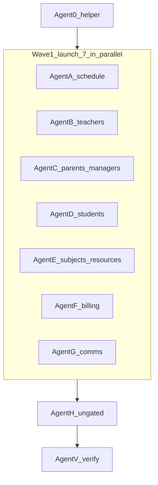

# Page-level permission redirects (subagent plan)

## Problem

Unauthorized users (e.g. student on `/schedule/tracking/reschedule`) see blank content because only client `<RequirePermission fallback={null}>` gates the page. Server `page.tsx` must redirect to `/dashboard`.

## Design decisions (fixed)

1. Redirect target: **`/dashboard`** (never gate `/dashboard` itself).
2. OR semantics for permission arrays (match client `RequirePermission`).
3. Prefer `context` from `getServerUserContext()`.
4. Use backend `AppPermission` in `page.tsx`.
5. Keep Container `<RequirePermission>` as defense-in-depth.
6. Permission lists = Container gates (not nav when they disagree).
7. Locale via `getLocale()` from `@/shared/locale/server-cookies`.

### Standard page snippet (every Wave 1 agent uses this)

```tsx
export default async function ExamplePage() {
  const locale = await getLocale();
  const { userId, context } = await getServerUserContext();
  if (!userId) {
    await redirectToLogin();
    return;
  }
  await requirePermissionForPage(userId, [AppPermission.SOME_KEY], locale, context);
  return <ExampleContainer />;
}
```

Imports each agent needs:
- `AppPermission` from `@/backend/enum`
- `requirePermissionForPage` from `@/backend/lib/auth/require-permission` (or `@/backend/lib/auth`)
- `getServerUserContext` from `@/backend/lib/auth/server-auth`
- `redirectToLogin` from `@/frontend/common/lib/redirectToLogin`
- `getLocale` from `@/shared/locale/server-cookies`

---

## Agent distribution (launch this)



### Master roster

| Wave | Agent ID | Model role | Files owned | Parallel? | Depends on |
|------|----------|------------|-------------|-----------|------------|
| 0 | **Agent 0** | Create helper + docs | `backend/lib/auth/require-permission.ts`, `backend/lib/auth/index.ts`, `app/AGENTS.md` | Solo | — |
| 1 | **Agent A** | Migrate schedule/classes/tools | 8 `page.tsx` listed below | With B–G | Agent 0 done |
| 1 | **Agent B** | Migrate teachers | 6 `page.tsx` | With A,C–G | Agent 0 done |
| 1 | **Agent C** | Migrate parents + managers | 6 `page.tsx` | With A,B,D–G | Agent 0 done |
| 1 | **Agent D** | Migrate students | 3 `page.tsx` | With A–C,E–G | Agent 0 done |
| 1 | **Agent E** | Migrate subjects + resources | 3 `page.tsx` | With A–D,F–G | Agent 0 done |
| 1 | **Agent F** | Migrate billing stack | 9 `page.tsx` | With A–E,G | Agent 0 done |
| 1 | **Agent G** | Migrate comms + permissions | 4 `page.tsx` (+ optional complaints href) | With A–F | Agent 0 done |
| 2 | **Agent H** | Ungated PAGE_PERMISSIONS routes | ~10 `page.tsx` + matching Containers | Solo | Wave 1 done |
| 3 | **Agent V** | Verify | read-only + `bun tsgo` | Solo | Wave 2 done |

### Orchestrator launch sequence

1. **Start Agent 0 only.** Wait until helper exports cleanly (`bun tsgo` on new file).
2. **Start Agents A–G in one parallel batch** (7 Task calls together). Each gets only its file list + permissions from this plan.
3. **After all A–G report CHANGED/SKIPPED:** start **Agent H**.
4. **After H:** run **Agent V** (or orchestrator does verify itself).

### Hard rules for every agent

- Edit **only** files in your ownership list. Never touch another agent’s `page.tsx`.
- Wave 1: **do not** modify Containers, stores, nav, or GraphQL.
- If blocked by a missing helper import → `BLOCKED: CROSS-FILE` (helper is Agent 0’s job).
- Skip profile / teacher-me / complaints parent pages (already redirect).
- Report: `CHANGED: [...]` / `SKIPPED: [...]` / `BLOCKED: [...]`

### Copy-paste Task prompts

**Agent 0**

> Implement `requirePermissionForPage` in `backend/lib/auth/require-permission.ts` mirroring `requireTeacherIdForPage` signature: `(userId, permissions, locale, permissionContext?)`. Super-admin or any permission in the list → allow; else `redirect({ href: "/dashboard", locale })` from `@/shared/i18n/routing`. Use backend `AppPermission` and `PermissionsService.getUserContext` only when context is missing. Export from `backend/lib/auth/index.ts`. Document in `app/AGENTS.md` (login vs identity helpers vs requirePermissionForPage vs client RequirePermission). Do not migrate any pages. Run `bun tsgo` on touched files.

**Agent A**

> After `requirePermissionForPage` exists: add server permission redirects to these 8 pages only, using getLocale + getServerUserContext + redirectToLogin + requirePermissionForPage. Permissions: search-schedule=`SCHEDULE_SEARCH_AVAILABILITY`; schedule/tracking/reschedule=`SESSION_RESCHEDULE`; schedule/tracking/status=`SCHEDULE_VIEW_ALL|DASHBOARD_VIEW_METRICS`; schedule/alerts=`SCHEDULE_VIEW_LIST`; reschedule=`SESSION_RESCHEDULE`; classes/new=`SCHEDULE_MANAGE_RECURRING`; recurring-schedules/[id]=`SCHEDULE_VIEW_ALL`; tools/dst-migration=`SYSTEM_BULK_UPDATE_DST`. Do not edit Containers. Report CHANGED/SKIPPED.

**Agent B**

> Migrate only: teachers, teachers/onboarding, teachers/rules, teachers/[id]/schedule/weekly, teachers/[id]/availability, teachers/[id]/reassignment. Perms: STAFF_VIEW_DIRECTORY; TEACHERS_CREATE; TEACHER_VIEW_DASHBOARD; SCHEDULE_VIEW_WEEKLY; SCHEDULE_SEARCH_AVAILABILITY; STUDENT_REASSIGN_TEACHER|STUDENT_MANAGE_STATUS. Skip teachers/me/schedule/* (already requireTeacherIdForPage). Pattern: getLocale + getServerUserContext + redirectToLogin + requirePermissionForPage. No Container edits.

**Agent C**

> Migrate only: parents, parents/onboarding, parents/rules, parents/me/social, managers, managers/onboarding. Perms: PARENTS_LIST; PARENTS_CREATE; SCHEDULE_VIEW_FAMILY; SCHEDULE_VIEW_FAMILY; STAFF_VIEW_DIRECTORY; STAFF_CREATE. Same page pattern. No Container edits.

**Agent D**

> Migrate only: students/onboarding (`STUDENTS_CREATE`), students/[id]/profile (`STUDENTS_LIST|STUDENT_VIEW_ASSOCIATED`), and students/page.tsx special: after existing audience resolution, if user has none of PARENT_VIEW_STUDENTS / TEACHER_VIEW_STUDENTS / STUDENTS_LIST → redirect to /dashboard. Do not change audience order. No Container edits.

**Agent E**

> Migrate only: subjects (`SUBJECTS_LIST`), resources (`RESOURCES_LIST`), resources/books-and-bags (`RESOURCES_LIST`). Same page pattern. No Container edits.

**Agent F**

> Migrate only these 9: billing, billing/invoices, billing/manual, billing/exchange-rates, billing/currencies, billing/currency-hedges, payment-catalogs, meeting-providers, users/[id]/billing-profile. Perms: BILLING_VIEW_HISTORY; BILLING_VIEW_HISTORY; BILLING_CREATE_INVOICE; BILLING_VIEW_EXCHANGE_RATES; BILLING_VIEW_EXCHANGE_RATES; BILLING_MANAGE_CURRENCY_HEDGES; PAYMENT_METHODS_MANAGE_CATALOGS; MEETING_PROVIDERS_MANAGE_CATALOG; BILLING_VIEW_HISTORY. Same page pattern. No Container edits.

**Agent G**

> Migrate only: suggestions (`COMMUNICATION_SUBMIT_SUGGESTION`), suggestions/manage (`SUGGESTIONS_LIST`), complaints/manage (`COMPLAINTS_RESPOND|COMPLAINTS_LIST`), permissions (`PERMISSION_GROUPS_MANAGE`). For permissions page: make page async with server requirePermissionForPage; keep client RequirePermission around container. Optionally change complaints/page.tsx redirect href from `/` to `/dashboard`. No other files.

**Agent H**

> Wave 2: for routes that have PAGE_PERMISSIONS but no full-page RequirePermission, add requirePermissionForPage in page.tsx AND wrap Containers with RequirePermission. Routes: reports (`REPORT_GENERATE_CUSTOM`); students/me, students/me/history, students/me/credits (`STUDENT_VIEW_OWN_DASHBOARD`); lesson-reports (`LESSON_REPORTS_REVIEW|LESSON_REPORTS_APPROVE`); teacher-dues (`TEACHER_DUES_VIEW`); monthly-reports (`MONTHLY_REPORTS_VIEW`); supervisor/dashboard only if it renders a real view (`SUPERVISOR_VIEW_DASHBOARD`) else SKIP. Also wrap ParentStudentsContainer with PARENT_VIEW_STUDENTS. Do not touch /dashboard page.

**Agent V**

> Verify: bun tsgo on all touched paths from Agents 0–H. Confirm student visiting /schedule/tracking/reschedule and /billing/manual redirects to /dashboard; /dashboard still loads for student; staff with SESSION_RESCHEDULE still sees reschedule tracking. Report failures only.

---

## Existing patterns to mirror

| Helper / page | Path | Behavior |
|---------------|------|----------|
| `requireTeacherIdForPage` | [`backend/lib/auth/require-teacher-id.ts`](backend/lib/auth/require-teacher-id.ts) | Missing identity → `/dashboard` |
| `requireParentIdForPage` | [`backend/lib/auth/require-parent-id.ts`](backend/lib/auth/require-parent-id.ts) | Same shape, unused |
| Profile pages | `resolveProfilePageContext` | → `/dashboard` or `/profile` |
| Complaints | `getCachedParentIdForComplaints` | → `"/"` today (Agent G may normalize) |

---

## Wave 0 — Agent 0 detail

Create [`backend/lib/auth/require-permission.ts`](backend/lib/auth/require-permission.ts):

```ts
export async function requirePermissionForPage(
  userId: string,
  permissions: readonly AppPermission[],
  locale: string,
  permissionContext?: UserPermissionContext | null
): Promise<void> {
  const context = permissionContext ?? (await PermissionsService.getUserContext(userId));
  const hasAccess =
    context.isSuperAdmin ||
    permissions.some((p) => context.permissions.includes(p));
  if (!hasAccess) {
    redirect({ href: "/dashboard", locale });
  }
}
```

- Export from [`backend/lib/auth/index.ts`](backend/lib/auth/index.ts)
- Document in [`app/AGENTS.md`](app/AGENTS.md)
- **Do not migrate pages**

---

## Wave 1 — file ownership (Agents A–G)

### Agent A — Schedule / classes / tools (8)

| Route | page.tsx | Permissions (OR) |
|-------|----------|------------------|
| `/search-schedule` | [`app/(dashboard)/search-schedule/page.tsx`](app/(dashboard)/search-schedule/page.tsx) | `SCHEDULE_SEARCH_AVAILABILITY` |
| `/schedule/tracking/reschedule` | [`app/(dashboard)/schedule/tracking/reschedule/page.tsx`](app/(dashboard)/schedule/tracking/reschedule/page.tsx) | `SESSION_RESCHEDULE` |
| `/schedule/tracking/status` | [`app/(dashboard)/schedule/tracking/status/page.tsx`](app/(dashboard)/schedule/tracking/status/page.tsx) | `SCHEDULE_VIEW_ALL` \| `DASHBOARD_VIEW_METRICS` |
| `/schedule/alerts` | [`app/(dashboard)/schedule/alerts/page.tsx`](app/(dashboard)/schedule/alerts/page.tsx) | `SCHEDULE_VIEW_LIST` |
| `/reschedule` | [`app/(dashboard)/reschedule/page.tsx`](app/(dashboard)/reschedule/page.tsx) | `SESSION_RESCHEDULE` |
| `/classes/new` | [`app/(dashboard)/classes/new/page.tsx`](app/(dashboard)/classes/new/page.tsx) | `SCHEDULE_MANAGE_RECURRING` |
| `/recurring-schedules/[id]` | [`app/(dashboard)/recurring-schedules/[id]/page.tsx`](app/(dashboard)/recurring-schedules/[id]/page.tsx) | `SCHEDULE_VIEW_ALL` |
| `/tools/dst-migration` | [`app/(dashboard)/tools/dst-migration/page.tsx`](app/(dashboard)/tools/dst-migration/page.tsx) | `SYSTEM_BULK_UPDATE_DST` |

### Agent B — Teachers (6)

| Route | page.tsx | Permissions (OR) |
|-------|----------|------------------|
| `/teachers` | [`app/(dashboard)/teachers/page.tsx`](app/(dashboard)/teachers/page.tsx) | `STAFF_VIEW_DIRECTORY` |
| `/teachers/onboarding` | [`app/(dashboard)/teachers/onboarding/page.tsx`](app/(dashboard)/teachers/onboarding/page.tsx) | `TEACHERS_CREATE` |
| `/teachers/rules` | [`app/(dashboard)/teachers/rules/page.tsx`](app/(dashboard)/teachers/rules/page.tsx) | `TEACHER_VIEW_DASHBOARD` |
| `/teachers/[id]/schedule/weekly` | [`app/(dashboard)/teachers/[id]/schedule/weekly/page.tsx`](app/(dashboard)/teachers/[id]/schedule/weekly/page.tsx) | `SCHEDULE_VIEW_WEEKLY` |
| `/teachers/[id]/availability` | [`app/(dashboard)/teachers/[id]/availability/page.tsx`](app/(dashboard)/teachers/[id]/availability/page.tsx) | `SCHEDULE_SEARCH_AVAILABILITY` |
| `/teachers/[id]/reassignment` | [`app/(dashboard)/teachers/[id]/reassignment/page.tsx`](app/(dashboard)/teachers/[id]/reassignment/page.tsx) | `STUDENT_REASSIGN_TEACHER` \| `STUDENT_MANAGE_STATUS` |

Skip: `/teachers/me/schedule/weekly`, `/teachers/me/schedule/future`.

### Agent C — Parents + managers (6)

| Route | page.tsx | Permissions (OR) |
|-------|----------|------------------|
| `/parents` | [`app/(dashboard)/parents/page.tsx`](app/(dashboard)/parents/page.tsx) | `PARENTS_LIST` |
| `/parents/onboarding` | [`app/(dashboard)/parents/onboarding/page.tsx`](app/(dashboard)/parents/onboarding/page.tsx) | `PARENTS_CREATE` |
| `/parents/rules` | [`app/(dashboard)/parents/rules/page.tsx`](app/(dashboard)/parents/rules/page.tsx) | `SCHEDULE_VIEW_FAMILY` |
| `/parents/me/social` | [`app/(dashboard)/parents/me/social/page.tsx`](app/(dashboard)/parents/me/social/page.tsx) | `SCHEDULE_VIEW_FAMILY` |
| `/managers` | [`app/(dashboard)/managers/page.tsx`](app/(dashboard)/managers/page.tsx) | `STAFF_VIEW_DIRECTORY` |
| `/managers/onboarding` | [`app/(dashboard)/managers/onboarding/page.tsx`](app/(dashboard)/managers/onboarding/page.tsx) | `STAFF_CREATE` |

### Agent D — Students (3)

| Route | page.tsx | Permissions / logic |
|-------|----------|---------------------|
| `/students` | [`app/(dashboard)/students/page.tsx`](app/(dashboard)/students/page.tsx) | Deny if none of `PARENT_VIEW_STUDENTS` \| `TEACHER_VIEW_STUDENTS` \| `STUDENTS_LIST` |
| `/students/onboarding` | [`app/(dashboard)/students/onboarding/page.tsx`](app/(dashboard)/students/onboarding/page.tsx) | `STUDENTS_CREATE` |
| `/students/[id]/profile` | [`app/(dashboard)/students/[id]/profile/page.tsx`](app/(dashboard)/students/[id]/profile/page.tsx) | `STUDENTS_LIST` \| `STUDENT_VIEW_ASSOCIATED` |

### Agent E — Subjects + resources (3)

| Route | page.tsx | Permissions |
|-------|----------|-------------|
| `/subjects` | [`app/(dashboard)/subjects/page.tsx`](app/(dashboard)/subjects/page.tsx) | `SUBJECTS_LIST` |
| `/resources` | [`app/(dashboard)/resources/page.tsx`](app/(dashboard)/resources/page.tsx) | `RESOURCES_LIST` |
| `/resources/books-and-bags` | [`app/(dashboard)/resources/books-and-bags/page.tsx`](app/(dashboard)/resources/books-and-bags/page.tsx) | `RESOURCES_LIST` |

### Agent F — Billing / payment / meeting (9)

| Route | page.tsx | Permissions |
|-------|----------|-------------|
| `/billing` | [`app/(dashboard)/billing/page.tsx`](app/(dashboard)/billing/page.tsx) | `BILLING_VIEW_HISTORY` |
| `/billing/invoices` | [`app/(dashboard)/billing/invoices/page.tsx`](app/(dashboard)/billing/invoices/page.tsx) | `BILLING_VIEW_HISTORY` |
| `/billing/manual` | [`app/(dashboard)/billing/manual/page.tsx`](app/(dashboard)/billing/manual/page.tsx) | `BILLING_CREATE_INVOICE` |
| `/billing/exchange-rates` | [`app/(dashboard)/billing/exchange-rates/page.tsx`](app/(dashboard)/billing/exchange-rates/page.tsx) | `BILLING_VIEW_EXCHANGE_RATES` |
| `/billing/currencies` | [`app/(dashboard)/billing/currencies/page.tsx`](app/(dashboard)/billing/currencies/page.tsx) | `BILLING_VIEW_EXCHANGE_RATES` |
| `/billing/currency-hedges` | [`app/(dashboard)/billing/currency-hedges/page.tsx`](app/(dashboard)/billing/currency-hedges/page.tsx) | `BILLING_MANAGE_CURRENCY_HEDGES` |
| `/payment-catalogs` | [`app/(dashboard)/payment-catalogs/page.tsx`](app/(dashboard)/payment-catalogs/page.tsx) | `PAYMENT_METHODS_MANAGE_CATALOGS` |
| `/meeting-providers` | [`app/(dashboard)/meeting-providers/page.tsx`](app/(dashboard)/meeting-providers/page.tsx) | `MEETING_PROVIDERS_MANAGE_CATALOG` |
| `/users/[id]/billing-profile` | [`app/(dashboard)/users/[id]/billing-profile/page.tsx`](app/(dashboard)/users/[id]/billing-profile/page.tsx) | `BILLING_VIEW_HISTORY` |

### Agent G — Communication + permissions (4)

| Route | page.tsx | Permissions (OR) |
|-------|----------|------------------|
| `/suggestions` | [`app/(dashboard)/suggestions/page.tsx`](app/(dashboard)/suggestions/page.tsx) | `COMMUNICATION_SUBMIT_SUGGESTION` |
| `/suggestions/manage` | [`app/(dashboard)/suggestions/manage/page.tsx`](app/(dashboard)/suggestions/manage/page.tsx) | `SUGGESTIONS_LIST` |
| `/complaints/manage` | [`app/(dashboard)/complaints/manage/page.tsx`](app/(dashboard)/complaints/manage/page.tsx) | `COMPLAINTS_RESPOND` \| `COMPLAINTS_LIST` |
| `/permissions` | [`app/(dashboard)/permissions/page.tsx`](app/(dashboard)/permissions/page.tsx) | `PERMISSION_GROUPS_MANAGE` |

Optional: [`complaints/page.tsx`](app/(dashboard)/complaints/page.tsx) redirect `"/"` → `"/dashboard"`.

**Wave 1 total: 39 pages.**

### Excluded (no Wave 1 agent owns these)

| Route | Reason |
|-------|--------|
| `/dashboard` | Landing page for redirects |
| `/complaints` | Already redirects (optional href fix = Agent G) |
| `/profile`, `/profile/edit`, `/users/[id]/profile(+edit)` | `resolveProfilePageContext` |
| `/teachers/me/schedule/weekly`, `/future` | `requireTeacherIdForPage` |
| Section-only gates | Not page migration |

---

## Wave 2 — Agent H ownership

| Route | page.tsx | Permissions (OR) | Also edit Container? |
|-------|----------|------------------|----------------------|
| `/reports` | [`app/(dashboard)/reports/page.tsx`](app/(dashboard)/reports/page.tsx) | `REPORT_GENERATE_CUSTOM` | Yes — add `RequirePermission` |
| `/students/me` | [`app/(dashboard)/students/me/page.tsx`](app/(dashboard)/students/me/page.tsx) | `STUDENT_VIEW_OWN_DASHBOARD` | Yes |
| `/students/me/history` | [`app/(dashboard)/students/me/history/page.tsx`](app/(dashboard)/students/me/history/page.tsx) | `STUDENT_VIEW_OWN_DASHBOARD` | Yes |
| `/students/me/credits` | [`app/(dashboard)/students/me/credits/page.tsx`](app/(dashboard)/students/me/credits/page.tsx) | `STUDENT_VIEW_OWN_DASHBOARD` | Yes |
| `/lesson-reports` | [`app/(dashboard)/lesson-reports/page.tsx`](app/(dashboard)/lesson-reports/page.tsx) | `LESSON_REPORTS_REVIEW` \| `LESSON_REPORTS_APPROVE` | Yes |
| `/teacher-dues` | [`app/(dashboard)/teacher-dues/page.tsx`](app/(dashboard)/teacher-dues/page.tsx) | `TEACHER_DUES_VIEW` | Yes |
| `/monthly-reports` | [`app/(dashboard)/monthly-reports/page.tsx`](app/(dashboard)/monthly-reports/page.tsx) | `MONTHLY_REPORTS_VIEW` | Yes |
| `/supervisor/dashboard` | only if real view | `SUPERVISOR_VIEW_DASHBOARD` | Yes or SKIP |
| Parent students branch | `ParentStudentsContainer` | `PARENT_VIEW_STUDENTS` | Client wrap only |

---

## Wave 3 — Agent V checks

1. `bun tsgo` on all touched paths
2. Student → `/schedule/tracking/reschedule` → `/dashboard`
3. Student → `/billing/manual` → `/dashboard`
4. Student → `/dashboard` still loads
5. Authorized staff → reschedule tracking still renders
