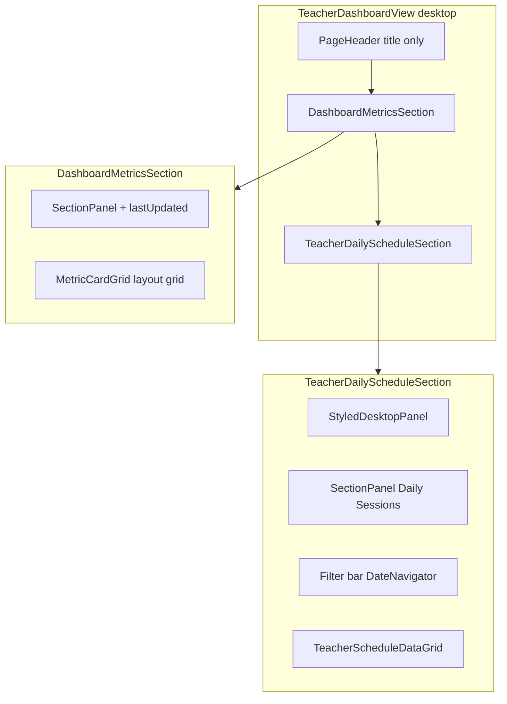
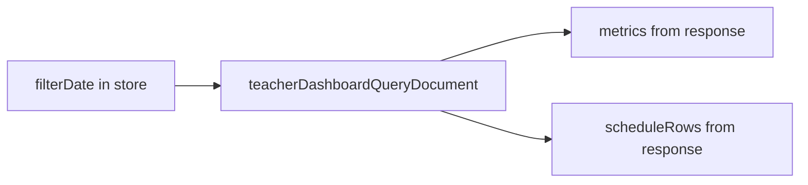

## Layer compliance (mandatory)

Read the applicable instruction files **before editing each file** (per root `AGENTS.md` sub-loop mapping):

| File pattern | Instruction files | AGENTS.md |
|---|---|---|
| `frontend/views/**/*.tsx` | [`.github/instructions/frontend.instructions.md`](.github/instructions/frontend.instructions.md) | [`frontend/views/AGENTS.md`](frontend/views/AGENTS.md), [`frontend/AGENTS.md`](frontend/AGENTS.md) |
| `frontend/stores/**/*.ts` | frontend.instructions.md | [`frontend/stores/AGENTS.md`](frontend/stores/AGENTS.md), frontend/AGENTS.md |
| `shared/messages/**` | frontend.instructions.md (i18n section) | root `AGENTS.md` (localized errors / next-intl) |

Also read before implementation: [`frontend/COMPONENT_PATTERNS.md`](frontend/COMPONENT_PATTERNS.md), [`frontend/THEME_PALETTE.md`](frontend/THEME_PALETTE.md), [`frontend/IMPLEMENTATION_LEARNINGS.md`](frontend/IMPLEMENTATION_LEARNINGS.md) if errors recur.

### Container layer — `TeacherDashboardContainer.tsx`

[`frontend/views/AGENTS.md`](frontend/views/AGENTS.md) + [`frontend/common/graphql/AGENTS.md`](frontend/common/graphql/AGENTS.md):

- **Container owns data**; view is presentational only — no `useQuery` in view components.
- **Single dashboard query**: `useQuery(teacherDashboardQueryDocument, …)` from [`teacher-dashboard.documents.ts`](frontend/common/graphql/sharedDocuments/teacher-dashboard.documents.ts); import hooks from `"@apollo/client/react"`.
- **No `useLazyQuery`**; stateful `useQuery` with `variables: { date: filterDate, pagination }`.
- **`filterDate` drives everything**: Zustand `useTeacherDashboardStore` `filterDate` is the single source of truth for query variables and `DateNavigator` (per COMPONENT_PATTERNS DateNavigator section — same as admin).
- **Metrics from query response only** — use generated operation types (`Operations.TeacherDashboardQuery_…_metrics_…`), not ad-hoc view DTOs or paginated-row math ([`frontend/stores/AGENTS.md`](frontend/stores/AGENTS.md): no complex mapping workarounds).
- **Lazy handbook query only**: `teacherHandbookUrlQueryDocument` with `skip: !handbookRequested` — not dashboard data.
- **`RequirePermission`** wrapper stays (`AppPermission.TeacherViewDashboard`).
- **Logging**: `logger` from `@/frontend/utils/logger` — never `console.*`.
- **Mutations**: `refetch()` dashboard query after activate/start/absent/leave/manual entry (existing pattern).

### View / component layer

[`frontend/views/AGENTS.md`](frontend/views/AGENTS.md) + [`frontend/AGENTS.md`](frontend/AGENTS.md) Dashboard UI Patterns + COMPONENT_PATTERNS:

- **Functional components only**; domain folder structure under `frontend/views/dashboard/teachers/dashboard/`.
- **Layout**: `PageContainer` with `theme.layout.sectionGap` — no outer `p: 2/3`; use [`teacherDashboardMobileLayout.ts`](frontend/views/dashboard/teachers/dashboard/utils/teacherDashboardMobileLayout.ts) for mobile padding exceptions only.
- **Headers**: `PageHeader` (title only on desktop) + `SectionPanel` — no ad-hoc flex title blocks.
- **Metrics**: shared `MetricCardGrid` via new `DashboardMetricsSection` — **do not** recreate per-feature metric card components ([`TeacherActiveMetricsRow`](frontend/views/dashboard/teachers/dashboard/components/TeacherActiveMetricsRow.tsx) deleted).
- **Schedule desktop**: `TeacherDailyScheduleSection` uses `StyledDesktopPanel` + `SectionPanel` + in-panel `DateNavigator` + existing `TeacherScheduleDataGrid` (`AppDataGrid` wrapper) — no hand-built tables.
- **Schedule mobile**: keep `TeacherScheduleCardList` + external `DateNavigator` (unchanged).
- **Status**: `StatusBadge` with `category` — remove desktop TODAY chip; no inline status chips.
- **MUI v9**: all layout/style props in `sx`; icons `*Outlined` not `*Outline`; theme palette via callback — **no hardcoded colors** (`theme.palette.border.light`, `theme.palette.background.default`, etc. when copying admin styled primitives).
- **Typography**: theme variants (`headlineLg`, `titleLg`, `labelMd`, `bodyMd`) — no hardcoded font sizes.
- **i18n**: all user-facing strings via `useTranslations` / labels from [`buildTeacherDashboardLabels.ts`](frontend/views/dashboard/teachers/dashboard/utils/buildTeacherDashboardLabels.ts) — no hardcoded UI text in components.
- **No nested ternaries** — extract desktop/mobile branches cleanly (SonarJS).

### Utils layer — `buildTeacherDashboardMetrics.ts`

- Accept **raw GraphQL metrics** type from `operations.ts` (operation result shape), mirroring [`adminDashboardMetrics.ts`](frontend/views/dashboard/admin/dashboard/utils/adminDashboardMetrics.ts).
- Map to `MetricItem[]` for `MetricCardGrid`; labels still from i18n via `buildTeacherDashboardLabels`.
- Do not redefine entity types locally — use generated types.

### Shared metrics component — `DashboardMetricsSection.tsx`

- Lives in [`frontend/views/dashboard/components/`](frontend/views/dashboard/components/) (cross-dashboard shared UI, not teacher-only).
- Reuse existing admin `TodayClassesSection` behavior; admin file becomes thin wrapper to avoid duplication.

### i18n layer — `shared/messages/`

- Update **both** [`shared/messages/en.ts`](shared/messages/en.ts) and [`shared/messages/ar/dashboard/teachers/dashboard.ts`](shared/messages/ar/dashboard/teachers/dashboard.ts).
- Update type in [`shared/messages/types/dashboard/teachers/dashboard.ts`](shared/messages/types/dashboard/teachers/dashboard.ts) if key text/shape changes.
- ICU plural keys (`updatedMinutesAgo`) stay formatted at runtime in [`useTeacherDashboardLastUpdated.ts`](frontend/views/dashboard/teachers/dashboard/utils/useTeacherDashboardLastUpdated.ts) — do not pass through label builders (prior FORMATTING_ERROR fix).

### Store layer — `teacherDashboardStore.ts`

[`frontend/stores/AGENTS.md`](frontend/stores/AGENTS.md):

- `setFilterDate` already resets `page: 0` — preserve this; container `handleDateChange` delegates to store.
- No new store fields unless required; filter state stays minimal (date + pagination).

### GraphQL layer (read-only for this task)

[`frontend/common/graphql/AGENTS.md`](frontend/common/graphql/AGENTS.md):

- **No schema/document changes expected** — existing `teacherDashboardQueryDocument` already returns `metrics` + `scheduleRows` + `progressFeed` with `id` fields.
- **No codegen** unless documents change.
- If documents do change: `bun run generate:gqlSchema` then `bun codegen`.

### Storybook — `TeacherDashboardContainer.stories.tsx`

[`frontend/views/AGENTS.md`](frontend/views/AGENTS.md) Storybook section:

- Use `useTranslations` / label builders for text.
- Seed permissions via `useUserStore.setState()` when testing teacher-specific gates.
- Decorators in story `decorators` array, not inline wraps.
- Verify desktop breakpoint: metrics panel, in-panel date nav, "Daily Sessions" title.

### Verification workflow

**Skip CodeScene and Sonar** for this task — do not run `bun quality-gate`, `bun run codescene`, `bun sonar-scan`, or `sonar-manager`.

**Per-file loop** before marking a file done (`bun run lint` is safe — it IS the lint queue client):

```bash
bun run scripts/health/sub-loop.ts <file-path> --lifecycle lint
```

This runs `tsgo` → `biome:check` → lint-queue-client only.

Run per new/edited file **before** importing elsewhere. Final pass: `bun tsgo` on the full change set.

- Do **not** create summary markdown files (root AGENTS.md communication rules).

---

# Teacher Desktop Layout Alignment with Admin Dashboard

## Target layout (desktop only)



Admin reference implementations:
- Metrics: [`TodayClassesSection.tsx`](frontend/views/dashboard/admin/dashboard/components/TodayClassesSection.tsx) — `SectionPanel` + `MetricCardGrid` + `lastUpdated` in header actions
- Schedule: [`ScheduleOverviewSection.tsx`](frontend/views/dashboard/admin/dashboard/components/ScheduleOverviewSection.tsx) `DesktopLayout` — `StyledDesktopPanel` → `SectionPanel` → `StyledFilterContainer` (filters) → data grid
- Data: [`AdminDashboardContainer.tsx`](frontend/views/dashboard/admin/dashboard/AdminDashboardContainer.tsx) — single `adminDashboardScheduleQueryDocument`; `input.date` drives both `metrics` and `rows` in one response; date change resets page

## 0. Single-query data fetching & date-scoped metrics (TeacherDashboardContainer)

**Current state (mostly correct):** [`TeacherDashboardContainer.tsx`](frontend/views/dashboard/teachers/dashboard/TeacherDashboardContainer.tsx) already uses one dashboard query:

```tsx
useQuery(teacherDashboardQueryDocument, {
  variables: { date: filterDate, pagination: paginationArgs },
});
```

Backend [`teacher-dashboard.service.ts`](backend/services/teacher/teacher-dashboard.service.ts) already scopes both schedule rows and metrics to the same `date` argument via `getAdminDashboardSchedule({ date })` and `getDailyMetrics(targetDate, teacher.id)` — same pattern as admin’s combined response.

**Allowed secondary query:** `teacherHandbookUrlQueryDocument` stays lazy (`skip: !handbookRequested`) — on-demand user action only, not dashboard data.

**Align container wiring with admin** (in same PR as layout work):

| Admin pattern | Teacher change |
|---------------|----------------|
| `buildAdminDashboardMetrics(scheduleResult?.metrics)` | Refactor [`buildTeacherActiveMetricItems`](frontend/views/dashboard/teachers/dashboard/utils/buildTeacherDashboardMetrics.ts) to accept raw query metrics (`total`, `running`, `absent`, `taken`, …) directly — mirror admin’s `buildAdminDashboardMetrics(rawMetrics)` |
| `handleDateChange` → `setDateFilter` + `setPage(0)` | Add explicit `handleDateChange` wrapper calling `setFilterDate` (store already resets `page: 0`) and pass to view — same intent as admin |
| Metrics never derived from paginated rows | Remove `studentsToday: new Set(scheduleRows.map(...))` from `viewMetrics`; drop unused `studentsToday` from container→view mapping if not displayed |
| Single response drives metrics + grid + feed | Pass `buildTeacherActiveMetricItems(dashboardData?.teacherDashboard?.metrics, labels)` to view; schedule rows and `totalCount` from same query result |



**No new GraphQL query or backend changes required** unless integration tests reveal a metrics/date bug (existing [`teacher-dashboard.test.ts`](frontend/common/graphql/test/teacher-dashboard.test.ts) already asserts `metrics` is returned).

## 1. Extract shared `DashboardMetricsSection`

Create [`frontend/views/dashboard/components/DashboardMetricsSection.tsx`](frontend/views/dashboard/components/DashboardMetricsSection.tsx) by generalizing the existing admin component:

- `SectionPanel` with optional `lastUpdated` clock action (same as admin)
- `MetricCardGrid` with responsive layout: `scroll` on mobile (`md` down), `grid` on desktop
- New optional `gridSize` prop (defaults to admin’s `{ sm: 4, md: 4, lg: 2 }` for 12 metrics)
- Optional `onMetricClick` / `selectedMetricKey` (admin filter behavior)
- **Do not** add `mb: { xs: 0, md: 4 }` — teacher page already uses `PageContainer` section gap via [`teacherDashboardMobileLayout.ts`](frontend/views/dashboard/teachers/dashboard/utils/teacherDashboardMobileLayout.ts)

Refactor admin [`TodayClassesSection.tsx`](frontend/views/dashboard/admin/dashboard/components/TodayClassesSection.tsx) into a thin re-export/wrapper around `DashboardMetricsSection` so [`DashboardView.tsx`](frontend/views/dashboard/dashboard/DashboardView.tsx) needs no import-path change.

## 2. Create `TeacherDailyScheduleSection` (desktop schedule shell)

New file: [`frontend/views/dashboard/teachers/dashboard/components/TeacherDailyScheduleSection.tsx`](frontend/views/dashboard/teachers/dashboard/components/TeacherDailyScheduleSection.tsx)

Mirror admin `DesktopLayout` structure (copy the two styled primitives from `ScheduleOverviewSection`):

```tsx
// Pattern from ScheduleOverviewSection DesktopLayout
<StyledDesktopPanel elevation={0}>
  <SectionPanel title={title}>  {/* no subTitle, no actions */}
    <StyledFilterContainer>
      <DateNavigator ... />
    </StyledFilterContainer>
    <TeacherScheduleDataGrid ... />
  </SectionPanel>
</StyledDesktopPanel>
```

- No search field, no teacher dropdown, no TODAY chip
- Accepts the same date-nav + grid props currently wired in [`TeacherDashboardView.tsx`](frontend/views/dashboard/teachers/dashboard/TeacherDashboardView.tsx)

## 3. Update `TeacherDashboardView`

In [`TeacherDashboardView.tsx`](frontend/views/dashboard/teachers/dashboard/TeacherDashboardView.tsx):

| Area | Desktop change | Mobile (unchanged) |
|------|----------------|-------------------|
| Page header | `PageHeader` with `title` only — remove `subtitle={welcomeSubtitle}` | Keep welcome stack + `mobileSummary` |
| Metrics | Replace `TeacherActiveMetricsRow` with `DashboardMetricsSection` using `buildTeacherActiveMetricItems(metrics, labels.activeMetrics)`, `title={labels.pageTitle}`, `lastUpdated`, `gridSize={{ xs: 6, sm: 6, md: 3 }}` (4 pills per row) | Replace `TeacherDashboardMetricsSection` with same shared component (scroll layout handled internally) |
| Date nav | Remove standalone `DateNavigator` box | Keep `DateNavigator` above schedule cards |
| Schedule | Replace `SectionPanel` + external date nav with `TeacherDailyScheduleSection` | Keep `SectionPanel` with `titleToday`, `viewAll` action, card list |

Cleanup in the same file:
- Remove `formatWelcomeSubtitle` and `welcomeSubtitle` (desktop-only dead code)
- Remove desktop `schedulePanelActions` TODAY chip (`StatusBadge` branch); mobile keeps `viewAll` action
- Remove unused `scheduleDateLabel` prop from view interface if no longer referenced (container can keep computing it for now or drop in same PR)

## 4. i18n updates

| Key | English | Arabic ([`ar/dashboard/teachers/dashboard.ts`](shared/messages/ar/dashboard/teachers/dashboard.ts)) |
|-----|---------|------|
| `dashboard.teacherDashboard.schedule.title` | `"Current Sessions"` → `"Daily Sessions"` | `"الحصص الحالية"` → `"الحصص اليومية"` |

`activeWelcome.subtitle` can remain in messages (unused on desktop after this change; still harmless).

## 5. Delete redundant teacher components

After wiring the shared section:
- Delete [`TeacherActiveMetricsRow.tsx`](frontend/views/dashboard/teachers/dashboard/components/TeacherActiveMetricsRow.tsx)
- Delete [`TeacherDashboardMetricsSection.tsx`](frontend/views/dashboard/teachers/dashboard/components/TeacherDashboardMetricsSection.tsx)

## 6. Verification

See **Layer compliance → Verification workflow** above. Additionally:

- Visually check [`TeacherDashboardContainer.stories.tsx`](frontend/views/dashboard/teachers/dashboard/TeacherDashboardContainer.stories.tsx) at desktop breakpoint
- Confirm admin dashboard metrics unchanged (shared `DashboardMetricsSection` regression)
- Change date in UI/story: metrics and grid both update from the same refetch (no separate metrics query)

## Files touched (summary)

| Action | File |
|--------|------|
| **Create** | `frontend/views/dashboard/components/DashboardMetricsSection.tsx` |
| **Create** | `frontend/views/dashboard/teachers/dashboard/components/TeacherDailyScheduleSection.tsx` |
| **Modify** | `TeacherDashboardContainer.tsx` (single-query metrics wiring, `handleDateChange`) |
| **Modify** | `buildTeacherDashboardMetrics.ts` (accept raw query metrics type) |
| **Modify** | `TeacherDashboardView.tsx` |
| **Modify** | `admin/dashboard/components/TodayClassesSection.tsx` (thin wrapper) |
| **Modify** | `shared/messages/en.ts`, `shared/messages/ar/dashboard/teachers/dashboard.ts` |
| **Delete** | `TeacherActiveMetricsRow.tsx`, `TeacherDashboardMetricsSection.tsx` |
