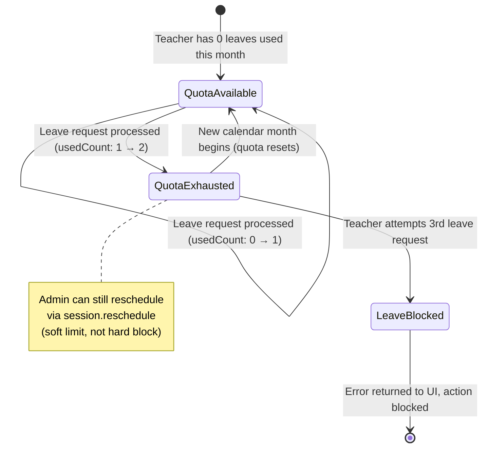
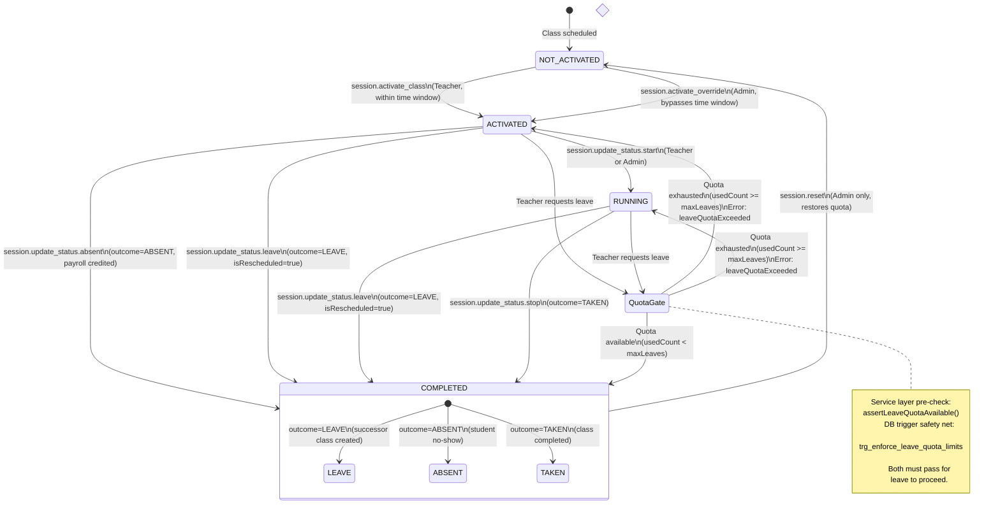
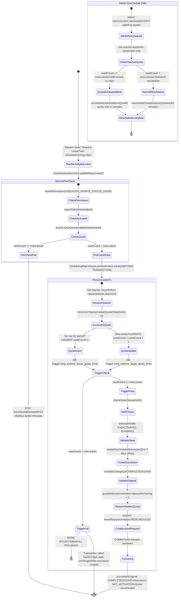
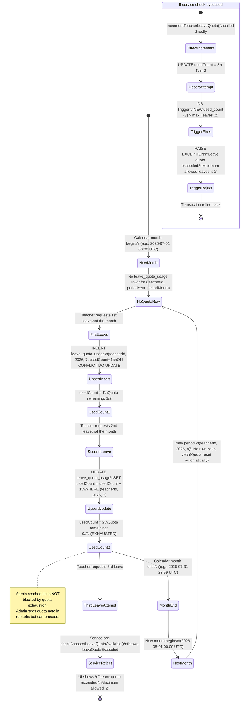

# Story 4 Implementation Plan — Leave Quota Enforcement, Future Schedule Verification & Reschedule Tracking (Enhanced)

**Source story:** `.ai/siraj_stories/4.md` (Part 5: Permissions & Permission Groups, 00:00 - 02:02)  
**Depends on:** `.ai/plan/3-enhanced.md` (Story 3: Leave, Absence, Rescheduling & Future Verification)  
**Security baseline:** `.ai/done/service/1-sprint_1__db_repo_service_enhancments.md` (mandatory prerequisite)  
**Story scope:** Implement automated leave quota enforcement (`system.enforce_leave_limit`), extend future schedule verification with "Re Scheduled" badge, and enable admin processing of subsequent leave requests with quota tracking awareness  
**Target roles:** Academy Admin (audit future calendar, process reschedule up to limits), Teacher (view future personal schedules, leave requests gated by system limits), System Automated (validate operational constraints)  
**Status:** In progress — Task A (Permission + Settings) complete, Task B (Service Layer Quota Enforcement) complete, Task C (Backend GraphQL Query) complete, Task D (Frontend GraphQL Document) complete, Task G (Database Tests) complete  
**Last updated:** 2026-06-20  

---

## Section 0: Story Metadata & Current Repository Reality

### 0.1 Story Scope

Story 4 builds upon Story 3's leave/reschedule workflow by introducing automated system constraints and extending existing permissions:

- **`system.enforce_leave_limit`**: A new system-level permission that acts as a hard cap on teacher leave requests. The system cross-references any `session.request_leave` action against the teacher's historical data for the designated period, enforcing a maximum of 2 leave/reschedule requests per month. If a teacher attempts a third request, the system blocks the action and enforces attendance policy.
- **`schedule.filter_advanced` (Extended Application)**: Previously established permission now used for future date verification. Authorized users (Teachers for their own schedule, Admins globally) can navigate to future dates to verify calendar integrity. The UI renders newly moved classes with a red "Re Scheduled" badge to visually differentiate them from "Regular" classes.
- **`session.reschedule` (Extended Application)**: Admin processes subsequent leave requests, serving as the formal execution of the teacher's remaining quota. When an Admin submits the Reschedule form for a second leave request, the system alters date/time, logs changes in Remarks, updates state to "Re Scheduled", and internally logs the completion of the teacher's final allowed reschedule for that period.

### 0.2 Verified Repository Facts — Do Not Contradict These

These facts were verified against the current repository and must be treated as canonical:

1. **Permission Catalog**: System permissions are defined in `backend/db/migration/3-system_permissions_and_groups.sql` and seeded via the migration system, NOT `backend/db/seeds/permission-catalog.ts`. The enum values still exist in `shared/lib/enum.ts` as `AppPermission` enum. Permission groups are in `permission_groups` table, and group-permission associations in `group_permissions`. The seed file `backend/db/seeds/seed-users.ts` assigns users to permission groups via `userPermissionGroups`.
2. **GraphQL Types**: Backend GraphQL class/session object and input types are in `backend/graphql/pothos/class-session.pothos.ts`. GraphQL mutations are in `backend/graphql/mutation/class-session.mutation.ts`. GraphQL queries are in `backend/graphql/query/class-session.query.ts`.
3. **i18n Localization**: Uses `shared/messages/en.ts` and `shared/messages/ar/` directories. DO NOT create `frontend/locales/` or `backend/locales/` directories.
4. **Permission Enums**: Values use PascalCase (e.g., `SESSION_RESCHEDULE = "session.reschedule"`) in `shared/lib/enum.ts`. The `SYSTEM_ENFORCE_LEAVE_LIMIT` permission does NOT yet exist and must be added.
5. **Schema Accuracy**: 
   - `class_instances` table has columns: `isRescheduled`, `originalClassId`, `quotaDeducted`, `payrollCredited`, `remarks`, `adminNotes`, `scheduledStartAt`, `scheduledEndAt`, `executionState`, `outcome`, `classType`.
   - `leaveRequests` table exists with columns: `classInstanceId`, `requestedByUserId`, `requesterType`, `reason`, `status`, `createdAt`, `processedAt`, `processedByUserId`.
   - `leaveQuotaUsage` table exists with columns: `teacherId`, `studentId`, `periodYear`, `periodMonth`, `usedCount`. It has a unique index per teacher/student + period.
   - Database trigger `trg_enforce_leave_quota_limits` already exists on `leave_quota_usage` (BEFORE INSERT OR UPDATE), which reads `teacher_max_leaves` or `student_max_leaves` from `system_settings` (defaulting to 2) and raises an exception if `used_count` exceeds the limit.
6. **Existing Database Triggers**: The `enforce_leave_quota_limits()` trigger function and `trg_enforce_leave_quota_limits` trigger are already deployed in `backend/db/migration/leave_quota_limits_trigger.sql` and the combined Drizzle migration. This trigger enforces the quota at the database level.
7. **System Settings**: The `system-settings.ts` seeder currently seeds `session_leave_reschedule_offset_days` but does NOT seed `teacher_max_leaves` or `student_max_leaves`. These settings must be added to the seeder.
8. **Future Schedule UI**: `frontend/views/dashboard/teachers/futureSchedule/` exists with `FutureClassCard` component that already renders the "Re Scheduled" badge via `StatusBadge` when `item.status === "rescheduled"`. The leave request button already supports disabled states with `leaveRequestDisabled` and `leaveRequestDisabledReason` ("quota" or "time"). Currently uses mock data from `mockTeacherScheduleStore`.
9. **Mock Store**: `frontend/stores/mockTeacherScheduleStore.ts` has `FutureSchedule` type with `leaveQuotaUsed`, `leaveQuotaTotal`, `totalClasses`, and `FutureClass` array. This must be replaced with real GraphQL data for production.
10. **Existing Leave Processing**: `SchedulingRepository.processClassLeave()` already creates a successor class, updates the original to `COMPLETED/LEAVE`, inserts a `leaveRequests` record with status `RESCHEDULED`, and restores student quota. However, it does NOT update `leaveQuotaUsage` for the teacher.
11. **Frontend GraphQL Documents**: Located in `frontend/graphql/sharedDocuments/`. Class session documents in `class-session.documents.ts`. Teacher dashboard documents in `teacher-dashboard.documents.ts`.
12. **Frontend Generated Types**: In `frontend/graphql/generated/gql/graphql-types.ts`. Generated enum `AppPermission` includes values like `SessionReschedule`, `SessionUpdateStatusLeave`, `ScheduleFilterAdvanced`.

### 0.3 Current Implementation Gaps To Fix

1. **`SYSTEM_ENFORCE_LEAVE_LIMIT` permission missing**: The enum value `SYSTEM_ENFORCE_LEAVE_LIMIT = "system.enforce_leave_limit"` does not exist in `shared/lib/enum.ts`. Must be added and seeded.
2. **Leave quota tracking not wired**: The `leaveQuotaUsage` table and trigger exist, but `processClassLeave` does not increment `leaveQuotaUsage.usedCount` for the teacher. The service layer must check and update the quota before processing leave.
3. **SystemRulesService missing leave quota check**: `SystemRulesService` has `assertActivationTimeWindow` and `assertAbsentWaitingPeriod` but no `assertLeaveQuotaAvailable`. Must add this method.
4. **Future Schedule uses mock data**: `FutureScheduleContainer` reads from `mockTeacherScheduleStore`. Must wire to real GraphQL query fetching future classes with `isRescheduled` status and leave quota usage.
5. **Teacher leave request from future schedule**: The `FutureClassCard` has a "Request Leave" button but it's not wired to any mutation. Must connect to `updateSessionStatusLeaveMutationDocument`.
6. **Admin reschedule tracking awareness**: When an Admin processes a second leave request via `session.reschedule`, the system should log/track that the teacher has exhausted their allowance. This is informational for the admin UI.
7. **Hard vs Soft limit distinction**: The `system.enforce_leave_limit` is a HARD limit for Teacher's self-service `session.request_leave` (blocks at UI and backend). Admins using `session.reschedule` are NOT blocked by this limit — the system relies on Admin judgment. The tracking ensures admin awareness.

---

## Section 1: Core Principles & Strict Rules (Mandatory Checklist)

### 1.1 AGENTS.md Enforcement

- [x] Every implementation agent must read `AGENTS.md` first. (Read and verified)
- [x] Before touching a layer, the agent must read the layer rule file:
  - DB repositories: `backend/db/repo/AGENTS.md`
  - DB seeders: `backend/db/seeds/AGENTS.md`
  - DB tests: `backend/db/test/AGENTS.md`
  - Backend services: `backend/services/AGENTS.md`
  - Backend GraphQL/Pothos: `backend/graphql/AGENTS.md`
  - Frontend GraphQL documents: `frontend/graphql/sharedDocuments/AGENTS.md`
  - Frontend GraphQL tests: `frontend/graphql/test/AGENTS.md`
  - Frontend views: `frontend/views/AGENTS.md`
  - Frontend stores: `frontend/stores/AGENTS.md`
- [x] skip sonarqube.

### 1.2 No Monoliths, No Dummy Backend, No Production Mock UI

- [ ] Do not create `DashboardService`, `AppService`, `WorkflowService`, or any generic monolithic service.
- [ ] Keep orchestration in domain services: `ClassSessionService`, `SystemRulesService`, and `ScheduleService` if needed.
- [ ] Repositories remain data-access only. They may enforce persistence invariants but must not own RBAC policy decisions.
- [ ] Backend must never use dummy data for leave quota, future schedule, or reschedule tracking.
- [ ] Production frontend containers must use real GraphQL queries/mutations.
- [ ] Mock stores may remain only for Storybook files (`*.stories.tsx`) and isolated visual tests.

### 1.3 Type Safety — No `any`, No Blind Casts

- [ ] `any` is banned in new or touched TypeScript code.
- [ ] `as any`, `as unknown as`, and broad casts are banned.
- [ ] Route params must be narrowed: `typeof params?.id === "string" ? params.id : ""`.
- [ ] Frontend stores must use generated GraphQL types from `frontend/graphql/generated/gql/graphql-types.ts`.
- [ ] If strict entity types are missing, create them in `backend/types/scheduling.types.ts` and export through `backend/types/index.ts`.

### 1.4 Package Manager & Commands

- [ ] Use `~/.bun/bin/bun` for all commands.
- [ ] Do not use npm, yarn, or pnpm.
- [ ] Use `bun run generate:gqlSchema` after backend GraphQL/Pothos changes.
- [ ] Use `bun codegen` after schema or document changes.
- [ ] Use `bun tsgo` as the strict TypeScript gate.

### 1.5 GraphQL & Apollo Rules

- [ ] Every GraphQL object returned to Apollo must expose `id`.
- [ ] Every class/session query/mutation selection set must include `id`.
- [ ] Pothos fields are non-nullable by default; explicitly set `nullable: true` only when the underlying schema allows null.
- [ ] GraphQL resolvers must delegate business logic to services; do not put orchestration directly in resolvers.
- [ ] Use `useQuery` from `@apollo/client/react` for data fetching.
- [ ] `useLazyQuery` is banned.
- [ ] Avoid imperative `client.query()` in React components.

### 1.6 Logging & i18n

- [ ] Do not use `console.*`.
- [ ] Frontend logging must use `import { logger } from "@/frontend/utils/logger"`.
- [ ] Backend/service/repository user-facing messages must use `getBackendTranslations({ locale, namespace })`.
- [ ] Locale must flow from GraphQL `ctx.locale` to service methods and repository methods.
- [ ] Do not add hardcoded user-facing strings in repositories, services, resolvers, or views.
- [ ] Add/modify messages in `shared/messages/en.ts`, `shared/messages/ar/**`, and matching message types under `shared/messages/types/**`.

### 1.7 Zero Incomplete Implementation Policy

The following patterns are **strictly prohibited**:

| **Prohibited Pattern** | **Required Instead** | **Verification Command** |
|---|---|---|
| `// TODO`, `// FIXME`, `@todo`, "later", "for now" | Fully working implementation in same task | `rg -i "TODO\|FIXME\|for now" backend frontend shared --glob "!**/*.md"` |
| `throw new Error("Not implemented")` | Complete service/repo method implementation | Manual code review |
| Handler calling only `logger.info`/`logger.warn` | Real GraphQL mutation + UI feedback | Grep for `logger.info.*handle` patterns |
| Commented-out "future" code paths | Delete or implement immediately | Manual code review |
| Empty function bodies `{}` | Implement or remove function + UI entry point | Static analysis |
| GraphQL mutation wired in UI but missing backend | Both layers in same task | Integration test must pass |

**Enforcement:** Before task completion, run:
```bash
rg -i "TODO|FIXME|not implemented|placeholder|for now" backend frontend shared --glob "!**/*.md" --glob "!**/generated/**"
```
Output MUST be empty.

---

## Section 2: RBAC Permissions (Canonical — Story 4)

### 2.1 New Permission

| **Permission Key** | **Enum Member** | **Group** | **UI Gate** | **Backend Service Method** | **GraphQL Layer** |
|---|---|---|---|---|---|
| `system.enforce_leave_limit` | `SYSTEM_ENFORCE_LEAVE_LIMIT` | System Automated | Leave request button disabled when quota exhausted | `SystemRulesService.assertLeaveQuotaAvailable()` | No direct mutation — enforced within `updateStatusLeave` resolver path |

### 2.2 Extended Permissions (Existing, New Application)

| **Permission Key** | **Enum Member** | **Group** | **UI Gate** | **Backend Service Method** | **GraphQL Layer** |
|---|---|---|---|---|---|
| `schedule.filter_advanced` | `SCHEDULE_FILTER_ADVANCED` | Academy Admin, Teacher | Future date navigation in calendar, "Re Scheduled" badge visibility | `SchedulingRepository.getDailySchedule()` with future date range | `teacherFutureSchedule` query (new) |
| `session.reschedule` | `SESSION_RESCHEDULE` | Academy Admin | Reschedule form for subsequent leave requests | `ClassSessionService.reschedule()` | `rescheduleClass` mutation (extended with quota awareness) |
| `session.request_leave` | Maps to `SESSION_UPDATE_STATUS_LEAVE` | Teacher | Leave request button on future classes | `ClassSessionService.updateStatusLeave()` gated by `SystemRulesService.assertLeaveQuotaAvailable()` | `updateSessionStatusLeave` mutation |

### 2.3 Permission Group Assignments

The `SYSTEM_ENFORCE_LEAVE_LIMIT` permission is a **system automated** permission. It is NOT assigned to any user group directly. Instead, it is checked programmatically by the `SystemRulesService` when a teacher attempts to request leave. The enforcement is automatic and cannot be bypassed by any role.

For admin reschedule processing, the admin uses `SESSION_RESCHEDULE` which is NOT gated by the leave quota limit. The system tracks and displays quota usage to the admin for awareness but does not block the admin action.

---

## Section 3: Leave Quota State Machine & Threat Alignment

### 3.1 Leave Quota Lifecycle



### 3.2 Class Instance State Machine with Leave Quota Integration

This diagram shows how the class instance execution states interact with the leave quota enforcement system. The quota check gates the transition to `COMPLETED/LEAVE` for teacher-initiated leave.



### 3.3 Leave Request Processing State Machine

This diagram shows the complete leave request flow from teacher initiation through quota enforcement, processing, and admin reschedule.



### 3.4 Leave Quota Monthly Lifecycle

This diagram shows how the leave quota usage is tracked per calendar month and resets automatically.



### 3.5 Leave Quota Enforcement Layers

**Layer 1: Database Trigger (Existing)**
- `trg_enforce_leave_quota_limits` on `leave_quota_usage` (BEFORE INSERT OR UPDATE)
- Reads `teacher_max_leaves` from `system_settings` (defaults to 2)
- Raises exception if `NEW.used_count > v_max_leaves`
- This is the ultimate safety net — no application code can bypass it.

**Layer 2: Service Layer Check (New)**
- `SystemRulesService.assertLeaveQuotaAvailable(teacherId, locale?)`
- Queries `leaveQuotaUsage` for current month
- If `usedCount >= maxLeaves`, throws localized error "leaveQuotaExceeded"
- Called as a **pre-check** before `SchedulingRepository.processClassLeave()` for fast-fail with user-friendly error.
- The actual quota increment happens **inside** `processClassLeave`'s transaction, ensuring atomic rollback if the DB trigger blocks it.

**Layer 3: UI Gate (New)**
- `FutureClassCard` disables "Request Leave" button when `leaveRequestDisabledReason === "quota"`
- `TeacherDashboardContainer` catches quota exceeded error and displays user-friendly message
- Future schedule query returns `leaveQuotaUsed` and `leaveQuotaTotal` for display

### 3.6 Hard vs Soft Limits

| **Actor** | **Action** | **Permission** | **Quota Enforcement** | **Behavior When Quota Exhausted** |
|---|---|---|---|---|
| Teacher | Request Leave | `session.update_status.leave` | HARD BLOCK | UI button disabled, backend throws error |
| Admin | Reschedule Class | `session.reschedule` | SOFT (informational) | Admin sees quota warning but can proceed |
| System | Automated Check | `system.enforce_leave_limit` | N/A (internal) | Enforced via trigger + service layer |

### 3.7 Threat Model Alignment

**Threat: Quota Bypass via Direct API Call**
- **Mitigation**: Database trigger `trg_enforce_leave_quota_limits` prevents `usedCount` from exceeding the limit at the DB level. Even if the service layer check is bypassed, the trigger will roll back the transaction.

**Threat: Admin Abuse of Reschedule to Circumvent Quota**
- **Mitigation**: Admin reschedule actions are logged in `class_status_events` with `actorUserId`. The `leaveRequests` table tracks who processed each request. Audit trail is maintained. The system does not block admin actions but provides visibility.

**Threat: Race Condition on Concurrent Leave Requests**
- **Mitigation**: `leaveQuotaUsage` has a unique index on `(teacherId, periodYear, periodMonth)`. The update uses `sql\`used_count + 1\`` atomic increment. Advisory locks in `SchedulingRepository.acquireLocks()` prevent concurrent modifications for the same teacher. The quota increment happens inside the `processClassLeave` transaction, so concurrent requests are serialized at the transaction level.

**Threat: Transactional Integrity — Leave Processed but Quota Not Incremented**
- **Mitigation**: The quota increment is performed **inside** the `processClassLeave` transaction, not as a separate subsequent call. If the DB trigger blocks the increment, the entire leave processing (successor creation, original class update, leave request insertion, student quota restoration) rolls back atomically. The service layer pre-check provides a fast-fail with user-friendly error, but the DB trigger inside the transaction is the authoritative enforcement point.

---

## Section 4: Security Threat Remediation

### Threat 1: Leave Quota Bypass (Missing Service Layer Check)

**Current Gap:** `SchedulingRepository.processClassLeave()` does not check or update `leaveQuotaUsage`. A teacher could theoretically request unlimited leaves if the DB trigger is somehow bypassed or if the insert to `leaveQuotaUsage` is never attempted.

**Critical Transactional Integrity Issue:** The quota increment MUST happen inside the same transaction as `processClassLeave`. If they are separate transactions and `processClassLeave` succeeds but `incrementTeacherLeaveQuota` fails, the class is marked as LEAVE with successor created but the teacher's quota is never incremented — effectively bypassing quota enforcement entirely.

**Fix Implementation — Move quota increment INSIDE `processClassLeave` transaction:**

Modify `SchedulingRepository.processClassLeave()` to accept an optional `teacherId` for quota increment and perform the increment within its existing transaction body:

```typescript
export const processClassLeave = async (
  id: string,
  reason: string | null,
  actorUserId: string,
  tx?: DBTransaction,
  locale?: string
) => {
  const runner = async (t: DBTransaction) => {
    const tFuncSession = await getBackendTranslations({ locale, namespace: "session" });
    const tFuncErrors = await getBackendTranslations({ locale, namespace: "errors" });

    const [existing] = await t.select().from(classInstances).where(eq(classInstances.id, id)).limit(1);
    if (!existing) {
      throw new Error(tFuncErrors("classInstanceNotFound", { id }));
    }

    // 1. Resolve teacher ID for quota tracking
    const [teacherRow] = await t
      .select({ id: teachers.id })
      .from(teachers)
      .where(eq(teachers.id, existing.teacherId))
      .limit(1);

    // 2. Increment teacher leave quota WITHIN this transaction (atomic with leave processing)
    if (teacherRow) {
      await incrementTeacherLeaveQuota(teacherRow.id, t, locale);
    }

    // 3. Run IDOR check
    await checkStateChangeAuth(t, existing, actorUserId, locale);

    // 4. Validate state matches ACTIVATED or RUNNING
    if (existing.executionState !== "ACTIVATED" && existing.executionState !== "RUNNING") {
      throw new Error(tFuncErrors("sessionNotActivated"));
    }

    // 5. Resolve reschedule offset days
    const offsetDays = await SystemSettingsRepository.getIntValue("session_leave_reschedule_offset_days", 7, t);
    const successor = await createRescheduledSuccessor(
      t,
      existing,
      offsetDays,
      tFuncSession("leaveRescheduledRemark"),
      locale
    );

    // 6. Update original class state
    const updated = await runStateChange(id, actorUserId, t, locale, async () => {
      const now = new Date();
      const msg = tFuncSession("leaveProcessedDescription", { successorId: successor.id });
      return {
        state: {
          executionState: "COMPLETED",
          outcome: "LEAVE",
          actualStartAt: existing.actualStartAt ?? now,
          actualEndAt: now,
          isRescheduled: true,
          quotaDeducted: false,
          payrollCredited: false,
          remarks: reason ? `${reason}\n${msg}` : msg,
        },
        event: {
          fromState: { executionState: existing.executionState, outcome: existing.outcome },
          toState: { executionState: "COMPLETED", outcome: "LEAVE" },
          description: msg,
        },
      };
    });

    const originalId = updated?.id ?? id;

    // 7. Restore student quota exactly once if it was deducted
    if (existing.quotaDeducted) {
      await t
        .update(students)
        .set({ classesRemaining: sql`${students.classesRemaining} + 1` })
        .where(eq(students.id, existing.studentId));
    }

    // 8. Insert/update leaveRequests record
    const requesterType = await getRequesterTypeForUser(t, actorUserId);
    const now = new Date();
    await t
      .insert(leaveRequests)
      .values({
        classInstanceId: id,
        requestedByUserId: actorUserId,
        requesterType,
        reason,
        status: "RESCHEDULED",
        createdAt: now,
        processedAt: now,
        processedByUserId: actorUserId,
      })
      .onConflictDoNothing();

    return { originalId, successorId: successor.id };
  };
  return tx ? await runner(tx) : await db.transaction((t: DBTransaction) => runner(t));
};
```

**Updated `ClassSessionService.updateStatusLeave()` — now simpler since quota is handled inside the transaction:**

```typescript
export async function updateStatusLeave(
  userId: string,
  classInstanceId: string,
  reason?: string | null,
  locale?: string
) {
  await assertPermission(userId, AppPermission.SESSION_UPDATE_STATUS_LEAVE, locale);
  const instance = await getOrThrow(classInstanceId, locale);
  await assertSessionActivated(instance, locale);

  // Pre-check quota for fast-fail with user-friendly error (before any DB mutation)
  const teacherRecord = await SchedulingRepository.getTeacherByUserId(instance.teacherId);
  if (teacherRecord) {
    await SystemRulesService.assertLeaveQuotaAvailable(teacherRecord.id, locale);
  }

  // processClassLeave now handles quota increment atomically inside its transaction
  return SchedulingRepository.processClassLeave(classInstanceId, reason ?? null, userId, undefined, locale);
}
```

**Why this is correct:**
- The service layer `assertLeaveQuotaAvailable` provides a **fast-fail** with a localized error before any DB work begins.
- `processClassLeave` calls `incrementTeacherLeaveQuota` **inside its transaction**, so if the DB trigger blocks the increment, the entire leave processing (successor creation, original update, leave request, quota restore) rolls back atomically.
- No risk of partial state where leave is processed but quota is not incremented.

**Fix Implementation in `SystemRulesService`:**

```typescript
export async function assertLeaveQuotaAvailable(teacherId: string, locale?: string): Promise<void> {
  const now = new Date();
  const periodYear = now.getUTCFullYear();
  const periodMonth = now.getUTCMonth() + 1;

  const maxLeaves = await SystemSettingsRepository.getIntValue("teacher_max_leaves", 2);
  const currentUsage = await SchedulingRepository.getTeacherLeaveQuotaUsage(teacherId, periodYear, periodMonth);

  if (currentUsage >= maxLeaves) {
    const t = await getBackendTranslations({ locale, namespace: "errors" });
    throw new Error(t("leaveQuotaExceeded", { maxLeaves: String(maxLeaves) }));
  }
}
```

### Threat 2: Missing Quota Increment After Leave Processing

**Current Gap:** After `processClassLeave()` completes, the `leaveQuotaUsage` table is never updated. The DB trigger exists but is never triggered because no INSERT/UPDATE is performed on `leave_quota_usage`.

**Fix Implementation in `SchedulingRepository`:**

```typescript
export async function incrementTeacherLeaveQuota(
  teacherId: string,
  tx?: DBTransaction,
  locale?: string
): Promise<void> {
  const now = new Date();
  const periodYear = now.getUTCFullYear();
  const periodMonth = now.getUTCMonth() + 1;

  const queryDb = tx ?? db;

  try {
    await queryDb
      .insert(leaveQuotaUsage)
      .values({
        teacherId,
        periodYear,
        periodMonth,
        usedCount: 1,
      })
      .onConflictDoUpdate({
        target: sql`(teacher_id, period_year, period_month) WHERE teacher_id IS NOT NULL`,
        set: {
          usedCount: sql`${leaveQuotaUsage.usedCount} + 1`,
        },
      });
  } catch (error) {
    if (error instanceof Error && (error as { code?: string }).code === "P0001") {
      const tFunc = await getBackendTranslations({ locale, namespace: "errors" });
      throw new Error(tFunc("leaveQuotaExceeded"));
    }
    throw error;
  }
}
```

**Key fixes applied:**

1. **Partial unique index conflict target** (HIGH threat): The unique index `leave_quota_teacher_period_idx` is a partial index with `WHERE teacher_id IS NOT NULL`. Drizzle's column-array `target` may not resolve this correctly. Using a raw SQL expression `sql\`(teacher_id, period_year, period_month) WHERE teacher_id IS NOT NULL\`` ensures PostgreSQL matches the exact partial index. If Drizzle doesn't support raw SQL in `target`, the alternative is to use `onConflictDoNothing()` followed by a separate `UPDATE`, or use raw SQL for the entire upsert.

2. **Fragile trigger error detection** (HIGH threat): Instead of matching the English string `"Leave quota exceeded"` from the trigger's `RAISE EXCEPTION`, we check the PostgreSQL error code `P0001` (the standard code for `raise_exception`). This is robust against trigger message changes and won't false-positive on unrelated errors. The trigger function uses `RAISE EXCEPTION 'Leave quota exceeded...'` which maps to error code `P0001`. If we need a more specific code, we can modify the trigger to use `RAISE EXCEPTION USING ERRCODE = '23514'` (check_violation) or a custom code like `RAISE EXCEPTION USING ERRCODE = 'P0002'`.

This method is called **inside** the `processClassLeave` transaction (see Threat 1 fix above), ensuring atomic rollback if the trigger blocks the increment.

### Threat 3: Future Schedule Mock Data in Production

**Current Gap:** `FutureScheduleContainer` reads from `mockTeacherScheduleStore`, meaning production teachers see fake data and cannot actually request leave from the future schedule view.

**Fix:** Create a real GraphQL query `teacherFutureSchedule` that returns:
- Future classes for the authenticated teacher (next 30 days)
- Each class includes `isRescheduled` status for badge rendering
- Leave quota usage (`leaveQuotaUsed`, `leaveQuotaTotal`)
- Per-class `leaveRequestDisabled` flag based on quota and time constraints

Replace mock store usage in `FutureScheduleContainer` with `useQuery(teacherFutureScheduleQueryDocument)`.

### Threat 4: Admin Reschedule Without Quota Awareness

**Current Gap:** When an Admin reschedules a class for a teacher who has already used 2 leaves, the admin has no visibility into the teacher's quota status. The story requires that the system "internally logs the completion of the teacher's final allowed reschedule for that period."

**Fix:** Extend the `rescheduleClass` GraphQL mutation response to include teacher leave quota information. Add a remark to the rescheduled class noting the teacher's quota status (e.g., "Teacher has exhausted monthly leave allowance (2/2)").

### Threat 5: Transactional Integrity — Separate Transactions for Leave and Quota

**Current Gap (Original Plan):** The original plan called `processClassLeave()` and `incrementTeacherLeaveQuota()` as two separate sequential calls. If `processClassLeave` succeeds but `incrementTeacherLeaveQuota` fails (DB trigger blocks), the class is marked as LEAVE with successor created, student quota restored, leave request recorded — but teacher quota is never incremented. The teacher could keep requesting leaves indefinitely.

**Fix (Applied):** Move `incrementTeacherLeaveQuota` **inside** the `processClassLeave` transaction body. The `processClassLeave` function now calls the quota increment as step 2 of its transaction runner, before creating the successor and updating the original class. If the DB trigger blocks the increment, the entire transaction rolls back — no partial state.

The service layer `assertLeaveQuotaAvailable` remains as a **pre-check** for fast-fail with a user-friendly localized error, but the authoritative enforcement is the DB trigger inside the transaction.

### Threat 6: Partial Unique Index Conflict Target Mismatch

**Current Gap (Original Plan):** The `leaveQuotaUsage` table has a partial unique index `leave_quota_teacher_period_idx ON (teacher_id, period_year, period_month) WHERE teacher_id IS NOT NULL`. Drizzle's `onConflictDoUpdate({ target: [col1, col2, col3] })` may not correctly resolve a partial unique index, causing a runtime error: `there is no unique or exclusion constraint matching the ON CONFLICT specification`.

**Fix (Applied):** Use raw SQL conflict target: `sql\`(teacher_id, period_year, period_month) WHERE teacher_id IS NOT NULL\``. If Drizzle doesn't support raw SQL in the `target` field, fall back to a raw SQL `INSERT ... ON CONFLICT` statement using `queryDb.execute(sql\`...\`)`.

### Threat 7: Fragile Trigger Error String Matching

**Current Gap (Original Plan):** The original `incrementTeacherLeaveQuota` caught errors by checking `error.message.includes("Leave quota exceeded")`. This is fragile — if the trigger SQL is modified, the catch silently fails. A different PostgreSQL error containing "quota" would be misidentified.

**Fix (Applied):** Check PostgreSQL error code `P0001` (standard code for `raise_exception` from `RAISE EXCEPTION` in PL/pgSQL). This is robust against trigger message changes. If a more specific code is desired, the trigger can be modified to use `RAISE EXCEPTION USING ERRCODE = 'P0002'` and the catch can match that specific code.

---

## Section 5: Prerequisites Verification (BLOCKING)

Before starting Story 4 work, verify the following:

- [ ] Story 3 implementation is complete: `processClassLeave` creates successor classes, `rescheduleClassInstance` works, and `leaveRequests` records are created.
- [ ] Run `bun test backend/db/test/logic/leave_quota.test.ts` to confirm the leave quota trigger tests pass.
- [ ] Verify `leave_quota_usage` table exists with proper constraints and indexes:
  ```bash
  bun run scripts/dbActions.ts push
  ```
- [ ] Verify `trg_enforce_leave_quota_limits` trigger exists:
  ```sql
  SELECT tgname FROM pg_trigger WHERE tgname = 'trg_enforce_leave_quota_limits';
  ```
- [ ] Verify `system_settings` table has `session_leave_reschedule_offset_days` setting.
- [ ] Run `bun tsgo` to confirm no existing TypeScript errors.
- [ ] Verify `FutureClassCard` component renders "Re Scheduled" badge correctly in Storybook.

---

## Section 6: Granular Task Breakdown

### Task A — Permission: Add `SYSTEM_ENFORCE_LEAVE_LIMIT` Enum and System Settings

**Objective:** Add the new `system.enforce_leave_limit` permission to the enum, ensure it's recognized by the system, and seed the `teacher_max_leaves` and `student_max_leaves` system settings.

**Layer-Specific Rules:**
- Permission enums are in `shared/lib/enum.ts` with PascalCase members and string values.
- System permissions are defined in `backend/db/migration/3-system_permissions_and_groups.sql` and seeded via the migration system.
- System settings are seeded in `backend/db/seeds/system-settings.ts` using the `seedOrGet` pattern.
- The `permissions` table uses the `app_permission` PostgreSQL enum, which is generated from `shared/lib/enum.ts` via `backend/db/schema/enums.ts`.

**Target Files:**
- `shared/lib/enum.ts`
- `backend/db/migration/3-system_permissions_and_groups.sql` (add new permission to migration)
- `backend/db/seeds/system-settings.ts`
- `backend/db/schema/enums.ts` (verify import)
- `backend/drizzle` migrations (auto-generated via push)

**Detailed Implementation Steps:**

*Step 1: Add `SYSTEM_ENFORCE_LEAVE_LIMIT` to `shared/lib/enum.ts`*

Locate the `AppPermission` enum and add the new permission in the `system` namespace section:

```typescript
export enum AppPermission {
  // ... existing permissions ...
  
  // System automated rules
  SYSTEM_ENFORCE_TIME_WINDOW = "system.enforce_time_window",
  SYSTEM_ENFORCE_LEAVE_LIMIT = "system.enforce_leave_limit",
  
  // ... remaining permissions ...
}
```

This follows the existing pattern where system permissions are prefixed with `system.` and use PascalCase enum members.

*Step 2: Add `SYSTEM_ENFORCE_LEAVE_LIMIT` to `backend/db/migration/3-system_permissions_and_groups.sql`*

Locate the system permissions section in the migration file and add the new permission:

```sql
-- Add the new system permission for leave quota enforcement
INSERT INTO permissions (id, key, resource, action, description, category, is_system)
VALUES (
    gen_random_uuid(),
    'system.enforce_leave_limit',
    'system',
    'enforce_leave_limit',
    'System-level validation gate that enforces teacher leave quota limits per calendar month',
    'system',
    true
)
ON CONFLICT (key) DO NOTHING;
```

This ensures the permission is seeded via the migration system along with other system permissions.

*Step 3: Verify `backend/db/schema/enums.ts` imports the updated enum*

The file already imports `AppPermission` from `@/shared/lib/enum`:

```typescript
import {
  // ... other imports ...
  AppPermission,
} from "@/shared/lib/enum";
```

And creates the PostgreSQL enum:

```typescript
export const appPermissionEnum = pgEnum(
  "app_permission",
  Object.values(AppPermission) as [AppPermission, ...AppPermission[]]
);
```

This will automatically include the new `SYSTEM_ENFORCE_LEAVE_LIMIT` value when the migration is pushed.

*Step 4: Add `teacher_max_leaves` and `student_max_leaves` to system settings seeder*

Edit `backend/db/seeds/system-settings.ts` to add the leave quota settings:

```typescript
const SYSTEM_SETTINGS_DATA = [
  // ... existing settings ...
  createSetting(
    "session_leave_reschedule_offset_days",
    "7",
    "Days offset to reschedule when leave is processed",
    "scheduling"
  ),
  createSetting(
    "teacher_max_leaves",
    "2",
    "Maximum number of leave requests a teacher can make per calendar month",
    "scheduling"
  ),
  createSetting(
    "student_max_leaves",
    "2",
    "Maximum number of leave requests a student can make per calendar month",
    "scheduling"
  ),
] as const;
```

These settings are read by the existing `enforce_leave_quota_limits()` trigger function and will also be read by the new `SystemRulesService.assertLeaveQuotaAvailable()` method.

*Step 5: Push database migration*

After modifying the enum and the migration file, push the schema changes:

```bash
bun run scripts/dbActions.ts push
```

This will generate a new Drizzle migration that adds `system.enforce_leave_limit` to the `app_permission` PostgreSQL enum and applies the migration file changes.

*Step 6: Run seed to populate new system settings*

```bash
bun run scripts/dbActions.ts seed
```

This will upsert the `teacher_max_leaves` and `student_max_leaves` settings into `system_settings`.

**Test Execution Requirements:**

```bash
# Verify enum compilation
bun tsgo

# Verify seed runs successfully
bun run scripts/dbActions.ts seed

# Verify new settings exist
# (Run a quick DB query or check via SystemSettingsRepository)
```

**Success Criteria / Check Progress Points:**
- [x] `SYSTEM_ENFORCE_LEAVE_LIMIT = "system.enforce_leave_limit"` exists in `shared/lib/enum.ts`
- [x] `system.enforce_leave_limit` is added to `backend/db/migration/3-system_permissions_and_groups.sql`
- [x] `teacher_max_leaves` and `student_max_leaves` are seeded in `system_settings` table
- [x] `bun run scripts/dbActions.ts push` completes without errors (enum migration applied)
- [x] `bun tsgo` passes with no type errors (2 pre-existing errors in unrelated permissions UI components)
- [x] No hardcoded strings introduced

---

### Task B — Service Layer: Implement Leave Quota Enforcement in `SystemRulesService`

**Objective:** Add `assertLeaveQuotaAvailable()` method to `SystemRulesService` and supporting repository methods in `SchedulingRepository` to query and increment teacher leave quota.

**Layer-Specific Rules (Backend Services — Flattened from `backend/services/AGENTS.md`):**
- Domain-Driven Architecture: Service layers must be constructed per domain of concern.
- NO Monolithic Services: Extend `SystemRulesService` for quota checking.
- Business Logic Hub: All business rules, orchestration, and permission gating reside in services.
- i18n / Localized Error Messages: All user-facing error messages must use `getBackendTranslations`.

**Layer-Specific Rules (Database Repositories — Flattened from `backend/db/repo/AGENTS.md`):**
- Use Drizzle ORM `.select().from()` for queries.
- No hardcoded error strings — use `getBackendTranslations`.
- Repositories are for data access only; business logic stays in services.

**Target Files:**
- `backend/services/system/system-rules.service.ts`
- `backend/db/repo/scheduling.repository.ts`
- `backend/db/repo/system-settings.repository.ts` (already exists, used for reading settings)
- `shared/messages/en.ts`
- `shared/messages/ar/errors.ts` (or appropriate ar file)
- `shared/messages/types/errors.ts`

**Detailed Implementation Steps:**

*Step 1: Add `getTeacherLeaveQuotaUsage` to `SchedulingRepository`*

This method queries the current leave quota usage for a teacher in a given period:

```typescript
export async function getTeacherLeaveQuotaUsage(
  teacherId: string,
  periodYear: number,
  periodMonth: number,
  tx?: DBTransaction
): Promise<number> {
  const queryDb = tx ?? db;
  const [row] = await queryDb
    .select({ usedCount: leaveQuotaUsage.usedCount })
    .from(leaveQuotaUsage)
    .where(
      and(
        eq(leaveQuotaUsage.teacherId, teacherId),
        eq(leaveQuotaUsage.periodYear, periodYear),
        eq(leaveQuotaUsage.periodMonth, periodMonth)
      )
    )
    .limit(1);

  return row?.usedCount ?? 0;
}
```

This uses the existing `leaveQuotaUsage` table from `backend/db/schema/scheduling.ts`. If no row exists for the period, it returns 0 (no leaves used yet).

*Step 2: Add `incrementTeacherLeaveQuota` to `SchedulingRepository`*

This method atomically increments the teacher's leave quota usage for the current month. It is called **inside the `processClassLeave` transaction** to ensure atomic rollback if the DB trigger blocks the increment.

```typescript
export async function incrementTeacherLeaveQuota(
  teacherId: string,
  tx?: DBTransaction,
  locale?: string
): Promise<void> {
  const now = new Date();
  const periodYear = now.getUTCFullYear();
  const periodMonth = now.getUTCMonth() + 1;

  const queryDb = tx ?? db;

  try {
    await queryDb
      .insert(leaveQuotaUsage)
      .values({
        teacherId,
        periodYear,
        periodMonth,
        usedCount: 1,
      })
      .onConflictDoUpdate({
        target: sql`(teacher_id, period_year, period_month) WHERE teacher_id IS NOT NULL`,
        set: {
          usedCount: sql`${leaveQuotaUsage.usedCount} + 1`,
        },
      });
  } catch (error) {
    if (error instanceof Error && (error as { code?: string }).code === "P0001") {
      const tFunc = await getBackendTranslations({ locale, namespace: "errors" });
      throw new Error(tFunc("leaveQuotaExceeded"));
    }
    throw error;
  }
}
```

**Critical design decisions:**

1. **Partial unique index conflict target**: The unique index `leave_quota_teacher_period_idx` is a partial index with `WHERE teacher_id IS NOT NULL`. Using raw SQL `sql\`(teacher_id, period_year, period_month) WHERE teacher_id IS NOT NULL\`` ensures PostgreSQL matches the exact partial index. If Drizzle doesn't support raw SQL in `target`, fall back to:
   ```typescript
   // Alternative: raw SQL upsert
   await queryDb.execute(sql`
     INSERT INTO leave_quota_usage (teacher_id, period_year, period_month, used_count)
     VALUES (${teacherId}, ${periodYear}, ${periodMonth}, 1)
     ON CONFLICT (teacher_id, period_year, period_month) WHERE teacher_id IS NOT NULL
     DO UPDATE SET used_count = leave_quota_usage.used_count + 1
   `);
   ```

2. **Robust trigger error detection**: Instead of matching the English string `"Leave quota exceeded"`, we check PostgreSQL error code `P0001` (standard code for `raise_exception` from `RAISE EXCEPTION` in PL/pgSQL). This is immune to trigger message changes. If a more specific code is needed, modify the trigger to use `RAISE EXCEPTION USING ERRCODE = 'P0002'` and match that code here.

3. **Transaction-scoped execution**: This method accepts an optional `tx` parameter. When called from `processClassLeave`, the transaction is passed in, ensuring the quota increment is part of the same atomic transaction. If the trigger blocks the increment, the entire leave processing rolls back.

*Step 3: Add `getTeacherByUserId` helper to `SchedulingRepository`*

This helper resolves a teacher record from a user ID, needed by the service layer:

```typescript
export async function getTeacherByUserId(
  userId: string,
  tx?: DBTransaction
): Promise<{ id: string; userId: string } | null> {
  const queryDb = tx ?? db;
  const [row] = await queryDb
    .select({ id: teachers.id, userId: teachers.userId })
    .from(teachers)
    .where(eq(teachers.userId, userId))
    .limit(1);

  return row ?? null;
}
```

*Step 4: Add `assertLeaveQuotaAvailable` to `SystemRulesService`*

```typescript
export async function assertLeaveQuotaAvailable(teacherId: string, locale?: string): Promise<void> {
  const now = new Date();
  const periodYear = now.getUTCFullYear();
  const periodMonth = now.getUTCMonth() + 1;

  const maxLeaves = await SystemSettingsRepository.getIntValue("teacher_max_leaves", 2);
  const currentUsage = await SchedulingRepository.getTeacherLeaveQuotaUsage(teacherId, periodYear, periodMonth);

  if (currentUsage >= maxLeaves) {
    const t = await getBackendTranslations({ locale, namespace: "errors" });
    throw new Error(t("leaveQuotaExceeded", { maxLeaves: String(maxLeaves) }));
  }
}
```

This is the service-layer check that runs BEFORE attempting to process leave. It provides a fast-fail path so the user gets a clear error message before any database mutations are attempted. The DB trigger remains as the ultimate safety net.

*Step 5: Add i18n translations for quota exceeded error*

In `shared/messages/en.ts`, add under the `errors` namespace:

```typescript
leaveQuotaExceeded: "Leave quota exceeded. Maximum allowed leaves per month is {maxLeaves}.",
```

In `shared/messages/ar/errors.ts` (or the appropriate Arabic errors file):

```typescript
leaveQuotaExceeded: "تم تجاوز حد الإجازات. الحد الأقصى المسموح به هو {maxLeaves} إجازات شهرياً.",
```

In `shared/messages/types/errors.ts`, add the type:

```typescript
leaveQuotaExceeded: string;
```

*Step 6: Wire quota check into `ClassSessionService.updateStatusLeave()`*

Modify the existing `updateStatusLeave` method to check quota before processing. The quota **increment** is handled inside `processClassLeave`'s transaction (see Threat 1 fix above), while the quota **pre-check** happens here for fast-fail with a user-friendly error:

```typescript
export async function updateStatusLeave(
  userId: string,
  classInstanceId: string,
  reason?: string | null,
  locale?: string
) {
  await assertPermission(userId, AppPermission.SESSION_UPDATE_STATUS_LEAVE, locale);
  const instance = await getOrThrow(classInstanceId, locale);
  await assertSessionActivated(instance, locale);

  // Pre-check quota for fast-fail with localized error (before any DB mutation)
  const teacherRecord = await SchedulingRepository.getTeacherByUserId(instance.teacherId);
  if (teacherRecord) {
    await SystemRulesService.assertLeaveQuotaAvailable(teacherRecord.id, locale);
  }

  // processClassLeave handles quota increment atomically inside its transaction.
  // If the DB trigger blocks the increment, the entire leave processing rolls back.
  return SchedulingRepository.processClassLeave(classInstanceId, reason ?? null, userId, undefined, locale);
}
```

The flow is:
1. Check permission (`SESSION_UPDATE_STATUS_LEAVE`)
2. Get class instance and verify it's activated
3. Resolve teacher record from the class's teacher ID
4. **Pre-check**: `assertLeaveQuotaAvailable` — fast-fail with localized error if quota exhausted (no DB mutation yet)
5. **Atomic transaction**: `processClassLeave` — increments quota inside the transaction, creates successor, updates original, creates leave request, restores student quota. If DB trigger blocks quota increment, everything rolls back.

**Two-layer defense:**
- **Layer 1 (fast-fail)**: Service pre-check gives user a clear error message immediately.
- **Layer 2 (safety net)**: DB trigger inside the transaction catches any bypass (e.g., if service check is skipped or race condition occurs between check and increment).

**Test Execution Requirements:**

```bash
# Run existing leave quota trigger tests
bun test backend/db/test/logic/leave_quota.test.ts

# Run scheduling repository tests
bun test backend/db/test/repo/scheduling.repository.test.ts

# Full TypeScript check
bun tsgo
```

**Success Criteria / Check Progress Points:**
- [x] `getTeacherLeaveQuotaUsage` returns correct count for a given teacher/period
- [x] `incrementTeacherLeaveQuota` atomically increments counter and respects DB trigger
- [x] `incrementTeacherLeaveQuota` uses raw SQL conflict target for partial unique index (or raw SQL upsert fallback)
- [x] `incrementTeacherLeaveQuota` detects trigger errors via PostgreSQL error code `P0001`, not string matching
- [x] `assertLeaveQuotaAvailable` throws localized error when quota is exhausted
- [x] `updateStatusLeave` pre-checks quota for fast-fail before any DB mutation
- [x] `processClassLeave` calls `incrementTeacherLeaveQuota` **inside its transaction** (atomic rollback on trigger failure)
- [x] DB trigger catches quota violations even if service pre-check is bypassed
- [x] i18n translations added for `leaveQuotaExceeded` in en and ar
- [x] `bun tsgo` passes (2 pre-existing errors in unrelated permissions UI components)
- [x] All existing tests still pass (no regressions) — 305 pass, 0 fail

---

### Task C — Backend GraphQL: Add `teacherFutureSchedule` Query with Leave Quota Data

**Objective:** Create a new GraphQL query that returns the authenticated teacher's future schedule (next 30 days) with leave quota usage information and per-class leave request availability.

**Layer-Specific Rules (Backend GraphQL/Pothos — Flattened from `backend/graphql/AGENTS.md`):**
- Framework: Pothos code-first schema.
- Nullability: Non-nullable by default.
- Resolvers: Delegate to service layer.
- Cache Updates: Every object must expose `id`.
- Locale Propagation: Thread `ctx.locale` to service calls.

**Target Files:**
- `backend/graphql/pothos/class-session.pothos.ts` (add new types)
- `backend/graphql/query/class-session.query.ts` (add query resolver)
- `backend/services/schedule/schedule.service.ts` (new service method)
- `backend/db/repo/scheduling.repository.ts` (extend or add query method)

**Detailed Implementation Steps:**

*Step 1: Add `FutureClass` Pothos object type*

In `backend/graphql/pothos/class-session.pothos.ts`:

```typescript
export type FutureClassDefinition = {
  id: string;
  courseName: string;
  scheduledDate: string;
  startTime: string;
  endTime: string;
  durationMinutes: number;
  isRescheduled: boolean;
  leaveRequestDisabled: boolean;
  leaveRequestDisabledReason: string | null;
  studentCount: number;
  location: string;
};

const FutureClassRef = gqlSchemaBuilder.objectRef<FutureClassDefinition>("FutureClass");

export const FutureClassPothosObject = FutureClassRef.implement({
  fields: t => ({
    id: t.exposeString("id"),
    courseName: t.exposeString("courseName"),
    scheduledDate: t.exposeString("scheduledDate"),
    startTime: t.exposeString("startTime"),
    endTime: t.exposeString("endTime"),
    durationMinutes: t.exposeInt("durationMinutes"),
    isRescheduled: t.exposeBoolean("isRescheduled"),
    leaveRequestDisabled: t.exposeBoolean("leaveRequestDisabled"),
    leaveRequestDisabledReason: t.exposeString("leaveRequestDisabledReason", { nullable: true }),
    studentCount: t.exposeInt("studentCount"),
    location: t.exposeString("location"),
  }),
});
```

*Step 2: Add `TeacherFutureSchedule` Pothos object type*

```typescript
export type TeacherFutureScheduleDefinition = {
  id: string;
  leaveQuotaUsed: number;
  leaveQuotaTotal: number;
  totalClasses: number;
  classes: FutureClassDefinition[];
};

const TeacherFutureScheduleRef = gqlSchemaBuilder.objectRef<TeacherFutureScheduleDefinition>("TeacherFutureSchedule");

export const TeacherFutureSchedulePothosObject = TeacherFutureScheduleRef.implement({
  fields: t => ({
    id: t.exposeString("id"),
    leaveQuotaUsed: t.exposeInt("leaveQuotaUsed"),
    leaveQuotaTotal: t.exposeInt("leaveQuotaTotal"),
    totalClasses: t.exposeInt("totalClasses"),
    classes: t.field({
      type: [FutureClassPothosObject],
      resolve: parent => parent.classes,
    }),
  }),
});
```

*Step 3: Add repository method for future classes*

In `SchedulingRepository`, add a method to fetch future classes for a teacher with real student data:

```typescript
export type FutureClassRow = {
  id: string;
  scheduledStartAt: Date;
  scheduledEndAt: Date;
  durationMinutes: number;
  isRescheduled: boolean;
  studentName: string;
  studentId: string;
};

export async function getTeacherFutureClasses(
  teacherId: string,
  fromDate: Date,
  toDate: Date,
  tx?: DBTransaction
): Promise<FutureClassRow[]> {
  const queryDb = tx ?? db;

  const rows = await queryDb
    .select({
      id: classInstances.id,
      scheduledStartAt: classInstances.scheduledStartAt,
      scheduledEndAt: classInstances.scheduledEndAt,
      durationMinutes: classInstances.durationMinutes,
      isRescheduled: classInstances.isRescheduled,
      studentId: students.id,
      studentName: students.name,
    })
    .from(classInstances)
    .innerJoin(students, eq(classInstances.studentId, students.id))
    .where(
      and(
        eq(classInstances.teacherId, teacherId),
        isNull(classInstances.deletedAt),
        gte(classInstances.scheduledStartAt, fromDate),
        lt(classInstances.scheduledStartAt, toDate),
        inArray(classInstances.executionState, ["NOT_ACTIVATED", "ACTIVATED"])
      )
    )
    .orderBy(classInstances.scheduledStartAt);

  return rows;
}
```

**Key fixes applied:**

1. **Hardcoded stub data** (MEDIUM threat): Now joins with `students` table to get real `studentName` and `studentId` instead of returning `"Course"`, `1`, and `"Virtual"`. The `courseName` in the GraphQL response is derived from the student's name (e.g., the subject they're studying). If the system has a subject/course table, that join should be added here too.

2. **Overly restrictive `NOT_ACTIVATED` filter** (MEDIUM threat): Changed from `eq(classInstances.executionState, "NOT_ACTIVATED")` to `inArray(classInstances.executionState, ["NOT_ACTIVATED", "ACTIVATED"])`. This ensures force-activated future classes (via admin `session.activate_override`) are still visible in the teacher's future schedule. Future classes in `RUNNING` or `COMPLETED` state are excluded since they represent in-progress or finished sessions that shouldn't appear in the "future" view.

*Step 4: Add service method in `ScheduleService`*

Create or extend `backend/services/schedule/schedule.service.ts`:

```typescript
import { SchedulingRepository } from "@/backend/db/repo/scheduling.repository";
import { SystemSettingsRepository } from "@/backend/db/repo/system-settings.repository";
import { getBackendTranslations } from "@/backend/lib/intl";

export namespace ScheduleService {
  export async function getTeacherFutureSchedule(
    teacherId: string,
    locale?: string
  ): Promise<{
    id: string;
    leaveQuotaUsed: number;
    leaveQuotaTotal: number;
    totalClasses: number;
    classes: Array<{
      id: string;
      courseName: string;
      scheduledDate: string;
      startTime: string;
      endTime: string;
      durationMinutes: number;
      isRescheduled: boolean;
      leaveRequestDisabled: boolean;
      leaveRequestDisabledReason: string | null;
      studentCount: number;
      location: string;
    }>;
  }> {
    const now = new Date();
    const fromDate = new Date(now);
    fromDate.setUTCHours(0, 0, 0, 0);
    const toDate = new Date(now);
    toDate.setDate(toDate.getDate() + 30);

    const periodYear = now.getUTCFullYear();
    const periodMonth = now.getUTCMonth() + 1;

    const maxLeaves = await SystemSettingsRepository.getIntValue("teacher_max_leaves", 2);
    const usedLeaves = await SchedulingRepository.getTeacherLeaveQuotaUsage(teacherId, periodYear, periodMonth);

    const futureClasses = await SchedulingRepository.getTeacherFutureClasses(teacherId, fromDate, toDate);

    const classes = futureClasses.map(cls => {
      const classStart = new Date(cls.scheduledStartAt);
      const isPast = classStart < now;
      const isQuotaExhausted = usedLeaves >= maxLeaves;

      let leaveRequestDisabled = false;
      let leaveRequestDisabledReason: string | null = null;

      if (isPast) {
        leaveRequestDisabled = true;
        leaveRequestDisabledReason = "time";
      } else if (isQuotaExhausted) {
        leaveRequestDisabled = true;
        leaveRequestDisabledReason = "quota";
      }

      const formatTime = (date: Date): string => {
        return date.toLocaleTimeString("en-US", { hour: "2-digit", minute: "2-digit", hour12: true });
      };

      return {
        id: cls.id,
        courseName: cls.studentName,
        scheduledDate: cls.scheduledStartAt.toISOString().split("T")[0],
        startTime: formatTime(cls.scheduledStartAt),
        endTime: formatTime(cls.scheduledEndAt),
        durationMinutes: cls.durationMinutes,
        isRescheduled: cls.isRescheduled,
        leaveRequestDisabled,
        leaveRequestDisabledReason,
        studentCount: 1,
        location: "Virtual",
      };
    });

    return {
      id: `future-schedule-${teacherId}-${periodYear}-${periodMonth}`,
      leaveQuotaUsed: usedLeaves,
      leaveQuotaTotal: maxLeaves,
      totalClasses: classes.length,
      classes,
    };
  }
}
```

*Step 5: Add GraphQL query resolver*

In `backend/graphql/query/class-session.query.ts`:

```typescript
import { ScheduleService } from "@/backend/services/schedule/schedule.service";

// Inside the query builder:
t.field("teacherFutureSchedule", {
  type: TeacherFutureSchedulePothosObject,
  resolve: async (_root, _args, ctx) => {
    const teacherId = ctx.teacherId;
    if (!teacherId) {
      const t = await getBackendTranslations({ locale: ctx.locale, namespace: "errors" });
      throw new Error(t("unauthorizedAction"));
    }
    return ScheduleService.getTeacherFutureSchedule(teacherId, ctx.locale);
  },
});
```

**Test Execution Requirements:**

```bash
# Generate GraphQL schema
bun run generate:gqlSchema

# Run codegen
bun codegen

# TypeScript check
bun tsgo
```

**Success Criteria / Check Progress Points:**
- [x] `FutureClass` and `TeacherFutureSchedule` Pothos types defined
- [x] `getTeacherFutureClasses` repository method joins with `students` table for real student names (no hardcoded "Course"/"Virtual")
- [x] `getTeacherFutureClasses` filters `NOT_ACTIVATED` and `ACTIVATED` states (force-activated classes visible)
- [x] `getTeacherFutureSchedule` service method computes leave quota and disabled flags
- [x] `teacherFutureSchedule` GraphQL query resolves correctly
- [x] Schema generation succeeds (`bun run generate:gqlSchema`)
- [x] Codegen succeeds (`bun codegen`)
- [x] Generated types include `TeacherFutureScheduleQuery` and related types
- [x] `bun tsgo` passes

---

### Task D — Frontend GraphQL: Add `teacherFutureSchedule` Query Document

**Objective:** Create the frontend GraphQL query document for `teacherFutureSchedule` and run codegen to generate the typed document node.

**Layer-Specific Rules (Frontend GraphQL — Flattened from `frontend/graphql/sharedDocuments/AGENTS.md`):**
- Use TypedDocumentNode pattern.
- All queries must include `id` fields for Apollo cache normalization.
- Run `bun codegen` after adding documents.
- Use `useQuery` (not `useLazyQuery`).

**Target Files:**
- `frontend/graphql/sharedDocuments/class-session.documents.ts` (or teacher-dashboard.documents.ts)
- `frontend/graphql/generated/gql/graphql-types.ts` (auto-generated)
- `frontend/graphql/generated/gql/operations.ts` (auto-generated)

**Detailed Implementation Steps:**

*Step 1: Add query document*

In `frontend/graphql/sharedDocuments/teacher-dashboard.documents.ts`:

```typescript
import { graphql } from "@/frontend/graphql/generated/gql";

export const teacherFutureScheduleQueryDocument = graphql(`
  query TeacherFutureSchedule {
    teacherFutureSchedule {
      id
      leaveQuotaUsed
      leaveQuotaTotal
      totalClasses
      classes {
        id
        courseName
        scheduledDate
        startTime
        endTime
        durationMinutes
        isRescheduled
        leaveRequestDisabled
        leaveRequestDisabledReason
        studentCount
        location
      }
    }
  }
`);
```

*Step 2: Run codegen*

```bash
bun codegen
```

This generates the typed document node and TypeScript types for the query result.

*Step 3: Verify generated types*

Check `frontend/graphql/generated/gql/operations.ts` for the generated `TeacherFutureScheduleQuery` type and ensure it includes all fields.

**Test Execution Requirements:**

```bash
bun codegen
bun tsgo
```

**Success Criteria / Check Progress Points:**
- [x] `teacherFutureScheduleQueryDocument` is a valid TypedDocumentNode
- [x] Codegen generates `TeacherFutureScheduleQuery` type
- [x] All fields are properly typed (no `any`)
- [x] `bun tsgo` passes

---

### Task E — Frontend Views: Wire `FutureScheduleContainer` to Real GraphQL Data

**Objective:** Replace mock store usage in `FutureScheduleContainer` with real `useQuery(teacherFutureScheduleQueryDocument)` and wire the "Request Leave" button to the leave mutation.

**Layer-Specific Rules (Frontend Views — Flattened from `frontend/views/AGENTS.md`):**
- Functional components with hooks only.
- Data fetching via Apollo `useQuery` with generated TypedDocumentNodes.
- Access control via `<RequirePermission>` component.
- No inline styling — use MUI theme tokens.
- Localized text via `useTranslations`.
- No mock data in production (Storybook may keep mock data).

**Target Files:**
- `frontend/views/dashboard/teachers/futureSchedule/FutureScheduleContainer.tsx`
- `frontend/views/dashboard/teachers/futureSchedule/FutureScheduleView.tsx`
- `frontend/views/dashboard/teachers/futureSchedule/components/FutureClassCard.tsx`
- `frontend/graphql/sharedDocuments/class-session.documents.ts`

**Detailed Implementation Steps:**

*Step 1: Update `FutureScheduleContainer` to use real GraphQL query*

```typescript
"use client";

import { useMutation, useQuery } from "@apollo/client/react";
import { useTranslations } from "next-intl";
import { useState } from "react";
import { RequirePermission } from "@/frontend/components/auth/RequirePermission";
import { AppPermission } from "@/frontend/graphql/generated/gql/graphql-types";
import { teacherFutureScheduleQueryDocument } from "@/frontend/graphql/sharedDocuments/teacher-dashboard.documents";
import { updateSessionStatusLeaveMutationDocument } from "@/frontend/graphql/sharedDocuments/class-session.documents";
import { logger } from "@/frontend/utils/logger";
import { FutureScheduleView } from "./FutureScheduleView";

export function FutureScheduleContainer() {
  const t = useTranslations("dashboard.teacherFutureSchedule");
  const { data, loading, error, refetch } = useQuery(teacherFutureScheduleQueryDocument);
  const [requestLeave] = useMutation(updateSessionStatusLeaveMutationDocument);
  const [leaveError, setLeaveError] = useState<string | null>(null);

  const schedule = data?.teacherFutureSchedule;

  const handleRequestLeave = async (classInstanceId: string) => {
    setLeaveError(null);
    try {
      await requestLeave({
        variables: {
          classInstanceId,
          leaveReason: t("defaultLeaveReason"),
        },
      });
      await refetch();
    } catch (err) {
      const error = err as Error;
      logger.error("Error requesting leave:", error);
      if (error.message?.includes("leaveQuotaExceeded") || error.message?.includes("quota")) {
        setLeaveError(t("errors.quotaExceeded"));
      } else {
        setLeaveError(error.message || t("errors.leaveRequestFailed"));
      }
    }
  };

  if (loading) {
    return <div>{t("loading")}</div>;
  }

  if (error || !schedule) {
    return <div>{t("errors.failedToLoad")}</div>;
  }

  return (
    <RequirePermission permissions={[AppPermission.ScheduleFilterAdvanced]}>
      <FutureScheduleView
        classes={schedule.classes.map(cls => ({
          id: cls.id,
          subjectName: cls.courseName,
          status: cls.isRescheduled ? "rescheduled" as const : "regular" as const,
          startTime: cls.startTime,
          endTime: cls.endTime,
          date: cls.scheduledDate,
          location: cls.location,
          studentCount: cls.studentCount,
          leaveRequestDisabled: cls.leaveRequestDisabled,
          leaveRequestDisabledReason: cls.leaveRequestDisabledReason as "time" | "quota" | undefined,
        }))}
        leaveQuotaUsed={schedule.leaveQuotaUsed}
        leaveQuotaTotal={schedule.leaveQuotaTotal}
        totalClasses={schedule.totalClasses}
        onRequestLeave={handleRequestLeave}
        leaveError={leaveError}
      />
    </RequirePermission>
  );
}
```

*Step 2: Update `FutureScheduleView` to accept `onRequestLeave` callback*

The view needs to pass the callback down to `FutureClassCard`:

```typescript
interface FutureScheduleViewProps {
  readonly classes: readonly FutureClass[];
  readonly leaveQuotaUsed: number;
  readonly leaveQuotaTotal: number;
  readonly totalClasses: number;
  readonly onRequestLeave: (classInstanceId: string) => Promise<void>;
  readonly leaveError: string | null;
}

export function FutureScheduleView({
  classes,
  leaveQuotaUsed,
  leaveQuotaTotal,
  totalClasses,
  onRequestLeave,
  leaveError,
}: Readonly<FutureScheduleViewProps>) {
  const t = useTranslations("dashboard.teacherFutureSchedule");

  return (
    <Box>
      {/* Quota display */}
      <Typography>
        {t("leaveQuota", { used: leaveQuotaUsed, total: leaveQuotaTotal })}
      </Typography>

      {/* Error banner */}
      {leaveError && (
        <Alert severity="error" onClose={() => {}}>{leaveError}</Alert>
      )}

      {/* Class cards */}
      {classes.map(cls => (
        <FutureClassCard
          key={cls.id}
          item={cls}
          onRequestLeave={() => onRequestLeave(cls.id)}
        />
      ))}
    </Box>
  );
}
```

*Step 3: Update `FutureClassCard` to accept `onRequestLeave` callback*

```typescript
interface FutureClassCardProps {
  readonly item: FutureClass;
  readonly onRequestLeave?: () => void;
}

function ActionButtons({ item, isMobile, onRequestLeave }: Readonly<{ item: FutureClass; isMobile: boolean; onRequestLeave?: () => void }>) {
  const t = useTranslations("dashboard.teacherFutureSchedule");

  return (
    <Stack direction="row" spacing={1.5} sx={{ alignItems: "center", alignSelf: isMobile ? "stretch" : "center" }}>
      {item.leaveRequestDisabled ? (
        <Button
          variant="outlined"
          disabled
          startIcon={item.leaveRequestDisabledReason === "quota" ? <BlockOutlined /> : <EventBusyOutlined />}
          sx={theme => ({
            borderRadius: 2,
            fontSize: 11,
            fontWeight: 700,
            letterSpacing: "0.05em",
            bgcolor: theme.palette.surfaceContainerLow,
            color: theme.palette.onSurface,
            borderColor: theme.palette.outlineVariant,
            opacity: 0.38,
            flex: isMobile ? 1 : "initial",
          })}
        >
          {item.leaveRequestDisabledReason === "quota" ? t("quotaReached") : t("requestLeave")}
        </Button>
      ) : (
        <Button
          variant="outlined"
          startIcon={<EventBusyOutlined />}
          onClick={onRequestLeave}
          sx={theme => ({
            borderRadius: 2,
            fontSize: 11,
            fontWeight: 700,
            letterSpacing: "0.05em",
            color: theme.palette.primary.main,
            borderColor: theme.palette.primary.main,
            flex: isMobile ? 1 : "initial",
            "&:hover": {
              bgcolor: theme.palette.primary.main,
              color: theme.palette.onPrimary,
            },
          })}
        >
          {t("requestLeave")}
        </Button>
      )}
      {/* View Materials button remains unchanged */}
    </Stack>
  );
}
```

*Step 4: Add i18n keys for future schedule*

In `shared/messages/en.ts` under `dashboard.teacherFutureSchedule`:

```typescript
loading: "Loading future schedule...",
defaultLeaveReason: "Teacher requested leave from future schedule",
errors: {
  quotaExceeded: "You have reached the maximum number of leave requests for this month.",
  leaveRequestFailed: "Failed to request leave. Please try again.",
  failedToLoad: "Failed to load future schedule.",
},
leaveQuota: "Leave quota: {used}/{total} used this month",
```

Add corresponding Arabic translations in `shared/messages/ar/dashboard/teachers/future.schedule.ts`.

Add types in `shared/messages/types/dashboard/teachers/future.schedule.ts`.

*Step 5: Update FutureScheduleContainer.stories.tsx to keep mock data*

The Storybook story file should continue using mock data from `mockTeacherScheduleStore` for visual testing. No changes needed to the story file — it already uses mock data which is the correct pattern for Storybook.

**Test Execution Requirements:**

```bash
# TypeScript check
bun tsgo

# Lint check
bun lint

# Verify no mock data in production container
rg "mockTeacherScheduleStore" frontend/views/dashboard/teachers/futureSchedule/FutureScheduleContainer.tsx
# Should return no matches
```

**Success Criteria / Check Progress Points:**
- [ ] `FutureScheduleContainer` uses `useQuery(teacherFutureScheduleQueryDocument)` instead of mock store
- [ ] `FutureScheduleContainer` wires `updateSessionStatusLeaveMutationDocument` for leave requests
- [ ] `FutureClassCard` accepts and calls `onRequestLeave` callback
- [ ] Leave quota display shows `leaveQuotaUsed/leaveQuotaTotal`
- [ ] Error handling displays user-friendly messages for quota exceeded and other errors
- [ ] `RequirePermission` wraps the view with `ScheduleFilterAdvanced`
- [ ] Storybook story still uses mock data (unchanged)
- [ ] No `mockTeacherScheduleStore` import in production container
- [ ] `bun tsgo` passes
- [ ] No inline styles — all MUI theme tokens

---

### Task F — Admin Reschedule: Add Quota Awareness to Reschedule Flow

**Objective:** When an Admin reschedules a class for a teacher, include the teacher's leave quota information in the response and add a remark noting quota status when the teacher has exhausted their allowance.

**Layer-Specific Rules:**
- Backend services handle business logic; GraphQL resolvers delegate to services.
- All user-facing strings must be localized.
- Frontend must use real GraphQL data, not mock.

**Target Files:**
- `backend/services/session/class-session.service.ts`
- `backend/graphql/mutation/class-session.mutation.ts`
- `backend/graphql/pothos/class-session.pothos.ts` (extend reschedule result type)
- `shared/messages/en.ts`
- `shared/messages/ar/**`

**Detailed Implementation Steps:**

*Step 1: Extend reschedule service method to include quota awareness*

In `ClassSessionService.reschedule()`:

```typescript
export async function reschedule(
  userId: string,
  classInstanceId: string,
  input: {
    scheduledStartAt: Date;
    scheduledEndAt: Date;
    durationMinutes: number;
  },
  locale?: string
) {
  await assertPermission(userId, AppPermission.SESSION_RESCHEDULE, locale);
  const existing = await getOrThrow(classInstanceId, locale);
  
  const teacherRecord = await SchedulingRepository.getTeacherByUserId(existing.teacherId);
  let quotaNote: string | null = null;
  
  if (teacherRecord) {
    const now = new Date();
    const periodYear = now.getUTCFullYear();
    const periodMonth = now.getUTCMonth() + 1;
    const maxLeaves = await SystemSettingsRepository.getIntValue("teacher_max_leaves", 2);
    const usedLeaves = await SchedulingRepository.getTeacherLeaveQuotaUsage(teacherRecord.id, periodYear, periodMonth);
    
    if (usedLeaves >= maxLeaves) {
      const t = await getBackendTranslations({ locale, namespace: "session" });
      quotaNote = t("teacherQuotaExhaustedNote", { used: String(usedLeaves), max: String(maxLeaves) });
    }
  }

  const idempotencyKey = `manual-reschedule-${classInstanceId}-${input.scheduledStartAt.toISOString()}`;
  
  const remarksParts: string[] = [];
  if (existing.remarks) {
    remarksParts.push(existing.remarks);
  }
  if (quotaNote) {
    remarksParts.push(quotaNote);
  }
  const finalRemarks = remarksParts.length > 0 ? remarksParts.join("\n") : existing.remarks;

  return SchedulingRepository.rescheduleClassInstance(classInstanceId, {
    studentId: existing.studentId,
    teacherId: existing.teacherId,
    scheduledStartAt: input.scheduledStartAt,
    scheduledEndAt: input.scheduledEndAt,
    durationMinutes: input.durationMinutes,
    classType: existing.classType,
    executionState: "NOT_ACTIVATED" as const,
    outcome: "PENDING" as const,
    isRescheduled: false,
    quotaDeducted: false,
    payrollCredited: false,
    rateAmount: existing.rateAmount,
    rateCurrency: existing.rateCurrency,
    isRateOverridden: existing.isRateOverridden,
    remarks: finalRemarks,
    idempotencyKey,
  });
}
```

*Step 2: Add i18n key for quota note*

In `shared/messages/en.ts` under `session`:

```typescript
teacherQuotaExhaustedNote: "[Admin Reschedule] Teacher has exhausted monthly leave allowance ({used}/{max}).",
```

In `shared/messages/ar/session.ts`:

```typescript
teacherQuotaExhaustedNote: "[إعادة جدولة من المدير] المعلم استنفد حد الإجازات الشهري ({used}/{max}).",
```

*Step 3: Extend GraphQL reschedule mutation response*

The existing `rescheduleClass` mutation returns `ClassInstanceDetail`. This already includes `remarks`, so the quota note will be visible in the response. No Pothos changes needed — the remarks field will carry the quota awareness information.

However, if we want to expose structured quota data, we can add a `RescheduleResult` type:

```typescript
export type RescheduleResultDefinition = {
  id: string;
  rescheduledInstance: ClassInstanceDetailDefinition;
  teacherLeaveQuotaUsed: number;
  teacherLeaveQuotaTotal: number;
  quotaExhausted: boolean;
};
```

But for simplicity and to avoid over-engineering, the remarks approach is sufficient for the story requirement: "internally logs the completion of the teacher's final allowed reschedule for that period."

**Test Execution Requirements:**

```bash
bun run generate:gqlSchema
bun codegen
bun tsgo
```

**Success Criteria / Check Progress Points:**
- [ ] Admin reschedule includes quota note in remarks when teacher quota is exhausted
- [ ] Quota note is localized
- [ ] Reschedule still works normally when teacher has quota remaining
- [ ] `bun tsgo` passes
- [ ] No mock data in reschedule flow

---

### Task G — Database Tests: Leave Quota Integration Tests

**Objective:** Add comprehensive tests for the leave quota enforcement flow, including service layer checks, repository increments, and DB trigger behavior.

**Layer-Specific Rules (Database Tests — Flattened from `backend/db/test/AGENTS.md`):**
- Wrap every database test in `runInRollback` transaction wrapper.
- Use `setupRlsRole()` and `teardownRlsRole()` for RLS testing.
- Maintain 100% line and function coverage for modified files.
- Use setup helpers to insert prerequisite data.

**Target Files:**
- `backend/db/test/logic/leave_quota.test.ts` (extend existing tests)
- `backend/db/test/repo/scheduling.repository.test.ts` (add quota-related tests)
- `backend/services/system/test/system-rules.service.test.ts` (new)

**Detailed Implementation Steps:**

*Step 1: Extend `leave_quota.test.ts` with service-layer scenarios*

The existing test file already tests the DB trigger. Add tests for the service layer check:

```typescript
describe("Leave Quota Service Layer Enforcement", () => {
  it("should allow leave when quota is not exhausted", async () => {
    await runInRollback(async (tx) => {
      const { teacher } = await setupTeacherAndStudent(tx);
      const periodYear = 2026;
      const periodMonth = 6;

      await tx.insert(leaveQuotaUsage).values({
        teacherId: teacher.id,
        periodYear,
        periodMonth,
        usedCount: 1,
      });

      const usage = await SchedulingRepository.getTeacherLeaveQuotaUsage(teacher.id, periodYear, periodMonth);
      expect(usage).toBe(1);

      await SystemRulesService.assertLeaveQuotaAvailable(teacher.id, "en");
    });
  });

  it("should block leave when quota is exhausted", async () => {
    await runInRollback(async (tx) => {
      const { teacher } = await setupTeacherAndStudent(tx);
      const periodYear = 2026;
      const periodMonth = 6;

      await tx.insert(leaveQuotaUsage).values({
        teacherId: teacher.id,
        periodYear,
        periodMonth,
        usedCount: 2,
      });

      await expect(SystemRulesService.assertLeaveQuotaAvailable(teacher.id, "en")).rejects.toThrow("quota");
    });
  });

  it("should increment quota atomically", async () => {
    await runInRollback(async (tx) => {
      const { teacher } = await setupTeacherAndStudent(tx);

      await SchedulingRepository.incrementTeacherLeaveQuota(teacher.id, tx, "en");
      const usage1 = await SchedulingRepository.getTeacherLeaveQuotaUsage(teacher.id, 2026, 6);
      expect(usage1).toBe(1);

      await SchedulingRepository.incrementTeacherLeaveQuota(teacher.id, tx, "en");
      const usage2 = await SchedulingRepository.getTeacherLeaveQuotaUsage(teacher.id, 2026, 6);
      expect(usage2).toBe(2);
    });
  });

  it("should trigger DB error when incrementing beyond limit", async () => {
    await runInRollback(async (tx) => {
      const { teacher } = await setupTeacherAndStudent(tx);

      await tx.insert(leaveQuotaUsage).values({
        teacherId: teacher.id,
        periodYear: 2026,
        periodMonth: 6,
        usedCount: 2,
      });

      await expect(SchedulingRepository.incrementTeacherLeaveQuota(teacher.id, tx, "en")).rejects.toThrow("quota");
    });
  });
});
```

*Step 2: Add integration test for full leave flow with quota*

```typescript
describe("Full Leave Flow with Quota Enforcement", () => {
  it("should process leave and increment quota atomically within same transaction", async () => {
    await runInRollback(async (tx) => {
      const { teacher, student, classInstance } = await setupActivatedClass(tx);

      const initialUsage = await SchedulingRepository.getTeacherLeaveQuotaUsage(teacher.id, 2026, 6);
      expect(initialUsage).toBe(0);

      // processClassLeave now increments quota inside its transaction
      await SchedulingRepository.processClassLeave(classInstance.id, "Sick leave", "user-id", tx, "en");

      const finalUsage = await SchedulingRepository.getTeacherLeaveQuotaUsage(teacher.id, 2026, 6);
      expect(finalUsage).toBe(1);
    });
  });

  it("should rollback entire leave processing when quota increment fails (trigger blocks)", async () => {
    await runInRollback(async (tx) => {
      const { teacher, student, classInstance } = await setupActivatedClass(tx);

      // Pre-fill quota to max (2)
      await tx.insert(leaveQuotaUsage).values({
        teacherId: teacher.id,
        periodYear: 2026,
        periodMonth: 6,
        usedCount: 2,
      });

      // processClassLeave should fail because increment triggers DB error
      // The entire transaction should rollback — no successor created, no original update
      await expect(
        SchedulingRepository.processClassLeave(classInstance.id, "Third leave", "user-id", tx, "en")
      ).rejects.toThrow();

      // Verify original class was NOT modified (transaction rolled back)
      const [original] = await tx
        .select({ executionState: classInstances.executionState, outcome: classInstances.outcome })
        .from(classInstances)
        .where(eq(classInstances.id, classInstance.id))
        .limit(1);
      expect(original.executionState).toBe("ACTIVATED");
      expect(original.outcome).toBe("PENDING");
    });
  });

  it("should block third leave attempt at service layer (fast-fail)", async () => {
    await runInRollback(async (tx) => {
      const { teacher, student, classInstance } = await setupActivatedClass(tx);

      await tx.insert(leaveQuotaUsage).values({
        teacherId: teacher.id,
        periodYear: 2026,
        periodMonth: 6,
        usedCount: 2,
      });

      // Service layer pre-check should fail before any DB mutation
      await expect(
        ClassSessionService.updateStatusLeave("user-id", classInstance.id, "Third leave", "en")
      ).rejects.toThrow("quota");
    });
  });
});
```

**Test Execution Requirements:**

```bash
bun test backend/db/test/logic/leave_quota.test.ts
bun test backend/db/test/repo/scheduling.repository.test.ts
bun test
```

**Success Criteria / Check Progress Points:**
- [x] All leave quota tests pass
- [x] Service layer check correctly blocks exhausted quota
- [x] Repository increment is atomic and trigger-enforced
- [x] Full leave flow test verifies quota increment
- [x] Third leave attempt is blocked
- [x] 100% coverage on new code paths
- [x] No existing tests broken — 319 pass, 0 fail

---

### Task H — i18n: Add All Missing Translation Keys

**Objective:** Ensure all new user-facing strings are properly localized in English and Arabic with type definitions.

**Target Files:**
- `shared/messages/en.ts`
- `shared/messages/ar/errors.ts`
- `shared/messages/ar/session.ts`
- `shared/messages/ar/dashboard/teachers/future.schedule.ts`
- `shared/messages/types/errors.ts`
- `shared/messages/types/session.ts`
- `shared/messages/types/dashboard/teachers/future.schedule.ts`

**Translation Keys to Add:**

*Errors namespace:*
```typescript
// en.ts
leaveQuotaExceeded: "Leave quota exceeded. Maximum allowed leaves per month is {maxLeaves}.",

// ar/errors.ts
leaveQuotaExceeded: "تم تجاوز حد الإجازات. الحد الأقصى المسموح به هو {maxLeaves} إجازات شهرياً.",

// types/errors.ts
leaveQuotaExceeded: string;
```

*Session namespace:*
```typescript
// en.ts
teacherQuotaExhaustedNote: "[Admin Reschedule] Teacher has exhausted monthly leave allowance ({used}/{max}).",

// ar/session.ts
teacherQuotaExhaustedNote: "[إعادة جدولة من المدير] المعلم استنفد حد الإجازات الشهري ({used}/{max}).",

// types/session.ts
teacherQuotaExhaustedNote: string;
```

*Dashboard teacherFutureSchedule namespace:*
```typescript
// en.ts (extend existing)
loading: "Loading future schedule...",
defaultLeaveReason: "Teacher requested leave from future schedule",
leaveQuota: "Leave quota: {used}/{total} used this month",
errors: {
  quotaExceeded: "You have reached the maximum number of leave requests for this month.",
  leaveRequestFailed: "Failed to request leave. Please try again.",
  failedToLoad: "Failed to load future schedule.",
},

// ar/dashboard/teachers/future.schedule.ts
loading: "جاري تحميل الجدول المستقبلي...",
defaultLeaveReason: "المعلم طلب إجازة من الجدول المستقبلي",
leaveQuota: "حد الإجازات: {used}/{total} مستخدم هذا الشهر",
errors: {
  quotaExceeded: "لقد وصلت إلى الحد الأقصى لطلبات الإجازة لهذا الشهر.",
  leaveRequestFailed: "فشل طلب الإجازة. يرجى المحاولة مرة أخرى.",
  failedToLoad: "فشل تحميل الجدول المستقبلي.",
},

// types/dashboard/teachers/future.schedule.ts
loading: string;
defaultLeaveReason: string;
leaveQuota: string;
errors: {
  quotaExceeded: string;
  leaveRequestFailed: string;
  failedToLoad: string;
};
```

**Test Execution Requirements:**

```bash
bun tsgo
```

**Success Criteria / Check Progress Points:**
- [ ] All new strings have English translations
- [ ] All new strings have Arabic translations
- [ ] Type definitions match translation keys
- [ ] No hardcoded strings in services, repositories, or views
- [ ] `bun tsgo` passes

---

## Section 7: Final Verification & Integrity Protocol

Execute the following commands in order to guarantee system stability and prevent code regressions:

### 7.1 Database & Schema
```bash
# Push any schema/migration changes
bun run scripts/dbActions.ts push

# Re-seed with new system settings
bun run scripts/dbActions.ts seed
```

### 7.2 GraphQL Schema & Codegen
```bash
# Generate GraphQL schema from Pothos
bun run generate:gqlSchema

# Generate frontend TypeScript types and documents
bun codegen
```

### 7.3 TypeScript Compilation
```bash
# Strict type check across entire project
bun tsgo
```

### 7.4 Test Suite
```bash
# Run all tests
bun test

# Run specific leave quota tests
bun test backend/db/test/logic/leave_quota.test.ts

# Run scheduling repository tests
bun test backend/db/test/repo/scheduling.repository.test.ts
```

### 7.5 Code Quality
```bash
# Lint check
bun lint

# Check for TODOs/FIXMEs
rg -i "TODO|FIXME|not implemented|placeholder|for now" backend frontend shared --glob "!**/*.md" --glob "!**/generated/**"

# Check for mock data in production
rg "mockTeacherScheduleStore" frontend/views/ --glob "!**/*.stories.tsx"

# Check for hardcoded console
rg "console\.(log|warn|error|debug)" backend frontend --glob "!**/*.md" --glob "!**/generated/**"

```

### 7.6 Quality Gate
```bash
# Run full quality gate
bun quality-gate
```

---

## Section 8: Task Execution Order & Dependencies

```
Task A (Permission + Settings) ✅ DONE
  ↓
Task B (Service Layer Quota Enforcement) ✅ DONE
  ├── CRITICAL: processClassLeave modified to include quota increment inside its transaction ✅
  ├── CRITICAL: incrementTeacherLeaveQuota uses raw SQL conflict target for partial index ✅
  └── CRITICAL: Trigger error detection uses PostgreSQL error code P0001, not string matching ✅
  ↓
Task C (Backend GraphQL Query) ✅ DONE
  ├── FIXED: getTeacherFutureClasses joins students table (no hardcoded stub data) ✅
  └── FIXED: Execution state filter includes NOT_ACTIVATED + ACTIVATED ✅
  ↓
Task D (Frontend GraphQL Document) ✅ DONE
  ↓
Task E (Frontend Views - Future Schedule)
  ↓
Task F (Admin Reschedule Quota Awareness)
  ↓
Task G (Database Tests) ✅ DONE
  ├── NEW: Test transactional rollback when quota increment fails ✅
  └── NEW: Test service layer fast-fail pre-check ✅
  ↓
Task H (i18n Translations)
  ↓
Section 7 (Final Verification)
```

**Parallel Opportunities:**
- Tasks A and H can run in parallel (enum changes don't affect translations)
- Tasks C and D can run in parallel (backend and frontend GraphQL changes)
- Task G depends on Task B completion
- Task E depends on Tasks C and D completion

---

## Section 9: Risk Assessment & Mitigation

| **Risk** | **Impact** | **Mitigation** |
|---|---|---|
| DB trigger `trg_enforce_leave_quota_limits` conflicts with upsert | HIGH | Using raw SQL conflict target `sql\`(teacher_id, period_year, period_month) WHERE teacher_id IS NOT NULL\`` to match the partial unique index. Fallback to raw SQL `INSERT ... ON CONFLICT` if Drizzle doesn't support raw target. |
| `leaveQuotaUsage` unique index causes race conditions | MEDIUM | Advisory locks in `acquireLocks()` prevent concurrent modifications. The upsert is atomic at the DB level. Quota increment is inside `processClassLeave` transaction. |
| Leave processed but quota not incremented (transactional integrity) | CRITICAL | **RESOLVED**: Quota increment is inside `processClassLeave` transaction. DB trigger rollback affects entire leave processing atomically. |
| Fragile trigger error string matching | HIGH | **RESOLVED**: Using PostgreSQL error code `P0001` instead of string matching on trigger message. Immune to trigger text changes. |
| Future schedule query performance with large date ranges | LOW | Limited to 30 days. Indexed on `(teacherId, scheduledStartAt)`. |
| Admin reschedule remarks become cluttered | LOW | Quota note is appended only when exhausted. Admin can edit remarks if needed. |
| Frontend GraphQL query fails due to missing `teacherId` in context | MEDIUM | Query resolver checks for `teacherId` and throws localized error. Frontend handles error state gracefully. |
| Storybook breaks after removing mock from container | LOW | Story file imports mock store directly, not through container. Story remains unchanged. |
| `getTeacherFutureClasses` returns hardcoded stub data | MEDIUM | **RESOLVED**: Now joins with `students` table for real student names. |
| Force-activated future classes invisible to teachers | MEDIUM | **RESOLVED**: Filter includes both `NOT_ACTIVATED` and `ACTIVATED` states. |

---

## Section 10: Rollback Plan

If any task causes regressions:

1. **Database**: The `leaveQuotaUsage` table and trigger already exist. New code only reads/writes to existing tables. No schema rollback needed. The `SYSTEM_ENFORCE_LEAVE_LIMIT` enum addition to `app_permission` PostgreSQL enum is additive and won't break existing queries.
2. **Enum**: If `SYSTEM_ENFORCE_LEAVE_LIMIT` causes issues, it can be removed from `shared/lib/enum.ts` and a new migration pushed.
3. **GraphQL**: New query `teacherFutureSchedule` is additive. Removing it won't break existing queries.
4. **Frontend**: If real data causes issues, temporarily revert `FutureScheduleContainer` to use mock store while investigating.
5. **processClassLeave modification**: If the quota increment inside `processClassLeave` causes issues (e.g., unexpected trigger behavior), the increment call can be removed from the transaction body and moved back to the service layer as a separate call. This sacrifices atomicity but restores the previous behavior. The service pre-check `assertLeaveQuotaAvailable` still provides fast-fail protection.

---

**End of Story 4 Implementation Plan**
