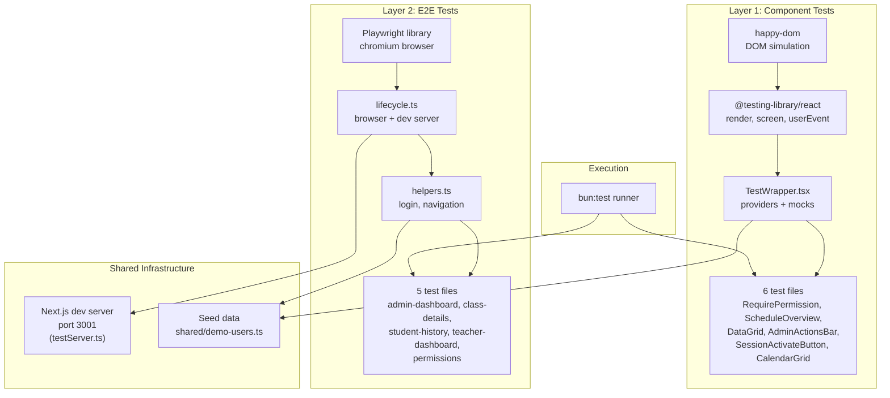
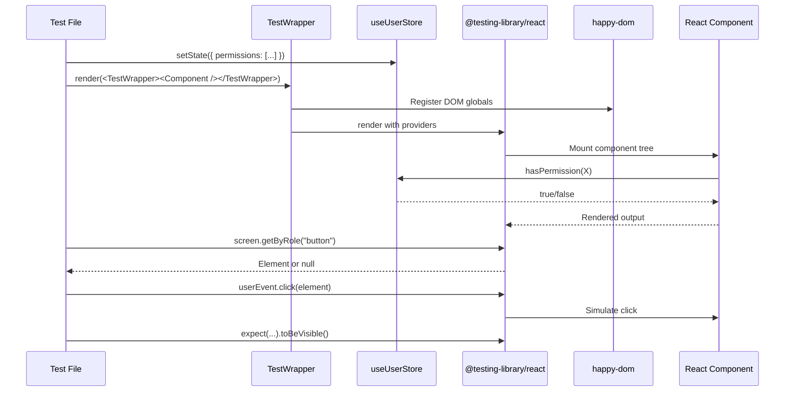
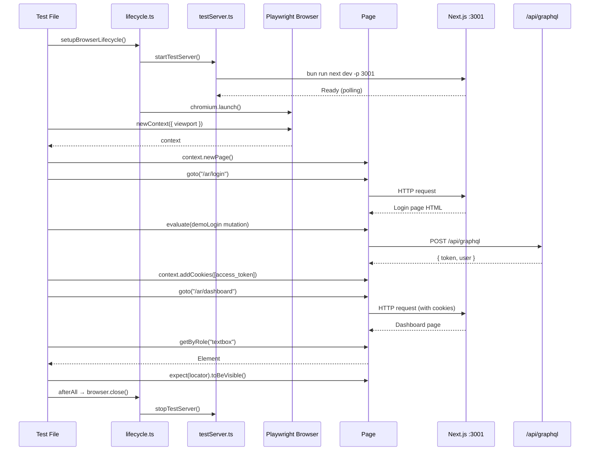
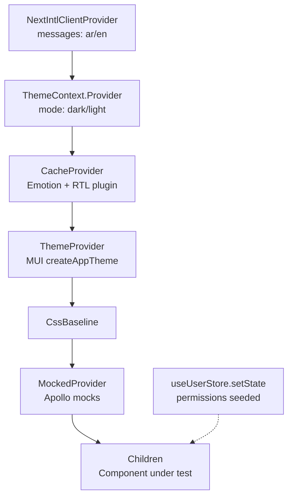
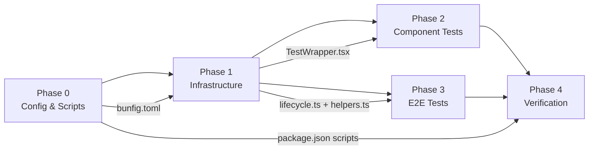

# Automated UI Tests — Implementation Plan (Enhanced)

**Source scenarios:** `test/manual/scenario/` (13 files, 5 categories)
**Baseline plan:** `.kilo/plans/automated-ui-tests.md` (kept intact)
**Depends on:** Sprint 1 implementation (`.ai/done/sprint/1-sprint.md`)
**Status:** Planning only — do not implement until approved
**Last updated:** 2026-06-20

---

## Section 0: Metadata & Context

### 0.1 Scope

Implement a two-layer automated UI test suite covering all manual test scenarios from Sprint 1:

- **Layer 1 — Component Tests**: Fast, isolated React component rendering in `happy-dom` using `@testing-library/react`. Tests permission gates, conditional rendering, and user interactions without a browser.
- **Layer 2 — E2E Tests**: Full user flows in a real Chromium browser using the `playwright` library within `bun:test`. Tests authentication, navigation, responsive layouts, and cross-page interactions against the running Next.js dev server.

### 0.2 Verified Repository Facts — Do Not Contradict

1. **Test runner**: All tests use `bun:test` (`describe`, `test`, `expect`, `beforeAll`, `afterAll`). Vitest is installed but only used for Storybook component testing via `vitest.config.ts`.
2. **Playwright**: `playwright` and `@playwright/test` are installed in `package.json`. No `playwright.config.ts` exists. The `test:e2e*` scripts reference `playwright test` but have no config — they are non-functional.
3. **Existing test infrastructure**: `frontend/graphql/test/` has `lifecycle.ts`, `testServer.ts`, `testClient.ts`, `helpers.ts` — all proven patterns we reuse.
4. **Dev server**: `testServer.ts` spawns `bun run next dev -p 3001` with reference counting. `lifecycle.ts` wraps it in `beforeAll`/`afterAll` hooks.
5. **Auth flow**: Login sets httpOnly cookies (`access_token`, `refresh_token`, `session_id`). Access token also stored in React context memory. Apollo sends `Authorization: Bearer <token>`.
6. **Demo users**: `shared/demo-users.ts` defines 5 roles (superAdmin, academyAdmin, teacher, parent, staff) all with password `12345678`.
7. **Provider stack**: Root layout wraps `NextIntlClientProvider` → `MuiProvider` → `AppApolloProvider` → `AuthProvider`. Storybook's `StoryWrapper.tsx` provides a similar stack for stories.
8. **Component tests**: Zero `.test.tsx` files exist. No `@testing-library/react` or `happy-dom` usage anywhere.
9. **Happy-dom**: Installed (`happy-dom` + `@happy-dom/global-registrator`). Needs preload configuration.
10. **Testing libraries**: `@testing-library/react`, `@testing-library/jest-dom`, `@testing-library/user-event` are installed.
11. **MCP servers**: `@playwright/mcp` and `next-devtools-mcp` are configured in `.mcp.json` for AI agent development assistance — NOT for automated testing.
12. **Package scripts**: Layer-specific test scripts already added to `package.json` (`test:db`, `test:graphql`, `test:ui:components`, `test:ui:e2e`, `test:ui`).
13. **AGENTS.md**: Root `AGENTS.md` and `frontend/AGENTS.md` already updated to reference layer-specific test scripts.

### 0.3 Current Gaps To Fill

| Gap | Current State | Target State |
|---|---|---|
| `bunfig.toml` | Does not exist | Created with happy-dom preload and coverage config |
| Component test infrastructure | None | `TestWrapper.tsx`, happy-dom preload |
| Component test files | 0 files | 6 `.test.tsx` files |
| E2E test infrastructure | None (scripts exist but no config) | `lifecycle.ts`, `helpers.ts` for Playwright |
| E2E test files | 0 files | 5 `.test.ts` files |
| Stale `test:e2e*` scripts | Reference `playwright test` with no config | Removed (replaced by `test:ui:e2e` using `bun:test`) |

---

## Section 1: Core Principles & Strict Rules

### 1.1 Test Runner — Bun Only

- [ ] **All tests use `bun:test`** — `describe`, `test`, `expect`, `beforeAll`, `afterAll`, `beforeEach`, `afterEach` imported from `"bun:test"`.
- [ ] **NO Vitest** — Vitest is installed for Storybook only. Never import from `vitest` in test files.
- [ ] **NO `@playwright/test` runner** — Use `playwright` (the library) within `bun:test` files. No `playwright.config.ts`.
- [ ] **NO Jest** — Jest types are installed but not used. Never import from `jest`.

### 1.2 Layer Separation

- [ ] **Component tests** (`test/ui/components/`) — Pure React rendering in `happy-dom`. No browser, no network, no dev server.
- [ ] **E2E tests** (`test/ui/e2e/`) — Real browser via Playwright. Requires running Next.js dev server on port 3001.
- [ ] **No cross-layer imports** — Component tests never import from `test/ui/e2e/`. E2E tests never import from `test/ui/components/`.
- [ ] **Shared infrastructure only** — `test/ui/e2e/lifecycle.ts` and `test/ui/e2e/helpers.ts` are E2E-only. Component tests have their own `TestWrapper.tsx`.

### 1.3 Next.js Testing Alignment

- [ ] **Only `"use client"` components in component tests** — Server Components (layouts, page shells) are tested via E2E only.
- [ ] **React Testing Library patterns** — Use `screen.getByRole()`, `screen.getByText()`, `screen.queryByRole()`. Never `container.querySelector()`.
- [ ] **`userEvent` for interactions** — Use `userEvent.click()`, `userEvent.type()`. Never `fireEvent`.
- [ ] **E2E tests target running application** — No mocking of Next.js internals. Navigate real pages, trigger real GraphQL requests.
- [ ] **Auto-waiting assertions in E2E** — Use `expect(locator).toBeVisible()`, `expect(locator).toHaveText()`. Never `waitForTimeout()`.

### 1.4 Type Safety

- [ ] **No `any`** — All test helpers, wrappers, and assertions are fully typed.
- [ ] **No blind casts** — Use type narrowing, not `as any` or `as unknown as`.
- [ ] **Generated types** — Import from `frontend/graphql/generated/gql/graphql-types.ts` for permission enums and GraphQL types.

### 1.5 Zero Incomplete Implementation Policy

| Prohibited | Required | Verification |
|---|---|---|
| `test.skip("not implemented")` | Fully working test or `test.todo()` with description | `rg -i "skip.*not impl" test/ui/` |
| Empty test body `test("x", () => {})` | At least one assertion | Code review |
| `// TODO: add more tests` | Implement or use `test.todo()` | `rg -i "TODO" test/ui/` |
| Hardcoded selectors without comments | Named constants or `data-testid` attributes | Code review |

### 1.6 Package Manager & Commands

- [ ] Use `~/.bun/bin/bun` for all commands.
- [ ] Run `bun run test:ui:components` for component tests.
- [ ] Run `bun run test:ui:e2e` for E2E tests.
- [ ] Run `bun run test:ui` for all UI tests.
- [ ] Run `bun quality-gate` after all changes.

---

## Section 2: Architecture & Diagrams

### 2.1 Test Architecture Overview



### 2.2 Component Test Flow



### 2.3 E2E Test Flow



### 2.4 Provider Stack for TestWrapper



### 2.5 Phase Dependency Graph



---

## Section 3: Granular Task Breakdown

### Phase 0 — Configuration & Scripts

#### Task A — Create `bunfig.toml`\n\n**Status:** Complete

**Target files:**
- `bunfig.toml` (new)

**Action plan:**

1. Create `bunfig.toml` at project root with:
   ```toml
   [test]
   timeout = 60000
   preload = ["./test/ui/components/happydom-preload.ts"]
   coverageSkipTestFiles = true
   ```
2. The `preload` directive registers happy-dom globals before all tests. E2E tests are unaffected because Playwright uses its own browser context, not the Node.js DOM.
3. The `coverageSkipTestFiles` excludes `*.test.ts` and `*.test.tsx` from coverage reports.
4. Verify: `bun run test:ui:components` starts without preload errors.

**Completion criteria:**
- [x] `bunfig.toml` exists at project root
- [x] `bun run test:ui:components` starts without errors (even if no test files exist yet)

---

#### Task B — Remove stale `test:e2e*` scripts\n\n**Status:** Complete

**Target files:**
- `package.json`

**Action plan:**

1. Remove these scripts from `package.json`:
   - `test:e2e` (`playwright test`)
   - `test:e2e:ui` (`playwright test --ui`)
   - `test:e2e:headed` (`playwright test --headed`)
   - `test:e2e:report` (`playwright show-report`)
2. These scripts reference `@playwright/test` runner which requires a `playwright.config.ts` that doesn't exist. They are replaced by `test:ui:e2e` which uses `bun:test` with the `playwright` library directly.
3. Verify: `bun run test:ui:e2e` resolves correctly (will fail with "no tests found" until Phase 3, but the script itself must exist).

**Completion criteria:**
- [x] No `test:e2e*` scripts in `package.json`
- [x] `test:ui:e2e` script exists and resolves

---

### Phase 1 — Infrastructure

#### Task C — Happy-dom preload\n\n**Status:** Complete

**Target files:**
- `test/ui/components/happydom-preload.ts` (new)

**Action plan:**

1. Create `test/ui/components/happydom-preload.ts`:
   ```ts
   import { GlobalRegistrator } from "@happy-dom/global-registrator";
   GlobalRegistrator.register();
   ```
2. This file is loaded by `bunfig.toml`'s `preload` directive before all tests.
3. It registers `document`, `window`, `HTMLElement`, and other DOM globals in the Node.js process.
4. E2E tests are unaffected — they use Playwright's browser context, not the Node.js DOM.
5. Verify: Create a trivial test file that accesses `document.createElement("div")` and confirm it works.

**Completion criteria:**
- [x] `test/ui/components/happydom-preload.ts` exists
- [x] A trivial test accessing `document` passes under `bun run test:ui:components`

---

#### Task D — TestWrapper component\n\n**Status:** Complete

**Target files:**
- `test/ui/components/TestWrapper.tsx` (new)

**Action plan:**

1. Create `test/ui/components/TestWrapper.tsx` modeled after `.storybook/StoryWrapper.tsx`:
   - Import `createCache` from `@emotion/cache` with `prepend: true`
   - Import `CacheProvider` from `@emotion/react`
   - Import `CssBaseline`, `ThemeProvider` from `@mui/material`
   - Import `MockedProvider` from `@apollo/client/testing`
   - Import `NextIntlClientProvider` from `next-intl`
   - Import `ThemeContext` from `@/frontend/context/ThemeContext`
   - Import `createAppTheme` from `@/frontend/providers/theme/theme`
   - Import `useUserStore` from `@/frontend/stores/userStore`
   - Import `ar` from `@/shared/messages/ar` and `en` from `@/shared/messages/en`
   - Import `prefixer` from `stylis` and `rtlPlugin` from `stylis-plugin-rtl`

2. Export a `TestWrapper` component that accepts props:
   - `locale?: "ar" | "en"` (default `"ar"`)
   - `themeMode?: "dark" | "light"` (default `"dark"`)
   - `permissions?: AppPermission[]` (default `[]`)
   - `mocks?: MockedResponse[]` (default `[]`)
   - `children: ReactNode`

3. Inside the wrapper:
   - Determine `direction` from locale (`"rtl"` for `"ar"`, `"ltr"` for `"en"`)
   - Create Emotion cache with RTL plugin when direction is `"rtl"`
   - Create MUI theme via `createAppTheme(themeMode, direction, locale)`
   - Seed `useUserStore` with provided permissions via `useUserStore.setState()`
   - Wrap children in: `NextIntlClientProvider` → `ThemeContext.Provider` → `CacheProvider` → `ThemeProvider` → `CssBaseline` → `MockedProvider`

4. Export a `renderWithWrapper` helper function:
   ```ts
   export function renderWithWrapper(
     ui: ReactElement,
     options?: { locale?: "ar" | "en"; permissions?: AppPermission[]; mocks?: MockedResponse[] }
   ): RenderResult
   ```
   This calls `render(ui, { wrapper: ... })` from `@testing-library/react` with the TestWrapper configured.

5. Verify: Write a trivial test that renders `<Typography>Hello</Typography>` inside the wrapper and asserts `screen.getByText("Hello")` is visible.

**Completion criteria:**
- [x] `test/ui/components/TestWrapper.tsx` exists with `TestWrapper` and `renderWithWrapper` exports
- [x] A trivial test rendering a component inside the wrapper passes
- [x] `useUserStore` permissions are correctly seeded

---

#### Task E — E2E lifecycle management\n\n**Status:** Complete

**Target files:**
- `test/ui/e2e/lifecycle.ts` (new)

**Action plan:**

1. Create `test/ui/e2e/lifecycle.ts`:
   - Import `chromium`, `Browser`, `BrowserContext` from `playwright`
   - Import `afterAll`, `beforeAll` from `bun:test`
   - Import `setupTestServerLifecycle` from `@/frontend/graphql/test/lifecycle`

2. Export `setupBrowserLifecycle()`:
   - Call `setupTestServerLifecycle()` to start Next.js dev server on port 3001 (reuses existing reference-counted lifecycle)
   - In `beforeAll`: launch Chromium with `headless: true`, 70-second timeout
   - In `afterAll`: close browser

3. Export `createContext(viewport?)`:
   - Creates a new `BrowserContext` with `baseURL: "http://localhost:3001"`
   - Default viewport: `{ width: 1280, height: 720 }`
   - Returns the context for test isolation

4. Export `createMobileContext()`:
   - Creates a context with `{ width: 375, height: 812 }`, `isMobile: true`, `hasTouch: true`

5. Verify: Write a trivial test that calls `setupBrowserLifecycle()`, creates a context, opens a page, and navigates to `http://localhost:3001`.

**Completion criteria:**
- [x] `test/ui/e2e/lifecycle.ts` exists with `setupBrowserLifecycle`, `createContext`, `createMobileContext`
- [x] A trivial test launches browser, connects to dev server, and navigates successfully

---

#### Task F — E2E helpers

**Status:** Pending

**Target files:**
- `test/ui/e2e/helpers.ts` (new)

**Action plan:**

1. Create `test/ui/e2e/helpers.ts`:
   - Import `Page`, `BrowserContext` from `playwright`
   - Import `expect` from `bun:test`

2. Export `DEMO_USERS` constant with group slugs, emails, and passwords for academyAdmin, teacher, and parent roles (sourced from `shared/demo-users.ts`).

3. Export `loginAsDemoUser(page, context, groupSlug)`:
   - Use `page.evaluate()` to call the `demoLogin` GraphQL mutation via `fetch("/api/graphql", ...)`
   - Extract `token` from response
   - Set `access_token` cookie via `context.addCookies()`
   - Navigate to `/ar/dashboard` and wait for URL match

4. Export assertion helpers:
   - `assertElementVisible(page, selector)` — `expect(page.locator(selector)).toBeVisible()`
   - `assertElementHidden(page, selector)` — `expect(page.locator(selector)).not.toBeVisible()`

5. Export `createMobileContext(browser)`:
   - Creates a mobile browser context with iPhone 14 dimensions and touch support

6. Verify: Write a trivial test that logs in as Academy Admin and asserts the dashboard page loads.

**Completion criteria:**
- [ ] `test/ui/e2e/helpers.ts` exists with all exports
- [ ] A trivial test logs in as demo user and reaches the dashboard

---

### Phase 2 — Component Tests

#### Task G — RequirePermission.test.tsx

**Status:** Pending

**Target files:**
- `test/ui/components/RequirePermission.test.tsx` (new)

**Action plan:**

1. Import `RequirePermission` from `@/frontend/components/auth/RequirePermission`
2. Import `AppPermission` from generated GraphQL types
3. Import `renderWithWrapper` from `./TestWrapper`
4. Import `screen` from `@testing-library/react`

5. Write test cases:
   - **"renders children when user has permission"**: Seed store with `DashboardSearch`, render `<RequirePermission permissions={[AppPermission.DashboardSearch]}>Protected</RequirePermission>`, assert `screen.getByText("Protected")` is visible
   - **"renders nothing when user lacks permission"**: Seed store with empty permissions, render same component, assert `screen.queryByText("Protected")` returns null
   - **"renders children when at least one permission matches (array)"**: Seed with `ScheduleViewList`, render with `permissions={[DashboardSearch, ScheduleViewList]}`, assert visible
   - **"renders fallback when provided and permission missing"**: Seed empty, render with `fallback={<span>Denied</span>}`, assert `screen.getByText("Denied")` is visible
   - **"renders nothing (not fallback) when permission exists"**: Seed with permission, render with fallback, assert fallback is NOT visible and children ARE visible

6. Verify: `bun run test:ui:components` passes all 5 tests.

**Completion criteria:**
- [ ] 5 test cases pass
- [ ] No `any` types or blind casts

---

#### Task H — ScheduleOverviewSection.test.tsx

**Status:** Pending

**Target files:**
- `test/ui/components/ScheduleOverviewSection.test.tsx` (new)

**Action plan:**

1. Import `ScheduleOverviewSection` from the dashboard components
2. Import `renderWithWrapper` from `./TestWrapper`
3. Import `screen`, `within` from `@testing-library/react`
4. Import `userEvent` from `@testing-library/user-event`

5. Create mock props matching `ScheduleOverviewSectionProps`:
   - `title`, `searchPlaceholder`, `searchValue`, `rows` (empty array), `headers`, `statusLabels`, `detailsLabel`, `emptyMessage`, `showingText`, `dateLabel`, `dateValue`, `teacherPlaceholder`, `teacherValue`, `submitLabel`, `teachers` (empty array)
   - Mock callbacks: `onSearchChange`, `onDateChange`, `onTeacherChange`, `onSubmit`, `onPageChange`

6. Write test cases:
   - **"search input visible with DashboardSearch permission"**: Seed with `DashboardSearch`, render, assert `screen.getByRole("textbox")` exists
   - **"search input hidden without DashboardSearch permission"**: Seed with empty permissions, render, assert `screen.queryByRole("textbox")` returns null
   - **"search input calls onSearchChange when typed into"**: Seed with `DashboardSearch`, render, `userEvent.type(textbox, "Ahmed")`, assert `onSearchChange` called with `"Ahmed"`
   - **"section title renders correctly"**: Render with `title="Schedule Overview"`, assert `screen.getByText("Schedule Overview")` is visible

7. Verify: `bun run test:ui:components` passes all tests.

**Completion criteria:**
- [ ] 4 test cases pass
- [ ] Mock props are typed correctly

---

#### Task I — ScheduleOverviewDataGrid.test.tsx

**Status:** Pending

**Target files:**
- `test/ui/components/ScheduleOverviewDataGrid.test.tsx` (new)

**Action plan:**

1. Import `ScheduleOverviewDataGrid` from the dashboard components
2. Import `renderWithWrapper` from `./TestWrapper`
3. Import `screen` from `@testing-library/react`

4. Create mock data:
   - `rows`: Array of `ScheduleRow` objects with `id`, `classId`, `student`, `teacher`, `yourTime`, `teacherTime`, `studentTime`, `time`, `status`
   - `headers`: Object with all column header labels
   - `statusLabels`: Record mapping `ClassStatus` to display strings
   - `detailsLabel`: `"View Details"`
   - `emptyMessage`: `"No classes scheduled"`

5. Write test cases:
   - **"shows timezone columns with ScheduleViewTimezones permission"**: Seed with `ScheduleViewTimezones`, render, assert `screen.getByText("Your Time")`, `screen.getByText("Teacher Time")`, `screen.getByText("Student Time")` are visible
   - **"shows single time column without ScheduleViewTimezones permission"**: Seed with empty permissions, render, assert `screen.getByText("Time")` is visible and timezone columns are NOT present
   - **"renders student and teacher names in rows"**: Render with mock rows, assert student and teacher names are visible
   - **"renders empty message when no rows"**: Render with empty rows array, assert empty message is visible

6. Note: `useRouter` from `next/navigation` needs to be mocked. Use `bun:test`'s `mock.module()` to mock `next/navigation` and return a mock router with `push` function.

7. Verify: `bun run test:ui:components` passes all tests.

**Completion criteria:**
- [ ] 4 test cases pass
- [ ] `next/navigation` router is properly mocked

---

#### Task J — AdminActionsBar.test.tsx

**Status:** Pending

**Target files:**
- `test/ui/components/AdminActionsBar.test.tsx` (new)

**Action plan:**

1. Import `AdminActionsBar` from the class details admin components
2. Import `renderWithWrapper` from `./TestWrapper`
3. Import `screen` from `@testing-library/react`
4. Import `userEvent` from `@testing-library/user-event`

5. Create mock handlers:
   - `onForceActivate`, `onStop`, `onDelete`, `onReschedule`, `onGenerateLog` — all `mock(() => {})`

6. Write test cases:
   - **"renders force activate button"**: Render, assert button with force activate icon/label is visible
   - **"renders stop button"**: Render, assert stop/pause button is visible
   - **"renders delete button"**: Render, assert delete button is visible
   - **"reschedule button visible with SessionReschedule permission"**: Seed with `SessionReschedule`, render, assert reschedule button is visible
   - **"reschedule button hidden without SessionReschedule permission"**: Seed with empty permissions, render, assert reschedule button is NOT visible
   - **"clicking force activate calls handler"**: Render, click force activate button, assert `onForceActivate` was called once

7. Verify: `bun run test:ui:components` passes all tests.

**Completion criteria:**
- [ ] 6 test cases pass
- [ ] All handlers are properly mocked and verified

---

#### Task K — SessionActivateButton.test.tsx

**Status:** Pending

**Target files:**
- `test/ui/components/SessionActivateButton.test.tsx` (new)

**Action plan:**

1. Import `SessionActivateButton` from the teacher dashboard components
2. Import `renderWithWrapper` from `./TestWrapper`
3. Import `screen` from `@testing-library/react`
4. Import `userEvent` from `@testing-library/user-event`

5. Write test cases:
   - **"renders activate button in ready state"**: Render with `disabled: false, isConnecting: false`, assert button is visible and enabled
   - **"renders connecting state with spinner"**: Render with `isConnecting: true`, assert button is disabled and contains CircularProgress
   - **"button is disabled when disabled prop is true"**: Render with `disabled: true`, assert button has disabled attribute
   - **"clicking button calls onActivate"**: Render with `disabled: false`, click button, assert `onActivate` was called once
   - **"clicking disabled button does not call onActivate"**: Render with `disabled: true`, click button, assert `onActivate` was NOT called

6. Verify: `bun run test:ui:components` passes all tests.

**Completion criteria:**
- [ ] 5 test cases pass

---

#### Task L — CalendarGrid.test.tsx

**Status:** Pending

**Target files:**
- `test/ui/components/CalendarGrid.test.tsx` (new)

**Action plan:**

1. Import `CalendarGrid` from the student history components
2. Import `renderWithWrapper` from `./TestWrapper`
3. Import `screen` from `@testing-library/react`
4. Import `userEvent` from `@testing-library/user-event`

5. Create mock data:
   - `sessions`: Map of day-of-month to session summaries (e.g., `{ 15: [{ id: "1", title: "Math Class", time: "10:00", status: "completed" }] }`)
   - `currentMonth`: `new Date(2026, 5, 1)` (June 2026)
   - `selectedDay`: `null`
   - `onDaySelect`: mock function
   - `onMonthChange`: mock function

6. Write test cases:
   - **"renders all days of the month"**: Render, assert day numbers 1-30 are visible (June has 30 days)
   - **"days with sessions are visually distinct"**: Render with session on day 15, assert day 15 has a different class or aria attribute than day 16
   - **"clicking a day calls onDaySelect"**: Render, click day 15, assert `onDaySelect` called with `15`
   - **"month navigation buttons call onMonthChange"**: Render, click previous/next buttons, assert `onMonthChange` called with appropriate direction

7. Verify: `bun run test:ui:components` passes all tests.

**Completion criteria:**
- [ ] 4 test cases pass
- [ ] Calendar renders correct number of days for the given month

---

### Phase 3 — E2E Tests

#### Task M — admin-dashboard.test.ts

**Status:** Pending

**Target files:**
- `test/ui/e2e/admin-dashboard.test.ts` (new)

**Action plan:**

1. Import `setupBrowserLifecycle`, `createContext`, `createMobileContext` from `./lifecycle`
2. Import `loginAsDemoUser`, `DEMO_USERS` from `./helpers`
3. Import `describe`, `test`, `expect` from `bun:test`

4. Call `setupBrowserLifecycle()` at describe root.

5. Write test cases:
   - **"Academy Admin sees search input"**: Login as academyAdmin, goto `/ar/dashboard`, assert `page.getByRole("textbox")` is visible
   - **"Academy Admin sees timezone columns"**: Login, goto dashboard, assert `page.getByText("Your Time")` is visible
   - **"Search filters schedule grid"**: Login, goto dashboard, type "Ahmed" in search, wait for grid to update, assert row count changes
   - **"Click details navigates to class page"**: Login, goto dashboard, click details icon on first row, assert URL contains `/classes/`
   - **"Teacher does not see search input"**: Login as teacher, goto dashboard, assert `page.getByRole("textbox")` is NOT visible
   - **"Mobile: card list renders instead of data grid"**: Login as academyAdmin in mobile context, goto dashboard, assert card elements are present

6. Each test creates a fresh context via `createContext()` or `createMobileContext()`, logs in, performs actions, and closes the context in `afterEach`.

7. Verify: `bun run test:ui:e2e` passes all tests.

**Completion criteria:**
- [ ] 6 test cases pass (4 desktop + 1 teacher + 1 mobile)
- [ ] Each test uses isolated browser context

---

#### Task N — class-details.test.ts

**Status:** Pending

**Target files:**
- `test/ui/e2e/class-details.test.ts` (new)

**Action plan:**

1. Import lifecycle and helpers.
2. Call `setupBrowserLifecycle()` at describe root.

3. Write test cases:
   - **"Admin sees AdminActionsBar on class details"**: Login as academyAdmin, navigate to a class details page (get ID from dashboard grid), assert force activate button is visible
   - **"Admin force activate changes status"**: Login, navigate to pending class, click force activate, assert status badge updates
   - **"Admin delete shows confirmation dialog"**: Login, navigate to class, click delete, assert `page.getByRole("dialog")` appears
   - **"Teacher sees ActionsPanel, not AdminActionsBar"**: Login as teacher, navigate to assigned class, assert ActionsPanel is visible and AdminActionsBar is NOT
   - **"Teacher activate within time window succeeds"**: Login as teacher, navigate to class within activation window, click activate, assert status updates
   - **"Teacher activate outside time window shows error"**: Login as teacher, navigate to class outside window, click activate, assert error message containing "missed" is visible
   - **"Timezone warning banner visible on mismatch"**: Login as admin, navigate to class with timezone mismatch, assert warning banner is visible

4. Note: These tests depend on seed data having classes in various states (pending, within window, outside window, with timezone mismatch). The tests should use the dashboard grid to find appropriate class IDs dynamically.

5. Verify: `bun run test:ui:e2e` passes all tests.

**Completion criteria:**
- [ ] 7 test cases pass
- [ ] Tests dynamically find class IDs from seed data (no hardcoded IDs)

---

#### Task O — student-history.test.ts

**Status:** Pending

**Target files:**
- `test/ui/e2e/student-history.test.ts` (new)

**Action plan:**

1. Import lifecycle and helpers.
2. Call `setupBrowserLifecycle()` at describe root.

3. Write test cases:
   - **"Calendar renders on history page"**: Login as academyAdmin, navigate to `/students/[id]/history`, assert calendar grid is visible
   - **"Days with sessions are highlighted"**: Navigate to history, assert at least one day has a visual indicator (different background or badge)
   - **"Clicking a day shows session list"**: Click a highlighted day, assert session list appears below calendar
   - **"Clicking a session opens details modal"**: Click a session entry, assert `page.getByRole("dialog")` appears with session metadata
   - **"Modal shows session metadata"**: After opening modal, assert title, time, duration, status, and instructor name are visible
   - **"Download logs triggers file download"**: Open modal, click download logs button, assert `page.waitForEvent("download")` resolves
   - **"Month navigation updates calendar"**: Click previous month button, assert calendar content changes
   - **"Teacher cannot see calendar"**: Login as teacher, navigate to student history, assert calendar is NOT rendered

4. Note: Student ID must be obtained dynamically from the dashboard or a known seed data student.

5. Verify: `bun run test:ui:e2e` passes all tests.

**Completion criteria:**
- [ ] 8 test cases pass
- [ ] Student ID obtained dynamically from seed data

---

#### Task P — teacher-dashboard.test.ts

**Status:** Pending

**Target files:**
- `test/ui/e2e/teacher-dashboard.test.ts` (new)

**Action plan:**

1. Import lifecycle and helpers.
2. Call `setupBrowserLifecycle()` at describe root.

3. Write test cases:
   - **"Teacher dashboard renders metrics row"**: Login as teacher, goto `/teachers/dashboard`, assert metric cards are present
   - **"Schedule grid shows teacher's classes"**: Login, goto dashboard, assert data grid has at least one row
   - **"Activate button within time window"**: Login, goto dashboard, find a class within activation window, click activate, assert status updates
   - **"Activate outside time window shows error"**: Login, goto dashboard, find a class outside window, click activate, assert error message
   - **"Manual entry dialog opens and submits"**: Login, goto dashboard, click manual entry button, assert dialog opens, fill form fields, submit, assert new row appears
   - **"Download handbook triggers download"**: Login, goto dashboard, click handbook button, assert download event fires
   - **"Contact coordinator shows success"**: Login, goto dashboard, click coordinator button, assert success feedback
   - **"Active dashboard mode renders correctly"**: Login, goto `/teachers/dashboard/active`, assert active-specific elements are present

4. Verify: `bun run test:ui:e2e` passes all tests.

**Completion criteria:**
- [ ] 8 test cases pass

---

#### Task Q — permissions.test.ts

**Status:** Pending

**Target files:**
- `test/ui/e2e/permissions.test.ts` (new)

**Action plan:**

1. Import lifecycle and helpers.
2. Call `setupBrowserLifecycle()` at describe root.

3. Write test cases:
   - **"Academy Admin sees all dashboard features"**: Login as academyAdmin, goto dashboard, assert search input, timezone columns, and schedule grid are all visible
   - **"Teacher sees limited dashboard features"**: Login as teacher, goto dashboard, assert search input is NOT visible, timezone columns are NOT visible
   - **"Parent sees minimal features"**: Login as parent, goto dashboard, assert search and timezone are NOT visible
   - **"Permission-gated elements are absent from DOM"**: Login as teacher, goto dashboard, use `page.locator(selector).count()` to verify admin-only elements have count 0 (not just hidden via CSS)
   - **"Teacher dashboard requires TeacherViewDashboard permission"**: Login as teacher, goto `/teachers/dashboard`, assert page renders. Login as parent, goto same URL, assert redirect or access denied
   - **"Admin actions only visible to Academy Admin"**: Login as academyAdmin, navigate to class details, assert AdminActionsBar visible. Login as teacher, navigate to same page, assert AdminActionsBar NOT visible

4. Verify: `bun run test:ui:e2e` passes all tests.

**Completion criteria:**
- [ ] 6 test cases pass
- [ ] Tests verify DOM absence (not just CSS hiding)

---

### Phase 4 — Verification

#### Task R — Full test suite verification

**Status:** Pending

**Target files:**
- None (verification only)

**Action plan:**

1. Run component tests: `bun run test:ui:components`
2. Run E2E tests: `bun run test:ui:e2e`
3. Run all UI tests: `bun run test:ui`
4. Run all tests across all layers: `bun run test`
5. Run quality gate: `bun quality-gate`
6. Verify zero `TODO`, `FIXME`, `skip` in test files: `rg -i "TODO|FIXME|skip.*not impl" test/ui/`
7. Verify no `any` types: `rg "as any|: any" test/ui/`
8. Verify no stale `test:e2e*` scripts: `rg "test:e2e" package.json`

**Completion criteria:**
- [ ] All component tests pass
- [ ] All E2E tests pass
- [ ] `bun run test` passes (all layers)
- [ ] `bun quality-gate` passes
- [ ] Zero prohibited patterns in test files

---

## Section 4: Execution Commands

All test commands use layer-specific scripts defined in `package.json`.

```bash
# All tests across all layers (db + graphql + ui)
bun run test

# Database tests only (backend/db/test/)
bun run test:db
bun run test:db:coverage

# GraphQL integration tests only (frontend/graphql/test/)
bun run test:graphql
bun run test:graphql:coverage

# UI component tests only (test/ui/components/) — fast, no browser
bun run test:ui:components
bun run test:ui:components:coverage

# UI E2E tests only (test/ui/e2e/) — real browser, needs dev server
bun run test:ui:e2e

# All UI tests (components + e2e)
bun run test:ui

# Run a specific test file (any layer)
bun test test/ui/e2e/admin-dashboard.test.ts
bun test test/ui/components/RequirePermission.test.tsx
bun test backend/db/test/repo/scheduling.repository.test.ts
```

### Timeout Strategy

| Layer | Timeout | Rationale |
|---|---|---|
| `test:db` | 60s | DB operations are fast; rollback transactions add minimal overhead |
| `test:graphql` | 120s | Next.js dev server startup takes ~60s; tests run after server is ready |
| `test:ui:components` | 30s | No server or browser; pure React rendering in happy-dom |
| `test:ui:e2e` | 120s | Dev server startup + browser launch + page navigation |
| `test` (all) | 60s per test | Global default; server startup handled in `beforeAll` with its own timeout |

---

## Section 5: Key Technical Decisions

### 5.1 Why `playwright` library within `bun:test` instead of `@playwright/test` runner?

User requirement: "using bun (not vitest at all)". We use `playwright` (the library) within `bun:test` to keep Bun as the test runner while still getting real browser automation. This reuses the project's existing `testServer.ts` infrastructure and reference-counted server lifecycle management, rather than Playwright's `webServer` config.

### 5.2 Why MockedProvider for component tests?

Component tests should be fast and isolated. `MockedProvider` from Apollo allows testing component rendering and behavior without a running server. E2E tests cover the full integration.

### 5.3 Why login via GraphQL mutation for E2E tests?

Calling `demoLogin` via `page.evaluate(fetch(...))` is faster than navigating the login form UI. The server sets httpOnly cookies (`access_token`, `refresh_token`, `session_id`) in the response, and we also set `access_token` via `context.addCookies()` for the Apollo auth link. This tests the actual auth system without the overhead of form interaction.

### 5.4 How to handle RTL (Arabic) layout?

Component tests support both LTR and RTL via the TestWrapper's `locale` prop. E2E tests default to Arabic (`/ar/` routes) matching the app's default locale.

### 5.5 Shared test server

E2E tests reuse `setupTestServerLifecycle()` from existing GraphQL tests. The reference counting mechanism ensures the Next.js dev server is started once and shared across all test suites, with automatic cleanup. Server runs on port 3001 to avoid conflicts with development server on 3000.

### 5.6 Server Components limitation

Per Next.js documentation, async Server Components cannot be tested with unit/component testing tools. Our component tests only cover `"use client"` components. Server-side logic (auth in `app/[locale]/(dashboard)/layout.tsx`, server-side redirects) is tested via E2E tests.

### 5.7 Why not `@playwright/mcp` or `next-devtools-mcp`?

Both are MCP servers designed for AI agent development assistance — runtime diagnostics, browser evaluation during dev sessions, documentation lookup. They are NOT testing frameworks. `@playwright/mcp` is non-deterministic (LLM decides actions), slow (LLM reasoning per step), and not CI-compatible. Keep them in `.mcp.json` for dev-time AI assistance only.

### 5.8 Dev server vs production build for E2E

Next.js recommends running E2E tests against production builds (`bun run build` + `bun run start`). For developer productivity, our E2E tests use the dev server (faster iteration, better error messages). CI pipelines can be configured to run against production builds by modifying `testServer.ts`.

---

## Section 6: Risks & Mitigations

| Risk | Mitigation |
|---|---|
| E2E tests are slow | Headless Chromium, shared browser context, parallelize test files. Dev server startup shared via reference counting (proven in GraphQL tests). |
| Flaky timing issues | Playwright auto-waiting (`waitForURL`, `toBeVisible`, `locator().click()`). Auto-retries assertions. 70s timeout for server startup. |
| Test data dependency on seeds | `demoLogin` works with seeded demo users from `shared/demo-users.ts`. No test data creation in E2E tests — rely on existing seed data. |
| Happy-dom conflicts with Playwright | Happy-dom only affects component tests via `bunfig.toml` preload. Playwright uses its own isolated browser context. No interaction. |
| MUI theme/emotion cache in tests | Reuse Storybook's proven provider stack pattern (`.storybook/StoryWrapper.tsx`) in TestWrapper. Same Emotion cache, same theme creation, same RTL handling. |
| Apollo MockedProvider complexity | Start with simple mocks; only mock queries actually used by tested components. For complex data, use seed data shapes. |
| Server Components can't be unit tested | Per Next.js docs, async Server Components require E2E testing. Component tests only cover `"use client"` components. |
| Auth cookies (httpOnly) not accessible to JS | E2E tests call `demoLogin` mutation via `page.evaluate(fetch(...))`, then set cookies via `context.addCookies()`. Server sets httpOnly cookies in response. |
| Dev server vs production behavior differences | E2E tests run against dev server by default. CI can use production build. Known differences: HMR, error overlays, caching. |
| RTL layout testing complexity | Component TestWrapper supports both LTR/RTL via locale prop. E2E tests default to Arabic (`/ar/`). |
| `next/navigation` mocking in component tests | Use `bun:test`'s `mock.module("next/navigation")` to return a mock router. Clean up in `afterEach`. |
| CalendarGrid depends on date | Use fixed dates in test data (e.g., June 2026) to avoid flaky date-dependent assertions. |

---

## Section 7: Final Verification & Integrity Protocol

Execute the following commands in order after all phases are complete:

```bash
# 1. Component tests
bun run test:ui:components

# 2. E2E tests
bun run test:ui:e2e

# 3. All UI tests
bun run test:ui

# 4. All tests across all layers
bun run test

# 5. TypeScript check
bun tsgo

# 6. Lint
bun run lint

# 7. Quality gate
bun quality-gate

# 8. Prohibited patterns check
rg -i "TODO|FIXME|skip.*not impl|as any|: any" test/ui/ --glob "!**/*.md"
# Expected: empty output

# 9. Stale scripts check
rg "test:e2e" package.json
# Expected: empty output (only test:ui:e2e should exist)
```

---

## Appendix A: File Manifest

| Path | Purpose | Phase |
|---|---|---|
| `bunfig.toml` | Test configuration with happy-dom preload | 0 |
| `package.json` | Layer-specific test scripts, remove stale e2e scripts | 0 |
| `test/ui/components/happydom-preload.ts` | Register happy-dom globals | 1 |
| `test/ui/components/TestWrapper.tsx` | Provider stack for component tests | 1 |
| `test/ui/e2e/lifecycle.ts` | Browser + dev server lifecycle | 1 |
| `test/ui/e2e/helpers.ts` | Login, navigation, assertion helpers | 1 |
| `test/ui/components/RequirePermission.test.tsx` | Permission gate tests | 2 |
| `test/ui/components/ScheduleOverviewSection.test.tsx` | Search visibility tests | 2 |
| `test/ui/components/ScheduleOverviewDataGrid.test.tsx` | Timezone column tests | 2 |
| `test/ui/components/AdminActionsBar.test.tsx` | Admin override action tests | 2 |
| `test/ui/components/SessionActivateButton.test.tsx` | Teacher activate button tests | 2 |
| `test/ui/components/CalendarGrid.test.tsx` | History calendar tests | 2 |
| `test/ui/e2e/admin-dashboard.test.ts` | Admin dashboard E2E scenarios | 3 |
| `test/ui/e2e/class-details.test.ts` | Class details E2E scenarios | 3 |
| `test/ui/e2e/student-history.test.ts` | Student history E2E scenarios | 3 |
| `test/ui/e2e/teacher-dashboard.test.ts` | Teacher dashboard E2E scenarios | 3 |
| `test/ui/e2e/permissions.test.ts` | Cross-role RBAC E2E scenarios | 3 |

## Appendix B: Manual Scenario Coverage Matrix

| Manual Scenario File | Component Tests | E2E Tests |
|---|---|---|
| `admin-dashboard/schedule-search.md` | ScheduleOverviewSection.test.tsx | admin-dashboard.test.ts |
| `admin-dashboard/timezone-columns.md` | ScheduleOverviewDataGrid.test.tsx | admin-dashboard.test.ts |
| `admin-dashboard/schedule-grid-navigation.md` | ScheduleOverviewDataGrid.test.tsx | admin-dashboard.test.ts |
| `class-details/admin-override-actions.md` | AdminActionsBar.test.tsx | class-details.test.ts |
| `class-details/admin-class-details-view.md` | — (complex layout) | class-details.test.ts |
| `class-details/teacher-session-view.md` | SessionActivateButton.test.tsx | class-details.test.ts |
| `student-history/calendar-view.md` | CalendarGrid.test.tsx | student-history.test.ts |
| `student-history/session-details-modal.md` | — (modal complexity) | student-history.test.ts |
| `teacher-dashboard/dashboard-view.md` | — (complex layout) | teacher-dashboard.test.ts |
| `teacher-dashboard/active-dashboard-view.md` | SessionActivateButton.test.tsx | teacher-dashboard.test.ts |
| `permissions/rbac-gates.md` | RequirePermission.test.tsx | permissions.test.ts |
| `permissions/session-permission-migration.md` | — | permissions.test.ts |
| `permissions/activation-time-window.md` | — | class-details.test.ts, teacher-dashboard.test.ts |


