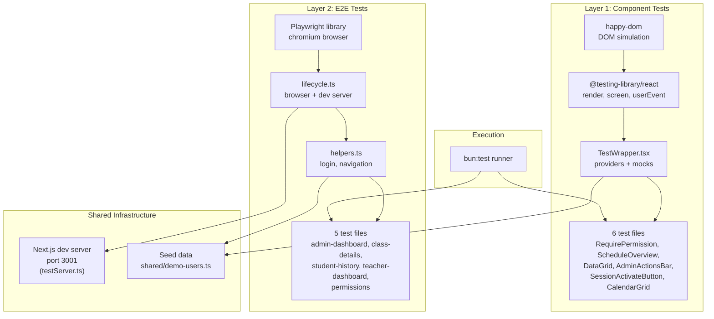
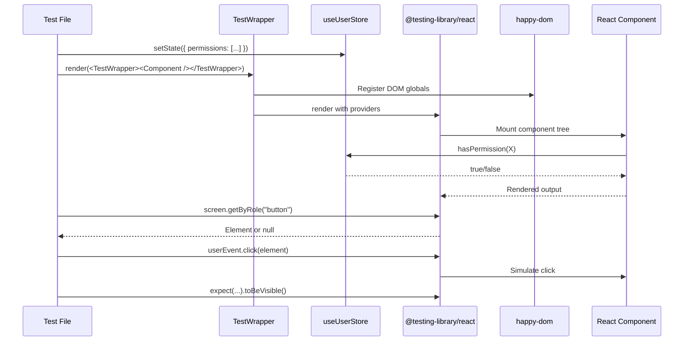
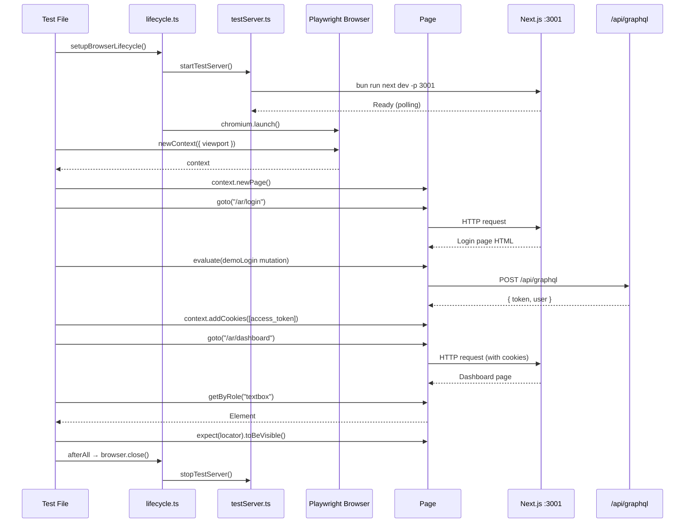
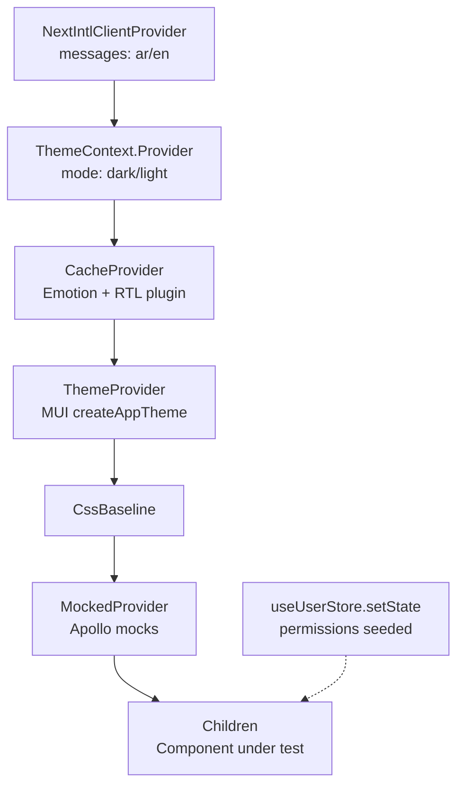
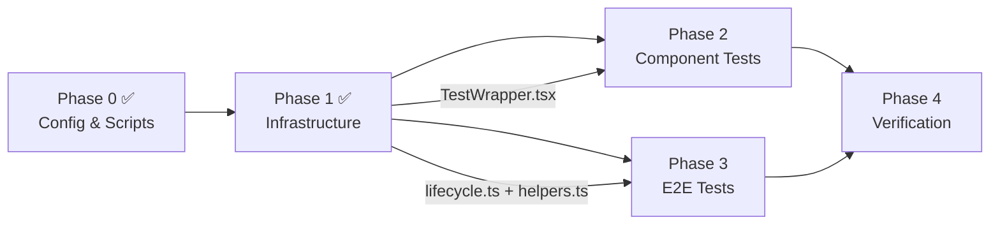

# Automated UI Tests — Implementation Plan v2 (Enhanced)

**Source scenarios:** `test/manual/scenario/` (13 files, 5 categories)
**Baseline plan:** `.kilo/plans/automated-ui-tests.md` (Phase 0-1 completed)
**Depends on:** Sprint 1 implementation (`.ai/done/sprint/1-sprint.md`)
**Status:** Phase 0-1 Complete — Phase 2-4 pending approval
**Last updated:** 2026-06-20

---

## Section 0: Metadata & Context

### 0.1 Scope

Implement the remaining two layers of the automated UI test suite covering all manual test scenarios from Sprint 1:

- **Layer 1 — Component Tests** (Phase 2): Fast, isolated React component rendering in `happy-dom` using `@testing-library/react`. Tests permission gates, conditional rendering, and user interactions without a browser.
- **Layer 2 — E2E Tests** (Phase 3): Full user flows in a real Chromium browser using the `playwright` library within `bun:test`. Tests authentication, navigation, responsive layouts, and cross-page interactions against the running Next.js dev server.
- **Verification** (Phase 4): Full test suite run, quality gate, and prohibited patterns check.

### 0.2 Completed Phases (Do Not Re-Implement)

| Phase | Tasks | Status | Artifacts |
|---|---|---|---|
| Phase 0 | A (bunfig.toml), B (remove stale scripts) | ✅ Complete | `bunfig.toml`, cleaned `package.json` |
| Phase 1 | C (happydom-preload), D (TestWrapper), E (lifecycle), F (helpers) | ✅ Complete | `test/ui/components/happydom-preload.ts`, `test/ui/components/TestWrapper.tsx`, `test/ui/e2e/lifecycle.ts`, `test/ui/e2e/helpers.ts` |

### 0.3 Verified Repository Facts — Do Not Contradict

1. **Test runner**: All tests use `bun:test` (`describe`, `test`, `expect`, `beforeAll`, `afterAll`). Vitest is installed but only used for Storybook component testing via `vitest.config.ts`.
2. **Playwright**: `playwright` and `@playwright/test` are installed in `package.json`. No `playwright.config.ts` exists.
3. **Existing test infrastructure**: `frontend/graphql/test/` has `lifecycle.ts`, `testServer.ts`, `testClient.ts`, `helpers.ts` — all proven patterns we reuse.
4. **Dev server**: `testServer.ts` spawns `bun run next dev -p 3001` with reference counting. `lifecycle.ts` wraps it in `beforeAll`/`afterAll` hooks.
5. **Auth flow**: Login sets httpOnly cookies (`access_token`, `refresh_token`, `session_id`). Access token also stored in React context memory. Apollo sends `Authorization: Bearer <token>`.
6. **Demo users**: `shared/demo-users.ts` defines 5 roles (superAdmin, academyAdmin, teacher, parent, staff) all with password `12345678`.
7. **Provider stack**: Root layout wraps `NextIntlClientProvider` → `MuiProvider` → `AppApolloProvider` → `AuthProvider`. Storybook's `StoryWrapper.tsx` provides a similar stack for stories.
8. **Happy-dom**: Installed (`happy-dom` + `@happy-dom/global-registrator`). Preload configured via `bunfig.toml`.
9. **Testing libraries**: `@testing-library/react`, `@testing-library/jest-dom`, `@testing-library/user-event` are installed.
10. **MCP servers**: `@playwright/mcp` and `next-devtools-mcp` are configured in `.mcp.json` for AI agent development assistance — NOT for automated testing.
11. **Package scripts**: Layer-specific test scripts already added to `package.json` (`test:db`, `test:graphql`, `test:ui:components`, `test:ui:e2e`, `test:ui`).
12. **Component boundaries**: Only `"use client"` components can be tested with component tests. Server Components (layouts, page shells with `async`) are tested via E2E only.
13. **Store reset pattern**: `useUserStore.setState({ permissions: [] }, false)` resets store without replacing the entire state object. The `false` parameter prevents full state replacement.
14. **Module mocking**: `bun:test` supports `mock.module("next/navigation")` for mocking Next.js router in component tests. Must be called before imports.
15. **Test isolation**: Each `describe` block in `bun:test` runs sequentially by default. Use `beforeEach`/`afterEach` for per-test setup/teardown, not `beforeAll`/`afterAll` (which run once per describe block).
16. **Coverage configuration**: `bunfig.toml` supports `coverageSkipTestFiles = true` to exclude test files from coverage reports.

### 0.4 Current Gaps To Fill

| Gap | Current State | Target State |
|---|---|---|
| Component test files | 0 files | 6 `.test.tsx` files | 2 of 6 complete |
| E2E test files | 0 files | 5 `.test.ts` files |
| Full verification | Not run | All suites pass + quality gate |

---

## Section 1: Core Principles & Strict Rules

### 1.1 Test Runner — Bun Only

- [ ] **All tests use `bun:test`** — `describe`, `test`, `expect`, `beforeAll`, `afterAll`, `beforeEach`, `afterEach` imported from `"bun:test"`.
- [ ] **NO Vitest** — Vitest is installed for Storybook only. Never import from `vitest` in test files.
- [ ] **NO `@playwright/test` runner** — Use `playwright` (the library) within `bun:test` files. No `playwright.config.ts`.
- [ ] **NO Jest** — Jest types are installed but not used. Never import from `jest`.

### 1.2 Layer Separation

- [ ] **Component tests** (`test/ui/components/`) — Pure React rendering in `happy-dom`. No browser, no network, no dev server.
- [ ] **E2E tests** (`test/ui/e2e/`) — Real browser via Playwright. Requires running Next.js dev server on port 3001.
- [ ] **No cross-layer imports** — Component tests never import from `test/ui/e2e/`. E2E tests never import from `test/ui/components/`.
- [ ] **Shared infrastructure only** — `test/ui/e2e/lifecycle.ts` and `test/ui/e2e/helpers.ts` are E2E-only. Component tests have their own `TestWrapper.tsx`.

### 1.3 Next.js Testing Alignment

- [ ] **Only `"use client"` components in component tests** — Server Components (layouts, page shells) are tested via E2E only.
- [ ] **React Testing Library patterns** — Use `screen.getByRole()`, `screen.getByText()`, `screen.queryByRole()`. Never `container.querySelector()`.
- [ ] **`userEvent` for interactions** — Use `userEvent.click()`, `userEvent.type()`. Never `fireEvent`.
- [ ] **E2E tests target running application** — No mocking of Next.js internals. Navigate real pages, trigger real GraphQL requests.
- [ ] **Auto-waiting assertions in E2E** — Use `expect(locator).toBeVisible()`, `expect(locator).toHaveText()`. Never `waitForTimeout()`.

### 1.4 Type Safety

- [ ] **No `any`** — All test helpers, wrappers, and assertions are fully typed.
- [ ] **No blind casts** — Use type narrowing, not `as any` or `as unknown as`.
- [ ] **Generated types** — Import from `frontend/graphql/generated/gql/graphql-types.ts` for permission enums and GraphQL types.

### 1.5 Zero Incomplete Implementation Policy

| Prohibited | Required | Verification |
|---|---|---|
| `test.skip("not implemented")` | Fully working test or `test.todo()` with description | `rg -i "skip.*not impl" test/ui/` |
| Empty test body `test("x", () => {})` | At least one assertion | Code review |
| `// TODO: add more tests` | Implement or use `test.todo()` | `rg -i "TODO" test/ui/` |
| Hardcoded selectors without comments | Named constants or `data-testid` attributes | Code review |
| `container.querySelector()` | Use `screen.getByRole()` or `screen.getByText()` | `rg "container.querySelector" test/ui/` |
| `fireEvent` instead of `userEvent` | Use `@testing-library/user-event` exclusively | `rg "fireEvent" test/ui/` |
| `waitForTimeout()` in E2E | Use auto-waiting assertions | `rg "waitForTimeout" test/ui/` |
| Hardcoded permission strings | Use `AppPermission.X` from generated types | `rg '"[a-z]+\.[a-z_]+"' test/ui/ --glob "*.test.*"` |

### 1.6 Package Manager & Commands

- [ ] Use `~/.bun/bin/bun` for all commands.
- [ ] Run `bun run test:ui:components` for component tests.
- [ ] Run `bun run test:ui:e2e` for E2E tests.
- [ ] Run `bun run test:ui` for all UI tests.
- [ ] Run `bun quality-gate` after all changes.

---

## Section 2: Architecture & Diagrams

### 2.1 Test Architecture Overview



### 2.2 Component Test Flow



### 2.3 E2E Test Flow



### 2.4 Provider Stack for TestWrapper



### 2.5 Phase Dependency Graph



---

## Section 2.5: Prerequisites Verification (BLOCKING)

Before starting Phase 2, verify all prerequisites pass:

- [x] `bun run test:db` passes — database layer is stable
- [x] `bun run test:graphql` passes — GraphQL layer is stable
- [x] `bun tsgo` passes — TypeScript compilation is clean
- [x] `bun run lint` passes — no lint errors
- [x] All 13 manual test scenarios exist in `test/manual/scenario/`
- [x] Dev server starts successfully on port 3001
- [x] Demo users are seeded: `shared/demo-users.ts` exists with all 5 roles
- [x] `test/ui/components/TestWrapper.tsx` exists with `renderWithWrapper` export
- [x] `test/ui/components/happydom-preload.ts` exists
- [x] `test/ui/e2e/lifecycle.ts` exists with `setupBrowserLifecycle`, `createContext`, `createMobileContext`
- [x] `test/ui/e2e/helpers.ts` exists with `loginAsDemoUser`, `DEMO_USERS`
- [ ] Component source files exist: `RequirePermission.tsx`, `ScheduleOverviewSection.tsx`, `ScheduleOverviewDataGrid.tsx`, `AdminActionsBar.tsx`, `SessionActivateButton.tsx`, `CalendarGrid.tsx`
- [ ] Storybook stories exist for tested components

---

## Section 3: Granular Task Breakdown

### Phase 2 — Component Tests

Each task in Phase 2 creates one `.test.tsx` file in `test/ui/components/`. All tasks use the Component Test Layer rules flattened from Section 4.A of the AGENTS.md.

---

#### Task G — RequirePermission.test.tsx

**Status:** ✅ Complete

**Objective:** Verify that the `RequirePermission` gate correctly renders/hides children and fallback based on the user's permission set in the Zustand store.

**Layer-Specific Rules (Component Tests — Flattened from Section 4.A):**
- DOM Environment: `happy-dom` registered via `bunfig.toml` preload. Provides `document`, `window`, `HTMLElement` globals.
- Rendering: `@testing-library/react` with `render()` and `screen` queries.
- Interactions: `@testing-library/user-event` for `click()`, `type()`, `tab()`, `hover()`.
- Store Seeding: `useUserStore.setState()` to set permissions before rendering. Reset in `afterEach`.
- Assertions: `@testing-library/jest-dom` matchers: `toBeVisible()`, `toBeInTheDocument()`, `toHaveTextContent()`, `toBeDisabled()`.
- Only `"use client"` components can be tested with component tests.
- Permission enums: Always import from `frontend/graphql/generated/gql/graphql-types.ts`, never hardcode permission strings.

**Input Sources (What to Read):**
- `frontend/components/auth/RequirePermission.tsx` — component under test (props interface, rendering logic, fallback behavior)
- `frontend/graphql/generated/gql/graphql-types.ts` — `AppPermission` enum values (62 keys including `DashboardSearch`, `ScheduleViewList`, `SessionActivateClass`)
- `frontend/stores/userStore.ts` — store shape (`UserState` interface, `permissions` field, `useUserStore` export)
- `test/manual/scenario/permissions/rbac-gates.md` — manual scenario being automated (test case table with desktop/mobile cases)
- `test/ui/components/TestWrapper.tsx` — `renderWithWrapper` helper signature and provider stack

**Target files:**
- `test/ui/components/RequirePermission.test.tsx` (new)

**Action plan:**

1. Import `RequirePermission` from `@/frontend/components/auth/RequirePermission`
2. Import `AppPermission` from `@/frontend/graphql/generated/gql/graphql-types`
3. Import `renderWithWrapper` from `./TestWrapper`
4. Import `screen` from `@testing-library/react`
5. Import `useUserStore` from `@/frontend/stores/userStore`
6. Import `afterEach` from `bun:test`

7. Add `afterEach` cleanup:
   ```typescript
   afterEach(() => {
     useUserStore.setState({ permissions: [] }, false);
   });
   ```

8. Write test cases inside `describe("RequirePermission", () => { ... })`:
   - **"renders children when user has permission"**: Seed store with `useUserStore.setState({ permissions: [AppPermission.DashboardSearch] })`, render `<RequirePermission permissions={[AppPermission.DashboardSearch]}>Protected Content</RequirePermission>`, assert `screen.getByText("Protected Content")` is visible via `expect(...).toBeVisible()`
   - **"renders nothing when user lacks permission"**: Seed store with empty permissions `[]`, render same component, assert `screen.queryByText("Protected Content")` returns `null`
   - **"renders children when at least one permission matches (array)"**: Seed with `[AppPermission.ScheduleViewList]`, render with `permissions={[AppPermission.DashboardSearch, AppPermission.ScheduleViewList]}`, assert `screen.getByText("Protected Content")` is visible
   - **"renders fallback when provided and permission missing"**: Seed empty `[]`, render with `fallback={<span>Access Denied</span>}`, assert `screen.getByText("Access Denied")` is visible
   - **"renders nothing (not fallback) when permission exists"**: Seed with `[AppPermission.DashboardSearch]`, render with both children and fallback, assert fallback text is NOT visible and children text IS visible

**Test Execution Requirements:**
- **Run the component test suite** to verify all 5 tests pass and no existing component tests are broken:
  ```bash
  bun run test:ui:components
  ```
  Expected: 5 tests pass, 0 failures.

**Completion criteria:**
- [x] 5 test cases pass
- [x] No `any` types or blind casts
- [x] `useUserStore` is reset in `afterEach` to prevent state leaking between tests

---

#### Task H — ScheduleOverviewSection.test.tsx

**Status:** ✅ Complete

**Objective:** Verify that the `ScheduleOverviewSection` component correctly shows/hides the search input based on `DashboardSearch` permission and handles user interactions with search, date, and teacher filters.

**Layer-Specific Rules (Component Tests — Flattened from Section 4.A):**
- DOM Environment: `happy-dom` registered via `bunfig.toml` preload. Provides `document`, `window`, `HTMLElement` globals.
- Rendering: `@testing-library/react` with `render()` and `screen` queries.
- Interactions: `@testing-library/user-event` for `click()`, `type()`, `tab()`, `hover()`.
- Store Seeding: `useUserStore.setState()` to set permissions before rendering. Reset in `afterEach`.
- Assertions: `@testing-library/jest-dom` matchers: `toBeVisible()`, `toBeInTheDocument()`, `toHaveTextContent()`, `toBeDisabled()`.
- Only `"use client"` components can be tested with component tests.
- Permission enums: Always import from `frontend/graphql/generated/gql/graphql-types.ts`, never hardcode permission strings.

**Input Sources (What to Read):**
- `frontend/views/dashboard/components/ScheduleOverviewSection.tsx` — component under test (props interface `ScheduleOverviewSectionProps`, search input conditional rendering)
- `frontend/views/dashboard/types/dashboard.ts` — type definitions for `ScheduleRow`, `ScheduleHeader`, status labels
- `frontend/graphql/generated/gql/graphql-types.ts` — `AppPermission.DashboardSearch` enum key
- `frontend/stores/userStore.ts` — store shape for permission seeding
- `test/manual/scenario/admin-dashboard/schedule-search.md` — manual scenario for search functionality
- `test/ui/components/TestWrapper.tsx` — `renderWithWrapper` helper signature

**Target files:**
- `test/ui/components/ScheduleOverviewSection.test.tsx` (new)

**Action plan:**

1. Import `ScheduleOverviewSection` from `@/frontend/views/dashboard/components/ScheduleOverviewSection`
2. Import `renderWithWrapper` from `./TestWrapper`
3. Import `screen` from `@testing-library/react`
4. Import `userEvent` from `@testing-library/user-event`
5. Import `useUserStore` from `@/frontend/stores/userStore`
6. Import `afterEach`, `mock` from `bun:test`

7. Add `afterEach` cleanup:
   ```typescript
   afterEach(() => {
     useUserStore.setState({ permissions: [] }, false);
   });
   ```

8. Create mock props matching `ScheduleOverviewSectionProps`:
   - `title: "Schedule Overview"`
   - `searchPlaceholder: "Search by student name"`
   - `searchValue: ""`
   - `rows: []` (empty array)
   - `headers: { time: "Time", student: "Student", teacher: "Teacher", status: "Status" }`
   - `statusLabels: {}` (empty record)
   - `detailsLabel: "View Details"`
   - `emptyMessage: "No classes scheduled"`
   - `showingText: "Showing"`
   - `dateLabel: "Date"`
   - `dateValue: "2026-06-20"`
   - `teacherPlaceholder: "Filter by teacher"`
   - `teacherValue: ""`
   - `submitLabel: "Apply"`
   - `teachers: []` (empty array)
   - Mock callbacks: `onSearchChange: mock(() => {})`, `onDateChange: mock(() => {})`, `onTeacherChange: mock(() => {})`, `onSubmit: mock(() => {})`, `onPageChange: mock(() => {})`

9. Write test cases inside `describe("ScheduleOverviewSection", () => { ... })`:
   - **"search input visible with DashboardSearch permission"**: Seed with `[AppPermission.DashboardSearch]`, render with mock props, assert `screen.getByRole("textbox")` exists and is visible
   - **"search input hidden without DashboardSearch permission"**: Seed with empty `[]`, render, assert `screen.queryByRole("textbox")` returns `null`
   - **"search input calls onSearchChange when typed into"**: Seed with `[AppPermission.DashboardSearch]`, render, use `userEvent.type(screen.getByRole("textbox"), "Ahmed")`, assert `onSearchChange` mock was called
   - **"section title renders correctly"**: Render with `title="Schedule Overview"`, assert `screen.getByText("Schedule Overview")` is visible
   - **"empty message shown when no rows"**: Render with empty `rows` array, assert `screen.getByText("No classes scheduled")` is visible

**Test Execution Requirements:**
- **Run the component test suite** to verify all tests pass:
  ```bash
  bun run test:ui:components
  ```
  Expected: All tests pass (5 from Task G + 5 from Task H = 10 total), 0 failures.

**Completion criteria:**
- [x] 5 test cases pass
- [x] Mock props are typed correctly matching `ScheduleOverviewSectionProps`
- [x] `useUserStore` is reset in `afterEach`

---

#### Task I — ScheduleOverviewDataGrid.test.tsx

**Status:** Pending

**Objective:** Verify that the `ScheduleOverviewDataGrid` correctly shows/hides timezone columns based on `ScheduleViewTimezones` permission and renders schedule rows with student/teacher data.

**Layer-Specific Rules (Component Tests — Flattened from Section 4.A):**
- DOM Environment: `happy-dom` registered via `bunfig.toml` preload. Provides `document`, `window`, `HTMLElement` globals.
- Rendering: `@testing-library/react` with `render()` and `screen` queries.
- Interactions: `@testing-library/user-event` for `click()`, `type()`, `tab()`, `hover()`.
- Store Seeding: `useUserStore.setState()` to set permissions before rendering. Reset in `afterEach`.
- Router Mocking: `mock.module("next/navigation")` to provide mock `useRouter` and `useParams`.
- Assertions: `@testing-library/jest-dom` matchers: `toBeVisible()`, `toBeInTheDocument()`, `toHaveTextContent()`, `toBeDisabled()`.
- Only `"use client"` components can be tested with component tests.
- Permission enums: Always import from `frontend/graphql/generated/gql/graphql-types.ts`, never hardcode permission strings.

**Input Sources (What to Read):**
- `frontend/views/dashboard/components/ScheduleOverviewDataGrid.tsx` — component under test (timezone column conditional rendering, row rendering)
- `frontend/views/dashboard/types/dashboard.ts` — `ScheduleRow` type definition (fields: `id`, `classId`, `student`, `teacher`, `yourTime`, `teacherTime`, `studentTime`, `time`, `status`)
- `frontend/graphql/generated/gql/graphql-types.ts` — `AppPermission.ScheduleViewTimezones` enum key
- `frontend/stores/userStore.ts` — store shape for permission seeding
- `test/manual/scenario/admin-dashboard/timezone-columns.md` — manual scenario for timezone column visibility
- `test/manual/scenario/admin-dashboard/schedule-grid-navigation.md` — manual scenario for grid navigation
- `test/ui/components/TestWrapper.tsx` — `renderWithWrapper` helper signature

**Target files:**
- `test/ui/components/ScheduleOverviewDataGrid.test.tsx` (new)

**Action plan:**

1. Mock `next/navigation` before imports:
   ```typescript
   mock.module("next/navigation", () => ({
     useRouter: () => ({ push: mock(() => {}), back: mock(() => {}), forward: mock(() => {}) }),
     useParams: () => ({ locale: "ar" }),
     usePathname: () => "/ar/dashboard",
   }));
   ```

2. Import `ScheduleOverviewDataGrid` from `@/frontend/views/dashboard/components/ScheduleOverviewDataGrid`
3. Import `renderWithWrapper` from `./TestWrapper`
4. Import `screen` from `@testing-library/react`
5. Import `useUserStore` from `@/frontend/stores/userStore`
6. Import `afterEach` from `bun:test`

7. Add `afterEach` cleanup:
   ```typescript
   afterEach(() => {
     useUserStore.setState({ permissions: [] }, false);
   });
   ```

8. Create mock data:
   - `rows`: Array of 2 `ScheduleRow` objects:
     ```typescript
     const mockRows = [
       { id: "1", classId: "101", student: "Ahmed Hassan", teacher: "Dr. Sarah", yourTime: "10:00 AM", teacherTime: "11:00 AM", studentTime: "10:00 AM", time: "10:00 AM", status: "SCHEDULED" },
       { id: "2", classId: "102", student: "Fatima Ali", teacher: "Mr. Omar", yourTime: "2:00 PM", teacherTime: "3:00 PM", studentTime: "2:00 PM", time: "2:00 PM", status: "COMPLETED" },
     ];
     ```
   - `headers`: `{ time: "Time", student: "Student", teacher: "Teacher", status: "Status", yourTime: "Your Time", teacherTime: "Teacher Time", studentTime: "Student Time" }`
   - `statusLabels`: `{ SCHEDULED: "Scheduled", COMPLETED: "Completed", CANCELLED: "Cancelled" }`
   - `detailsLabel: "View Details"`
   - `emptyMessage: "No classes scheduled"`

9. Write test cases inside `describe("ScheduleOverviewDataGrid", () => { ... })`:
   - **"shows timezone columns with ScheduleViewTimezones permission"**: Seed with `[AppPermission.ScheduleViewTimezones]`, render with mock data, assert `screen.getByText("Your Time")`, `screen.getByText("Teacher Time")`, `screen.getByText("Student Time")` are all visible
   - **"shows single time column without ScheduleViewTimezones permission"**: Seed with empty `[]`, render, assert `screen.getByText("Time")` is visible and `screen.queryByText("Your Time")` returns `null`
   - **"renders student and teacher names in rows"**: Render with mock rows, assert `screen.getByText("Ahmed Hassan")` and `screen.getByText("Dr. Sarah")` are visible
   - **"renders empty message when no rows"**: Render with empty `rows: []`, assert `screen.getByText("No classes scheduled")` is visible

**Test Execution Requirements:**
- **Run the component test suite** to verify all tests pass:
  ```bash
  bun run test:ui:components
  ```
  Expected: All tests pass (10 from G+H + 4 from I = 14 total), 0 failures.

**Completion criteria:**
- [ ] 4 test cases pass
- [ ] `next/navigation` router is properly mocked via `mock.module()`
- [ ] `useUserStore` is reset in `afterEach`

---

#### Task J — AdminActionsBar.test.tsx

**Status:** Pending

**Objective:** Verify that the `AdminActionsBar` renders all admin action buttons (force activate, stop, delete, reschedule) and that the reschedule button visibility is gated by `SessionReschedule` permission.

**Layer-Specific Rules (Component Tests — Flattened from Section 4.A):**
- DOM Environment: `happy-dom` registered via `bunfig.toml` preload. Provides `document`, `window`, `HTMLElement` globals.
- Rendering: `@testing-library/react` with `render()` and `screen` queries.
- Interactions: `@testing-library/user-event` for `click()`, `type()`, `tab()`, `hover()`.
- Store Seeding: `useUserStore.setState()` to set permissions before rendering. Reset in `afterEach`.
- Assertions: `@testing-library/jest-dom` matchers: `toBeVisible()`, `toBeInTheDocument()`, `toHaveTextContent()`, `toBeDisabled()`.
- Only `"use client"` components can be tested with component tests.
- Permission enums: Always import from `frontend/graphql/generated/gql/graphql-types.ts`, never hardcode permission strings.

**Input Sources (What to Read):**
- `frontend/views/dashboard/classes/details/admin/AdminActionsBar.tsx` — component under test (button rendering, permission-gated reschedule)
- `frontend/views/dashboard/classes/details/ClassDetailsContainer.stories.tsx` — existing mock data patterns for admin actions
- `frontend/graphql/generated/gql/graphql-types.ts` — `AppPermission.SessionReschedule`, `AppPermission.SessionOverrideActions`, `AppPermission.SessionReset` enum keys
- `frontend/stores/userStore.ts` — store shape for permission seeding
- `test/manual/scenario/class-details/admin-override-actions.md` — manual scenario for admin override actions
- `test/ui/components/TestWrapper.tsx` — `renderWithWrapper` helper signature

**Target files:**
- `test/ui/components/AdminActionsBar.test.tsx` (new)

**Action plan:**

1. Import `AdminActionsBar` from `@/frontend/views/dashboard/classes/details/admin/AdminActionsBar`
2. Import `renderWithWrapper` from `./TestWrapper`
3. Import `screen` from `@testing-library/react`
4. Import `userEvent` from `@testing-library/user-event`
5. Import `useUserStore` from `@/frontend/stores/userStore`
6. Import `afterEach`, `mock` from `bun:test`

7. Add `afterEach` cleanup:
   ```typescript
   afterEach(() => {
     useUserStore.setState({ permissions: [] }, false);
   });
   ```

8. Create mock handlers:
   ```typescript
   const onForceActivate = mock(() => {});
   const onStop = mock(() => {});
   const onDelete = mock(() => {});
   const onReschedule = mock(() => {});
   const onGenerateLog = mock(() => {});
   ```

9. Write test cases inside `describe("AdminActionsBar", () => { ... })`:
   - **"renders force activate button"**: Seed with `[AppPermission.SessionOverrideActions]`, render, assert button containing force activate label/icon is visible via `screen.getByRole("button", { name: /force/i })`
   - **"renders stop button"**: Render, assert stop/pause button is visible
   - **"renders delete button"**: Render, assert delete button is visible
   - **"reschedule button visible with SessionReschedule permission"**: Seed with `[AppPermission.SessionReschedule]`, render, assert reschedule button is visible
   - **"reschedule button hidden without SessionReschedule permission"**: Seed with empty `[]`, render, assert reschedule button is NOT visible via `screen.queryByRole("button", { name: /reschedule/i })` returning `null`
   - **"clicking force activate calls handler"**: Seed with `[AppPermission.SessionOverrideActions]`, render, click force activate button via `userEvent.click(...)`, assert `onForceActivate` was called exactly once

**Test Execution Requirements:**
- **Run the component test suite** to verify all tests pass:
  ```bash
  bun run test:ui:components
  ```
  Expected: All tests pass (14 from G+H+I + 6 from J = 20 total), 0 failures.

**Completion criteria:**
- [ ] 6 test cases pass
- [ ] All handler mocks are properly verified (called/not called)
- [ ] `useUserStore` is reset in `afterEach`

---

#### Task K — SessionActivateButton.test.tsx

**Status:** Pending

**Objective:** Verify that the `SessionActivateButton` correctly renders in ready, connecting, and disabled states, and that click handlers fire only when the button is enabled.

**Layer-Specific Rules (Component Tests — Flattened from Section 4.A):**
- DOM Environment: `happy-dom` registered via `bunfig.toml` preload. Provides `document`, `window`, `HTMLElement` globals.
- Rendering: `@testing-library/react` with `render()` and `screen` queries.
- Interactions: `@testing-library/user-event` for `click()`, `type()`, `tab()`, `hover()`.
- Assertions: `@testing-library/jest-dom` matchers: `toBeVisible()`, `toBeInTheDocument()`, `toHaveTextContent()`, `toBeDisabled()`.
- Only `"use client"` components can be tested with component tests.

**Input Sources (What to Read):**
- `frontend/views/dashboard/teachers/dashboard/components/SessionActivateButton.tsx` — component under test (props: `disabled`, `isConnecting`, `onActivate`)
- `frontend/views/dashboard/teachers/dashboard/TeacherDashboardContainer.stories.tsx` — existing mock data patterns for teacher dashboard
- `test/manual/scenario/class-details/teacher-session-view.md` — manual scenario for teacher session activation
- `test/manual/scenario/teacher-dashboard/active-dashboard-view.md` — manual scenario for active dashboard with activate button
- `test/ui/components/TestWrapper.tsx` — `renderWithWrapper` helper signature

**Target files:**
- `test/ui/components/SessionActivateButton.test.tsx` (new)

**Action plan:**

1. Import `SessionActivateButton` from `@/frontend/views/dashboard/teachers/dashboard/components/SessionActivateButton`
2. Import `renderWithWrapper` from `./TestWrapper`
3. Import `screen` from `@testing-library/react`
4. Import `userEvent` from `@testing-library/user-event`
5. Import `mock` from `bun:test`

6. Write test cases inside `describe("SessionActivateButton", () => { ... })`:
   - **"renders activate button in ready state"**: Render with `disabled: false, isConnecting: false`, assert button is visible and NOT disabled via `expect(screen.getByRole("button")).not.toBeDisabled()`
   - **"renders connecting state with spinner"**: Render with `isConnecting: true`, assert button is disabled and contains a progress indicator (check for `progressbar` role or CircularProgress class)
   - **"button is disabled when disabled prop is true"**: Render with `disabled: true`, assert button has disabled attribute via `expect(screen.getByRole("button")).toBeDisabled()`
   - **"clicking button calls onActivate"**: Render with `disabled: false, isConnecting: false`, click button via `userEvent.click(screen.getByRole("button"))`, assert `onActivate` mock was called exactly once
   - **"clicking disabled button does not call onActivate"**: Render with `disabled: true`, attempt click via `userEvent.click(screen.getByRole("button"))`, assert `onActivate` mock was NOT called

**Test Execution Requirements:**
- **Run the component test suite** to verify all tests pass:
  ```bash
  bun run test:ui:components
  ```
  Expected: All tests pass (20 from G+H+I+J + 5 from K = 25 total), 0 failures.

**Completion criteria:**
- [ ] 5 test cases pass
- [ ] `onActivate` mock is properly verified in both enabled and disabled states
- [ ] Connecting state renders progress indicator

---

#### Task L — CalendarGrid.test.tsx

**Status:** Pending

**Objective:** Verify that the `CalendarGrid` renders all days of a given month, highlights days with sessions, and fires callbacks when days are clicked or month navigation buttons are used.

**Layer-Specific Rules (Component Tests — Flattened from Section 4.A):**
- DOM Environment: `happy-dom` registered via `bunfig.toml` preload. Provides `document`, `window`, `HTMLElement` globals.
- Rendering: `@testing-library/react` with `render()` and `screen` queries.
- Interactions: `@testing-library/user-event` for `click()`, `type()`, `tab()`, `hover()`.
- Assertions: `@testing-library/jest-dom` matchers: `toBeVisible()`, `toBeInTheDocument()`, `toHaveTextContent()`, `toBeDisabled()`.
- Only `"use client"` components can be tested with component tests.

**Input Sources (What to Read):**
- `frontend/views/dashboard/students/history/components/CalendarGrid.tsx` — component under test (props: `sessions`, `currentMonth`, `selectedDay`, `onDaySelect`, `onMonthChange`)
- `frontend/views/dashboard/students/history/StudentHistoryContainer.stories.tsx` — existing mock data patterns for student history
- `frontend/views/dashboard/students/history/types.ts` — type definitions for session data
- `test/manual/scenario/student-history/calendar-view.md` — manual scenario for calendar view
- `test/ui/components/TestWrapper.tsx` — `renderWithWrapper` helper signature

**Target files:**
- `test/ui/components/CalendarGrid.test.tsx` (new)

**Action plan:**

1. Import `CalendarGrid` from `@/frontend/views/dashboard/students/history/components/CalendarGrid`
2. Import `renderWithWrapper` from `./TestWrapper`
3. Import `screen` from `@testing-library/react`
4. Import `userEvent` from `@testing-library/user-event`
5. Import `mock` from `bun:test`

6. Create mock data:
   ```typescript
   const mockSessions = new Map<number, Array<{ id: string; title: string; time: string; status: string }>>();
   mockSessions.set(15, [{ id: "1", title: "Math Class", time: "10:00", status: "completed" }]);
   mockSessions.set(22, [{ id: "2", title: "Science Lab", time: "14:00", status: "scheduled" }]);
   
   const currentMonth = new Date(2026, 5, 1); // June 2026 (30 days)
   const onDaySelect = mock((day: number) => {});
   const onMonthChange = mock((direction: "prev" | "next") => {});
   ```

7. Write test cases inside `describe("CalendarGrid", () => { ... })`:
   - **"renders all days of the month"**: Render with `currentMonth: new Date(2026, 5, 1)`, assert day numbers 1 through 30 are visible (June has 30 days). Use `screen.getByText("1")`, `screen.getByText("15")`, `screen.getByText("30")`
   - **"days with sessions are visually distinct"**: Render with `sessions` map containing day 15, assert day 15 element has a different class or aria attribute than day 16. Check for `aria-label` or CSS class difference
   - **"clicking a day calls onDaySelect"**: Render, click day 15 via `userEvent.click(screen.getByText("15"))`, assert `onDaySelect` was called with `15`
   - **"month navigation buttons call onMonthChange"**: Render, click previous month button and next month button, assert `onMonthChange` was called with appropriate direction values

**Test Execution Requirements:**
- **Run the component test suite** to verify all tests pass:
  ```bash
  bun run test:ui:components
  ```
  Expected: All tests pass (25 from G+H+I+J+K + 4 from L = 29 total), 0 failures.

**Completion criteria:**
- [ ] 4 test cases pass
- [ ] Calendar renders correct number of days for June 2026 (30 days)
- [ ] Days with sessions have distinguishable visual indicators

---

### Phase 3 — E2E Tests

Each task in Phase 3 creates one `.test.ts` file in `test/ui/e2e/`. All tasks use the E2E Test Layer rules flattened from Section 4.B of the AGENTS.md.

---

#### Task M — admin-dashboard.test.ts

**Status:** Pending

**Objective:** Verify the Academy Admin dashboard experience end-to-end: search visibility, timezone columns, grid filtering, navigation to class details, role-based access differences, and mobile responsive layout.

**Layer-Specific Rules (E2E Tests — Flattened from Section 4.B):**
- Browser: `playwright` library, `chromium.launch({ headless: true })`.
- Dev Server: Reuses `setupTestServerLifecycle()` from `frontend/graphql/test/lifecycle.ts`. Port 3001.
- Context Isolation: Each test creates a fresh `BrowserContext` with `baseURL: "http://localhost:3001"`. Cookies/storage isolated per test.
- Authentication: `loginAsDemoUser()` calls `demoLogin` GraphQL mutation via `page.evaluate(fetch(...))`, sets `access_token` cookie via `context.addCookies()`.
- Navigation: `page.goto("/ar/[route]")` with `page.waitForURL()` for navigation assertions.
- Assertions: Playwright auto-waiting: `expect(page.getByRole("button")).toBeVisible()`, `expect(page.locator(selector)).toHaveText()`.
- Mobile Testing: `createMobileContext()` with `{ width: 375, height: 812, isMobile: true, hasTouch: true }`.
- Seed data: E2E tests rely on existing seed data. Never create test data in E2E tests.

**Input Sources (What to Read):**
- `frontend/views/dashboard/dashboard/AdminDashboardContainer.tsx` — admin dashboard container component
- `frontend/views/dashboard/components/ScheduleOverviewSection.tsx` — search input rendering
- `frontend/views/dashboard/components/ScheduleOverviewDataGrid.tsx` — timezone columns and grid
- `shared/demo-users.ts` — demo user credentials and role slugs (academyAdmin, teacher)
- `test/manual/scenario/admin-dashboard/schedule-search.md` — manual scenario for search
- `test/manual/scenario/admin-dashboard/timezone-columns.md` — manual scenario for timezone columns
- `test/manual/scenario/admin-dashboard/schedule-grid-navigation.md` — manual scenario for grid navigation
- `test/ui/e2e/lifecycle.ts` — `setupBrowserLifecycle`, `createContext`, `createMobileContext` exports
- `test/ui/e2e/helpers.ts` — `loginAsDemoUser`, `DEMO_USERS` exports

**Target files:**
- `test/ui/e2e/admin-dashboard.test.ts` (new)

**Action plan:**

1. Import `setupBrowserLifecycle`, `createContext`, `createMobileContext` from `./lifecycle`
2. Import `loginAsDemoUser`, `DEMO_USERS` from `./helpers`
3. Import `describe`, `test`, `expect`, `afterEach` from `bun:test`
4. Import `BrowserContext` from `playwright`

5. Call `setupBrowserLifecycle()` at describe root.

6. Declare `let context: BrowserContext` and add `afterEach` cleanup:
   ```typescript
   afterEach(async () => {
     if (context) await context.close();
   });
   ```

7. Write test cases inside `describe("Admin Dashboard E2E", () => { ... })`:
   - **"Academy Admin sees search input"**: `context = await createContext()`, `const page = await context.newPage()`, `await loginAsDemoUser(page, context, DEMO_USERS.academyAdmin)`, `await page.goto("/ar/dashboard")`, assert `expect(page.getByRole("textbox")).toBeVisible()`
   - **"Academy Admin sees timezone columns"**: Login as academyAdmin, goto `/ar/dashboard`, assert `expect(page.getByText("Your Time")).toBeVisible()`
   - **"Search filters schedule grid"**: Login as academyAdmin, goto `/ar/dashboard`, type "Ahmed" in search textbox, wait for grid to update (use `expect(page.locator("[data-testid='schedule-row']")).toHaveCount(...)` or wait for text change), assert row count changes or filtered results appear
   - **"Click details navigates to class page"**: Login as academyAdmin, goto `/ar/dashboard`, click details icon on first row, assert `expect(page).toHaveURL(/\/classes\//)`
   - **"Teacher does not see search input"**: `context = await createContext()`, login as teacher, goto `/ar/dashboard`, assert `expect(page.getByRole("textbox")).not.toBeVisible()` or `await expect(page.locator("input[type='text']")).toHaveCount(0)`
   - **"Mobile: card list renders instead of data grid"**: `context = await createMobileContext()`, login as academyAdmin, goto `/ar/dashboard`, assert card elements are present via `expect(page.locator("[data-testid='schedule-card']")).toHaveCount(...)` or check for card-specific elements

**Test Execution Requirements:**
- **Run the E2E test suite** to verify all 6 tests pass against the running dev server:
  ```bash
  bun run test:ui:e2e
  ```
  Expected: 6 tests pass (4 desktop + 1 teacher + 1 mobile), 0 failures.
- **Run the component test suite** to verify no regressions from Phase 2:
  ```bash
  bun run test:ui:components
  ```
  Expected: All 29 Phase 2 component tests still pass.

**Completion criteria:**
- [ ] 6 test cases pass (4 desktop + 1 teacher + 1 mobile)
- [ ] Each test uses isolated browser context
- [ ] No hardcoded class/student IDs — all IDs obtained dynamically from seed data
- [ ] Phase 2 component tests still pass (no regressions)

---

#### Task N — class-details.test.ts

**Status:** Pending

**Objective:** Verify the class details page end-to-end: admin actions bar visibility, force activate status changes, delete confirmation dialog, teacher vs admin view differences, time window enforcement, and timezone warning banner.

**Layer-Specific Rules (E2E Tests — Flattened from Section 4.B):**
- Browser: `playwright` library, `chromium.launch({ headless: true })`.
- Dev Server: Reuses `setupTestServerLifecycle()` from `frontend/graphql/test/lifecycle.ts`. Port 3001.
- Context Isolation: Each test creates a fresh `BrowserContext` with `baseURL: "http://localhost:3001"`. Cookies/storage isolated per test.
- Authentication: `loginAsDemoUser()` calls `demoLogin` GraphQL mutation via `page.evaluate(fetch(...))`, sets `access_token` cookie via `context.addCookies()`.
- Navigation: `page.goto("/ar/[route]")` with `page.waitForURL()` for navigation assertions.
- Assertions: Playwright auto-waiting: `expect(page.getByRole("button")).toBeVisible()`, `expect(page.locator(selector)).toHaveText()`.
- Dialogs: `page.getByRole("dialog")` for modal/dialog assertions.
- Seed data: E2E tests rely on existing seed data. Never create test data in E2E tests.

**Input Sources (What to Read):**
- `frontend/views/dashboard/classes/details/ClassDetailsContainer.tsx` — class details container
- `frontend/views/dashboard/classes/details/admin/AdminActionsBar.tsx` — admin actions bar
- `frontend/views/dashboard/classes/details/admin/ClassDetailsAdminView.tsx` — admin view layout
- `frontend/views/dashboard/classes/details/teacher/ClassDetailsTeacherView.tsx` — teacher view layout
- `frontend/views/dashboard/classes/details/teacher/ActionsPanel.tsx` — teacher actions panel
- `frontend/views/dashboard/classes/details/teacher/TimezoneWarningBanner.tsx` — timezone warning
- `shared/demo-users.ts` — demo user credentials
- `test/manual/scenario/class-details/admin-override-actions.md` — manual scenario for admin actions
- `test/manual/scenario/class-details/admin-class-details-view.md` — manual scenario for admin view
- `test/manual/scenario/class-details/teacher-session-view.md` — manual scenario for teacher view
- `test/ui/e2e/lifecycle.ts` — browser lifecycle setup
- `test/ui/e2e/helpers.ts` — login and assertion helpers

**Target files:**
- `test/ui/e2e/class-details.test.ts` (new)

**Action plan:**

1. Import `setupBrowserLifecycle`, `createContext` from `./lifecycle`
2. Import `loginAsDemoUser`, `DEMO_USERS` from `./helpers`
3. Import `describe`, `test`, `expect`, `afterEach` from `bun:test`
4. Import `BrowserContext` from `playwright`

5. Call `setupBrowserLifecycle()` at describe root.

6. Declare `let context: BrowserContext` and add `afterEach` cleanup:
   ```typescript
   afterEach(async () => {
     if (context) await context.close();
   });
   ```

7. Write test cases inside `describe("Class Details E2E", () => { ... })`:
   - **"Admin sees AdminActionsBar on class details"**: `context = await createContext()`, login as academyAdmin, navigate to dashboard, click first class row to get class ID dynamically, goto `/ar/classes/${classId}`, assert force activate button is visible
   - **"Admin force activate changes status"**: Login as academyAdmin, navigate to a pending class, click force activate button, assert status badge text updates (e.g., from "Scheduled" to "Active" or similar)
   - **"Admin delete shows confirmation dialog"**: Login as academyAdmin, navigate to class, click delete button, assert `expect(page.getByRole("dialog")).toBeVisible()`
   - **"Teacher sees ActionsPanel, not AdminActionsBar"**: Login as teacher, navigate to assigned class, assert ActionsPanel elements are visible and AdminActionsBar elements are NOT visible
   - **"Teacher activate within time window succeeds"**: Login as teacher, navigate to class within activation window, click activate, assert status updates successfully
   - **"Teacher activate outside time window shows error"**: Login as teacher, navigate to class outside window, click activate, assert error message containing "missed" or "window" is visible
   - **"Timezone warning banner visible on mismatch"**: Login as academyAdmin, navigate to class with timezone mismatch, assert warning banner element is visible

**Test Execution Requirements:**
- **Run the E2E test suite** to verify all 7 tests pass:
  ```bash
  bun run test:ui:e2e
  ```
  Expected: 7 tests pass, 0 failures.
- **Run the component test suite** to verify no regressions:
  ```bash
  bun run test:ui:components
  ```
  Expected: All 29 Phase 2 component tests still pass.

**Completion criteria:**
- [ ] 7 test cases pass
- [ ] Tests dynamically find class IDs from seed data (no hardcoded IDs)
- [ ] Dialog assertions use `page.getByRole("dialog")`
- [ ] Phase 2 component tests still pass (no regressions)

---

#### Task O — student-history.test.ts

**Status:** Pending

**Objective:** Verify the student history page end-to-end: calendar rendering, session highlighting, day selection, session details modal, file download, month navigation, and role-based access control.

**Layer-Specific Rules (E2E Tests — Flattened from Section 4.B):**
- Browser: `playwright` library, `chromium.launch({ headless: true })`.
- Dev Server: Reuses `setupTestServerLifecycle()` from `frontend/graphql/test/lifecycle.ts`. Port 3001.
- Context Isolation: Each test creates a fresh `BrowserContext` with `baseURL: "http://localhost:3001"`. Cookies/storage isolated per test.
- Authentication: `loginAsDemoUser()` calls `demoLogin` GraphQL mutation via `page.evaluate(fetch(...))`, sets `access_token` cookie via `context.addCookies()`.
- Navigation: `page.goto("/ar/[route]")` with `page.waitForURL()` for navigation assertions.
- Assertions: Playwright auto-waiting assertions.
- File Downloads: `page.waitForEvent("download")` for download assertions.
- Dialogs: `page.getByRole("dialog")` for modal/dialog assertions.
- Seed data: E2E tests rely on existing seed data. Never create test data in E2E tests.

**Input Sources (What to Read):**
- `frontend/views/dashboard/students/history/StudentHistoryContainer.tsx` — student history container
- `frontend/views/dashboard/students/history/components/CalendarGrid.tsx` — calendar grid component
- `frontend/views/dashboard/students/history/components/ClassDetailsModal.tsx` — session details modal
- `frontend/views/dashboard/students/history/components/ClassSessionList.tsx` — session list component
- `frontend/views/dashboard/students/history/types.ts` — type definitions
- `shared/demo-users.ts` — demo user credentials
- `test/manual/scenario/student-history/calendar-view.md` — manual scenario for calendar
- `test/manual/scenario/student-history/session-details-modal.md` — manual scenario for modal
- `test/ui/e2e/lifecycle.ts` — browser lifecycle setup
- `test/ui/e2e/helpers.ts` — login and assertion helpers

**Target files:**
- `test/ui/e2e/student-history.test.ts` (new)

**Action plan:**

1. Import `setupBrowserLifecycle`, `createContext` from `./lifecycle`
2. Import `loginAsDemoUser`, `DEMO_USERS` from `./helpers`
3. Import `describe`, `test`, `expect`, `afterEach` from `bun:test`
4. Import `BrowserContext` from `playwright`

5. Call `setupBrowserLifecycle()` at describe root.

6. Declare `let context: BrowserContext` and add `afterEach` cleanup.

7. Write test cases inside `describe("Student History E2E", () => { ... })`:
   - **"Calendar renders on history page"**: Login as academyAdmin, navigate to student history page (obtain student ID dynamically from dashboard or student list), assert calendar grid is visible
   - **"Days with sessions are highlighted"**: Navigate to history, assert at least one day has a visual indicator (different background class or badge element)
   - **"Clicking a day shows session list"**: Click a highlighted day, assert session list appears below calendar
   - **"Clicking a session opens details modal"**: Click a session entry, assert `expect(page.getByRole("dialog")).toBeVisible()` with session metadata
   - **"Modal shows session metadata"**: After opening modal, assert title, time, duration, status, and instructor name are visible within the dialog
   - **"Download logs triggers file download"**: Open modal, click download logs button, assert `const [download] = await Promise.all([page.waitForEvent("download"), page.click("button:has-text('Download')")])` resolves and `download.suggestedFilename()` is non-empty
   - **"Month navigation updates calendar"**: Click previous month button, assert calendar content changes (different day count or different highlighted days)
   - **"Teacher cannot see calendar"**: Login as teacher, navigate to student history URL, assert calendar grid is NOT rendered

**Test Execution Requirements:**
- **Run the E2E test suite** to verify all 8 tests pass:
  ```bash
  bun run test:ui:e2e
  ```
  Expected: 8 tests pass, 0 failures.
- **Run the component test suite** to verify no regressions:
  ```bash
  bun run test:ui:components
  ```
  Expected: All 29 Phase 2 component tests still pass.

**Completion criteria:**
- [ ] 8 test cases pass
- [ ] Student ID obtained dynamically from seed data
- [ ] Download assertion uses `page.waitForEvent("download")`
- [ ] Phase 2 component tests still pass (no regressions)

---

#### Task P — teacher-dashboard.test.ts

**Status:** Pending

**Objective:** Verify the teacher dashboard experience end-to-end: metrics row, schedule grid, activation within/outside time windows, manual entry dialog, handbook download, coordinator contact, and active dashboard mode.

**Layer-Specific Rules (E2E Tests — Flattened from Section 4.B):**
- Browser: `playwright` library, `chromium.launch({ headless: true })`.
- Dev Server: Reuses `setupTestServerLifecycle()` from `frontend/graphql/test/lifecycle.ts`. Port 3001.
- Context Isolation: Each test creates a fresh `BrowserContext` with `baseURL: "http://localhost:3001"`. Cookies/storage isolated per test.
- Authentication: `loginAsDemoUser()` calls `demoLogin` GraphQL mutation via `page.evaluate(fetch(...))`, sets `access_token` cookie via `context.addCookies()`.
- Navigation: `page.goto("/ar/[route]")` with `page.waitForURL()` for navigation assertions.
- Assertions: Playwright auto-waiting assertions.
- File Downloads: `page.waitForEvent("download")` for download assertions.
- Dialogs: `page.getByRole("dialog")` for modal/dialog assertions.
- Seed data: E2E tests rely on existing seed data. Never create test data in E2E tests.

**Input Sources (What to Read):**
- `frontend/views/dashboard/teachers/dashboard/TeacherDashboardContainer.tsx` — teacher dashboard container
- `frontend/views/dashboard/teachers/dashboard/TeacherDashboardView.tsx` — teacher dashboard view
- `frontend/views/dashboard/teachers/dashboard/TeacherDashboardActiveView.tsx` — active dashboard mode
- `frontend/views/dashboard/teachers/dashboard/components/TeacherDashboardMetricsRow.tsx` — metrics row
- `frontend/views/dashboard/teachers/dashboard/components/TeacherScheduleDataGrid.tsx` — schedule grid
- `frontend/views/dashboard/teachers/dashboard/components/SessionActivateButton.tsx` — activate button
- `frontend/views/dashboard/teachers/dashboard/components/ManualClassEntryDialog.tsx` — manual entry dialog
- `shared/demo-users.ts` — demo user credentials
- `test/manual/scenario/teacher-dashboard/dashboard-view.md` — manual scenario for dashboard
- `test/manual/scenario/teacher-dashboard/active-dashboard-view.md` — manual scenario for active view
- `test/ui/e2e/lifecycle.ts` — browser lifecycle setup
- `test/ui/e2e/helpers.ts` — login and assertion helpers

**Target files:**
- `test/ui/e2e/teacher-dashboard.test.ts` (new)

**Action plan:**

1. Import `setupBrowserLifecycle`, `createContext` from `./lifecycle`
2. Import `loginAsDemoUser`, `DEMO_USERS` from `./helpers`
3. Import `describe`, `test`, `expect`, `afterEach` from `bun:test`
4. Import `BrowserContext` from `playwright`

5. Call `setupBrowserLifecycle()` at describe root.

6. Declare `let context: BrowserContext` and add `afterEach` cleanup.

7. Write test cases inside `describe("Teacher Dashboard E2E", () => { ... })`:
   - **"Teacher dashboard renders metrics row"**: Login as teacher, goto `/ar/teachers/dashboard`, assert metric cards are present (check for multiple card elements)
   - **"Schedule grid shows teacher's classes"**: Login, goto dashboard, assert data grid has at least one row via `expect(page.locator("[data-testid='schedule-row']").first()).toBeVisible()`
   - **"Activate button within time window"**: Login, goto dashboard, find a class within activation window, click activate button, assert status updates
   - **"Activate outside time window shows error"**: Login, goto dashboard, find a class outside window, click activate, assert error message is visible
   - **"Manual entry dialog opens and submits"**: Login, goto dashboard, click manual entry button, assert `expect(page.getByRole("dialog")).toBeVisible()`, fill form fields, submit, assert dialog closes or new row appears
   - **"Download handbook triggers download"**: Login, goto dashboard, click handbook button, assert `page.waitForEvent("download")` resolves
   - **"Contact coordinator shows success"**: Login, goto dashboard, click coordinator button, assert success feedback (snackbar or toast) is visible
   - **"Active dashboard mode renders correctly"**: Login, goto `/ar/teachers/dashboard/active`, assert active-specific elements are present (active metrics, live session controls)

**Test Execution Requirements:**
- **Run the E2E test suite** to verify all 8 tests pass:
  ```bash
  bun run test:ui:e2e
  ```
  Expected: 8 tests pass, 0 failures.
- **Run the component test suite** to verify no regressions:
  ```bash
  bun run test:ui:components
  ```
  Expected: All 29 Phase 2 component tests still pass.

**Completion criteria:**
- [ ] 8 test cases pass
- [ ] Dialog interactions use `page.getByRole("dialog")`
- [ ] Download assertions use `page.waitForEvent("download")`
- [ ] Phase 2 component tests still pass (no regressions)

---

#### Task Q — permissions.test.ts

**Status:** Pending

**Objective:** Verify cross-role RBAC enforcement end-to-end: Academy Admin sees all features, Teacher sees limited features, Parent sees minimal features, and permission-gated elements are absent from DOM (not just hidden via CSS).

**Layer-Specific Rules (E2E Tests — Flattened from Section 4.B):**
- Browser: `playwright` library, `chromium.launch({ headless: true })`.
- Dev Server: Reuses `setupTestServerLifecycle()` from `frontend/graphql/test/lifecycle.ts`. Port 3001.
- Context Isolation: Each test creates a fresh `BrowserContext` with `baseURL: "http://localhost:3001"`. Cookies/storage isolated per test.
- Authentication: `loginAsDemoUser()` calls `demoLogin` GraphQL mutation via `page.evaluate(fetch(...))`, sets `access_token` cookie via `context.addCookies()`.
- Navigation: `page.goto("/ar/[route]")` with `page.waitForURL()` for navigation assertions.
- Assertions: Playwright auto-waiting assertions. Use `page.locator(selector).count()` to verify DOM absence (not just CSS hiding).
- Seed data: E2E tests rely on existing seed data. Never create test data in E2E tests.

**Input Sources (What to Read):**
- `frontend/views/dashboard/dashboard/AdminDashboardContainer.tsx` — admin dashboard (full features)
- `frontend/views/dashboard/teachers/dashboard/TeacherDashboardContainer.tsx` — teacher dashboard (limited features)
- `frontend/views/dashboard/parents/dashboard/ParentDashboardContainer.tsx` — parent dashboard (minimal features)
- `frontend/components/auth/RequirePermission.tsx` — permission gate component
- `frontend/graphql/generated/gql/graphql-types.ts` — `AppPermission` enum (62 keys)
- `shared/demo-users.ts` — demo user credentials (academyAdmin, teacher, parent)
- `test/manual/scenario/permissions/rbac-gates.md` — manual scenario for RBAC gates
- `test/manual/scenario/permissions/session-permission-migration.md` — manual scenario for permission migration
- `test/manual/scenario/permissions/activation-time-window.md` — manual scenario for time window
- `test/ui/e2e/lifecycle.ts` — browser lifecycle setup
- `test/ui/e2e/helpers.ts` — login and assertion helpers

**Target files:**
- `test/ui/e2e/permissions.test.ts` (new)

**Action plan:**

1. Import `setupBrowserLifecycle`, `createContext` from `./lifecycle`
2. Import `loginAsDemoUser`, `DEMO_USERS` from `./helpers`
3. Import `describe`, `test`, `expect`, `afterEach` from `bun:test`
4. Import `BrowserContext` from `playwright`

5. Call `setupBrowserLifecycle()` at describe root.

6. Declare `let context: BrowserContext` and add `afterEach` cleanup.

7. Write test cases inside `describe("Permissions & RBAC E2E", () => { ... })`:
   - **"Academy Admin sees all dashboard features"**: Login as academyAdmin, goto `/ar/dashboard`, assert search input (`page.getByRole("textbox")`), timezone columns (`page.getByText("Your Time")`), and schedule grid are all visible
   - **"Teacher sees limited dashboard features"**: Login as teacher, goto `/ar/dashboard`, assert search input is NOT visible (`expect(page.locator("input[type='text']")).toHaveCount(0)`), timezone columns are NOT visible
   - **"Parent sees minimal features"**: Login as parent, goto `/ar/dashboard`, assert search and timezone are NOT visible
   - **"Permission-gated elements are absent from DOM"**: Login as teacher, goto `/ar/dashboard`, use `page.locator(selector).count()` to verify admin-only elements have count 0 (not just hidden via CSS `display: none`)
   - **"Teacher dashboard requires TeacherViewDashboard permission"**: Login as teacher, goto `/ar/teachers/dashboard`, assert page renders. Login as parent, goto same URL, assert redirect or access denied message
   - **"Admin actions only visible to Academy Admin"**: Login as academyAdmin, navigate to class details, assert AdminActionsBar visible. Login as teacher, navigate to same page, assert AdminActionsBar NOT visible

**Test Execution Requirements:**
- **Run the E2E test suite** to verify all 6 tests pass:
  ```bash
  bun run test:ui:e2e
  ```
  Expected: 6 tests pass, 0 failures.
- **Run the component test suite** to verify no regressions:
  ```bash
  bun run test:ui:components
  ```
  Expected: All 29 Phase 2 component tests still pass.

**Completion criteria:**
- [ ] 6 test cases pass
- [ ] Tests verify DOM absence (not just CSS hiding) using `.count()` or `.toHaveCount(0)`
- [ ] All 3 roles tested (academyAdmin, teacher, parent)
- [ ] Phase 2 component tests still pass (no regressions)

---

### Phase 4 — Verification

#### Task R — Full test suite verification

**Status:** Pending

**Objective:** Run the complete test suite across all layers and verify zero prohibited patterns, confirming the entire UI test suite is production-ready.

**Layer-Specific Rules (Verification — Flattened from Section 1.5):**
- No `test.skip("not implemented")` — fully working test or `test.todo()` with description
- No empty test body `test("x", () => {})` — at least one assertion per test
- No `// TODO: add more tests` — implement or use `test.todo()`
- No `container.querySelector()` — use `screen.getByRole()` or `screen.getByText()`
- No `fireEvent` — use `@testing-library/user-event` exclusively
- No `waitForTimeout()` in E2E — use auto-waiting assertions
- No hardcoded permission strings — use `AppPermission.X` from generated types
- No `any` types or blind casts

**Input Sources (What to Read):**
- `test/ui/components/` — all 6 component test files created in Phase 2
- `test/ui/e2e/` — all 5 E2E test files created in Phase 3
- `package.json` — verify no stale `test:e2e*` scripts remain

**Target files:**
- None (verification only)

**Action plan:**

1. Run component tests:
   ```bash
   bun run test:ui:components
   ```
   Expected: 29 tests pass, 0 failures.

2. Run E2E tests:
   ```bash
   bun run test:ui:e2e
   ```
   Expected: 35 tests pass (6+7+8+8+6), 0 failures.

3. Run all UI tests:
   ```bash
   bun run test:ui
   ```
   Expected: 64 tests pass (29 component + 35 E2E), 0 failures.

4. Run all tests across all layers:
   ```bash
   bun run test
   ```
   Expected: All tests pass (db + graphql + ui), 0 failures.

5. Run quality gate:
   ```bash
   bun quality-gate
   ```
   Expected: Passes with 0 issues.

6. Run prohibited patterns checks:
   ```bash
   rg -i "TODO|FIXME|skip.*not impl|as any|: any" test/ui/ --glob "!**/*.md"
   rg "container.querySelector" test/ui/
   rg "fireEvent" test/ui/
   rg "waitForTimeout|waitForSelector|page\.waitFor" test/ui/e2e/
   rg '"[a-z]+\.[a-z_]+"' test/ui/ --glob "*.test.*"
   rg "test:e2e" package.json
   rg "from.*test/ui/e2e" test/ui/components/
   rg "from.*test/ui/components" test/ui/e2e/
   ```
   Expected: All commands return empty output.

**Test Execution Requirements:**
- **Run the full test suite** to verify everything passes:
  ```bash
  bun run test
  ```
  Expected: All tests across all layers pass, 0 failures.
- **Run quality gate**:
  ```bash
  bun quality-gate
  ```
  Expected: Passes.

**Completion criteria:**
- [ ] All 29 component tests pass
- [ ] All 35 E2E tests pass
- [ ] `bun run test` passes (all layers: db + graphql + ui)
- [ ] `bun quality-gate` passes
- [ ] Zero prohibited patterns in test files (all 8 `rg` commands return empty)
- [ ] No stale `test:e2e*` scripts in `package.json`
- [ ] No cross-layer imports between component and E2E test directories

---

## Section 4: Execution Commands

All test commands use layer-specific scripts defined in `package.json`.

```bash
# All tests across all layers (db + graphql + ui)
bun run test

# Database tests only (backend/db/test/)
bun run test:db
bun run test:db:coverage

# GraphQL integration tests only (frontend/graphql/test/)
bun run test:graphql
bun run test:graphql:coverage

# UI component tests only (test/ui/components/) — fast, no browser
bun run test:ui:components
bun run test:ui:components:coverage

# UI E2E tests only (test/ui/e2e/) — real browser, needs dev server
bun run test:ui:e2e

# All UI tests (components + e2e)
bun run test:ui

# Run a specific test file (any layer)
bun test test/ui/e2e/admin-dashboard.test.ts
bun test test/ui/components/RequirePermission.test.tsx
bun test backend/db/test/repo/scheduling.repository.test.ts
```

### Timeout Strategy

| Layer | Timeout | Rationale |
|---|---|---|
| `test:db` | 60s | DB operations are fast; rollback transactions add minimal overhead |
| `test:graphql` | 120s | Next.js dev server startup takes ~60s; tests run after server is ready |
| `test:ui:components` | 30s | No server or browser; pure React rendering in happy-dom |
| `test:ui:e2e` | 120s | Dev server startup + browser launch + page navigation |
| `test` (all) | 60s per test | Global default; server startup handled in `beforeAll` with its own timeout |

---

## Section 5: Key Technical Decisions

### 5.1 Why `playwright` library within `bun:test` instead of `@playwright/test` runner?

User requirement: "using bun (not vitest at all)". We use `playwright` (the library) within `bun:test` to keep Bun as the test runner while still getting real browser automation. This reuses the project's existing `testServer.ts` infrastructure and reference-counted server lifecycle management, rather than Playwright's `webServer` config.

### 5.2 Why MockedProvider for component tests?

Component tests should be fast and isolated. `MockedProvider` from Apollo allows testing component rendering and behavior without a running server. E2E tests cover the full integration.

### 5.3 Why login via GraphQL mutation for E2E tests?

Calling `demoLogin` via `page.evaluate(fetch(...))` is faster than navigating the login form UI. The server sets httpOnly cookies (`access_token`, `refresh_token`, `session_id`) in the response, and we also set `access_token` via `context.addCookies()` for the Apollo auth link. This tests the actual auth system without the overhead of form interaction.

### 5.4 How to handle RTL (Arabic) layout?

Component tests support both LTR and RTL via the TestWrapper's `locale` prop. E2E tests default to Arabic (`/ar/` routes) matching the app's default locale.

### 5.5 Shared test server

E2E tests reuse `setupTestServerLifecycle()` from existing GraphQL tests. The reference counting mechanism ensures the Next.js dev server is started once and shared across all test suites, with automatic cleanup. Server runs on port 3001 to avoid conflicts with development server on 3000.

### 5.6 Server Components limitation

Per Next.js documentation, async Server Components cannot be tested with unit/component testing tools. Our component tests only cover `"use client"` components. Server-side logic (auth in `app/[locale]/(dashboard)/layout.tsx`, server-side redirects) is tested via E2E tests.

### 5.7 Why not `@playwright/mcp` or `next-devtools-mcp`?

Both are MCP servers designed for AI agent development assistance — runtime diagnostics, browser evaluation during dev sessions, documentation lookup. They are NOT testing frameworks. `@playwright/mcp` is non-deterministic (LLM decides actions), slow (LLM reasoning per step), and not CI-compatible. Keep them in `.mcp.json` for dev-time AI assistance only.

### 5.8 Dev server vs production build for E2E

Next.js recommends running E2E tests against production builds (`bun run build` + `bun run start`). For developer productivity, our E2E tests use the dev server (faster iteration, better error messages). CI pipelines can be configured to run against production builds by modifying `testServer.ts`.

---

## Section 6: Risks & Mitigations

| Risk | Mitigation |
|---|---|
| E2E tests are slow | Headless Chromium, shared browser context, parallelize test files. Dev server startup shared via reference counting (proven in GraphQL tests). |
| Flaky timing issues | Playwright auto-waiting (`waitForURL`, `toBeVisible`, `locator().click()`). Auto-retries assertions. 70s timeout for server startup. |
| Test data dependency on seeds | `demoLogin` works with seeded demo users from `shared/demo-users.ts`. No test data creation in E2E tests — rely on existing seed data. |
| Happy-dom conflicts with Playwright | Happy-dom only affects component tests via `bunfig.toml` preload. Playwright uses its own isolated browser context. No interaction. |
| MUI theme/emotion cache in tests | Reuse Storybook's proven provider stack pattern (`.storybook/StoryWrapper.tsx`) in TestWrapper. Same Emotion cache, same theme creation, same RTL handling. |
| Apollo MockedProvider complexity | Start with simple mocks; only mock queries actually used by tested components. For complex data, use seed data shapes. |
| Server Components can't be unit tested | Per Next.js docs, async Server Components require E2E testing. Component tests only cover `"use client"` components. |
| Auth cookies (httpOnly) not accessible to JS | E2E tests call `demoLogin` mutation via `page.evaluate(fetch(...))`, then set cookies via `context.addCookies()`. Server sets httpOnly cookies in response. |
| Dev server vs production behavior differences | E2E tests run against dev server by default. CI can use production build. Known differences: HMR, error overlays, caching. |
| RTL layout testing complexity | Component TestWrapper supports both LTR/RTL via locale prop. E2E tests default to Arabic (`/ar/`). |
| `next/navigation` mocking in component tests | Use `bun:test`'s `mock.module("next/navigation")` to return a mock router. Clean up in `afterEach`. |
| CalendarGrid depends on date | Use fixed dates in test data (e.g., June 2026) to avoid flaky date-dependent assertions. |

---

## Section 6.5: Test Integrity Threats & Mitigations

### Threat 1: State Leakage Between Component Tests
**Current Gap:** `useUserStore.setState()` sets permissions but never resets them.
**Risk:** Test B inherits Test A's permissions, causing false passes.
**Fix in every component test file:**
```typescript
import { afterEach } from "bun:test";
import { useUserStore } from "@/frontend/stores/userStore";

afterEach(() => {
  useUserStore.setState({ permissions: [] }, false);
});
```

### Threat 2: Hardcoded IDs from Seed Data
**Current Gap:** E2E tests use hardcoded class/student IDs like `goto("/classes/42")`.
**Risk:** Tests break when seed data is regenerated with different IDs.
**Fix:** Dynamically extract IDs from the dashboard grid or API responses:
```typescript
const firstRow = page.locator("[data-testid='schedule-row']").first();
const classId = await firstRow.getAttribute("data-class-id");
await page.goto(`/ar/classes/${classId}`);
```

### Threat 3: Missing `afterEach` Cleanup
**Current Gap:** Browser contexts created in tests are not closed.
**Risk:** Memory leaks, port exhaustion, and state contamination between tests.
**Fix in every E2E test file:**
```typescript
import { afterEach } from "bun:test";

let context: BrowserContext;

afterEach(async () => {
  if (context) await context.close();
});
```

### Threat 4: Happy-dom vs Playwright DOM Globals
**Current Gap:** `bunfig.toml` preload registers happy-dom globals for all tests.
**Risk:** E2E test files might accidentally use `document` or `window` from happy-dom instead of Playwright's browser page.
**Fix:** E2E tests never import from `@testing-library/react` or access `document`/`window` directly. All DOM interaction goes through Playwright's `page` object. Cross-layer import check (`rg "from.*test/ui/components" test/ui/e2e/`) catches violations.

### Threat 5: MockedProvider Stale Mocks
**Current Gap:** MockedProvider mocks might not match actual query signatures after GraphQL schema changes.
**Risk:** Silent test failures where mocks don't match and components render empty states.
**Fix:** Component tests that use MockedProvider should assert specific rendered content, not just "component renders without crashing". If a mock doesn't match, the component will show an error state that the test will catch.

### Threat 6: Date-Dependent Tests
**Current Gap:** CalendarGrid and schedule tests use `new Date()` which changes daily.
**Risk:** Tests pass today but fail tomorrow due to different month lengths or day-of-week.
**Fix:** Use fixed dates in all test data: `new Date(2026, 5, 1)` for June 2026 (30 days). Never use `new Date()` without arguments in test data.

### Threat 7: Cross-Layer Import Contamination
**Current Gap:** No automated check prevents component tests from importing E2E helpers.
**Risk:** A component test accidentally imports `playwright` or `lifecycle.ts`, causing happy-dom to conflict with Playwright's browser context.
**Fix:** The `rg` verification commands in Section 7 catch cross-layer imports. The Post-Task Verification Matrix requires running these checks after Phase 4.

### Threat 8: Flaky E2E Timing
**Current Gap:** Page navigation and GraphQL responses have variable latency.
**Risk:** Tests fail intermittently due to race conditions between navigation and assertions.
**Fix:** Use Playwright's auto-waiting assertions exclusively: `expect(locator).toBeVisible()`, `expect(page).toHaveURL(...)`. Never use `page.waitForTimeout()`. Set 70-second timeout for server startup in `beforeAll`.

---

## Section 7: Final Verification & Integrity Protocol

Execute the following commands in order after all phases are complete:

```bash
# 1. Component tests
bun run test:ui:components

# 2. E2E tests
bun run test:ui:e2e

# 3. All UI tests
bun run test:ui

# 4. All tests across all layers
bun run test

# 5. TypeScript check
bun tsgo

# 6. Lint
bun run lint

# 7. Quality gate
bun quality-gate

# 8. Prohibited patterns check
rg -i "TODO|FIXME|skip.*not impl|as any|: any" test/ui/ --glob "!**/*.md"
# Expected: empty output

# 9. Stale scripts check
rg "test:e2e" package.json
# Expected: empty output (only test:ui:e2e should exist)

# 10. Cross-layer import check
rg "from.*test/ui/e2e" test/ui/components/
rg "from.*test/ui/components" test/ui/e2e/
# Expected: empty output for both

# 11. Hardcoded permission strings
rg '"[a-z]+\.[a-z_]+"' test/ui/ --glob "*.test.*"
# Expected: empty output (all permissions use AppPermission enum)

# 12. Legacy Playwright patterns
rg "waitForTimeout|waitForSelector|page\.waitFor" test/ui/e2e/
# Expected: empty output

# 13. fireEvent usage
rg "fireEvent" test/ui/
# Expected: empty output (only userEvent allowed)

# 14. container.querySelector usage
rg "container.querySelector" test/ui/
# Expected: empty output (only screen queries allowed)
```

---

## Appendix A: File Manifest

| Path | Purpose | Phase |
|---|---|---|
| `bunfig.toml` | Test configuration with happy-dom preload | 0 ✅ |
| `package.json` | Layer-specific test scripts, remove stale e2e scripts | 0 ✅ |
| `test/ui/components/happydom-preload.ts` | Register happy-dom globals | 1 ✅ |
| `test/ui/components/TestWrapper.tsx` | Provider stack for component tests | 1 ✅ |
| `test/ui/e2e/lifecycle.ts` | Browser + dev server lifecycle | 1 ✅ |
| `test/ui/e2e/helpers.ts` | Login, navigation, assertion helpers | 1 ✅ |
| `test/ui/components/RequirePermission.test.tsx` | Permission gate tests (5 cases) | 2 |
| `test/ui/components/ScheduleOverviewSection.test.tsx` | Search visibility tests (5 cases) | 2 |
| `test/ui/components/ScheduleOverviewDataGrid.test.tsx` | Timezone column tests (4 cases) | 2 |
| `test/ui/components/AdminActionsBar.test.tsx` | Admin override action tests (6 cases) | 2 |
| `test/ui/components/SessionActivateButton.test.tsx` | Teacher activate button tests (5 cases) | 2 |
| `test/ui/components/CalendarGrid.test.tsx` | History calendar tests (4 cases) | 2 |
| `test/ui/e2e/admin-dashboard.test.ts` | Admin dashboard E2E scenarios (6 cases) | 3 |
| `test/ui/e2e/class-details.test.ts` | Class details E2E scenarios (7 cases) | 3 |
| `test/ui/e2e/student-history.test.ts` | Student history E2E scenarios (8 cases) | 3 |
| `test/ui/e2e/teacher-dashboard.test.ts` | Teacher dashboard E2E scenarios (8 cases) | 3 |
| `test/ui/e2e/permissions.test.ts` | Cross-role RBAC E2E scenarios (6 cases) | 3 |

## Appendix B: Manual Scenario Coverage Matrix

| Manual Scenario File | Component Tests | E2E Tests |
|---|---|---|
| `admin-dashboard/schedule-search.md` | ScheduleOverviewSection.test.tsx | admin-dashboard.test.ts |
| `admin-dashboard/timezone-columns.md` | ScheduleOverviewDataGrid.test.tsx | admin-dashboard.test.ts |
| `admin-dashboard/schedule-grid-navigation.md` | ScheduleOverviewDataGrid.test.tsx | admin-dashboard.test.ts |
| `class-details/admin-override-actions.md` | AdminActionsBar.test.tsx | class-details.test.ts |
| `class-details/admin-class-details-view.md` | — (complex layout) | class-details.test.ts |
| `class-details/teacher-session-view.md` | SessionActivateButton.test.tsx | class-details.test.ts |
| `student-history/calendar-view.md` | CalendarGrid.test.tsx | student-history.test.ts |
| `student-history/session-details-modal.md` | — (modal complexity) | student-history.test.ts |
| `teacher-dashboard/dashboard-view.md` | — (complex layout) | teacher-dashboard.test.ts |
| `teacher-dashboard/active-dashboard-view.md` | SessionActivateButton.test.tsx | teacher-dashboard.test.ts |
| `permissions/rbac-gates.md` | RequirePermission.test.tsx | permissions.test.ts |
| `permissions/session-permission-migration.md` | — | permissions.test.ts |
| `permissions/activation-time-window.md` | — | class-details.test.ts, teacher-dashboard.test.ts |

**Coverage:** All 13 manual scenario files are covered by at least one automated test. Complex scenarios (multi-page flows, modal interactions, file downloads) are covered by E2E tests. Simple permission gates and conditional rendering are covered by component tests.

## Appendix C: Test Count Summary

| Layer | Files | Test Cases | Phase |
|---|---|---|---|
| Component Tests | 6 `.test.tsx` | 29 (5+5+4+6+5+4) | 2 |
| E2E Tests | 5 `.test.ts` | 35 (6+7+8+8+6) | 3 |
| **Total** | **11 test files** | **64 test cases** | — |
