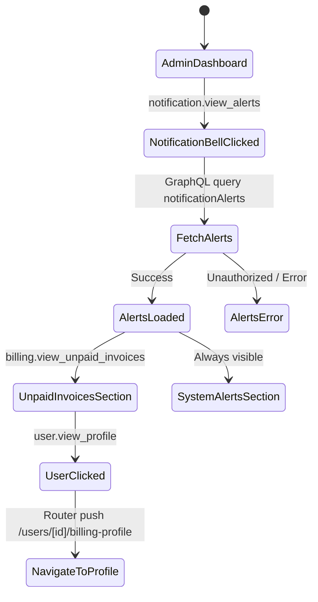
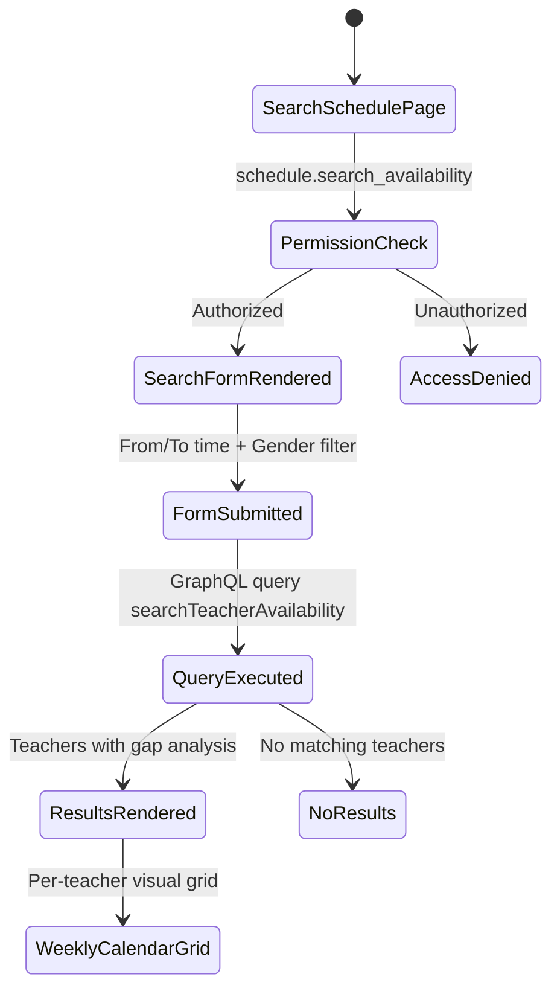
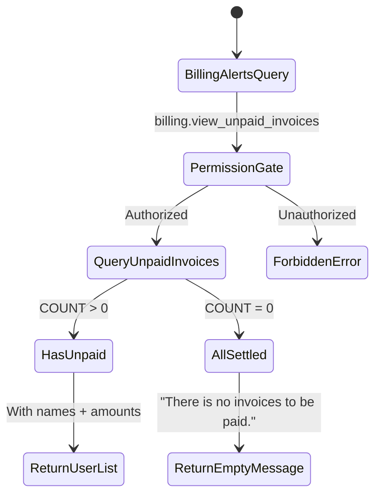

# Story 5 — Permissions & Permission Groups: Notifications, Billing Alerts, User Profiles, and Availability Search

## Section 0: Story Metadata & Context

- **Source story:** `.ai/siraj_stories/5.md` (Part 6 — Permissions & Permission Groups, timestamps 00:00 - 01:57)
- **Story scope:** Implement 4 Academy Admin-gated features: (1) Global Notifications UI with bell-icon dropdown, (2) Unpaid Invoices financial alerts, (3) User billing profile drill-down, (4) Cross-staff Schedule Availability Search.
- **Target roles:** Academy Admin (full access to all 4 features), Teacher/Student (explicitly excluded).
- **Status:** Planning phase — awaiting approval for execution.

### Business Objectives
1. **Financial Oversight:** Academy Admins must see outstanding balances at a glance and drill into specific user billing profiles.
2. **Operational Awareness:** System-wide alerts (complaints, system statuses) surfaced via the notification bell.
3. **Staffing Efficiency:** Cross-staff availability search to find open time slots across all teachers for scheduling optimization.
4. **Security Boundary:** All 4 features are strictly gated behind new/existing permissions, invisible to Teachers and Students.

---

## Section 1: Core Principles & Strict Rules (Mandatory Checklist)

### 1.1 Service Layer Architecture
- [ ] **NO monolithic services** — Each domain gets its own service: `NotificationAlertsService`, `BillingAlertsService`, `AvailabilitySearchService`.
- [ ] **Business logic centralization** — All permission checks, data aggregation, and orchestration reside in services, NOT repositories or resolvers.

### 1.2 Type Safety — NO `any`, NO Casts
- [ ] **Strict Type Narrowing** — BANNED: `any`, `as any`, and `as unknown as`. Narrow using type guards.
- [ ] **No route param casts** — Use safety checks like `typeof params?.id === "string" ? params.id : ""`.

### 1.3 Zero Incomplete Implementation Policy

| **Prohibited Pattern** | **Required Instead** | **Verification Command** |
|---|---|---|
| `// TODO`, `// FIXME`, `@todo` | Fully working implementation in same task | `rg -i "TODO\|FIXME" backend frontend` |
| `throw new Error("Not implemented")` | Complete service/repo method implementation | Manual code review |
| Handler calling only `logger.info` | Real GraphQL query + UI feedback | Grep for `logger.info.*handle` patterns |
| Mock data in production views | Real Apollo `useQuery` hooks | Grep for `mock` in non-storybook files |

### 1.4 Permission Integrity
- [ ] New permissions MUST be added to `shared/lib/enum.ts` `AppPermission` enum.
- [ ] New permissions MUST be seeded via a new Drizzle migration (NOT the existing `3-system_permissions_and_groups.sql`).
- [ ] Academy Admin group MUST receive all 4 new permissions in the migration.
- [ ] Super Admin group MUST also receive the 3 new permissions (it already has `schedule.search_availability`).

### 1.5 Localization
- [ ] All new user-facing strings MUST use `shared/messages/en.ts` and `shared/messages/ar/` directories.
- [ ] Backend error messages MUST use `getBackendTranslations({ locale, namespace })`.
- [ ] NO hardcoded English or Arabic strings in components or services.

---

## Section 2: RBAC Permissions (Canonical)

### 2.1 New Permissions to Create

| **Permission Key** | **Enum Value** | **Group** | **Category** | **Description** |
|---|---|---|---|---|
| `notification.view_alerts` | `NOTIFICATION_VIEW_ALERTS` | Academy Admin, Super Admin | Notifications | Access the global notifications dropdown with system alerts |
| `billing.view_unpaid_invoices` | `BILLING_VIEW_UNPAID_INVOICES` | Academy Admin, Super Admin | Billing | View accounts with pending/overdue financial balances |
| `user.view_profile` | `USER_VIEW_PROFILE` | Academy Admin, Super Admin | Users | View specific user billing/account details from alerts |

### 2.2 Existing Permission (Already Seeded)

| **Permission Key** | **Enum Value** | **Group** | **Category** | **Description** |
|---|---|---|---|---|
| `schedule.search_availability` | `SCHEDULE_SEARCH_AVAILABILITY` | Academy Admin, Super Admin | Scheduling | Cross-staff availability search engine |

### 2.3 Permission-to-Feature Mapping

| **Permission** | **UI Gate** | **Backend Service** | **GraphQL Query** | **Route** |
|---|---|---|---|---|
| `notification.view_alerts` | Notification bell dropdown visibility | `NotificationAlertsService.getAlerts()` | `notificationAlerts` | N/A (component in navbar) |
| `billing.view_unpaid_invoices` | Unpaid invoices section inside notification panel | `BillingAlertsService.getUnpaidInvoices()` | `unpaidInvoicesAlert` | N/A (inside notification panel) |
| `user.view_profile` | Clickable user rows in unpaid invoices list → route | N/A (uses existing `UserRepository`) | N/A (uses existing user query) | `/users/[id]/billing-profile` |
| `schedule.search_availability` | Sidebar nav item + dedicated page | `AvailabilitySearchService.searchAvailability()` | `searchTeacherAvailability` | `/search-schedule` |

### 2.4 Migration Group Assignments

**Super Admin** — add: `notification.view_alerts`, `billing.view_unpaid_invoices`, `user.view_profile`
**Academy Admin** — add: `notification.view_alerts`, `billing.view_unpaid_invoices`, `user.view_profile`, `schedule.search_availability`

---

## Section 3: Data Flow & Processing Diagrams

### 3.1 Notification Alerts Flow



### 3.2 Availability Search Flow



### 3.3 Billing Alerts Aggregation



---

## Section 4: Security Threat Remediation

### Threat 1: Financial Data Leakage via Notification Endpoint
**Current Gap:** The `NotificationButton` currently accepts a static `notificationCount` prop with no backend query. There is no permission gate on the notification data.
**Fix:** The `notificationAlerts` GraphQL query MUST check `notification.view_alerts` permission before returning any data. The `unpaidInvoicesAlert` sub-field MUST independently verify `billing.view_unpaid_invoices`.

```typescript
export async function getNotificationAlerts(userId: string, locale?: string) {
  const canViewAlerts = await PermissionsService.hasPermission(userId, AppPermission.NOTIFICATION_VIEW_ALERTS);
  if (!canViewAlerts) {
    const t = await getBackendTranslations({ locale, namespace: "errors" });
    throw new Error(t("unauthorizedAction"));
  }
  // ... aggregate alerts
}
```

### Threat 2: Cross-User Financial Data Exposure in Unpaid Invoices
**Current Gap:** The `invoices` table has RLS but the billing repository has no method to aggregate unpaid invoices with user identity.
**Fix:** The `BillingAlertsService.getUnpaidInvoices()` must:
1. Verify `billing.view_unpaid_invoices` permission.
2. Join `invoices` → `parents` → `users` to return user names.
3. Only return `UNPAID` status invoices with `dueDate < NOW()`.

### Threat 3: Unauthorized User Profile Access
**Current Gap:** The user profile drill-down route must not be accessible to non-admin users.
**Fix:** The billing profile page MUST:
1. Gate rendering with `<RequirePermission permissions={[AppPermission.UserViewProfile]} />`.
2. The backend service MUST verify the permission before returning billing details.

### Threat 4: Cross-Staff Schedule Data Leakage via Availability Search
**Current Gap:** `TeacherAvailabilityRepository` only validates booking conflicts — it has no cross-teacher search capability.
**Fix:** The `AvailabilitySearchService.searchAvailability()` must:
1. Verify `schedule.search_availability` permission.
2. Query ALL teachers' availability windows, subtract booked classes and recurring unavailability.
3. Return only gap/empty slots, never full schedule details of other teachers to unauthorized users.

---

## Section 5: Prerequisites Verification (BLOCKING)

Before starting story work, verify:

- [ ] Run `bun run test:db` to confirm existing database tests pass.
- [ ] Run `bun run test:graphql` to confirm existing GraphQL tests pass.
- [ ] Verify `invoices` table has `status`, `dueDate`, `parentId` columns in `backend/db/schema/billing.ts`. ✅ (verified)
- [ ] Verify `notificationDeliveries` table exists in `backend/db/schema/communications.ts`. ✅ (verified)
- [ ] Verify `teacherAvailabilityWindows` table exists in `backend/db/schema/teacher-availability.ts`. ✅ (verified)
- [ ] Verify `classInstances` table has `teacherId`, `scheduledStartAt`, `scheduledEndAt` in `backend/db/schema/scheduling.ts`. ✅ (verified)
- [ ] Verify `SCHEDULE_SEARCH_AVAILABILITY` exists in `shared/lib/enum.ts`. ✅ (verified)
- [ ] Verify `AppPermission` enum is used by `appPermissionEnum` in `backend/db/schema/enums.ts`. ✅ (verified)
- [ ] Verify the current `academy_admin` group does NOT have `schedule.search_availability`. ✅ (verified — line 94 of migration only has session/schedule view permissions, NOT search_availability)

---

## Section 6: Granular Task Breakdown

### Task A — Database: New Permissions Enum, Migration, and Seed

**Objective:** Add 3 new permission values to the `AppPermission` enum, create a Drizzle migration to seed them, and assign them to the Academy Admin and Super Admin groups. Also assign `schedule.search_availability` to Academy Admin.

**Layer-Specific Rules (Database — Flattened from backend/db/repo/AGENTS.md):**
- Permissions are seeded via Drizzle migrations, NOT manual SQL files in `backend/db/migration/`.
- The `AppPermission` enum in `shared/lib/enum.ts` is the single source of truth for permission keys.
- The `appPermissionEnum` in `backend/db/schema/enums.ts` is auto-derived from `AppPermission`.
- System permissions triggers (`trg_protect_system_permissions`) prevent manual INSERT of `is_system = true` — migrations must use raw SQL that bypasses triggers or use `ON CONFLICT DO UPDATE`.

**Target Files:**
- `shared/lib/enum.ts` — Add 3 new enum values
- New migration file (auto-generated via `bun run scripts/dbActions.ts push`)
- `backend/db/schema/enums.ts` — No changes needed (auto-derived)

**Detailed Implementation Steps:**

*Step 1: Add new permission values to `shared/lib/enum.ts`*

Add the following 3 entries to the `AppPermission` enum, placed logically in their respective domain groups:

```typescript
// In shared/lib/enum.ts, inside the AppPermission enum:

// --- Notifications domain ---
NOTIFICATION_VIEW_ALERTS = "notification.view_alerts",

// --- Billing domain ---
BILLING_VIEW_UNPAID_INVOICES = "billing.view_unpaid_invoices",

// --- User domain ---
USER_VIEW_PROFILE = "user.view_profile",
```

The full updated `AppPermission` enum will look like (showing only the new entries in context):

```typescript
export enum AppPermission {
  AUTH_LOGIN = "auth.login",
  AUTH_VIEW_OWN_PROFILE = "auth.view_own_profile",
  DASHBOARD_VIEW = "dashboard.view",
  DASHBOARD_VIEW_METRICS = "dashboard.view_metrics",
  DASHBOARD_FILTER_METRICS = "dashboard.filter_metrics",
  DASHBOARD_METRICS_VIEW_ALL = "dashboard.metrics.view_all",
  SCHEDULE_VIEW_LIST = "schedule.view_list",
  SCHEDULE_FILTER_ADVANCED = "schedule.filter_advanced",
  SCHEDULE_VIEW_ALL = "schedule.view_all",
  SCHEDULE_VIEW_ASSIGNED = "schedule.view_assigned",
  SCHEDULE_VIEW_FAMILY = "schedule.view_family",
  SCHEDULE_SEARCH_AVAILABILITY = "schedule.search_availability",
  SCHEDULE_MANAGE_RECURRING = "schedule.manage_recurring",
  SCHEDULE_DST_MIGRATE = "schedule.dst_migrate",
  SESSION_VIEW_DETAILS = "session.view_details",
  SESSION_ACTIVATE_CLASS = "session.activate_class",
  SESSION_ACTIVATE_OVERRIDE = "session.activate_override",
  SESSION_UPDATE_STATUS_START = "session.update_status.start",
  SESSION_UPDATE_STATUS_ABSENT = "session.update_status.absent",
  SESSION_UPDATE_STATUS_LEAVE = "session.update_status.leave",
  SESSION_RESCHEDULE = "session.reschedule",
  SESSION_RESET = "session.reset",
  SESSION_OVERRIDE_ACTIONS = "session.override_actions",
  DASHBOARD_SEARCH = "dashboard.search",
  SCHEDULE_VIEW_TIMEZONES = "schedule.view_timezones",
  HISTORY_VIEW_CALENDAR = "history.view_calendar",
  HISTORY_VIEW_DETAILS = "history.view_details",
  TEACHER_VIEW_DASHBOARD = "teacher.view_dashboard",
  SYSTEM_ENFORCE_TIME_WINDOW = "system.enforce_time_window",
  SYSTEM_ENFORCE_LEAVE_LIMIT = "system.enforce_leave_limit",
  TEACHERS_LIST = "teachers.list",
  TEACHERS_CREATE = "teachers.create",
  TEACHERS_EDIT = "teachers.edit",
  TEACHERS_MANAGE_SCHEDULE = "teachers.manage_schedule",
  PARENTS_LIST = "parents.list",
  PARENTS_CREATE = "parents.create",
  PARENTS_EDIT = "parents.edit",
  STUDENTS_LIST = "students.list",
  STUDENTS_EDIT = "students.edit",
  STUDENTS_CHANGE_TEACHER = "students.change_teacher",
  STUDENTS_CHANGE_STATUS = "students.change_status",
  STUDENTS_OVERRIDE_QUOTA = "students.override_quota",
  INVOICES_LIST = "invoices.list",
  INVOICES_DELETE = "invoices.delete",
  INVOICES_CREATE = "invoices.create",
  INVOICES_MARK_PAID = "invoices.mark_paid",
  INVOICES_EDIT = "invoices.edit",
  RESOURCES_LIST = "resources.list",
  RESOURCES_DELETE = "resources.delete",
  RESOURCES_UPLOAD = "resources.upload",
  REPORTS_GENERATE = "reports.generate",
  COMPLAINTS_LIST = "complaints.list",
  COMPLAINTS_DELETE = "complaints.delete",
  COMPLAINTS_RESPOND = "complaints.respond",
  STAFF_LIST = "staff.list",
  STAFF_CREATE = "staff.create",
  STAFF_EDIT = "staff.edit",
  PERMISSION_GROUPS_MANAGE = "permission_groups.manage",
  PERMISSION_GROUPS_ASSIGN = "permission_groups.assign",
  NOTIFICATION_VIEW_ALERTS = "notification.view_alerts",
  BILLING_VIEW_UNPAID_INVOICES = "billing.view_unpaid_invoices",
  USER_VIEW_PROFILE = "user.view_profile",
  TEST_SYSTEM_ONLY = "test.system_only",
  TEST_CUSTOM_ONLY = "test.custom_only",
}
```

*Step 2: Generate Drizzle migration*

Run the following command to push schema changes (the enum change) and generate a migration:

```bash
bun run scripts/dbActions.ts push
```

This will create a new migration file under `backend/drizzle/` that adds the 3 new enum values to the PostgreSQL `app_permission` type.

*Step 3: Create seed migration for new permissions and group assignments*

Create a new SQL migration file at `backend/db/migration/4-story5_permissions_alerts_billing_profile.sql`:

```sql
-- Migration: Story 5 — Add notification, billing, and user permissions
-- Seeds new permissions and assigns them to Academy Admin and Super Admin groups

INSERT INTO permissions (id, key, resource, action, description, category, is_system) VALUES
  (gen_random_uuid(), 'notification.view_alerts', 'notification', 'view_alerts', 'Access global notifications UI with system alerts', 'Notifications', true),
  (gen_random_uuid(), 'billing.view_unpaid_invoices', 'billing', 'view_unpaid_invoices', 'View accounts with pending or overdue financial balances', 'Billing', true),
  (gen_random_uuid(), 'user.view_profile', 'user', 'view_profile', 'View specific user comprehensive account and billing details', 'Users', true)
ON CONFLICT (key) DO UPDATE SET
  resource = EXCLUDED.resource,
  action = EXCLUDED.action,
  description = EXCLUDED.description,
  category = EXCLUDED.category,
  is_system = EXCLUDED.is_system;

-- Assign new permissions to Super Admin
INSERT INTO group_permissions (group_id, permission_id)
SELECT g.id, p.id
FROM permission_groups g, permissions p
WHERE g.slug = 'super_admin' AND p.key IN ('notification.view_alerts', 'billing.view_unpaid_invoices', 'user.view_profile');

-- Assign new permissions + schedule.search_availability to Academy Admin
INSERT INTO group_permissions (group_id, permission_id)
SELECT g.id, p.id
FROM permission_groups g, permissions p
WHERE g.slug = 'academy_admin' AND p.key IN ('notification.view_alerts', 'billing.view_unpaid_invoices', 'user.view_profile', 'schedule.search_availability');
```

**Test Execution Requirements:**
```bash
bun run test:db
```

**Success Criteria / Check Progress Points:**
- [ ] `AppPermission` enum in `shared/lib/enum.ts` contains `NOTIFICATION_VIEW_ALERTS`, `BILLING_VIEW_UNPAID_INVOICES`, `USER_VIEW_PROFILE`.
- [ ] Drizzle migration generated successfully with new enum values.
- [ ] SQL migration file created with permission seeds and group assignments.
- [ ] `bun run test:db` passes with 0 failures.

---

### Task B — Repository: Unpaid Invoices Aggregation and Availability Search Queries

**Objective:** Implement two new repository methods: (1) `BillingRepository.getUnpaidInvoicesSummary()` to aggregate overdue invoices with user names, and (2) `TeacherAvailabilityRepository.searchCrossStaffAvailability()` to find open time slots across all teachers.

**Layer-Specific Rules (Database Repositories — Flattened from backend/db/repo/AGENTS.md):**
- Use Drizzle standard syntax `db.select().from(table).leftJoin(...)` instead of relational `findMany` when multiple joins are needed.
- Wrap all repository changes modifying multiple tables in an atomic `db.transaction()`.
- No hardcoded error strings — use `getBackendTranslations`.
- Conditional aggregation uses `sql` template literal with `.mapWith(Number)`.

**Target Files:**
- `backend/db/repo/billing.repository.ts` — Add `getUnpaidInvoicesSummary()`
- `backend/db/repo/teacher-availability.repository.ts` — Add `searchCrossStaffAvailability()`
- `backend/types/index.ts` — Add new input/output types
- `backend/db/test/repo/billing.repository.test.ts` — Tests for unpaid invoices
- `backend/db/test/repo/teacher-availability.repository.test.ts` — Tests for availability search

**Detailed Implementation Steps:**

*Step 1: Define types in `backend/types/index.ts`*

```typescript
export interface UnpaidInvoiceSummaryItem {
  id: string;
  userId: string;
  userName: string;
  userEmail: string;
  totalUnpaidAmount: string;
  currency: string;
  overdueCount: number;
  oldestDueDate: string;
}

export interface UnpaidInvoicesSummaryResult {
  id: string;
  totalOverdueInvoices: number;
  totalOverdueAmount: string;
  items: UnpaidInvoiceSummaryItem[];
}

export interface AvailabilitySearchInput {
  fromTime: string;
  toTime: string;
  gender?: Gender | null;
}

export interface TeacherAvailabilityGap {
  id: string;
  teacherId: string;
  teacherName: string;
  teacherGender: string | null;
  dayOfWeek: DayOfWeek;
  gapStartTime: string;
  gapEndTime: string;
  timezone: string;
}

export interface AvailabilitySearchResult {
  id: string;
  teachers: {
    id: string;
    name: string;
    gender: string | null;
    timezone: string;
    gaps: TeacherAvailabilityGap[];
  }[];
  totalGaps: number;
}
```

*Step 2: Implement `BillingRepository.getUnpaidInvoicesSummary()`*

Add the following method to the `BillingRepository` namespace in `backend/db/repo/billing.repository.ts`:

```typescript
export const getUnpaidInvoicesSummary = async (
  tx?: DBTransaction
): Promise<Types.UnpaidInvoicesSummaryResult> => {
  const t = tx ?? db;

  const unpaidInvoices = await t
    .select({
      invoiceId: invoices.id,
      parentId: invoices.parentId,
      amount: invoices.amount,
      currency: invoices.currency,
      dueDate: invoices.dueDate,
    })
    .from(invoices)
    .where(
      and(
        eq(invoices.status, "UNPAID"),
        sql`${invoices.dueDate} < CURRENT_DATE`
      )
    )
    .orderBy(invoices.dueDate);

  if (unpaidInvoices.length === 0) {
    return {
      id: "unpaid-invoices-summary",
      totalOverdueInvoices: 0,
      totalOverdueAmount: "0.00",
      items: [],
    };
  }

  const parentIds = [...new Set(unpaidInvoices.map(inv => inv.parentId))];

  const parentUsers = await t
    .select({
      parentId: parents.id,
      userId: parents.userId,
      userName: users.name,
      userEmail: users.email,
    })
    .from(parents)
    .leftJoin(users, eq(parents.userId, users.id))
    .where(sql`${parents.id} IN (${sql.join(parentIds.map(id => sql`${id}`), sql`, `)})`);

  const parentMap = new Map(parentUsers.map(p => [p.parentId, p]));

  const groupedByParent = new Map<string, typeof unpaidInvoices>();
  for (const inv of unpaidInvoices) {
    const existing = groupedByParent.get(inv.parentId) ?? [];
    existing.push(inv);
    groupedByParent.set(inv.parentId, existing);
  }

  const items: Types.UnpaidInvoiceSummaryItem[] = [];
  let totalAmount = 0;

  for (const [parentId, invs] of groupedByParent) {
    const parent = parentMap.get(parentId);
    if (!parent?.userId) continue;

    const parentTotal = invs.reduce((sum, inv) => sum + Number.parseFloat(inv.amount), 0);
    totalAmount += parentTotal;

    items.push({
      id: parentId,
      userId: parent.userId,
      userName: parent.userName ?? "Unknown",
      userEmail: parent.userEmail ?? "",
      totalUnpaidAmount: parentTotal.toFixed(2),
      currency: invs[0].currency,
      overdueCount: invs.length,
      oldestDueDate: invs[0].dueDate,
    });
  }

  return {
    id: "unpaid-invoices-summary",
    totalOverdueInvoices: unpaidInvoices.length,
    totalOverdueAmount: totalAmount.toFixed(2),
    items,
  };
};
```

*Step 3: Implement `TeacherAvailabilityRepository.searchCrossStaffAvailability()`*

Add the following method to the `TeacherAvailabilityRepository` namespace in `backend/db/repo/teacher-availability.repository.ts`:

```typescript
export interface CrossStaffSearchInput {
  fromTime: string;
  toTime: string;
  gender?: Gender | null;
}

export const searchCrossStaffAvailability = async (
  input: CrossStaffSearchInput,
  tx?: DBTransaction
): Promise<Types.AvailabilitySearchResult> => {
  const t = tx ?? db;

  const fromMinutes = timeToMinutes(input.fromTime);
  const toMinutes = timeToMinutes(input.toTime);

  if (fromMinutes >= toMinutes) {
    const tFunc = await getBackendTranslations({ locale: undefined, namespace: "errors" });
    throw new Error(tFunc("startTimeBeforeEndTime"));
  }

  let teacherQuery = t
    .select({
      teacherId: teachers.id,
      teacherName: users.name,
      teacherGender: teachers.gender,
      teacherTimezone: teachers.timezone,
    })
    .from(teachers)
    .leftJoin(users, eq(teachers.userId, users.id))
    .where(eq(teachers.status, "ACTIVATED"));

  if (input.gender) {
    teacherQuery = teacherQuery.where(
      and(eq(teachers.status, "ACTIVATED"), eq(teachers.gender, input.gender))
    ) as typeof teacherQuery;
  }

  const allTeachers = await teacherQuery;

  if (allTeachers.length === 0) {
    return {
      id: `availability-search-${input.fromTime}-${input.toTime}`,
      teachers: [],
      totalGaps: 0,
    };
  }

  const daysOfWeek = Object.values(DayOfWeek);
  const result: Types.AvailabilitySearchResult["teachers"] = [];
  let totalGaps = 0;

  for (const teacher of allTeachers) {
    const windows = await t
      .select()
      .from(teacherAvailabilityWindows)
      .where(eq(teacherAvailabilityWindows.teacherId, teacher.teacherId));

    const unavailabilities = await t
      .select()
      .from(teacherRecurringUnavailability)
      .where(eq(teacherRecurringUnavailability.teacherId, teacher.teacherId));

    const bookedClasses = await t
      .select({
        scheduledStartAt: classInstances.scheduledStartAt,
        scheduledEndAt: classInstances.scheduledEndAt,
      })
      .from(classInstances)
      .where(
        and(
          eq(classInstances.teacherId, teacher.teacherId),
          sql`${classInstances.executionState} IN ('ACTIVATED', 'RUNNING', 'NOT_ACTIVATED')`,
          sql`${classInstances.deletedAt} IS NULL`
        )
      );

    const gaps: Types.TeacherAvailabilityGap[] = [];

    for (const day of daysOfWeek) {
      const dayWindows = windows.filter(w => (w.dayOfWeek as DayOfWeek) === day);
      const dayUnavail = unavailabilities.filter(u => (u.dayOfWeek as DayOfWeek) === day);

      for (const window of dayWindows) {
        const windowStart = timeToMinutes(window.startTime);
        const windowEnd = timeToMinutes(window.endTime);

        const searchStart = Math.max(windowStart, fromMinutes);
        const searchEnd = Math.min(windowEnd, toMinutes);

        if (searchStart >= searchEnd) continue;

        let blockedRanges: { start: number; end: number }[] = [];

        for (const u of dayUnavail) {
          const uStart = timeToMinutes(u.startTime);
          const uEnd = timeToMinutes(u.endTime);
          if (uStart < searchEnd && uEnd > searchStart) {
            blockedRanges.push({ start: Math.max(uStart, searchStart), end: Math.min(uEnd, searchEnd) });
          }
        }

        blockedRanges.sort((a, b) => a.start - b.start);

        const mergedBlocked: { start: number; end: number }[] = [];
        for (const range of blockedRanges) {
          if (mergedBlocked.length > 0 && range.start <= mergedBlocked[mergedBlocked.length - 1].end) {
            mergedBlocked[mergedBlocked.length - 1].end = Math.max(mergedBlocked[mergedBlocked.length - 1].end, range.end);
          } else {
            mergedBlocked.push({ ...range });
          }
        }

        let cursor = searchStart;
        for (const blocked of mergedBlocked) {
          if (cursor < blocked.start) {
            gaps.push({
              id: `${teacher.teacherId}-${day}-${cursor}-${blocked.start}`,
              teacherId: teacher.teacherId,
              teacherName: teacher.teacherName ?? "Unknown",
              teacherGender: teacher.teacherGender,
              dayOfWeek: day,
              gapStartTime: `${String(Math.floor(cursor / 60)).padStart(2, "0")}:${String(cursor % 60).padStart(2, "0")}`,
              gapEndTime: `${String(Math.floor(blocked.start / 60)).padStart(2, "0")}:${String(blocked.start % 60).padStart(2, "0")}`,
              timezone: teacher.teacherTimezone,
            });
          }
          cursor = Math.max(cursor, blocked.end);
        }

        if (cursor < searchEnd) {
          gaps.push({
            id: `${teacher.teacherId}-${day}-${cursor}-${searchEnd}`,
            teacherId: teacher.teacherId,
            teacherName: teacher.teacherName ?? "Unknown",
            teacherGender: teacher.teacherGender,
            dayOfWeek: day,
            gapStartTime: `${String(Math.floor(cursor / 60)).padStart(2, "0")}:${String(cursor % 60).padStart(2, "0")}`,
            gapEndTime: `${String(Math.floor(searchEnd / 60)).padStart(2, "0")}:${String(searchEnd % 60).padStart(2, "0")}`,
            timezone: teacher.teacherTimezone,
          });
        }
      }
    }

    if (gaps.length > 0) {
      result.push({
        id: teacher.teacherId,
        name: teacher.teacherName ?? "Unknown",
        gender: teacher.teacherGender,
        timezone: teacher.teacherTimezone,
        gaps,
      });
      totalGaps += gaps.length;
    }
  }

  return {
    id: `availability-search-${input.fromTime}-${input.toTime}`,
    teachers: result,
    totalGaps,
  };
};
```

*Step 4: Add imports for `classInstances`, `teachers`, `users` in `teacher-availability.repository.ts`*

The file already imports from `@/backend/db/schema` but needs `classInstances`, `teachers`, and `users` added:

```typescript
import {
  classInstances,
  teacherAvailabilityWindows,
  teacherRecurringUnavailability,
  teacherVacationRequests,
  teachers,
  users,
} from "@/backend/db/schema";
```

And add `Gender` to the enum imports:

```typescript
import { DayOfWeek, Gender, VacationRequestStatus } from "@/shared/lib/enum";
```

*Step 5: Add imports for `parents`, `users` in `billing.repository.ts`*

```typescript
import {
  currencyExchangeAuditLogs,
  currencyExchangeRates,
  invoices,
  parents,
  payments,
  systemSettings,
  users,
} from "@/backend/db/schema";
```

**Test Execution Requirements:**
```bash
bun run test:db
```

**Success Criteria / Check Progress Points:**
- [ ] `getUnpaidInvoicesSummary()` returns overdue invoices grouped by parent with user names.
- [ ] `searchCrossStaffAvailability()` returns gap analysis for all matching teachers.
- [ ] Gender filter works correctly in availability search.
- [ ] Empty results return proper empty-state structures.
- [ ] `bun run test:db` passes with 0 failures.

---

### Task C — Service Layer: Notification Alerts, Billing Alerts, and Availability Search Services

**Objective:** Create 3 new domain-driven services that orchestrate permission checks, call repositories, and return data for GraphQL resolvers.

**Layer-Specific Rules (Backend Services — Flattened from backend/services/AGENTS.md):**
- Domain-Driven Architecture: One service per domain.
- Business Logic Hub: Permission checks and orchestration here, NOT in repos or resolvers.
- i18n: All error messages via `getBackendTranslations`.
- SSR-compatible: Can be called from Next.js Server Components.

**Target Files:**
- `backend/services/notification/notification-alerts.service.ts` (NEW)
- `backend/services/billing/billing-alerts.service.ts` (NEW)
- `backend/services/schedule/availability-search.service.ts` (NEW)

**Detailed Implementation Steps:**

*Step 1: Create `NotificationAlertsService`*

```typescript
// backend/services/notification/notification-alerts.service.ts

import { db } from "@/backend/db/drizzleDb";
import { complaints, notificationDeliveries } from "@/backend/db/schema";
import { getBackendTranslations } from "@/backend/lib/intl";
import { logger } from "@/backend/lib/logger";
import { PermissionsService } from "@/backend/services/auth/permissions.service";
import { AppPermission, ComplaintStatus } from "@/shared/lib/enum";
import { and, count, desc, eq, isNull, or } from "drizzle-orm";

export interface SystemAlert {
  id: string;
  type: "complaint" | "notification" | "system";
  title: string;
  body: string | null;
  createdAt: Date;
  severity: "info" | "warning" | "error";
}

export interface NotificationAlertsResult {
  id: string;
  alerts: SystemAlert[];
  totalCount: number;
  unreadCount: number;
}

export namespace NotificationAlertsService {
  export async function getAlerts(userId: string, locale?: string): Promise<NotificationAlertsResult> {
    try {
      const canViewAlerts = await PermissionsService.hasPermission(
        userId,
        AppPermission.NOTIFICATION_VIEW_ALERTS
      );
      if (!canViewAlerts) {
        const t = await getBackendTranslations({ locale, namespace: "errors" });
        throw new Error(t("unauthorizedAction"));
      }

      const unansweredComplaints = await db
        .select({
          id: complaints.id,
          body: complaints.body,
          createdAt: complaints.createdAt,
        })
        .from(complaints)
        .where(
          and(
            eq(complaints.status, ComplaintStatus.UNANSWERED),
            isNull(complaints.deletedAt)
          )
        )
        .orderBy(desc(complaints.createdAt))
        .limit(20);

      const recentNotifications = await db
        .select({
          id: notificationDeliveries.id,
          title: notificationDeliveries.title,
          body: notificationDeliveries.body,
          createdAt: notificationDeliveries.createdAt,
          status: notificationDeliveries.status,
        })
        .from(notificationDeliveries)
        .where(eq(notificationDeliveries.userId, userId))
        .orderBy(desc(notificationDeliveries.createdAt))
        .limit(20);

      const alerts: SystemAlert[] = [];

      for (const complaint of unansweredComplaints) {
        alerts.push({
          id: `complaint-${complaint.id}`,
          type: "complaint",
          title: "New Unanswered Complaint",
          body: complaint.body.length > 100 ? `${complaint.body.substring(0, 100)}...` : complaint.body,
          createdAt: complaint.createdAt,
          severity: "warning",
        });
      }

      for (const notification of recentNotifications) {
        alerts.push({
          id: `notification-${notification.id}`,
          type: "notification",
          title: notification.title ?? "System Notification",
          body: notification.body,
          createdAt: notification.createdAt,
          severity: notification.status === "FAILED" ? "error" : "info",
        });
      }

      alerts.sort((a, b) => b.createdAt.getTime() - a.createdAt.getTime());

      const unreadCount = recentNotifications.filter(n => n.status !== "OPENED").length;

      return {
        id: `notification-alerts-${userId}`,
        alerts,
        totalCount: alerts.length,
        unreadCount,
      };
    } catch (error) {
      logger.error("Error fetching notification alerts", { userId, error });
      throw error;
    }
  }
}
```

*Step 2: Create `BillingAlertsService`*

```typescript
// backend/services/billing/billing-alerts.service.ts

import { BillingRepository } from "@/backend/db/repo/billing.repository";
import { getBackendTranslations } from "@/backend/lib/intl";
import { logger } from "@/backend/lib/logger";
import { PermissionsService } from "@/backend/services/auth/permissions.service";
import { AppPermission } from "@/shared/lib/enum";

export namespace BillingAlertsService {
  export async function getUnpaidInvoices(userId: string, locale?: string) {
    try {
      const isAuthorized = await PermissionsService.hasPermission(
        userId,
        AppPermission.BILLING_VIEW_UNPAID_INVOICES
      );
      if (!isAuthorized) {
        const t = await getBackendTranslations({ locale, namespace: "errors" });
        throw new Error(t("unauthorizedAction"));
      }

      const summary = await BillingRepository.getUnpaidInvoicesSummary();

      return summary;
    } catch (error) {
      logger.error("Error fetching unpaid invoices", { userId, error });
      throw error;
    }
  }
}
```

*Step 3: Create `AvailabilitySearchService`*

```typescript
// backend/services/schedule/availability-search.service.ts

import { TeacherAvailabilityRepository } from "@/backend/db/repo/teacher-availability.repository";
import { getBackendTranslations } from "@/backend/lib/intl";
import { logger } from "@/backend/lib/logger";
import { PermissionsService } from "@/backend/services/auth/permissions.service";
import { AppPermission, Gender } from "@/shared/lib/enum";

export interface AvailabilitySearchServiceInput {
  fromTime: string;
  toTime: string;
  gender?: string | null;
}

export namespace AvailabilitySearchService {
  export async function searchAvailability(
    userId: string,
    input: AvailabilitySearchServiceInput,
    locale?: string
  ) {
    try {
      const isAuthorized = await PermissionsService.hasPermission(
        userId,
        AppPermission.SCHEDULE_SEARCH_AVAILABILITY
      );
      if (!isAuthorized) {
        const t = await getBackendTranslations({ locale, namespace: "errors" });
        throw new Error(t("unauthorizedAction"));
      }

      const genderFilter = input.gender
        ? (input.gender as Gender)
        : null;

      const result = await TeacherAvailabilityRepository.searchCrossStaffAvailability({
        fromTime: input.fromTime,
        toTime: input.toTime,
        gender: genderFilter,
      });

      return result;
    } catch (error) {
      logger.error("Error searching availability", { userId, error });
      throw error;
    }
  }
}
```

**Test Execution Requirements:**
```bash
bun run test:db
```

**Success Criteria / Check Progress Points:**
- [ ] `NotificationAlertsService.getAlerts()` returns aggregated alerts with permission check.
- [ ] `BillingAlertsService.getUnpaidInvoices()` returns overdue invoice summary with permission check.
- [ ] `AvailabilitySearchService.searchAvailability()` returns gap analysis with permission check.
- [ ] All 3 services throw localized errors on unauthorized access.
- [ ] `bun run test:db` passes with 0 failures.

---

### Task D — Backend GraphQL: Pothos Types and Resolvers for New Queries

**Objective:** Register 3 new GraphQL queries in the Pothos schema: `notificationAlerts`, `unpaidInvoicesAlert`, and `searchTeacherAvailability`.

**Layer-Specific Rules (Backend GraphQL — Flattened from backend/graphql/AGENTS.md):**
- `nullable: false` by default.
- Every object MUST expose an `id` field.
- Resolvers delegate to services, NOT repositories directly.
- Locale propagation via `ctx.locale`.

**Target Files:**
- `backend/graphql/pothos/notification-alerts.pothos.ts` (NEW)
- `backend/graphql/pothos/billing-alerts.pothos.ts` (NEW)
- `backend/graphql/pothos/availability-search.pothos.ts` (NEW)
- `backend/graphql/pothos/index.ts` — Add exports
- `backend/graphql/gqlSchemaBuilder.ts` — Register new query fields

**Detailed Implementation Steps:**

*Step 1: Create `notification-alerts.pothos.ts`*

```typescript
// backend/graphql/pothos/notification-alerts.pothos.ts

import { gqlSchemaBuilder } from "../gqlSchemaBuilder";

export type SystemAlertDefinition = {
  id: string;
  type: string;
  title: string;
  body: string | null;
  createdAt: Date;
  severity: string;
};

const SystemAlertRef = gqlSchemaBuilder.objectRef<SystemAlertDefinition>("SystemAlert");

export const SystemAlertPothosObject = SystemAlertRef.implement({
  fields: t => ({
    id: t.exposeString("id"),
    type: t.exposeString("type"),
    title: t.exposeString("title"),
    body: t.exposeString("body", { nullable: true }),
    createdAt: t.expose("createdAt", { type: "DateTime" }),
    severity: t.exposeString("severity"),
  }),
});

export type NotificationAlertsResultDefinition = {
  id: string;
  alerts: SystemAlertDefinition[];
  totalCount: number;
  unreadCount: number;
};

const NotificationAlertsResultRef =
  gqlSchemaBuilder.objectRef<NotificationAlertsResultDefinition>("NotificationAlertsResult");

export const NotificationAlertsResultPothosObject = NotificationAlertsResultRef.implement({
  fields: t => ({
    id: t.exposeString("id"),
    alerts: t.expose("alerts", { type: [SystemAlertPothosObject] }),
    totalCount: t.exposeInt("totalCount"),
    unreadCount: t.exposeInt("unreadCount"),
  }),
});
```

*Step 2: Create `billing-alerts.pothos.ts`*

```typescript
// backend/graphql/pothos/billing-alerts.pothos.ts

import { gqlSchemaBuilder } from "../gqlSchemaBuilder";

export type UnpaidInvoiceItemDefinition = {
  id: string;
  userId: string;
  userName: string;
  userEmail: string;
  totalUnpaidAmount: string;
  currency: string;
  overdueCount: number;
  oldestDueDate: string;
};

const UnpaidInvoiceItemRef =
  gqlSchemaBuilder.objectRef<UnpaidInvoiceItemDefinition>("UnpaidInvoiceItem");

export const UnpaidInvoiceItemPothosObject = UnpaidInvoiceItemRef.implement({
  fields: t => ({
    id: t.exposeString("id"),
    userId: t.exposeString("userId"),
    userName: t.exposeString("userName"),
    userEmail: t.exposeString("userEmail"),
    totalUnpaidAmount: t.exposeString("totalUnpaidAmount"),
    currency: t.exposeString("currency"),
    overdueCount: t.exposeInt("overdueCount"),
    oldestDueDate: t.exposeString("oldestDueDate"),
  }),
});

export type UnpaidInvoicesSummaryDefinition = {
  id: string;
  totalOverdueInvoices: number;
  totalOverdueAmount: string;
  items: UnpaidInvoiceItemDefinition[];
};

const UnpaidInvoicesSummaryRef =
  gqlSchemaBuilder.objectRef<UnpaidInvoicesSummaryDefinition>("UnpaidInvoicesSummary");

export const UnpaidInvoicesSummaryPothosObject = UnpaidInvoicesSummaryRef.implement({
  fields: t => ({
    id: t.exposeString("id"),
    totalOverdueInvoices: t.exposeInt("totalOverdueInvoices"),
    totalOverdueAmount: t.exposeString("totalOverdueAmount"),
    items: t.expose("items", { type: [UnpaidInvoiceItemPothosObject] }),
  }),
});
```

*Step 3: Create `availability-search.pothos.ts`*

```typescript
// backend/graphql/pothos/availability-search.pothos.ts

import { gqlSchemaBuilder } from "../gqlSchemaBuilder";

export type TeacherAvailabilityGapDefinition = {
  id: string;
  teacherId: string;
  teacherName: string;
  teacherGender: string | null;
  dayOfWeek: string;
  gapStartTime: string;
  gapEndTime: string;
  timezone: string;
};

const TeacherAvailabilityGapRef =
  gqlSchemaBuilder.objectRef<TeacherAvailabilityGapDefinition>("TeacherAvailabilityGap");

export const TeacherAvailabilityGapPothosObject = TeacherAvailabilityGapRef.implement({
  fields: t => ({
    id: t.exposeString("id"),
    teacherId: t.exposeString("teacherId"),
    teacherName: t.exposeString("teacherName"),
    teacherGender: t.exposeString("teacherGender", { nullable: true }),
    dayOfWeek: t.exposeString("dayOfWeek"),
    gapStartTime: t.exposeString("gapStartTime"),
    gapEndTime: t.exposeString("gapEndTime"),
    timezone: t.exposeString("timezone"),
  }),
});

export type AvailabilitySearchTeacherDefinition = {
  id: string;
  name: string;
  gender: string | null;
  timezone: string;
  gaps: TeacherAvailabilityGapDefinition[];
};

const AvailabilitySearchTeacherRef =
  gqlSchemaBuilder.objectRef<AvailabilitySearchTeacherDefinition>("AvailabilitySearchTeacher");

export const AvailabilitySearchTeacherPothosObject = AvailabilitySearchTeacherRef.implement({
  fields: t => ({
    id: t.exposeString("id"),
    name: t.exposeString("name"),
    gender: t.exposeString("gender", { nullable: true }),
    timezone: t.exposeString("timezone"),
    gaps: t.expose("gaps", { type: [TeacherAvailabilityGapPothosObject] }),
  }),
});

export type AvailabilitySearchResultDefinition = {
  id: string;
  teachers: AvailabilitySearchTeacherDefinition[];
  totalGaps: number;
};

const AvailabilitySearchResultRef =
  gqlSchemaBuilder.objectRef<AvailabilitySearchResultDefinition>("AvailabilitySearchResult");

export const AvailabilitySearchResultPothosObject = AvailabilitySearchResultRef.implement({
  fields: t => ({
    id: t.exposeString("id"),
    teachers: t.expose("teachers", { type: [AvailabilitySearchTeacherPothosObject] }),
    totalGaps: t.exposeInt("totalGaps"),
  }),
});

export type AvailabilitySearchInputDefinition = {
  fromTime: string;
  toTime: string;
  gender?: string | null;
};

export const AvailabilitySearchInputPothosObject = gqlSchemaBuilder
  .inputRef<AvailabilitySearchInputDefinition>("AvailabilitySearchInput")
  .implement({
    fields: t => ({
      fromTime: t.string(),
      toTime: t.string(),
      gender: t.string({ required: false }),
    }),
  });
```

*Step 4: Update `backend/graphql/pothos/index.ts`*

Add the new exports:

```typescript
export * from "./auth.pothos";
export * from "./availability-search.pothos";
export * from "./billing-alerts.pothos";
export * from "./class-session.pothos";
export * from "./enum.pothos";
export * from "./notification-alerts.pothos";
export * from "./pagination.objects";
export * from "./permission-management.pothos";
export * from "./schedule.pothos";
export * from "./storage.pothos";
export * from "./student.pothos";
export * from "./student-history.pothos";
export * from "./teacher.pothos";
export * from "./teacher-dashboard.pothos";
```

*Step 5: Register query fields in `backend/graphql/gqlSchemaBuilder.ts`*

Add 3 new query fields to the schema builder's `queryType`:

```typescript
notificationAlerts: t.field({
  type: NotificationAlertsResultPothosObject,
  resolve: async (_root, _args, ctx) => {
    return NotificationAlertsService.getAlerts(ctx.userId, ctx.locale);
  },
}),

unpaidInvoicesAlert: t.field({
  type: UnpaidInvoicesSummaryPothosObject,
  resolve: async (_root, _args, ctx) => {
    return BillingAlertsService.getUnpaidInvoices(ctx.userId, ctx.locale);
  },
}),

searchTeacherAvailability: t.field({
  type: AvailabilitySearchResultPothosObject,
  args: {
    input: t.arg({ type: AvailabilitySearchInputPothosObject, required: true }),
  },
  resolve: async (_root, args, ctx) => {
    return AvailabilitySearchService.searchAvailability(ctx.userId, args.input, ctx.locale);
  },
}),
```

**Test Execution Requirements:**
```bash
bun run generate:gqlSchema
bun run test:graphql
```

**Success Criteria / Check Progress Points:**
- [ ] 3 new Pothos type files created with proper `id` fields on all objects.
- [ ] Query fields registered in the schema builder.
- [ ] `bun run generate:gqlSchema` succeeds without errors.
- [ ] `bun run test:graphql` passes with 0 failures.

---

### Task E — Frontend GraphQL: Apollo Documents and Codegen

**Objective:** Create Apollo TypedDocumentNodes for the 3 new queries and run codegen to generate types.

**Layer-Specific Rules (Frontend GraphQL — Flattened from frontend/graphql/AGENTS.md):**
- Use `TypedDocumentNode` pattern with generated types.
- NO `useLazyQuery` — use stateful `useQuery`.
- Always include `id` field on every named object type.
- Import from `"@apollo/client"` — never `"@apollo/client/core"`.

**Target Files:**
- `frontend/graphql/sharedDocuments/notification-alerts.documents.ts` (NEW)
- `frontend/graphql/sharedDocuments/billing-alerts.documents.ts` (NEW)
- `frontend/graphql/sharedDocuments/availability-search.documents.ts` (NEW)
- `frontend/graphql/sharedDocuments/index.ts` — Add exports

**Detailed Implementation Steps:**

*Step 1: Create `notification-alerts.documents.ts`*

```typescript
// frontend/graphql/sharedDocuments/notification-alerts.documents.ts

import { gql, type TypedDocumentNode } from "@apollo/client";
import type * as Types from "@/frontend/graphql/generated/gql/graphql-types";
import type * as Operations from "@/frontend/graphql/generated/gql/operations";

export const notificationAlertsQueryDocument: TypedDocumentNode<
  Operations.NotificationAlertsQuery
> = gql`
  query notificationAlerts {
    notificationAlerts {
      id
      totalCount
      unreadCount
      alerts {
        id
        type
        title
        body
        createdAt
        severity
      }
    }
  }
`;
```

*Step 2: Create `billing-alerts.documents.ts`*

```typescript
// frontend/graphql/sharedDocuments/billing-alerts.documents.ts

import { gql, type TypedDocumentNode } from "@apollo/client";
import type * as Types from "@/frontend/graphql/generated/gql/graphql-types";
import type * as Operations from "@/frontend/graphql/generated/gql/operations";

export const unpaidInvoicesAlertQueryDocument: TypedDocumentNode<
  Operations.UnpaidInvoicesAlertQuery
> = gql`
  query unpaidInvoicesAlert {
    unpaidInvoicesAlert {
      id
      totalOverdueInvoices
      totalOverdueAmount
      items {
        id
        userId
        userName
        userEmail
        totalUnpaidAmount
        currency
        overdueCount
        oldestDueDate
      }
    }
  }
`;
```

*Step 3: Create `availability-search.documents.ts`*

```typescript
// frontend/graphql/sharedDocuments/availability-search.documents.ts

import { gql, type TypedDocumentNode } from "@apollo/client";
import type * as Types from "@/frontend/graphql/generated/gql/graphql-types";
import type * as Operations from "@/frontend/graphql/generated/gql/operations";

export const searchTeacherAvailabilityQueryDocument: TypedDocumentNode<
  Operations.SearchTeacherAvailabilityQuery,
  Types.QuerySearchTeacherAvailabilityArgs
> = gql`
  query searchTeacherAvailability($input: AvailabilitySearchInput!) {
    searchTeacherAvailability(input: $input) {
      id
      totalGaps
      teachers {
        id
        name
        gender
        timezone
        gaps {
          id
          teacherId
          teacherName
          teacherGender
          dayOfWeek
          gapStartTime
          gapEndTime
          timezone
        }
      }
    }
  }
`;
```

*Step 4: Update `frontend/graphql/sharedDocuments/index.ts`*

Add the new document exports.

*Step 5: Run codegen*

```bash
bun run generate:gqlSchema
bun codegen
```

**Test Execution Requirements:**
```bash
bun run test:graphql
```

**Success Criteria / Check Progress Points:**
- [ ] 3 new document files created with proper `TypedDocumentNode` typing.
- [ ] Codegen runs successfully, generating `NotificationAlertsQuery`, `UnpaidInvoicesAlertQuery`, `SearchTeacherAvailabilityQuery` types.
- [ ] `bun run test:graphql` passes with 0 failures.

---

### Task F — Frontend Views: Notification Panel with Billing Alerts

**Objective:** Transform the existing `NotificationButton` into a full notification dropdown panel that shows system alerts and unpaid invoices (gated by permissions), with clickable user rows that navigate to billing profiles.

**Layer-Specific Rules (Frontend Views — Flattened from frontend/views/AGENTS.md):**
- Functional components with hooks only.
- Use `<RequirePermission>` for permission-gated sections.
- Data fetching via Apollo `useQuery` with generated TypedDocumentNodes.
- NO hardcoded colors — use theme palette tokens.
- MUI v9+ rules: no style props on Typography/Stack/Box — use `sx`.
- Import Apollo hooks from `"@apollo/client/react"`.

**Target Files:**
- `frontend/views/dashboard/components/navbar/NotificationButton.tsx` — Refactor to include dropdown
- `frontend/views/dashboard/components/navbar/NotificationPanel.tsx` (NEW) — The dropdown content
- `frontend/views/dashboard/components/navbar/UnpaidInvoicesSection.tsx` (NEW) — Billing alerts section

**Detailed Implementation Steps:**

*Step 1: Create `NotificationPanel.tsx`*

This component renders inside a `Popover` anchored to the bell icon. It shows:
- System alerts (complaints, notifications) — always visible when `notification.view_alerts` is granted
- Unpaid invoices section — gated by `billing.view_unpaid_invoices`
- Each unpaid invoice row is clickable (gated by `user.view_profile`) → navigates to `/users/[id]/billing-profile`

```typescript
// frontend/views/dashboard/components/navbar/NotificationPanel.tsx
"use client";

import { useQuery } from "@apollo/client/react";
import {
  AlertOutlined,
  ErrorOutlined,
  InfoOutlined,
  PaymentsOutlined,
  WarningOutlined,
} from "@mui/icons-material";
import {
  Box,
  CircularProgress,
  Divider,
  List,
  ListItem,
  ListItemButton,
  ListItemIcon,
  ListItemText,
  Typography,
} from "@mui/material";
import { useRouter } from "next/navigation";
import { useLocale, useTranslations } from "next-intl";
import { RequirePermission } from "@/frontend/components/auth/RequirePermission";
import { AppPermission } from "@/frontend/graphql/generated/gql/graphql-types";
import { notificationAlertsQueryDocument } from "@/frontend/graphql/sharedDocuments/notification-alerts.documents";
import { UnpaidInvoicesSection } from "./UnpaidInvoicesSection";

interface NotificationPanelProps {
  readonly onClose: () => void;
}

function getSeverityIcon(severity: string) {
  switch (severity) {
    case "error":
      return <ErrorOutlined fontSize="small" />;
    case "warning":
      return <WarningOutlined fontSize="small" />;
    default:
      return <InfoOutlined fontSize="small" />;
  }
}

function getSeverityColor(severity: string, theme: { palette: { error: { main: string }; warning: { main: string }; info: { main: string } } }) {
  switch (severity) {
    case "error":
      return theme.palette.error.main;
    case "warning":
      return theme.palette.warning.main;
    default:
      return theme.palette.info.main;
  }
}

export function NotificationPanel({ onClose }: Readonly<NotificationPanelProps>) {
  const t = useTranslations("dashboard.core.notifications");
  const locale = useLocale();
  const router = useRouter();

  const { data, loading, error } = useQuery(notificationAlertsQueryDocument);

  if (loading) {
    return (
      <Box sx={{ display: "flex", justifyContent: "center", p: 3 }}>
        <CircularProgress size={24} />
      </Box>
    );
  }

  if (error) {
    return (
      <Box sx={{ p: 2 }}>
        <Typography variant="body2" color="error">
          {t("errorLoading")}
        </Typography>
      </Box>
    );
  }

  const alerts = data?.notificationAlerts?.alerts ?? [];

  return (
    <Box sx={{ width: 360, maxHeight: 480, overflowY: "auto" }}>
      <Box sx={{ px: 2, py: 1.5, display: "flex", alignItems: "center", justifyContent: "space-between" }}>
        <Typography variant="subtitle1" sx={{ fontWeight: 600 }}>
          {t("title")}
        </Typography>
        {data?.notificationAlerts?.unreadCount !== undefined && data.notificationAlerts.unreadCount > 0 && (
          <Typography
            variant="caption"
            sx={theme => ({
              bgcolor: theme.palette.error.main,
              color: theme.palette.onError,
              px: 1,
              py: 0.25,
              borderRadius: 1,
            })}
          >
            {data.notificationAlerts.unreadCount}
          </Typography>
        )}
      </Box>

      <Divider />

      <RequirePermission permissions={[AppPermission.BillingViewUnpaidInvoices]}>
        <UnpaidInvoicesSection />
        <Divider />
      </RequirePermission>

      {alerts.length === 0 ? (
        <Box sx={{ p: 3, textAlign: "center" }}>
          <AlertOutlined sx={{ fontSize: 40, opacity: 0.4 }} />
          <Typography variant="body2" color="text.secondary" sx={{ mt: 1 }}>
            {t("noAlerts")}
          </Typography>
        </Box>
      ) : (
        <List disablePadding>
          {alerts.map(alert => (
            <ListItem key={alert.id} disablePadding>
              <ListItemButton sx={{ py: 1 }}>
                <ListItemIcon
                  sx={theme => ({
                    minWidth: 36,
                    color: getSeverityColor(alert.severity, theme),
                  })}
                >
                  {getSeverityIcon(alert.severity)}
                </ListItemIcon>
                <ListItemText
                  primary={alert.title}
                  secondary={alert.body}
                  slotProps={{
                    primary: { variant: "body2", sx: { fontWeight: 500 } },
                    secondary: {
                      variant: "caption",
                      sx: {
                        overflow: "hidden",
                        textOverflow: "ellipsis",
                        display: "-webkit-box",
                        WebkitLineClamp: 2,
                        WebkitBoxOrient: "vertical",
                      },
                    },
                  }}
                />
              </ListItemButton>
            </ListItem>
          ))}
        </List>
      )}
    </Box>
  );
}
```

*Step 2: Create `UnpaidInvoicesSection.tsx`*

```typescript
// frontend/views/dashboard/components/navbar/UnpaidInvoicesSection.tsx
"use client";

import { useQuery } from "@apollo/client/react";
import { PaymentsOutlined } from "@mui/icons-material";
import { Box, List, ListItem, ListItemButton, ListItemIcon, ListItemText, Typography } from "@mui/material";
import { useRouter } from "next/navigation";
import { useLocale, useTranslations } from "next-intl";
import { RequirePermission } from "@/frontend/components/auth/RequirePermission";
import { AppPermission } from "@/frontend/graphql/generated/gql/graphql-types";
import { unpaidInvoicesAlertQueryDocument } from "@/frontend/graphql/sharedDocuments/billing-alerts.documents";

export function UnpaidInvoicesSection() {
  const t = useTranslations("dashboard.core.notifications");
  const locale = useLocale();
  const router = useRouter();

  const { data, loading } = useQuery(unpaidInvoicesAlertQueryDocument);

  if (loading) {
    return (
      <Box sx={{ px: 2, py: 1.5 }}>
        <Typography variant="caption" color="text.secondary">
          {t("loadingBilling")}
        </Typography>
      </Box>
    );
  }

  const summary = data?.unpaidInvoicesAlert;

  if (!summary || summary.totalOverdueInvoices === 0) {
    return (
      <Box sx={{ px: 2, py: 1.5, textAlign: "center" }}>
        <Typography variant="body2" color="text.secondary">
          {t("noUnpaidInvoices")}
        </Typography>
      </Box>
    );
  }

  const handleUserClick = (userId: string) => {
    router.push(`/${locale}/users/${userId}/billing-profile`);
  };

  return (
    <Box>
      <Box sx={{ px: 2, py: 1, display: "flex", alignItems: "center", gap: 1 }}>
        <PaymentsOutlined fontSize="small" />
        <Typography variant="subtitle2" sx={{ fontWeight: 600 }}>
          {t("unpaidInvoicesTitle")}
        </Typography>
        <Typography
          variant="caption"
          sx={theme => ({
            bgcolor: theme.palette.error.main,
            color: theme.palette.onError,
            px: 0.75,
            py: 0.25,
            borderRadius: 1,
            fontWeight: 600,
          })}
        >
          {summary.totalOverdueInvoices}
        </Typography>
      </Box>

      <List disablePadding dense>
        {summary.items.map(item => (
          <ListItem key={item.id} disablePadding>
            <RequirePermission permissions={[AppPermission.UserViewProfile]}>
              <ListItemButton onClick={() => handleUserClick(item.userId)} sx={{ py: 0.75 }}>
                <ListItemText
                  primary={item.userName}
                  secondary={`${item.totalUnpaidAmount} ${item.currency} — ${item.overdueCount} overdue`}
                  slotProps={{
                    primary: { variant: "body2", sx: { fontWeight: 500 } },
                    secondary: { variant: "caption" },
                  }}
                />
              </ListItemButton>
            </RequirePermission>
          </ListItem>
        ))}
      </List>
    </Box>
  );
}
```

*Step 3: Refactor `NotificationButton.tsx` to include Popover*

```typescript
// frontend/views/dashboard/components/navbar/NotificationButton.tsx
"use client";

import { NotificationsOutlined } from "@mui/icons-material";
import { Badge, Popover } from "@mui/material";
import { useTranslations } from "next-intl";
import { type MouseEvent, useState } from "react";
import { RequirePermission } from "@/frontend/components/auth/RequirePermission";
import { AppPermission } from "@/frontend/graphql/generated/gql/graphql-types";
import { NavbarIcon } from "./NavbarIcon";
import { NotificationPanel } from "./NotificationPanel";

interface NotificationButtonProps {
  readonly notificationCount: number;
}

export function NotificationButton({ notificationCount }: Readonly<NotificationButtonProps>) {
  const t = useTranslations("common");
  const [anchorEl, setAnchorEl] = useState<HTMLElement | null>(null);

  const handleClick = (event: MouseEvent<HTMLElement>) => {
    setAnchorEl(event.currentTarget);
  };

  const handleClose = () => {
    setAnchorEl(null);
  };

  return (
    <>
      <RequirePermission permissions={[AppPermission.NotificationViewAlerts]}>
        <NavbarIcon tooltipTitle={t("notifications")} onClick={handleClick}>
          <Badge
            badgeContent={notificationCount}
            variant="dot"
            sx={theme => ({
              "& .MuiBadge-badge": {
                backgroundColor: theme.palette.error.main,
                color: theme.palette.onError,
              },
            })}
          >
            <NotificationsOutlined />
          </Badge>
        </NavbarIcon>
      </RequirePermission>

      <Popover
        open={Boolean(anchorEl)}
        anchorEl={anchorEl}
        onClose={handleClose}
        anchorOrigin={{ vertical: "bottom", horizontal: "right" }}
        transformOrigin={{ vertical: "top", horizontal: "right" }}
        slotProps={{
          paper: {
            elevation: 4,
            sx: theme => ({
              mt: 1,
              borderRadius: 2,
              border: `1px solid ${theme.palette.outlineVariant}`,
              bgcolor: theme.palette.surface,
            }),
          },
        }}
      >
        <NotificationPanel onClose={handleClose} />
      </Popover>
    </>
  );
}
```

**Test Execution Requirements:**
```bash
bun run test:ui:components
```

**Success Criteria / Check Progress Points:**
- [ ] Notification bell is wrapped in `<RequirePermission>` — invisible to non-admin users.
- [ ] Clicking the bell opens a Popover with system alerts and unpaid invoices.
- [ ] Unpaid invoices section is independently gated by `billing.view_unpaid_invoices`.
- [ ] User rows in unpaid invoices are clickable (gated by `user.view_profile`) and navigate to billing profile.
- [ ] Empty states render localized placeholder text.
- [ ] NO hardcoded colors — all use theme tokens.

---

### Task G — Frontend Views: Schedule Availability Search Page

**Objective:** Create a dedicated `/search-schedule` page with a search form (From time, To time, Gender filter) and a results view showing weekly calendar grids per teacher with highlighted gap slots.

**Layer-Specific Rules (Frontend Views — Flattened from frontend/views/AGENTS.md):**
- Use `PageContainer` inside views — no outer `p: 2/3`.
- Use MUI theme tokens — no hardcoded colors.
- Data via Apollo `useQuery` with generated TypedDocumentNodes.
- `<RequirePermission>` gate the entire page.
- Use `useTranslations` for all user-facing text.

**Target Files:**
- `app/[locale]/(dashboard)/search-schedule/page.tsx` (NEW)
- `frontend/views/dashboard/search-schedule/SearchScheduleView.tsx` (NEW)
- `frontend/views/dashboard/search-schedule/SearchScheduleContainer.tsx` (NEW)
- `frontend/views/dashboard/search-schedule/SearchScheduleForm.tsx` (NEW)
- `frontend/views/dashboard/search-schedule/TeacherAvailabilityGrid.tsx` (NEW)
- `frontend/views/dashboard/search-schedule/SearchScheduleContainer.stories.tsx` (NEW)

**Detailed Implementation Steps:**

*Step 1: Create the Next.js page at `app/[locale]/(dashboard)/search-schedule/page.tsx`*

```typescript
// app/[locale]/(dashboard)/search-schedule/page.tsx

import { SearchScheduleContainer } from "@/frontend/views/dashboard/search-schedule/SearchScheduleContainer";

export default function SearchSchedulePage() {
  return <SearchScheduleContainer />;
}
```

*Step 2: Create `SearchScheduleContainer.tsx`*

This is the main container that manages state (form inputs) and triggers the GraphQL query.

```typescript
// frontend/views/dashboard/search-schedule/SearchScheduleContainer.tsx
"use client";

import { useQuery } from "@apollo/client/react";
import { Box, CircularProgress, Typography } from "@mui/material";
import { useTranslations } from "next-intl";
import { useState } from "react";
import { RequirePermission } from "@/frontend/components/auth/RequirePermission";
import { AppPermission } from "@/frontend/graphql/generated/gql/graphql-types";
import { searchTeacherAvailabilityQueryDocument } from "@/frontend/graphql/sharedDocuments/availability-search.documents";
import { SearchScheduleForm } from "./SearchScheduleForm";
import { SearchScheduleView } from "./SearchScheduleView";

export function SearchScheduleContainer() {
  const t = useTranslations("dashboard.core.searchSchedule");

  const [searchInput, setSearchInput] = useState<{
    fromTime: string;
    toTime: string;
    gender: string | null;
  } | null>(null);

  const { data, loading, error } = useQuery(searchTeacherAvailabilityQueryDocument, {
    variables: searchInput
      ? {
          input: {
            fromTime: searchInput.fromTime,
            toTime: searchInput.toTime,
            gender: searchInput.gender,
          },
        }
      : undefined,
    skip: !searchInput,
  });

  return (
    <RequirePermission permissions={[AppPermission.ScheduleSearchAvailability]}>
      <Box>
        <Typography variant="h5" sx={{ fontWeight: 700, mb: 3 }}>
          {t("pageTitle")}
        </Typography>

        <SearchScheduleForm
          onSearch={(fromTime, toTime, gender) => {
            setSearchInput({ fromTime, toTime, gender });
          }}
        />

        {loading && (
          <Box sx={{ display: "flex", justifyContent: "center", py: 4 }}>
            <CircularProgress />
          </Box>
        )}

        {error && (
          <Typography color="error" sx={{ mt: 2 }}>
            {t("errorLoading")}
          </Typography>
        )}

        {data?.searchTeacherAvailability && (
          <SearchScheduleView result={data.searchTeacherAvailability} />
        )}
      </Box>
    </RequirePermission>
  );
}
```

*Step 3: Create `SearchScheduleForm.tsx`*

```typescript
// frontend/views/dashboard/search-schedule/SearchScheduleForm.tsx
"use client";

import { SearchOutlined } from "@mui/icons-material";
import { Box, Button, MenuItem, TextField } from "@mui/material";
import { useTranslations } from "next-intl";
import { useState } from "react";

interface SearchScheduleFormProps {
  readonly onSearch: (fromTime: string, toTime: string, gender: string | null) => void;
}

export function SearchScheduleForm({ onSearch }: Readonly<SearchScheduleFormProps>) {
  const t = useTranslations("dashboard.core.searchSchedule");

  const [fromTime, setFromTime] = useState("08:00");
  const [toTime, setToTime] = useState("17:00");
  const [gender, setGender] = useState<string>("");

  const handleSubmit = (e: React.SyntheticEvent<HTMLFormElement>) => {
    e.preventDefault();
    onSearch(fromTime, toTime, gender || null);
  };

  return (
    <Box
      component="form"
      onSubmit={handleSubmit}
      sx={theme => ({
        display: "flex",
        gap: 2,
        alignItems: "flex-end",
        flexWrap: "wrap",
        p: 2,
        borderRadius: 2,
        bgcolor: theme.palette.surfaceContainerLow,
        mb: 3,
      })}
    >
      <TextField
        label={t("fromTime")}
        type="time"
        value={fromTime}
        onChange={e => setFromTime(e.target.value)}
        slotProps={{ inputLabel: { shrink: true } }}
        sx={{ minWidth: 150 }}
      />

      <TextField
        label={t("toTime")}
        type="time"
        value={toTime}
        onChange={e => setToTime(e.target.value)}
        slotProps={{ inputLabel: { shrink: true } }}
        sx={{ minWidth: 150 }}
      />

      <TextField
        select
        label={t("gender")}
        value={gender}
        onChange={e => setGender(e.target.value)}
        sx={{ minWidth: 150 }}
      >
        <MenuItem value="">{t("allGenders")}</MenuItem>
        <MenuItem value="MALE">{t("male")}</MenuItem>
        <MenuItem value="FEMALE">{t("female")}</MenuItem>
      </TextField>

      <Button type="submit" variant="contained" startIcon={<SearchOutlined />}>
        {t("searchBtn")}
      </Button>
    </Box>
  );
}
```

*Step 4: Create `SearchScheduleView.tsx`*

```typescript
// frontend/views/dashboard/search-schedule/SearchScheduleView.tsx
"use client";

import { Box, Typography } from "@mui/material";
import { useTranslations } from "next-intl";
import type { SearchTeacherAvailabilityQuery } from "@/frontend/graphql/generated/gql/operations";
import { TeacherAvailabilityGrid } from "./TeacherAvailabilityGrid";

interface SearchScheduleViewProps {
  readonly result: SearchTeacherAvailabilityQuery["searchTeacherAvailability"];
}

export function SearchScheduleView({ result }: Readonly<SearchScheduleViewProps>) {
  const t = useTranslations("dashboard.core.searchSchedule");

  if (!result || result.teachers.length === 0) {
    return (
      <Box sx={{ textAlign: "center", py: 4 }}>
        <Typography variant="body1" color="text.secondary">
          {t("noResults")}
        </Typography>
      </Box>
    );
  }

  return (
    <Box>
      <Typography variant="subtitle1" sx={{ fontWeight: 600, mb: 2 }}>
        {t("resultsCount", { count: result.teachers.length, gaps: result.totalGaps })}
      </Typography>

      <Box sx={{ display: "flex", flexDirection: "column", gap: 3 }}>
        {result.teachers.map(teacher => (
          <TeacherAvailabilityGrid key={teacher.id} teacher={teacher} />
        ))}
      </Box>
    </Box>
  );
}
```

*Step 5: Create `TeacherAvailabilityGrid.tsx`*

```typescript
// frontend/views/dashboard/search-schedule/TeacherAvailabilityGrid.tsx
"use client";

import { Box, Chip, Paper, Typography } from "@mui/material";
import { useTranslations } from "next-intl";
import type { SearchTeacherAvailabilityQuery } from "@/frontend/graphql/generated/gql/operations";

const DAYS_OF_WEEK = ["MONDAY", "TUESDAY", "WEDNESDAY", "THURSDAY", "FRIDAY", "SATURDAY", "SUNDAY"] as const;

interface TeacherAvailabilityGridProps {
  readonly teacher: SearchTeacherAvailabilityQuery["searchTeacherAvailability"]["teachers"][number];
}

export function TeacherAvailabilityGrid({ teacher }: Readonly<TeacherAvailabilityGridProps>) {
  const t = useTranslations("dashboard.core.searchSchedule");

  const gapsByDay = new Map<string, typeof teacher.gaps>();
  for (const gap of teacher.gaps) {
    const existing = gapsByDay.get(gap.dayOfWeek) ?? [];
    existing.push(gap);
    gapsByDay.set(gap.dayOfWeek, existing);
  }

  return (
    <Paper
      elevation={0}
      sx={theme => ({
        p: 2,
        borderRadius: 2,
        border: `1px solid ${theme.palette.outlineVariant}`,
      })}
    >
      <Box sx={{ display: "flex", alignItems: "center", gap: 1, mb: 2 }}>
        <Typography variant="subtitle1" sx={{ fontWeight: 600 }}>
          {teacher.name}
        </Typography>
        {teacher.gender && (
          <Chip label={teacher.gender} size="small" variant="outlined" />
        )}
        <Typography variant="caption" color="text.secondary">
          ({teacher.timezone})
        </Typography>
      </Box>

      <Box
        sx={{
          display: "grid",
          gridTemplateColumns: "repeat(7, 1fr)",
          gap: 1,
        }}
      >
        {DAYS_OF_WEEK.map(day => {
          const dayGaps = gapsByDay.get(day) ?? [];
          return (
            <Box
              key={day}
              sx={theme => ({
                p: 1,
                borderRadius: 1,
                bgcolor: dayGaps.length > 0 ? theme.palette.primaryContainer : theme.palette.surfaceContainerLow,
                minHeight: 60,
              })}
            >
              <Typography
                variant="caption"
                sx={{ fontWeight: 600, display: "block", mb: 0.5 }}
              >
                {t(`day.${day.toLowerCase()}`)}
              </Typography>
              {dayGaps.map(gap => (
                <Box
                  key={gap.id}
                  sx={theme => ({
                    bgcolor: theme.palette.primary,
                    color: theme.palette.onPrimary,
                    borderRadius: 0.5,
                    px: 0.5,
                    py: 0.25,
                    mb: 0.25,
                    fontSize: "10px",
                  })}
                >
                  {gap.gapStartTime} - {gap.gapEndTime}
                </Box>
              ))}
              {dayGaps.length === 0 && (
                <Typography variant="caption" color="text.secondary">
                  —
                </Typography>
              )}
            </Box>
          );
        })}
      </Box>
    </Paper>
  );
}
```

**Test Execution Requirements:**
```bash
bun run test:ui:components
```

**Success Criteria / Check Progress Points:**
- [ ] `/search-schedule` page renders with search form.
- [ ] Entire page is gated by `<RequirePermission permissions={[AppPermission.ScheduleSearchAvailability]} />`.
- [ ] Form submission triggers GraphQL query with correct variables.
- [ ] Results render as weekly calendar grids per teacher with highlighted gaps.
- [ ] Empty state shows "no results" message.
- [ ] NO hardcoded colors — all theme tokens.
- [ ] All text uses `useTranslations`.

---

### Task H — Navigation, Routing, and Localization

**Objective:** Add the Schedule Search nav item to the sidebar, create the user billing profile route, and add all new i18n strings.

**Layer-Specific Rules:**
- Navigation items use `NavItem` type from `frontend/views/dashboard/types/dashboard.ts`.
- Localization uses `shared/messages/en.ts` and `shared/messages/ar/`.
- New message type definitions in `shared/messages/types/`.

**Target Files:**
- `frontend/views/dashboard/config/navigationConfig.ts` — Add search-schedule nav item
- `shared/messages/en.ts` — Add new translation keys
- `shared/messages/ar/dashboard/core/search.schedule.ts` (NEW) — Arabic translations
- `shared/messages/ar/dashboard/core/notifications.ts` (NEW) — Arabic notification translations
- `shared/messages/types/dashboard/core/search.schedule.ts` (NEW) — Type definitions
- `shared/messages/types/dashboard/core/notifications.ts` (NEW) — Type definitions
- `shared/messages/types/dashboard/core/index.ts` — Export new types
- `shared/messages/types/message.ts` — Import new types
- `app/[locale]/(dashboard)/users/[id]/billing-profile/page.tsx` (NEW) — User billing profile page
- `frontend/views/dashboard/users/billing-profile/UserBillingProfileView.tsx` (NEW)

**Detailed Implementation Steps:**

*Step 1: Add nav item to `navigationConfig.ts`*

```typescript
import { SearchOutlined } from "@mui/icons-material";

// Add to SIDEBAR_NAV_ITEMS:
{
  key: "search-schedule",
  labelKey: "dashboard.nav.searchSchedule",
  icon: SearchOutlined,
  href: "/search-schedule",
  section: "main",
  permission: AppPermission.ScheduleSearchAvailability,
},
```

*Step 2: Add i18n keys to `shared/messages/en.ts`*

Add the following sections:

```typescript
// Inside dashboard.core:
searchSchedule: {
  pageTitle: "Schedule Availability Search",
  fromTime: "From",
  toTime: "To",
  gender: "Gender",
  allGenders: "All",
  male: "Male",
  female: "Female",
  searchBtn: "Search",
  noResults: "No available time slots found for the selected criteria.",
  resultsCount: "{count} teachers with {gaps} available slots",
  errorLoading: "Failed to load availability data.",
  day: {
    monday: "Mon",
    tuesday: "Tue",
    wednesday: "Wed",
    thursday: "Thu",
    friday: "Fri",
    saturday: "Sat",
    sunday: "Sun",
  },
},
notifications: {
  title: "Notifications",
  noAlerts: "No alerts at this time.",
  errorLoading: "Failed to load notifications.",
  unpaidInvoicesTitle: "Unpaid Invoices",
  noUnpaidInvoices: "There is no invoices to be paid.",
  loadingBilling: "Loading billing data...",
},
```

Add nav key:
```typescript
// Inside dashboard.nav:
searchSchedule: "Schedule Search",
```

*Step 3: Create Arabic translations*

Create `shared/messages/ar/dashboard/core/search.schedule.ts` and `shared/messages/ar/dashboard/core/notifications.ts` with Arabic equivalents.

*Step 4: Create type definitions*

Create `shared/messages/types/dashboard/core/search.schedule.ts` and `shared/messages/types/dashboard/core/notifications.ts` with the corresponding type interfaces.

*Step 5: Create user billing profile page*

```typescript
// app/[locale]/(dashboard)/users/[id]/billing-profile/page.tsx

import { UserBillingProfileView } from "@/frontend/views/dashboard/users/billing-profile/UserBillingProfileView";

interface BillingProfilePageProps {
  params: Promise<{ id: string }>;
}

export default async function BillingProfilePage({ params }: BillingProfilePageProps) {
  const { id } = await params;
  return <UserBillingProfileView userId={id} />;
}
```

*Step 6: Create `UserBillingProfileView.tsx`*

This component shows the user's billing details, gated by `user.view_profile`.

```typescript
// frontend/views/dashboard/users/billing-profile/UserBillingProfileView.tsx
"use client";

import { Box, Typography, Paper, CircularProgress } from "@mui/material";
import { useTranslations } from "next-intl";
import { RequirePermission } from "@/frontend/components/auth/RequirePermission";
import { AppPermission } from "@/frontend/graphql/generated/gql/graphql-types";

interface UserBillingProfileViewProps {
  readonly userId: string;
}

export function UserBillingProfileView({ userId }: Readonly<UserBillingProfileViewProps>) {
  const t = useTranslations("dashboard.billing");

  if (!userId) {
    return (
      <Typography color="error">
        {t("invalidUserId")}
      </Typography>
    );
  }

  return (
    <RequirePermission permissions={[AppPermission.UserViewProfile]}>
      <Box>
        <Typography variant="h5" sx={{ fontWeight: 700, mb: 3 }}>
          {t("billingProfileTitle")}
        </Typography>

        <Paper
          elevation={0}
          sx={theme => ({
            p: 3,
            borderRadius: 2,
            border: `1px solid ${theme.palette.outlineVariant}`,
          })}
        >
          <Typography variant="body1">
            {t("profileForUser", { userId })}
          </Typography>
        </Paper>
      </Box>
    </RequirePermission>
  );
}
```

**Test Execution Requirements:**
```bash
bun run test:ui:components
```

**Success Criteria / Check Progress Points:**
- [ ] Sidebar shows "Schedule Search" nav item for users with `schedule.search_availability`.
- [ ] `/search-schedule` route is accessible.
- [ ] `/users/[id]/billing-profile` route is accessible and gated by `user.view_profile`.
- [ ] All new i18n keys added to English and Arabic.
- [ ] Navigation config updated with proper permission gate.
- [ ] `bun run test:ui:components` passes with 0 failures.

---

## Section 7: Final Verification & Integrity Protocol

Execute the following commands in order to guarantee system stability and prevent code regressions:

1. **Database migration push and seed:**
   ```bash
   bun run scripts/dbActions.ts push
   ```

2. **GraphQL schema generation:**
   ```bash
   bun run generate:gqlSchema
   ```

3. **Frontend codegen:**
   ```bash
   bun codegen
   ```

4. **Global TypeScript typecheck:**
   ```bash
   bun tsgo
   ```

5. **Database tests:**
   ```bash
   bun run test:db
   ```

6. **GraphQL integration tests:**
   ```bash
   bun run test:graphql
   ```

7. **UI component tests:**
   ```bash
   bun run test:ui:components
   ```

8. **Full test suite:**
   ```bash
   bun run test
   ```

9. **Quality gate:**
   ```bash
   bun quality-gate
   ```

---

## Appendix: Verified Repository Facts

| **Fact** | **Verified** | **Location** |
|---|---|---|
| `SCHEDULE_SEARCH_AVAILABILITY` exists in enum | ✅ | `shared/lib/enum.ts:412` |
| `notification.view_alerts` NOT in enum | ✅ | Missing — needs creation |
| `billing.view_unpaid_invoices` NOT in enum | ✅ | Missing — needs creation |
| `user.view_profile` NOT in enum | ✅ | Missing — needs creation |
| Academy Admin does NOT have `schedule.search_availability` | ✅ | `3-system_permissions_and_groups.sql:94` |
| `invoices` table has `status`, `dueDate`, `parentId` | ✅ | `backend/db/schema/billing.ts` |
| `notificationDeliveries` table exists | ✅ | `backend/db/schema/communications.ts` |
| `teacherAvailabilityWindows` table exists | ✅ | `backend/db/schema/teacher-availability.ts` |
| `classInstances` has `teacherId`, `scheduledStartAt` | ✅ | `backend/db/schema/scheduling.ts` |
| `NotificationButton` is simple badge, no dropdown | ✅ | `frontend/views/dashboard/components/navbar/NotificationButton.tsx` |
| No `/search-schedule` route exists | ✅ | No matching page in `app/` |
| `RequirePermission` uses `useUserStore` | ✅ | `frontend/components/auth/RequirePermission.tsx` |
| Nav config at `navigationConfig.ts` | ✅ | `frontend/views/dashboard/config/navigationConfig.ts` |
| Permissions service at `permissions.service.ts` | ✅ | `backend/services/auth/permissions.service.ts` |
| `BillingRepository` has no unpaid summary method | ✅ | Only CRUD methods exist |
| `TeacherAvailabilityRepository` has no cross-staff search | ✅ | Only booking validation exists |
