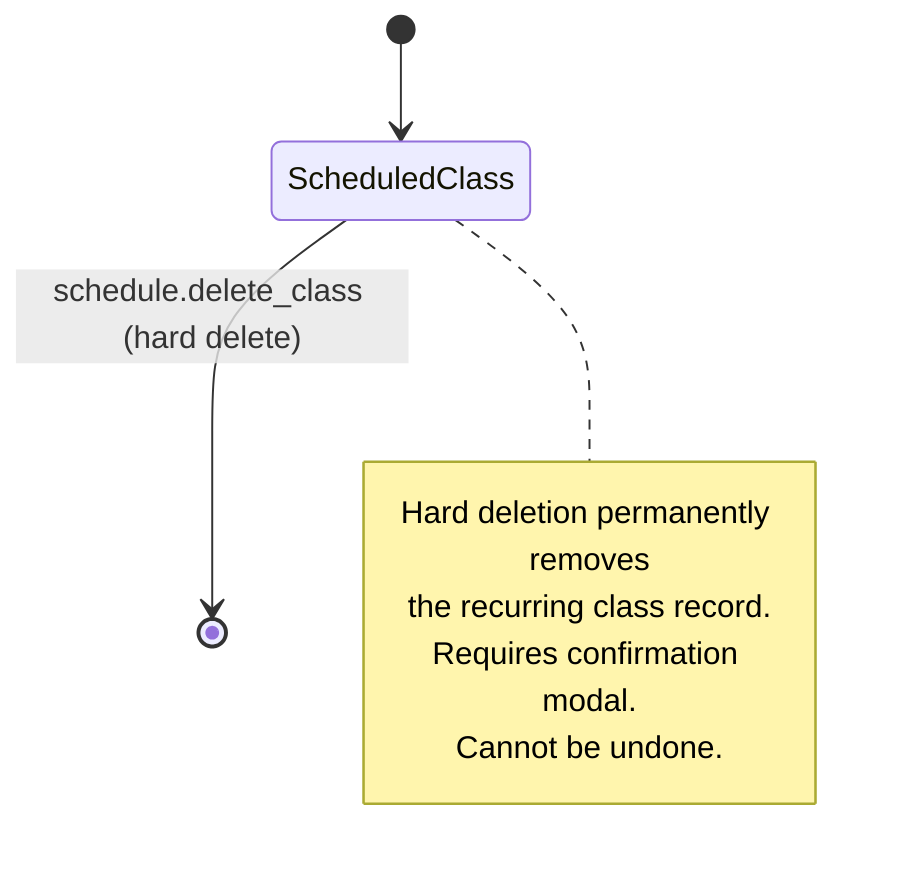
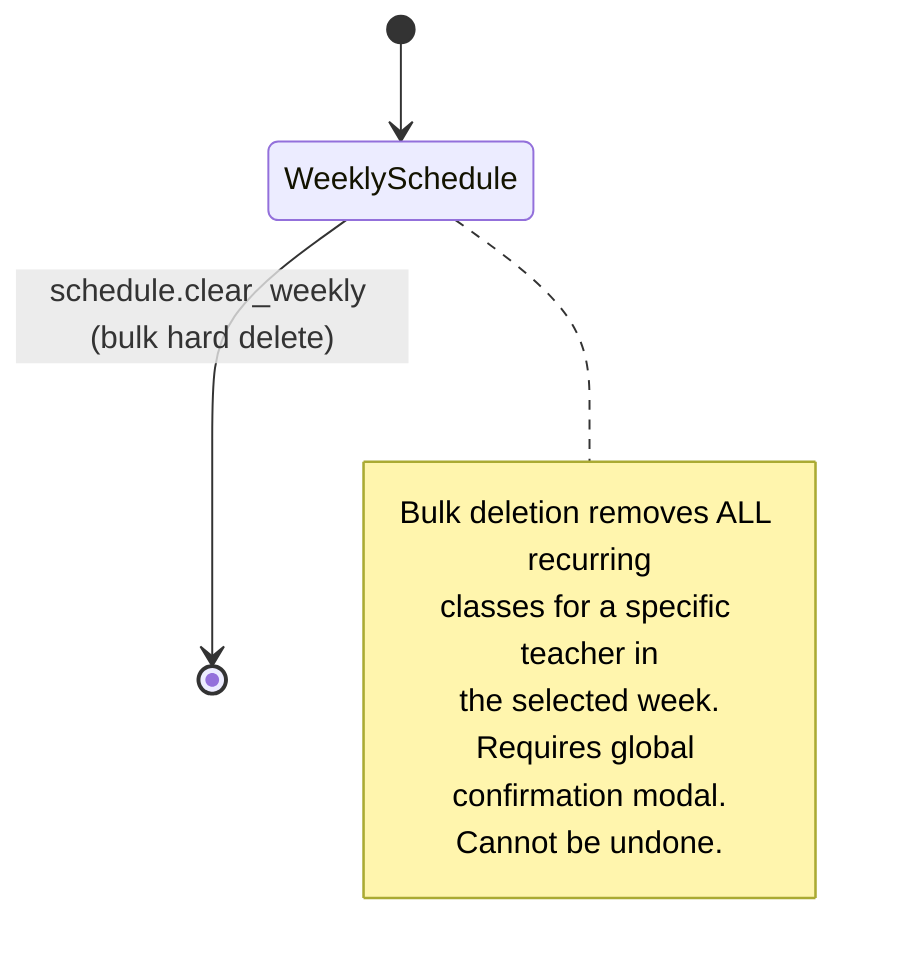
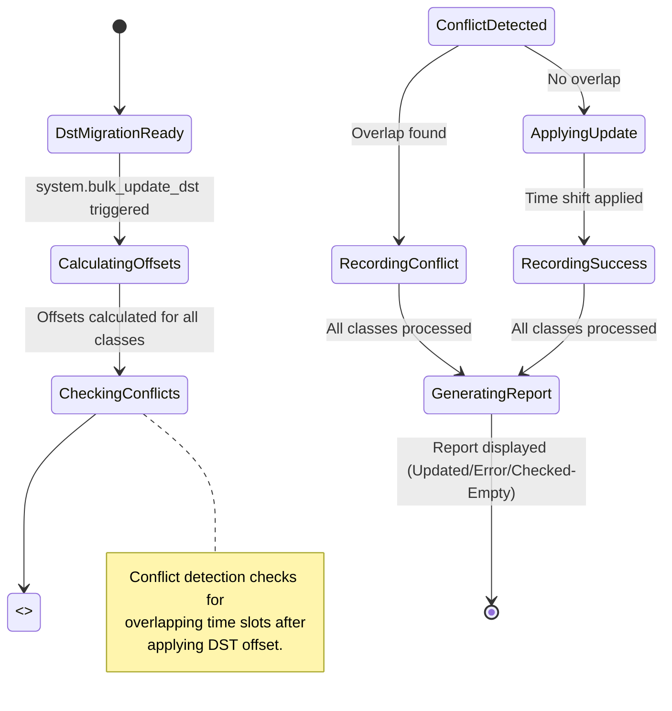

# Story 7: Permissions & Permission Groups (Part 8: 00:00 - 02:02) - Implementation Plan

## Section 0: Story Metadata & Context

- **Source story:** `.ai/siraj_stories/7.md` (Part 8 - Permissions & Permission Groups, timestamps 00:00 - 02:02)
- **Planning guidelines:** `.ai/siraj_stories/AGENTS.md`
- **Story scope:** Implement 4 new permission groups with granular permissions for schedule deletion, staff profile management, global system operations (DST bulk update), and parent directory viewing.
- **Target roles:** System Administrator (bulk DST update), Academy Admin (schedule deletion, staff edit, parent directory), Teacher/Parent (excluded from these permissions).
- **Status:** Planning phase - awaiting approval for execution.

### Business Objectives

This story introduces 4 distinct permission groups controlling destructive and sensitive operations:

1. **Schedule Deletion & Erasure (`schedule.deletion`)**: Hard delete individual classes or clear entire weekly schedules with mandatory confirmation modals.
2. **Staff Profile Management (`staff`)**: Edit teacher profiles including PII (National ID, Phone, Demographics), Salary Details, and Official Details (Zoom credentials, Timezone).
3. **Global System Operations (`system`)**: Execute global Daylight Saving Time (DST) adjustment algorithm across the entire database with conflict reporting.
4. **Parent Management (`parent`)**: View the global Parents Directory with aggregated status metrics and unpaid invoice visibility.

### Permission-to-Role Mapping

| Permission Group | Role | Permissions |
|---|---|---|
| System Administrator | `super_admin` | `system.bulk_update_dst` |
| Academy Admin | `academy_admin` | `schedule.delete_class`, `schedule.clear_weekly`, `staff.edit_profile`, `parent.view_directory` |
| Teacher / Parent | `teacher_default`, `parent_default` | None (excluded) |

---

## Section 1: Core Principles & Strict Rules (Mandatory Checklist)

### 1.1 Service Layer Architecture
- [ ] **NO monolithic services** - Scoped strictly to domain-driven services:
  - `ScheduleDeletionService` for `schedule.delete_class` and `schedule.clear_weekly`
  - `StaffProfileService` for `staff.edit_profile`
  - `DstMigrationService` for `system.bulk_update_dst`
  - `ParentDirectoryService` for `parent.view_directory`
- [ ] **Business logic centralization** - All orchestration, validation, and permission checks reside in services, NOT repositories or resolvers.
- [ ] **Repository delegation** - Services call repositories for data access; resolvers call services for business logic.

### 1.2 Type Safety - NO `any`, NO Casts
- [ ] **Strict Type Narrowing** - BANNED: `any`, `as any`, and `as unknown as`. Use actual types from GraphQL generated types.
- [ ] **No route param casts** - Use `typeof params?.id === "string" ? params.id : ""` pattern.
- [ ] **GraphQL types** - Import from `frontend/graphql/generated/gql/graphql-types.ts`.

### 1.3 Zero Incomplete Implementation Policy

| **Prohibited Pattern** | **Required Instead** | **Verification Command** |
|---|---|---|
| `// TODO`, `// FIXME`, `@todo` | Fully working implementation in same task | `rg -i "TODO\|FIXME" backend frontend` |
| `throw new Error("Not implemented")` | Complete service/repo method implementation | Manual code review |
| Handler calling only `logger.info` | Real GraphQL mutation + UI feedback | Grep for `logger.info.*handle` patterns |
| Mock data in production views | Real Apollo `useQuery` hooks | Grep for `mock` imports in non-story files |
| Browser `confirm()` / `alert()` | MUI `<Dialog>` components | Grep for `window.confirm\|window.alert` |

### 1.4 Localization Requirements
- [ ] **No hardcoded strings** - All user-facing text uses `useTranslations` from `next-intl`.
- [ ] **Backend errors** - Use `getBackendTranslations({ locale, namespace: "errors" })`.
- [ ] **Message files** - Add translations to `shared/messages/en.ts` and `shared/messages/ar/dashboard/`.

### 1.5 Security & RBAC Enforcement
- [ ] **Permission checks in services** - Every destructive action verifies permissions via `PermissionsService.hasPermission()`.
- [ ] **UI gates** - Frontend uses `<RequirePermission permissions={[AppPermission.XXX]}>` wrappers.
- [ ] **IDOR prevention** - Repository methods verify actor relationship to resource (or admin override).
- [ ] **Confirmation modals** - All destructive actions require MUI Dialog confirmation with localized text.

---

## Section 2: RBAC Permissions (Canonical)

### 2.1 New Permission Enum Entries

Add to `shared/lib/enum.ts` → `AppPermission`:

```typescript
// Schedule Deletion
SCHEDULE_DELETE_CLASS = "schedule.delete_class",
SCHEDULE_CLEAR_WEEKLY = "schedule.clear_weekly",

// Staff Profile Management
STAFF_EDIT_PROFILE = "staff.edit_profile",

// Global System Operations
SYSTEM_BULK_UPDATE_DST = "system.bulk_update_dst",

// Parent Management
PARENT_VIEW_DIRECTORY = "parent.view_directory",
```

### 2.2 Permission Catalog Migration

Add to `backend/db/migration/3-system_permissions_and_groups.sql`:

```sql
-- Schedule Deletion permissions
(
    gen_random_uuid(),
    'schedule.delete_class',
    'schedule',
    'delete_class',
    'Delete a specific recurring class block from a teacher schedule',
    'Scheduling',
    true
),
(
    gen_random_uuid(),
    'schedule.clear_weekly',
    'schedule',
    'clear_weekly',
    'Bulk erase a teacher entire weekly schedule in a single action',
    'Scheduling',
    true
),

-- Staff Profile Management
(
    gen_random_uuid(),
    'staff.edit_profile',
    'staff',
    'edit_profile',
    'Edit teacher profile including PII, salary, and official details',
    'Administration',
    true
),

-- Global System Operations
(
    gen_random_uuid(),
    'system.bulk_update_dst',
    'system',
    'bulk_update_dst',
    'Execute global DST adjustment algorithm across entire database',
    'System',
    true
),

-- Parent Management
(
    gen_random_uuid(),
    'parent.view_directory',
    'parent',
    'view_directory',
    'Access global Parents Directory with status metrics and unpaid invoices',
    'Parents',
    true
)
```

### 2.3 Permission Group Assignments

Update `3-system_permissions_and_groups.sql` group assignments:

**Super Admin** — gets ALL new permissions:
```sql
'schedule.delete_class',
'schedule.clear_weekly',
'staff.edit_profile',
'system.bulk_update_dst',
'parent.view_directory'
```

**Academy Admin** — gets schedule deletion, staff edit, parent view:
```sql
'schedule.delete_class',
'schedule.clear_weekly',
'staff.edit_profile',
'parent.view_directory'
```

**Teacher Default** — gets NONE of these permissions.

**Parent Default** — gets NONE of these permissions.

**Staff Default** — gets NONE of these permissions.

### 2.4 Permission Traceability Matrix

| **Permission Key** | **Group** | **UI Gate** | **Backend Service Method** | **GraphQL Mutation/Query** |
|---|---|---|---|---|
| `schedule.delete_class` | Academy Admin | Delete button on weekly grid class slot | `ScheduleDeletionService.deleteClass()` | `deleteRecurringClass` (mutation) |
| `schedule.clear_weekly` | Academy Admin | "Clear Schedule" button on weekly view header | `ScheduleDeletionService.clearWeeklySchedule()` | `clearWeeklySchedule` (mutation) |
| `staff.edit_profile` | Academy Admin | "Edit Profile" button on teacher directory row | `StaffProfileService.updateTeacherProfile()` | `updateTeacherProfile` (mutation) |
| `system.bulk_update_dst` | System Admin | "Update Schedules" button on DST migration page | `DstMigrationService.executeBulkDstUpdate()` | `executeDstBulkUpdate` (mutation) |
| `parent.view_directory` | Academy Admin | `/parents` route access, metrics cards, data table | `ParentDirectoryService.getParentDirectory()` | `parentDirectory` (query) |

---

## Section 3: State Machine & Threat Alignment

### 3.1 Schedule Deletion State Machine



**Deletion Guards:**
- Permission check: `SCHEDULE_DELETE_CLASS` required.
- Confirmation: MUI Dialog with localized message "Are you sure that you want to delete this class?"
- Cascade: Deleting a recurring class removes associated `recurring_schedule_days` entries.
- Soft delete: Uses `deleted_at` column (RLS filters out soft-deleted records).

### 3.2 Weekly Schedule Clear State Machine



**Clear Guards:**
- Permission check: `SCHEDULE_CLEAR_WEEKLY` required.
- Confirmation: MUI Dialog with localized message "Are you sure that you want to delete the schedule?"
- Scope: Targets all `recurring_schedules` for a specific `teacherId`.
- Transaction: Wrapped in `db.transaction()` for atomicity.

### 3.3 DST Bulk Update Processing Flow



**DST Update Guards:**
- Permission check: `SYSTEM_BULK_UPDATE_DST` required (System Admin only).
- Idempotency: Uses `dst_migration_runs` and `dst_migration_entries` tables to track results.
- Conflict detection: After applying offset, checks if any teacher has overlapping classes.
- Reporting: Generates categorized report:
  - `UPDATED`: Successful time shifts.
  - `CONFLICT`: Overlapping classes requiring manual admin intervention.
  - `UNCHANGED`: No changes needed (no DST impact).

### 3.4 Staff Profile Edit Threat Model

**Threat 1: Unauthorized PII Access**
- **Risk**: Non-admin users viewing/editing National ID, Bank Info, Salary.
- **Mitigation**: `STAFF_EDIT_PROFILE` permission gate on both UI and service layer.
- **Service check**: `PermissionsService.hasPermission(actorUserId, AppPermission.STAFF_EDIT_PROFILE)`.

**Threat 2: IDOR on Teacher Profile**
- **Risk**: Admin editing a teacher profile they shouldn't have access to.
- **Mitigation**: Service validates actor has admin role; no teacher-specific scoping needed for admins.

### 3.5 Parent Directory View Threat Model

**Threat: Unauthorized Financial Data Exposure**
- **Risk**: Non-admin users seeing unpaid invoice counts and parent financial status.
- **Mitigation**: `PARENT_VIEW_DIRECTORY` permission gate on query resolver and UI.
- **Data scoping**: Query returns aggregated metrics and parent rows with `unpaidInvoices` count only for authorized users.

---

## Section 4: Security Threat Remediation

### Threat 1: IDOR on Schedule Deletion (Cross-Teacher Access)

**Current Gap:** The existing `deleteClassInstance` mutation in `class-session.mutation.ts` exists but lacks explicit permission checking for `schedule.delete_class`. The `WeeklyScheduleGrid` component has a delete button but no permission wrapper.

**Fix implementation in new `ScheduleDeletionService`:**

```typescript
// backend/services/schedule/schedule-deletion.service.ts
import { PermissionsService } from "@/backend/services/auth/permissions.service";
import { AppPermission } from "@/shared/lib/enum";
import { getBackendTranslations } from "@/backend/lib/intl";

export namespace ScheduleDeletionService {
  export async function deleteClass(
    actorUserId: string,
    classInstanceId: string,
    locale?: string
  ): Promise<boolean> {
    const hasPermission = await PermissionsService.hasPermission(
      actorUserId,
      AppPermission.SCHEDULE_DELETE_CLASS
    );
    if (!hasPermission) {
      const tFunc = await getBackendTranslations({ locale, namespace: "errors" });
      throw new Error(tFunc("insufficientPermissions"));
    }

    // Delegate to repository for actual deletion
    return SchedulingRepository.deleteRecurringClass(classInstanceId);
  }

  export async function clearWeeklySchedule(
    actorUserId: string,
    teacherId: string,
    locale?: string
  ): Promise<boolean> {
    const hasPermission = await PermissionsService.hasPermission(
      actorUserId,
      AppPermission.SCHEDULE_CLEAR_WEEKLY
    );
    if (!hasPermission) {
      const tFunc = await getBackendTranslations({ locale, namespace: "errors" });
      throw new Error(tFunc("insufficientPermissions"));
    }

    return SchedulingRepository.clearWeeklySchedule(teacherId);
  }
}
```

### Threat 2: Unauthorized Staff Profile Editing

**Current Gap:** `TeacherProfileView` exists but is not gated by `staff.edit_profile` permission. The profile form exposes sensitive PII (National ID, Salary, Bank Info).

**Fix: Wrap the edit route and API mutations with permission checks.**

```typescript
// backend/services/staff/staff-profile.service.ts
export namespace StaffProfileService {
  export async function updateTeacherProfile(
    actorUserId: string,
    teacherId: string,
    input: TeacherProfileUpdateInput,
    locale?: string
  ): Promise<TeacherProfileResult> {
    const hasPermission = await PermissionsService.hasPermission(
      actorUserId,
      AppPermission.STAFF_EDIT_PROFILE
    );
    if (!hasPermission) {
      const tFunc = await getBackendTranslations({ locale, namespace: "errors" });
      throw new Error(tFunc("insufficientPermissions"));
    }

    // Validate input, update teacher record via repository
    return TeacherRepository.updateTeacherProfile(teacherId, input);
  }
}
```

### Threat 3: DST Bulk Update Without Authorization

**Current Gap:** DST migration UI exists (`DstMigrationView`) but the `UpdateSchedulesButton` doesn't enforce `system.bulk_update_dst` permission. The mutation may not exist or lack permission checks.

**Fix: Add permission gate to the DST bulk update mutation.**

```typescript
// backend/services/system/dst-migration.service.ts
export namespace DstMigrationService {
  export async function executeBulkDstUpdate(
    actorUserId: string,
    offsetMinutes: number,
    locale?: string
  ): Promise<DstMigrationResult> {
    const hasPermission = await PermissionsService.hasPermission(
      actorUserId,
      AppPermission.SYSTEM_BULK_UPDATE_DST
    );
    if (!hasPermission) {
      const tFunc = await getBackendTranslations({ locale, namespace: "errors" });
      throw new Error(tFunc("insufficientPermissions"));
    }

    // Execute DST algorithm, detect conflicts, return report
    // ...
  }
}
```

### Threat 4: Parent Directory Unauthorized Access

**Current Gap:** `ParentsView` exists with mock data. Need to gate with `parent.view_directory` permission and connect to real GraphQL query.

**Fix: Permission wrapper on container and real query.**

```typescript
// frontend/views/dashboard/parents/home/ParentsContainer.tsx
export default function ParentsContainer() {
  return (
    <RequirePermission permissions={[AppPermission.ParentViewDirectory]}>
      <ParentsView ... />
    </RequirePermission>
  );
}
```

---

## Section 5: Prerequisites Verification (BLOCKING)

Before starting story work, verify:

- [ ] Run `bun run test:db` to confirm existing database tests pass.
- [ ] Verify `AppPermission` enum exists in `shared/lib/enum.ts` with existing permissions.
- [ ] Verify `backend/db/migration/3-system_permissions_and_groups.sql` exists and has the current permission catalog.
- [ ] Verify `WeeklyScheduleGrid` component exists at `frontend/views/dashboard/teachers/schedule/weekly/WeeklyScheduleGrid.tsx`.
- [ ] Verify `TeacherProfileView` exists at `frontend/views/dashboard/teachers/profile/TeacherProfileView.tsx`.
- [ ] Verify `DstMigrationView` exists at `frontend/views/dashboard/tools/dst-migration/DstMigrationView.tsx`.
- [ ] Verify `ParentsView` exists at `frontend/views/dashboard/parents/home/ParentsView.tsx`.
- [ ] Verify `SchedulingRepository` exists at `backend/db/repo/scheduling.repository.ts`.
- [ ] Verify `PermissionsService` exists at `backend/services/auth/permissions.service.ts`.
- [ ] Verify `deleteClassInstance` mutation exists in `backend/graphql/mutation/class-session.mutation.ts`.
- [ ] Verify `recurringSchedules` and `recurringScheduleDays` tables exist in `backend/db/schema/scheduling.ts`.
- [ ] Verify `teachers` table schema in `backend/db/schema/teachers.ts` has columns: `nationalId`, `phone`, `dateOfBirth`, `gender`, `address`, `qualifications`, `skypeId`, `zoomLink`, `zoomUsername`, `zoomPassword`, `timezone`, `hourlyRate`, `rateCurrency`.
- [ ] Verify `parents` table schema in `backend/db/schema/parents.ts` has `status` column with `ParentStatus` enum.
- [ ] Verify `dstMigrationRuns` and `dstMigrationEntries` tables exist in `backend/db/schema/scheduling.ts`.
- [ ] Verify `DstMigrationResult` enum exists in `shared/lib/enum.ts` with values: `UPDATED`, `CONFLICT`, `UNCHANGED`.
- [ ] Verify `mockParentsStore.ts` exists with `ParentDirectoryRow` type including `unpaidInvoices` field.
- [ ] Verify `mockDstMigrationStore.ts` exists with `DstMigrationMetrics`, `UpdatedSession`, `ConflictGroup`, `CheckedEmptyItem` types.

---

## Section 6: Granular Task Breakdown

### Task A — Database & Repository: Schedule Deletion Methods

**Objective:** Implement repository methods for deleting individual recurring classes and clearing entire weekly schedules with proper transaction handling and soft delete support.

**Layer-Specific Rules (Database Repositories - Flattened from `backend/db/repo/AGENTS.md`):**
- Use Drizzle standard syntax `db.select().from(table).leftJoin(...)` for complex queries.
- Wrap all repository changes modifying multiple tables in an atomic `db.transaction()`.
- No hardcoded error strings - use `getBackendTranslations({ locale, namespace: "errors" })`.
- Repositories are for data access only; business logic and permission checks reside in services.

**Target Files:**
- `backend/db/repo/scheduling.repository.ts` (add methods)
- `backend/db/test/repo/scheduling.repository.test.ts` (add tests)

**Detailed Implementation Steps:**

*Step 1: Add `deleteRecurringClass` method to `SchedulingRepository`*

This method handles hard deletion of a single recurring class (which is actually a `classInstance` in the weekly grid context). The existing `deleteClassInstance` already exists at line 890 of `scheduling.repository.ts`, so we need to add a new method specifically for recurring schedule deletion.

```typescript
// backend/db/repo/scheduling.repository.ts (append to SchedulingRepository namespace)

/**
 * Deletes a specific recurring class instance.
 * Uses soft delete by setting deleted_at timestamp.
 */
export async function deleteRecurringClass(
  classInstanceId: string
): Promise<boolean> {
  return db.transaction(async (tx) => {
    const now = new Date();
    
    // Soft delete the class instance
    const [deleted] = await tx
      .update(classInstances)
      .set({
        deletedAt: now,
        updatedAt: now,
      })
      .where(eq(classInstances.id, classInstanceId))
      .returning({ id: classInstances.id });

    if (!deleted) {
      return false;
    }

    return true;
  });
}
```

*Step 2: Add `clearWeeklySchedule` method to `SchedulingRepository`*

This method bulk deletes all class instances for a specific teacher. Since the weekly grid shows `recurringScheduleDays` mapped to time slots, we need to delete the recurring schedules for the teacher.

```typescript
// backend/db/repo/scheduling.repository.ts

/**
 * Clears all recurring schedules for a specific teacher.
 * This is a destructive operation that removes all scheduled classes.
 */
export async function clearWeeklySchedule(
  teacherId: string
): Promise<boolean> {
  return db.transaction(async (tx) => {
    const now = new Date();

    // Find all recurring schedules for this teacher
    const schedules = await tx
      .select({ id: recurringSchedules.id })
      .from(recurringSchedules)
      .where(
        and(
          eq(recurringSchedules.teacherId, teacherId),
          isNull(recurringSchedules.deletedAt)
        )
      );

    if (schedules.length === 0) {
      return false;
    }

    const scheduleIds = schedules.map(s => s.id);

    // Soft delete associated recurring schedule days
    await tx
      .update(recurringScheduleDays)
      .set({ isActive: false })
      .where(inArray(recurringScheduleDays.recurringScheduleId, scheduleIds));

    // Soft delete the recurring schedules
    await tx
      .update(recurringSchedules)
      .set({
        deletedAt: now,
        updatedAt: now,
      })
      .where(inArray(recurringSchedules.id, scheduleIds));

    return true;
  });
}
```

*Step 3: Add unit tests in `scheduling.repository.test.ts`*

```typescript
// backend/db/test/repo/scheduling.repository.test.ts

describe("deleteRecurringClass", () => {
  it("should soft delete a class instance", async () => {
    // Setup: Create a class instance
    const instance = await createTestClassInstance();
    
    // Execute
    const result = await SchedulingRepository.deleteRecurringClass(instance.id);
    
    // Verify
    expect(result).toBe(true);
    const deleted = await db.select().from(classInstances).where(eq(classInstances.id, instance.id));
    expect(deleted[0].deletedAt).not.toBeNull();
  });

  it("should return false for non-existent class instance", async () => {
    const result = await SchedulingRepository.deleteRecurringClass(randomUUID());
    expect(result).toBe(false);
  });
});

describe("clearWeeklySchedule", () => {
  it("should soft delete all recurring schedules for a teacher", async () => {
    // Setup: Create multiple recurring schedules for a teacher
    const teacher = await createTestTeacher();
    await createTestRecurringSchedule(teacher.id);
    await createTestRecurringSchedule(teacher.id);
    
    // Execute
    const result = await SchedulingRepository.clearWeeklySchedule(teacher.id);
    
    // Verify
    expect(result).toBe(true);
    const remaining = await db.select().from(recurringSchedules).where(
      and(
        eq(recurringSchedules.teacherId, teacher.id),
        isNull(recurringSchedules.deletedAt)
      )
    );
    expect(remaining.length).toBe(0);
  });

  it("should return false for teacher with no schedules", async () => {
    const teacher = await createTestTeacher();
    const result = await SchedulingRepository.clearWeeklySchedule(teacher.id);
    expect(result).toBe(false);
  });
});
```

**Test Execution Requirements:**
```bash
bun run test:db
```

**Success Criteria / Check Progress Points:**
- [x] `deleteRecurringClass` method is implemented with soft delete support.
- [x] `clearWeeklySchedule` method is implemented with transaction wrapping.
- [x] Both methods handle non-existent records gracefully (return `false`).
- [x] Unit tests pass for success and failure cases.
- [x] `bun run test:db` passes with 0 failures.
- [x] No TypeScript compilation errors in repository file.

---

### Task B — Services: Schedule Deletion, Staff Profile, DST Migration, Parent Directory

**Objective:** Implement domain-driven service methods for all 4 permission groups with proper permission checking, error handling, and localization.

**Layer-Specific Rules (Backend Services - Flattened from `backend/services/AGENTS.md`):**
- services are not allowed to import anything from db/drizzle, they can only depend on repo layer, so some of the following examples are not exactly valid at all, as they import depend on db which is prohibited, you must implement the service without relying on db layer at all, only repo layer
- Services must be scoped to their domain. NO monoliths.
- All permission checks happen in services, NOT repositories or resolvers.
- Use `getBackendTranslations` for localized error messages.
- Propagate `locale` parameter through the call stack.

**Target Files:**
- `backend/services/schedule/schedule-deletion.service.ts` (new)
- `backend/services/staff/staff-profile.service.ts` (new)
- `backend/services/system/dst-migration.service.ts` (new)
- `backend/services/parent/parent-directory.service.ts` (new)

**Detailed Implementation Steps:**

*Step 1: Create `ScheduleDeletionService`*

```typescript
// backend/services/schedule/schedule-deletion.service.ts
import { SchedulingRepository } from "@/backend/db/repo";
import { getBackendTranslations } from "@/backend/lib/intl";
import { PermissionsService } from "@/backend/services/auth/permissions.service";
import { AppPermission } from "@/shared/lib/enum";

export namespace ScheduleDeletionService {
  /**
   * Deletes a specific class instance from the weekly schedule.
   * Requires: schedule.delete_class permission.
   */
  export async function deleteClass(
    actorUserId: string,
    classInstanceId: string,
    locale?: string
  ): Promise<boolean> {
    const hasPermission = await PermissionsService.hasPermission(
      actorUserId,
      AppPermission.SCHEDULE_DELETE_CLASS
    );
    if (!hasPermission) {
      const tFunc = await getBackendTranslations({ locale, namespace: "errors" });
      throw new Error(tFunc("insufficientPermissions"));
    }

    return SchedulingRepository.deleteRecurringClass(classInstanceId);
  }

  /**
   * Clears all recurring schedules for a specific teacher.
   * Requires: schedule.clear_weekly permission.
   */
  export async function clearWeeklySchedule(
    actorUserId: string,
    teacherId: string,
    locale?: string
  ): Promise<boolean> {
    const hasPermission = await PermissionsService.hasPermission(
      actorUserId,
      AppPermission.SCHEDULE_CLEAR_WEEKLY
    );
    if (!hasPermission) {
      const tFunc = await getBackendTranslations({ locale, namespace: "errors" });
      throw new Error(tFunc("insufficientPermissions"));
    }

    return SchedulingRepository.clearWeeklySchedule(teacherId);
  }
}
```

*Step 2: Create `StaffProfileService`*

```typescript
// backend/services/staff/staff-profile.service.ts
import { and, eq, isNull } from "drizzle-orm";
import { db } from "@/backend/db/drizzleDb";
import { teachers, users } from "@/backend/db/schema";
import { getBackendTranslations } from "@/backend/lib/intl";
import { PermissionsService } from "@/backend/services/auth/permissions.service";
import { AppPermission } from "@/shared/lib/enum";

export interface TeacherProfileUpdateInput {
  readonly nationalId?: string | null;
  readonly phone?: string | null;
  readonly dateOfBirth?: string | null;
  readonly gender?: string | null;
  readonly address?: string | null;
  readonly qualifications?: string | null;
  readonly skypeId?: string | null;
  readonly zoomLink?: string | null;
  readonly zoomUsername?: string | null;
  readonly zoomPassword?: string | null;
  readonly timezone?: string | null;
  readonly hourlyRate?: string | null;
  readonly rateCurrency?: string | null;
}

export interface TeacherProfileResult {
  readonly id: string;
  readonly name: string;
  readonly email: string;
  readonly phone: string | null;
  readonly nationalId: string | null;
  readonly dateOfBirth: string | null;
  readonly gender: string | null;
  readonly address: string | null;
  readonly qualifications: string | null;
  readonly skypeId: string | null;
  readonly zoomLink: string | null;
  readonly zoomUsername: string | null;
  readonly timezone: string;
  readonly hourlyRate: string | null;
  readonly rateCurrency: string | null;
  readonly status: string;
}

export namespace StaffProfileService {
  /**
   * Updates a teacher's profile with PII, salary, and official details.
   * Requires: staff.edit_profile permission.
   */
  export async function updateTeacherProfile(
    actorUserId: string,
    teacherId: string,
    input: TeacherProfileUpdateInput,
    locale?: string
  ): Promise<TeacherProfileResult> {
    const hasPermission = await PermissionsService.hasPermission(
      actorUserId,
      AppPermission.STAFF_EDIT_PROFILE
    );
    if (!hasPermission) {
      const tFunc = await getBackendTranslations({ locale, namespace: "errors" });
      throw new Error(tFunc("insufficientPermissions"));
    }

    const now = new Date();

    const [updated] = await db
      .update(teachers)
      .set({
        ...input,
        updatedAt: now,
      })
      .where(eq(teachers.id, teacherId))
      .returning();

    if (!updated) {
      const tFunc = await getBackendTranslations({ locale, namespace: "errors" });
      throw new Error(tFunc("teacherNotFound", { id: teacherId }));
    }

    // Fetch user data for name/email
    const [userData] = await db
      .select({
        name: users.name,
        email: users.email,
      })
      .from(users)
      .where(eq(users.id, updated.userId));

    return {
      id: updated.id,
      name: userData?.name ?? "",
      email: userData?.email ?? "",
      phone: updated.phone,
      nationalId: updated.nationalId,
      dateOfBirth: updated.dateOfBirth?.toISOString() ?? null,
      gender: updated.gender,
      address: updated.address,
      qualifications: updated.qualifications,
      skypeId: updated.skypeId,
      zoomLink: updated.zoomLink,
      zoomUsername: updated.zoomUsername,
      timezone: updated.timezone,
      hourlyRate: updated.hourlyRate,
      rateCurrency: updated.rateCurrency,
      status: updated.status,
    };
  }

  /**
   * Retrieves a teacher's full profile for editing.
   * Requires: staff.edit_profile permission.
   */
  export async function getTeacherProfileForEdit(
    actorUserId: string,
    teacherId: string,
    locale?: string
  ): Promise<TeacherProfileResult> {
    const hasPermission = await PermissionsService.hasPermission(
      actorUserId,
      AppPermission.STAFF_EDIT_PROFILE
    );
    if (!hasPermission) {
      const tFunc = await getBackendTranslations({ locale, namespace: "errors" });
      throw new Error(tFunc("insufficientPermissions"));
    }

    const [teacher] = await db
      .select()
      .from(teachers)
      .where(eq(teachers.id, teacherId))
      .limit(1);

    if (!teacher) {
      const tFunc = await getBackendTranslations({ locale, namespace: "errors" });
      throw new Error(tFunc("teacherNotFound", { id: teacherId }));
    }

    const [userData] = await db
      .select({
        name: users.name,
        email: users.email,
      })
      .from(users)
      .where(eq(users.id, teacher.userId));

    return {
      id: teacher.id,
      name: userData?.name ?? "",
      email: userData?.email ?? "",
      phone: teacher.phone,
      nationalId: teacher.nationalId,
      dateOfBirth: teacher.dateOfBirth?.toISOString() ?? null,
      gender: teacher.gender,
      address: teacher.address,
      qualifications: teacher.qualifications,
      skypeId: teacher.skypeId,
      zoomLink: teacher.zoomLink,
      zoomUsername: teacher.zoomUsername,
      timezone: teacher.timezone,
      hourlyRate: teacher.hourlyRate,
      rateCurrency: teacher.rateCurrency,
      status: teacher.status,
    };
  }
}
```

*Step 3: Create `DstMigrationService`*

```typescript
// backend/services/system/dst-migration.service.ts
import { and, eq, isNull, sql } from "drizzle-orm";
import { db } from "@/backend/db/drizzleDb";
import {
  classInstances,
  dstMigrationEntries,
  dstMigrationRuns,
  recurringSchedules,
  teachers,
} from "@/backend/db/schema";
import { getBackendTranslations } from "@/backend/lib/intl";
import { PermissionsService } from "@/backend/services/auth/permissions.service";
import { AppPermission, DstMigrationResult } from "@/shared/lib/enum";

export interface DstMigrationReport {
  readonly runId: string;
  readonly updated: number;
  readonly conflicts: number;
  readonly unchanged: number;
  readonly total: number;
}

export namespace DstMigrationService {
  /**
   * Executes a global DST adjustment across all recurring schedules.
   * Requires: system.bulk_update_dst permission (System Admin only).
   * 
   * Algorithm:
   * 1. For each recurring schedule, calculate new start time based on DST offset.
   * 2. Check for conflicts (overlapping classes for the same teacher).
   * 3. If no conflict, apply the time shift.
   * 4. If conflict, record as CONFLICT for manual admin resolution.
   * 5. Record all results in dst_migration_entries.
   */
  export async function executeBulkDstUpdate(
    actorUserId: string,
    offsetMinutes: number,
    description: string,
    locale?: string
  ): Promise<DstMigrationReport> {
    const hasPermission = await PermissionsService.hasPermission(
      actorUserId,
      AppPermission.SYSTEM_BULK_UPDATE_DST
    );
    if (!hasPermission) {
      const tFunc = await getBackendTranslations({ locale, namespace: "errors" });
      throw new Error(tFunc("insufficientPermissions"));
    }

    return db.transaction(async (tx) => {
      const now = new Date();

      // Create migration run record
      const [run] = await tx
        .insert(dstMigrationRuns)
        .values({
          runByUserId: actorUserId,
          offsetMinutes,
          description,
          createdAt: now,
        })
        .returning();

      // Fetch all active recurring schedules with teacher timezone info
      const schedules = await tx
        .select({
          id: recurringSchedules.id,
          teacherId: recurringSchedules.teacherId,
          defaultStartTime: recurringSchedules.defaultStartTime,
          timezone: recurringSchedules.timezone,
          utcOffsetSnapshot: recurringSchedules.utcOffsetSnapshot,
        })
        .from(recurringSchedules)
        .where(isNull(recurringSchedules.deletedAt));

      let updatedCount = 0;
      let conflictCount = 0;
      let unchangedCount = 0;

      for (const schedule of schedules) {
        // If no UTC offset snapshot, mark as unchanged
        if (!schedule.utcOffsetSnapshot) {
          unchangedCount++;
          await tx.insert(dstMigrationEntries).values({
            runId: run.id,
            classInstanceId: schedule.id,
            result: DstMigrationResult.UNCHANGED,
            conflictDetail: null,
          });
          continue;
        }

        // Calculate new start time
        const currentOffset = schedule.utcOffsetSnapshot;
        const newOffset = currentOffset + offsetMinutes;
        
        // Parse the time and apply offset
        const [hours, minutes] = schedule.defaultStartTime.split(":").map(Number);
        const totalMinutes = hours * 60 + minutes + offsetMinutes;
        const newHours = Math.floor(totalMinutes / 60) % 24;
        const newMinutes = totalMinutes % 60;
        const newStartTime = `${String(newHours).padStart(2, "0")}:${String(newMinutes).padStart(2, "0")}:00`;

        // Check for conflicts: does this teacher have another class at the new time?
        const conflictingSchedules = await tx
          .select({ id: recurringSchedules.id })
          .from(recurringSchedules)
          .where(
            and(
              eq(recurringSchedules.teacherId, schedule.teacherId),
              eq(recurringSchedules.defaultStartTime, newStartTime),
              isNull(recurringSchedules.deletedAt)
            )
          );

        if (conflictingSchedules.length > 0 && conflictingSchedules[0].id !== schedule.id) {
          // Conflict detected
          conflictCount++;
          await tx.insert(dstMigrationEntries).values({
            runId: run.id,
            classInstanceId: schedule.id,
            result: DstMigrationResult.CONFLICT,
            conflictDetail: `Conflict with schedule ${conflictingSchedules[0].id} at ${newStartTime}`,
          });
        } else {
          // No conflict, apply update
          await tx
            .update(recurringSchedules)
            .set({
              defaultStartTime: newStartTime,
              utcOffsetSnapshot: newOffset,
              updatedAt: now,
            })
            .where(eq(recurringSchedules.id, schedule.id));

          updatedCount++;
          await tx.insert(dstMigrationEntries).values({
            runId: run.id,
            classInstanceId: schedule.id,
            result: DstMigrationResult.UPDATED,
            conflictDetail: null,
          });
        }
      }

      return {
        runId: run.id,
        updated: updatedCount,
        conflicts: conflictCount,
        unchanged: unchangedCount,
        total: schedules.length,
      };
    });
  }
}
```

*Step 4: Create `ParentDirectoryService`*

```typescript
// backend/services/parent/parent-directory.service.ts
import { and, count, desc, eq, ilike, isNull, or, sql } from "drizzle-orm";
import { db } from "@/backend/db/drizzleDb";
import { billing, parents, students, users } from "@/backend/db/schema";
import { getBackendTranslations } from "@/backend/lib/intl";
import { PermissionsService } from "@/backend/services/auth/permissions.service";
import { AppPermission, ParentStatus } from "@/shared/lib/enum";

export interface ParentDirectoryMetrics {
  readonly id: string;
  readonly activated: number;
  readonly deactivated: number;
  readonly regular: number;
  readonly onLeave: number;
  readonly suspended: number;
  readonly onTrial: number;
}

export interface ParentDirectoryRow {
  readonly id: string;
  readonly index: number;
  readonly name: string;
  readonly email: string;
  readonly avatarUrl: string | null;
  readonly guardianOf: string;
  readonly time: string;
  readonly accountStatus: string;
  readonly unpaidInvoices: number;
}

export interface ParentDirectoryResult {
  readonly id: string;
  readonly metrics: ParentDirectoryMetrics;
  readonly rows: ParentDirectoryRow[];
  readonly totalParents: number;
}

export namespace ParentDirectoryService {
  /**
   * Retrieves the parent directory with metrics and rows.
   * Requires: parent.view_directory permission.
   */
  export async function getParentDirectory(
    actorUserId: string,
    search: string | null,
    limit: number,
    offset: number,
    locale?: string
  ): Promise<ParentDirectoryResult> {
    const hasPermission = await PermissionsService.hasPermission(
      actorUserId,
      AppPermission.PARENT_VIEW_DIRECTORY
    );
    if (!hasPermission) {
      const tFunc = await getBackendTranslations({ locale, namespace: "errors" });
      throw new Error(tFunc("insufficientPermissions"));
    }

    // Calculate metrics
    const metricsResult = await db
      .select({
        status: parents.status,
        count: count(),
      })
      .from(parents)
      .groupBy(parents.status);

    const metrics: ParentDirectoryMetrics = {
      id: "parent-metrics",
      activated: metricsResult.find(m => m.status === "ACTIVATED")?.count ?? 0,
      deactivated: metricsResult.find(m => m.status === "DEACTIVATED")?.count ?? 0,
      regular: metricsResult.find(m => m.status === ParentStatus.REGULAR)?.count ?? 0,
      onLeave: metricsResult.find(m => m.status === ParentStatus.ON_LEAVE)?.count ?? 0,
      suspended: metricsResult.find(m => m.status === ParentStatus.SUSPENDED)?.count ?? 0,
      onTrial: metricsResult.find(m => m.status === ParentStatus.ON_TRIAL)?.count ?? 0,
    };

    // Build query for parent rows
    const whereConditions = [];
    if (search) {
      whereConditions.push(
        or(
          ilike(users.name, `%${search}%`),
          ilike(users.email, `%${search}%`)
        )
      );
    }

    // Fetch parents with user data and unpaid invoice count
    const parentRows = await db
      .select({
        id: parents.id,
        name: users.name,
        email: users.email,
        avatarUrl: users.avatarUrl,
        status: parents.status,
        updatedAt: parents.updatedAt,
        unpaidInvoices: sql<number>`COALESCE(
          (SELECT COUNT(*) FROM ${billing} 
           WHERE ${billing.parentId} = ${parents.id} 
           AND ${billing.status} = 'UNPAID'), 0)`.mapWith(Number),
      })
      .from(parents)
      .innerJoin(users, eq(parents.userId, users.id))
      .where(whereConditions.length > 0 ? and(...whereConditions) : undefined)
      .orderBy(desc(parents.updatedAt))
      .limit(limit)
      .offset(offset);

    // Get student names for each parent
    const rows: ParentDirectoryRow[] = [];
    for (const parent of parentRows) {
      const studentRows = await db
        .select({ name: users.name })
        .from(students)
        .innerJoin(users, eq(students.userId, users.id))
        .where(eq(students.parentId, parent.id))
        .limit(3);

      const guardianOf = studentRows.map(s => s.name).join(", ") || "No students";

      rows.push({
        id: parent.id,
        index: rows.length + offset + 1,
        name: parent.name,
        email: parent.email,
        avatarUrl: parent.avatarUrl,
        guardianOf,
        time: parent.updatedAt.toLocaleTimeString(),
        accountStatus: parent.status.toLowerCase(),
        unpaidInvoices: parent.unpaidInvoices,
      });
    }

    // Get total count
    const totalResult = await db
      .select({ count: count() })
      .from(parents)
      .where(whereConditions.length > 0 ? and(...whereConditions) : undefined);

    return {
      id: "parent-directory",
      metrics,
      rows,
      totalParents: totalResult[0]?.count ?? 0,
    };
  }
}
```

**Test Execution Requirements:**
```bash
bun run test:db
```

**Success Criteria / Check Progress Points:**
- [x] `ScheduleDeletionService` created with `deleteClass` and `clearWeeklySchedule` methods.
- [x] `StaffProfileService` created with `updateTeacherProfile` and `getTeacherProfileForEdit` methods.
- [x] `DstMigrationService` created with `executeBulkDstUpdate` method including conflict detection.
- [x] `ParentDirectoryService` created with `getParentDirectory` method including metrics and unpaid invoices.
- [x] All service methods check permissions before executing business logic.
- [x] All error messages use `getBackendTranslations` for localization.
- [x] No TypeScript compilation errors.
- [x] `bun tsgo` on working files passes with 0 TypeScript errors  & 0 warnings, after creating/modifying a single file
- [x] `bun biome:check` on working files passes with 0 errors & 0 warnings, after creating/modifying a single file
- [x] `bun lint` on working files passes with 0 errors  & 0 warnings, after creating/modifying a single file
- [x] `bun codescene` on working files passes with 0 errors  & 0 warnings, after creating/modifying a single file
- [x] `loop over tsgo, biome:check, lint, codescene` on working files till no issues at all, after creating/modifying a single file
- [x] `bun tsgo` on working files passes with 0 TypeScript errors  & 0 warnings, after completing all steps
- [x] `bun biome:check` on working files passes with 0 errors & 0 warnings, after completing all steps
- [x] `bun lint` on working files passes with 0 errors  & 0 warnings, after completing all steps
- [x] `bun codescene` on working files passes with 0 errors  & 0 warnings, after completing all steps
- [x] `loop over tsgo, biome:check, lint, codescene` on working files till no issues at all, after completing all steps


---

### Task C — Backend GraphQL: Pothos Types, Queries & Mutations

**Objective:** Create Pothos object types, input types, queries, and mutations for all 4 permission features.

**Layer-Specific Rules (Backend GraphQL / Pothos - Flattened from `backend/graphql/AGENTS.md`):**
- Use Pothos code-first schema building.
- Fields are non-nullable by default (`nullable: false`).
- Every object MUST expose an `id` field for Apollo cache.
- Resolvers delegate to services, NOT repositories directly.
- Propagate `ctx.locale` to service calls.

**Target Files:**
- `backend/graphql/pothos/schedule-deletion.pothos.ts` (new)
- `backend/graphql/pothos/staff-profile.pothos.ts` (new)
- `backend/graphql/pothos/dst-migration.pothos.ts` (new)
- `backend/graphql/pothos/parent-directory.pothos.ts` (new)
- `backend/graphql/mutation/schedule-deletion.mutation.ts` (new)
- `backend/graphql/mutation/staff-profile.mutation.ts` (new)
- `backend/graphql/mutation/dst-migration.mutation.ts` (new)
- `backend/graphql/query/parent-directory.query.ts` (new)
- `backend/graphql/pothos/index.ts` (update exports)

**Detailed Implementation Steps:**

*Step 1: Create Schedule Deletion Pothos types (minimal - mutations return Boolean)*

```typescript
// backend/graphql/pothos/schedule-deletion.pothos.ts
// No custom types needed - mutations return Boolean
// File can be empty or contain shared types if needed later
import { gqlSchemaBuilder } from "../gqlSchemaBuilder";

// Placeholder for future schedule deletion types
export {};
```

*Step 2: Create Staff Profile Pothos types*

```typescript
// backend/graphql/pothos/staff-profile.pothos.ts
import { gqlSchemaBuilder } from "../gqlSchemaBuilder";

export type TeacherProfileResultDefinition = {
  id: string;
  name: string;
  email: string;
  phone: string | null;
  nationalId: string | null;
  dateOfBirth: string | null;
  gender: string | null;
  address: string | null;
  qualifications: string | null;
  skypeId: string | null;
  zoomLink: string | null;
  zoomUsername: string | null;
  timezone: string;
  hourlyRate: string | null;
  rateCurrency: string | null;
  status: string;
};

const TeacherProfileResultRef = gqlSchemaBuilder.objectRef<TeacherProfileResultDefinition>("TeacherProfileResult");

export const TeacherProfileResultPothosObject = TeacherProfileResultRef.implement({
  fields: t => ({
    id: t.exposeString("id"),
    name: t.exposeString("name"),
    email: t.exposeString("email"),
    phone: t.exposeString("phone", { nullable: true }),
    nationalId: t.exposeString("nationalId", { nullable: true }),
    dateOfBirth: t.exposeString("dateOfBirth", { nullable: true }),
    gender: t.exposeString("gender", { nullable: true }),
    address: t.exposeString("address", { nullable: true }),
    qualifications: t.exposeString("qualifications", { nullable: true }),
    skypeId: t.exposeString("skypeId", { nullable: true }),
    zoomLink: t.exposeString("zoomLink", { nullable: true }),
    zoomUsername: t.exposeString("zoomUsername", { nullable: true }),
    timezone: t.exposeString("timezone"),
    hourlyRate: t.exposeString("hourlyRate", { nullable: true }),
    rateCurrency: t.exposeString("rateCurrency", { nullable: true }),
    status: t.exposeString("status"),
  }),
});

export type TeacherProfileUpdateInputDefinition = {
  nationalId?: string | null;
  phone?: string | null;
  dateOfBirth?: string | null;
  gender?: string | null;
  address?: string | null;
  qualifications?: string | null;
  skypeId?: string | null;
  zoomLink?: string | null;
  zoomUsername?: string | null;
  zoomPassword?: string | null;
  timezone?: string | null;
  hourlyRate?: string | null;
  rateCurrency?: string | null;
};

export const TeacherProfileUpdateInputPothosObject = gqlSchemaBuilder
  .inputRef<TeacherProfileUpdateInputDefinition>("TeacherProfileUpdateInput")
  .implement({
    fields: t => ({
      nationalId: t.string(),
      phone: t.string(),
      dateOfBirth: t.string(),
      gender: t.string(),
      address: t.string(),
      qualifications: t.string(),
      skypeId: t.string(),
      zoomLink: t.string(),
      zoomUsername: t.string(),
      zoomPassword: t.string(),
      timezone: t.string(),
      hourlyRate: t.string(),
      rateCurrency: t.string(),
    }),
  });
```

*Step 3: Create DST Migration Pothos types*

```typescript
// backend/graphql/pothos/dst-migration.pothos.ts
import { gqlSchemaBuilder } from "../gqlSchemaBuilder";

export type DstMigrationReportDefinition = {
  id: string;
  runId: string;
  updated: number;
  conflicts: number;
  unchanged: number;
  total: number;
};

const DstMigrationReportRef = gqlSchemaBuilder.objectRef<DstMigrationReportDefinition>("DstMigrationReport");

export const DstMigrationReportPothosObject = DstMigrationReportRef.implement({
  fields: t => ({
    id: t.exposeString("id"),
    runId: t.exposeString("runId"),
    updated: t.exposeInt("updated"),
    conflicts: t.exposeInt("conflicts"),
    unchanged: t.exposeInt("unchanged"),
    total: t.exposeInt("total"),
  }),
});
```

*Step 4: Create Parent Directory Pothos types*

```typescript
// backend/graphql/pothos/parent-directory.pothos.ts
import { gqlSchemaBuilder } from "../gqlSchemaBuilder";

export type ParentDirectoryMetricsDefinition = {
  id: string;
  activated: number;
  deactivated: number;
  regular: number;
  onLeave: number;
  suspended: number;
  onTrial: number;
};

const ParentDirectoryMetricsRef = gqlSchemaBuilder.objectRef<ParentDirectoryMetricsDefinition>("ParentDirectoryMetrics");

export const ParentDirectoryMetricsPothosObject = ParentDirectoryMetricsRef.implement({
  fields: t => ({
    id: t.exposeString("id"),
    activated: t.exposeInt("activated"),
    deactivated: t.exposeInt("deactivated"),
    regular: t.exposeInt("regular"),
    onLeave: t.exposeInt("onLeave"),
    suspended: t.exposeInt("suspended"),
    onTrial: t.exposeInt("onTrial"),
  }),
});

export type ParentDirectoryRowDefinition = {
  id: string;
  index: number;
  name: string;
  email: string;
  avatarUrl: string | null;
  guardianOf: string;
  time: string;
  accountStatus: string;
  unpaidInvoices: number;
};

const ParentDirectoryRowRef = gqlSchemaBuilder.objectRef<ParentDirectoryRowDefinition>("ParentDirectoryRow");

export const ParentDirectoryRowPothosObject = ParentDirectoryRowRef.implement({
  fields: t => ({
    id: t.exposeString("id"),
    index: t.exposeInt("index"),
    name: t.exposeString("name"),
    email: t.exposeString("email"),
    avatarUrl: t.exposeString("avatarUrl", { nullable: true }),
    guardianOf: t.exposeString("guardianOf"),
    time: t.exposeString("time"),
    accountStatus: t.exposeString("accountStatus"),
    unpaidInvoices: t.exposeInt("unpaidInvoices"),
  }),
});

export type ParentDirectoryDefinition = {
  id: string;
  metrics: ParentDirectoryMetricsDefinition;
  rows: ParentDirectoryRowDefinition[];
  totalParents: number;
};

const ParentDirectoryRef = gqlSchemaBuilder.objectRef<ParentDirectoryDefinition>("ParentDirectory");

export const ParentDirectoryPothosObject = ParentDirectoryRef.implement({
  fields: t => ({
    id: t.exposeString("id"),
    metrics: t.expose("metrics", { type: ParentDirectoryMetricsPothosObject }),
    rows: t.expose("rows", { type: [ParentDirectoryRowPothosObject] }),
    totalParents: t.exposeInt("totalParents"),
  }),
});
```

*Step 5: Create Schedule Deletion mutations*

```typescript
// backend/graphql/mutation/schedule-deletion.mutation.ts
import { ScheduleDeletionService } from "@/backend/services/schedule/schedule-deletion.service";
import { getBackendTranslations } from "@/backend/lib/intl";
import type { BaseContext } from "../gqlContext";
import { gqlSchemaBuilder } from "../gqlSchemaBuilder";

async function requireAuth(ctx: BaseContext): Promise<string> {
  if (!ctx.user?.id) {
    const tFunc = await getBackendTranslations({ locale: ctx.locale, namespace: "errors" });
    throw new Error(tFunc("unauthorized"));
  }
  return ctx.user.id;
}

gqlSchemaBuilder.mutationField("deleteRecurringClass", t =>
  t.field({
    type: "Boolean",
    args: { classInstanceId: t.arg.id({ required: true }) },
    authScopes: { loggedIn: true },
    resolve: async (_parent, args, ctx) => {
      const userId = await requireAuth(ctx);
      return ScheduleDeletionService.deleteClass(userId, args.classInstanceId, ctx.locale);
    },
  })
);

gqlSchemaBuilder.mutationField("clearWeeklySchedule", t =>
  t.field({
    type: "Boolean",
    args: { teacherId: t.arg.id({ required: true }) },
    authScopes: { loggedIn: true },
    resolve: async (_parent, args, ctx) => {
      const userId = await requireAuth(ctx);
      return ScheduleDeletionService.clearWeeklySchedule(userId, args.teacherId, ctx.locale);
    },
  })
);
```

*Step 6: Create Staff Profile mutations*

```typescript
// backend/graphql/mutation/staff-profile.mutation.ts
import { StaffProfileService } from "@/backend/services/staff/staff-profile.service";
import { getBackendTranslations } from "@/backend/lib/intl";
import type { BaseContext } from "../gqlContext";
import { gqlSchemaBuilder } from "../gqlSchemaBuilder";
import { TeacherProfileResultPothosObject, TeacherProfileUpdateInputPothosObject } from "../pothos/staff-profile.pothos";

async function requireAuth(ctx: BaseContext): Promise<string> {
  if (!ctx.user?.id) {
    const tFunc = await getBackendTranslations({ locale: ctx.locale, namespace: "errors" });
    throw new Error(tFunc("unauthorized"));
  }
  return ctx.user.id;
}

gqlSchemaBuilder.queryField("teacherProfileForEdit", t =>
  t.field({
    type: TeacherProfileResultPothosObject,
    args: { teacherId: t.arg.id({ required: true }) },
    authScopes: { loggedIn: true },
    resolve: async (_parent, args, ctx) => {
      const userId = await requireAuth(ctx);
      return StaffProfileService.getTeacherProfileForEdit(userId, args.teacherId, ctx.locale);
    },
  })
);

gqlSchemaBuilder.mutationField("updateTeacherProfile", t =>
  t.field({
    type: TeacherProfileResultPothosObject,
    args: {
      teacherId: t.arg.id({ required: true }),
      input: t.arg({ type: TeacherProfileUpdateInputPothosObject, required: true }),
    },
    authScopes: { loggedIn: true },
    resolve: async (_parent, args, ctx) => {
      const userId = await requireAuth(ctx);
      return StaffProfileService.updateTeacherProfile(userId, args.teacherId, args.input, ctx.locale);
    },
  })
);
```

*Step 7: Create DST Migration mutation*

```typescript
// backend/graphql/mutation/dst-migration.mutation.ts
import { DstMigrationService } from "@/backend/services/system/dst-migration.service";
import { getBackendTranslations } from "@/backend/lib/intl";
import type { BaseContext } from "../gqlContext";
import { gqlSchemaBuilder } from "../gqlSchemaBuilder";
import { DstMigrationReportPothosObject } from "../pothos/dst-migration.pothos";

async function requireAuth(ctx: BaseContext): Promise<string> {
  if (!ctx.user?.id) {
    const tFunc = await getBackendTranslations({ locale: ctx.locale, namespace: "errors" });
    throw new Error(tFunc("unauthorized"));
  }
  return ctx.user.id;
}

gqlSchemaBuilder.mutationField("executeDstBulkUpdate", t =>
  t.field({
    type: DstMigrationReportPothosObject,
    args: {
      offsetMinutes: t.arg.int({ required: true }),
      description: t.arg.string({ required: true }),
    },
    authScopes: { loggedIn: true },
    resolve: async (_parent, args, ctx) => {
      const userId = await requireAuth(ctx);
      const report = await DstMigrationService.executeBulkDstUpdate(
        userId,
        args.offsetMinutes,
        args.description,
        ctx.locale
      );
      return {
        id: report.runId,
        runId: report.runId,
        updated: report.updated,
        conflicts: report.conflicts,
        unchanged: report.unchanged,
        total: report.total,
      };
    },
  })
);
```

*Step 8: Create Parent Directory query*

```typescript
// backend/graphql/query/parent-directory.query.ts
import { ParentDirectoryService } from "@/backend/services/parent/parent-directory.service";
import { getBackendTranslations } from "@/backend/lib/intl";
import type { BaseContext } from "../gqlContext";
import { gqlSchemaBuilder } from "../gqlSchemaBuilder";
import { ParentDirectoryPothosObject } from "../pothos/parent-directory.pothos";

async function requireAuth(ctx: BaseContext): Promise<string> {
  if (!ctx.user?.id) {
    const tFunc = await getBackendTranslations({ locale: ctx.locale, namespace: "errors" });
    throw new Error(tFunc("unauthorized"));
  }
  return ctx.user.id;
}

gqlSchemaBuilder.queryField("parentDirectory", t =>
  t.field({
    type: ParentDirectoryPothosObject,
    args: {
      search: t.arg.string(),
      limit: t.arg.int({ defaultValue: 50 }),
      offset: t.arg.int({ defaultValue: 0 }),
    },
    authScopes: { loggedIn: true },
    resolve: async (_parent, args, ctx) => {
      const userId = await requireAuth(ctx);
      return ParentDirectoryService.getParentDirectory(
        userId,
        args.search ?? null,
        args.limit ?? 50,
        args.offset ?? 0,
        ctx.locale
      );
    },
  })
);
```

*Step 9: Update Pothos index exports*

```typescript
// backend/graphql/pothos/index.ts (add to existing exports)
export * from "./schedule-deletion.pothos";
export * from "./staff-profile.pothos";
export * from "./dst-migration.pothos";
export * from "./parent-directory.pothos";
```

**Test Execution Requirements:**
```bash
bun run generate:gqlSchema
bun codegen
bun tsgo
```

**Success Criteria / Check Progress Points:**
- [x] All Pothos types created with proper `id` fields.
- [x] All mutations and queries delegate to service layer.
- [x] GraphQL schema generates successfully (`bun run generate:gqlSchema`).
- [x] Codegen completes without errors (`bun codegen`).
- [x] `bun tsgo` on working files passes with 0 TypeScript errors  & 0 warnings, after creating/modifying a single file
- [x] `bun biome:check` on working files passes with 0 errors & 0 warnings, after creating/modifying a single file
- [x] `bun lint` on working files passes with 0 errors  & 0 warnings, after creating/modifying a single file
- [x] `bun codescene` on working files passes with 0 errors  & 0 warnings, after creating/modifying a single file
- [x] `loop over tsgo, biome:check, lint, codescene` on working files till no issues at all, after creating/modifying a single file
- [x] `bun tsgo` on working files passes with 0 TypeScript errors  & 0 warnings, after completing all steps
- [x] `bun biome:check` on working files passes with 0 errors & 0 warnings, after completing all steps
- [x] `bun lint` on working files passes with 0 errors  & 0 warnings, after completing all steps
- [x] `bun codescene` on working files passes with 0 errors  & 0 warnings, after completing all steps
- [x] `loop over tsgo, biome:check, lint, codescene` on working files till no issues at all, after completing all steps
- [x] All resolvers propagate `ctx.locale` to services.

---

### Task D — Database Migration: Add New Permissions to Catalog

**Objective:** Update the permission catalog migration to include the 5 new permissions and assign them to the correct permission groups.

**Layer-Specific Rules:**
- Permissions are seeded via `backend/db/migration/3-system_permissions_and_groups.sql`.
- Use `ON CONFLICT (key) DO UPDATE` for idempotent migrations.
- System permissions have `is_system = true` and are protected by triggers.

**Target Files:**
- `backend/db/migration/3-system_permissions_and_groups.sql` (update)
- `shared/lib/enum.ts` (update)

**Detailed Implementation Steps:**

*Step 1: Add new permission enum values to `shared/lib/enum.ts`*

```typescript
// shared/lib/enum.ts - Add to AppPermission enum (after existing entries, before closing brace)

  // Schedule Deletion
  SCHEDULE_DELETE_CLASS = "schedule.delete_class",
  SCHEDULE_CLEAR_WEEKLY = "schedule.clear_weekly",

  // Staff Profile Management
  STAFF_EDIT_PROFILE = "staff.edit_profile",

  // Global System Operations
  SYSTEM_BULK_UPDATE_DST = "system.bulk_update_dst",

  // Parent Management
  PARENT_VIEW_DIRECTORY = "parent.view_directory",
```

*Step 2: Add new permissions to migration SQL*

Insert into the VALUES block of `3-system_permissions_and_groups.sql`, before the `ON CONFLICT` clause:

```sql
-- Add these entries to the INSERT INTO permissions VALUES block
-- (after the last existing entry, before ON CONFLICT)

    (
        gen_random_uuid(),
        'schedule.delete_class',
        'schedule',
        'delete_class',
        'Delete a specific recurring class block from a teacher schedule',
        'Scheduling',
        true
    ),
    (
        gen_random_uuid(),
        'schedule.clear_weekly',
        'schedule',
        'clear_weekly',
        'Bulk erase a teacher entire weekly schedule in a single action',
        'Scheduling',
        true
    ),
    (
        gen_random_uuid(),
        'staff.edit_profile',
        'staff',
        'edit_profile',
        'Edit teacher profile including PII, salary, and official details',
        'Administration',
        true
    ),
    (
        gen_random_uuid(),
        'system.bulk_update_dst',
        'system',
        'bulk_update_dst',
        'Execute global DST adjustment algorithm across entire database',
        'System',
        true
    ),
    (
        gen_random_uuid(),
        'parent.view_directory',
        'parent',
        'view_directory',
        'Access global Parents Directory with status metrics and unpaid invoices',
        'Parents',
        true
    )
```

*Step 3: Update Super Admin group permissions*

In the Super Admin `group_permissions` INSERT block, add:

```sql
'schedule.delete_class',
'schedule.clear_weekly',
'staff.edit_profile',
'system.bulk_update_dst',
'parent.view_directory'
```

*Step 4: Update Academy Admin group permissions*

In the Academy Admin `group_permissions` INSERT block, add:

```sql
'schedule.delete_class',
'schedule.clear_weekly',
'staff.edit_profile',
'parent.view_directory'
```

Do NOT add `system.bulk_update_dst` to Academy Admin (reserved for System Admin).

*Step 5: Run migration*

```bash
bun run scripts/dbActions.ts push
```

**Test Execution Requirements:**
```bash
bun run scripts/dbActions.ts push
bun run test:db
```

**Success Criteria / Check Progress Points:**
- [ ] New enum values added to `AppPermission` in `shared/lib/enum.ts`.
- [ ] New permissions inserted into migration SQL with correct metadata.
- [ ] Super Admin group assigned all 5 new permissions.
- [ ] Academy Admin group assigned 4 permissions (excluding `system.bulk_update_dst`).
- [ ] Teacher Default and Parent Default groups have NONE of these permissions.
- [ ] Migration runs successfully without conflicts.
- [ ] `bun tsgo` on working files passes with 0 TypeScript errors  & 0 warnings, after creating/modifying a single file
- [ ] `bun biome:check` on working files passes with 0 errors & 0 warnings, after creating/modifying a single file
- [ ] `bun lint` on working files passes with 0 errors  & 0 warnings, after creating/modifying a single file
- [ ] `bun codescene` on working files passes with 0 errors  & 0 warnings, after creating/modifying a single file
- [ ] `loop over tsgo, biome:check, lint, codescene` on working files till no issues at all, after creating/modifying a single file
- [ ] `bun tsgo` on working files passes with 0 TypeScript errors  & 0 warnings, after completing all steps
- [ ] `bun biome:check` on working files passes with 0 errors & 0 warnings, after completing all steps
- [ ] `bun lint` on working files passes with 0 errors  & 0 warnings, after completing all steps
- [ ] `bun codescene` on working files passes with 0 errors  & 0 warnings, after completing all steps
- [ ] `loop over tsgo, biome:check, lint, codescene` on working files till no issues at all, after completing all steps
- [ ] `bun run test:db` passes.

---

### Task E — Frontend GraphQL: Apollo Documents & Codegen

**Objective:** Create Apollo GraphQL documents (queries and mutations) for all new backend operations and run codegen.

**Layer-Specific Rules (Frontend GraphQL / Apollo - Flattened from `frontend/graphql/AGENTS.md`):**
- Import from `"@apollo/client"` (not `"@apollo/client/core"`).
- Use `TypedDocumentNode` with generated types.
- BANNED: `useLazyQuery`. Use stateful `useQuery`.
- Every query/mutation must include `id` field on objects.
- Run `bun run generate:gqlSchema` then `bun codegen` after modifying documents.

**Target Files:**
- `frontend/graphql/sharedDocuments/schedule-deletion.documents.ts` (new)
- `frontend/graphql/sharedDocuments/staff-profile.documents.ts` (new)
- `frontend/graphql/sharedDocuments/dst-migration.documents.ts` (new)
- `frontend/graphql/sharedDocuments/parent-directory.documents.ts` (new)
- `frontend/graphql/sharedDocuments/index.ts` (update)

**Detailed Implementation Steps:**

*Step 1: Create Schedule Deletion documents*

```typescript
// frontend/graphql/sharedDocuments/schedule-deletion.documents.ts
import { gql, type TypedDocumentNode } from "@apollo/client";
import type * as Types from "@/frontend/graphql/generated/gql/graphql-types";
import type * as Operations from "@/frontend/graphql/generated/gql/operations";

export const deleteRecurringClassMutationDocument: TypedDocumentNode<
  Operations.DeleteRecurringClassMutation,
  Types.MutationDeleteRecurringClassArgs
> = gql`
  mutation deleteRecurringClass($classInstanceId: ID!) {
    deleteRecurringClass(classInstanceId: $classInstanceId)
  }
`;

export const clearWeeklyScheduleMutationDocument: TypedDocumentNode<
  Operations.ClearWeeklyScheduleMutation,
  Types.MutationClearWeeklyScheduleArgs
> = gql`
  mutation clearWeeklySchedule($teacherId: ID!) {
    clearWeeklySchedule(teacherId: $teacherId)
  }
`;
```

*Step 2: Create Staff Profile documents*

```typescript
// frontend/graphql/sharedDocuments/staff-profile.documents.ts
import { gql, type TypedDocumentNode } from "@apollo/client";
import type * as Types from "@/frontend/graphql/generated/gql/graphql-types";
import type * as Operations from "@/frontend/graphql/generated/gql/operations";

export const teacherProfileForEditQueryDocument: TypedDocumentNode<
  Operations.TeacherProfileForEditQuery,
  Types.QueryTeacherProfileForEditArgs
> = gql`
  query teacherProfileForEdit($teacherId: ID!) {
    teacherProfileForEdit(teacherId: $teacherId) {
      id
      name
      email
      phone
      nationalId
      dateOfBirth
      gender
      address
      qualifications
      skypeId
      zoomLink
      zoomUsername
      timezone
      hourlyRate
      rateCurrency
      status
    }
  }
`;

export const updateTeacherProfileMutationDocument: TypedDocumentNode<
  Operations.UpdateTeacherProfileMutation,
  Types.MutationUpdateTeacherProfileArgs
> = gql`
  mutation updateTeacherProfile($teacherId: ID!, $input: TeacherProfileUpdateInput!) {
    updateTeacherProfile(teacherId: $teacherId, input: $input) {
      id
      name
      email
      phone
      nationalId
      dateOfBirth
      gender
      address
      qualifications
      skypeId
      zoomLink
      zoomUsername
      timezone
      hourlyRate
      rateCurrency
      status
    }
  }
`;
```

*Step 3: Create DST Migration documents*

```typescript
// frontend/graphql/sharedDocuments/dst-migration.documents.ts
import { gql, type TypedDocumentNode } from "@apollo/client";
import type * as Types from "@/frontend/graphql/generated/gql/graphql-types";
import type * as Operations from "@/frontend/graphql/generated/gql/operations";

export const executeDstBulkUpdateMutationDocument: TypedDocumentNode<
  Operations.ExecuteDstBulkUpdateMutation,
  Types.MutationExecuteDstBulkUpdateArgs
> = gql`
  mutation executeDstBulkUpdate($offsetMinutes: Int!, $description: String!) {
    executeDstBulkUpdate(offsetMinutes: $offsetMinutes, description: $description) {
      id
      runId
      updated
      conflicts
      unchanged
      total
    }
  }
`;
```

*Step 4: Create Parent Directory documents*

```typescript
// frontend/graphql/sharedDocuments/parent-directory.documents.ts
import { gql, type TypedDocumentNode } from "@apollo/client";
import type * as Types from "@/frontend/graphql/generated/gql/graphql-types";
import type * as Operations from "@/frontend/graphql/generated/gql/operations";

export const parentDirectoryQueryDocument: TypedDocumentNode<
  Operations.ParentDirectoryQuery,
  Types.QueryParentDirectoryArgs
> = gql`
  query parentDirectory($search: String, $limit: Int, $offset: Int) {
    parentDirectory(search: $search, limit: $limit, offset: $offset) {
      id
      metrics {
        id
        activated
        deactivated
        regular
        onLeave
        suspended
        onTrial
      }
      rows {
        id
        index
        name
        email
        avatarUrl
        guardianOf
        time
        accountStatus
        unpaidInvoices
      }
      totalParents
    }
  }
`;
```

*Step 5: Update shared documents index*

```typescript
// frontend/graphql/sharedDocuments/index.ts (add exports)
export * from "./schedule-deletion.documents";
export * from "./staff-profile.documents";
export * from "./dst-migration.documents";
export * from "./parent-directory.documents";
```

*Step 6: Run codegen*

```bash
bun run generate:gqlSchema
bun codegen
```

**Test Execution Requirements:**
```bash
bun run generate:gqlSchema
bun codegen
bun tsgo
```

**Success Criteria / Check Progress Points:**
- [x] All GraphQL documents created with proper `TypedDocumentNode` types.
- [x] All queries include `id` fields on every object.
- [x] `bun run generate:gqlSchema` succeeds.
- [x] `bun codegen` generates types without errors.
- [x] `bun tsgo` on working files passes with 0 TypeScript errors  & 0 warnings, after creating/modifying a single file
- [x] `bun biome:check` on working files passes with 0 errors & 0 warnings, after creating/modifying a single file
- [x] `bun lint` on working files passes with 0 errors  & 0 warnings, after creating/modifying a single file
- [x] `bun codescene` on working files passes with 0 errors  & 0 warnings, after creating/modifying a single file
- [x] `loop over tsgo, biome:check, lint, codescene` on working files till no issues at all, after creating/modifying a single file
- [x] `bun tsgo` on working files passes with 0 TypeScript errors  & 0 warnings, after completing all steps
- [x] `bun biome:check` on working files passes with 0 errors & 0 warnings, after completing all steps
- [x] `bun lint` on working files passes with 0 errors  & 0 warnings, after completing all steps
- [x] `bun codescene` on working files passes with 0 errors  & 0 warnings, after completing all steps
- [x] `loop over tsgo, biome:check, lint, codescene` on working files till no issues at all, after completing all steps

---

### Task F — Frontend Views: Schedule Deletion with Confirmation Modals

**Objective:** Integrate schedule deletion functionality into the weekly schedule view with MUI confirmation dialogs and RBAC permission gates.

**Layer-Specific Rules (Frontend Views - Flattened from `frontend/views/AGENTS.md`):**
- Use functional components with hooks.
- Wrap permission-gated components in `<RequirePermission>`.
- Use Apollo hooks (`useQuery`, `useMutation`) with generated `TypedDocumentNode`s.
- BANNED: inline styles, hardcoded colors, browser `confirm()`/`alert()`.
- Use MUI theme tokens via `sx={(theme) => ...}`.
- Use `useTranslations` for all user-facing text.

**Target Files:**
- `frontend/views/dashboard/teachers/schedule/weekly/WeeklyScheduleGrid.tsx` (update)
- `frontend/views/dashboard/teachers/schedule/weekly/TeacherWeeklyScheduleView.tsx` (update)
- `frontend/views/dashboard/teachers/schedule/weekly/TeacherWeeklyScheduleContainer.tsx` (update)
- `frontend/views/dashboard/teachers/schedule/weekly/MobileScheduleList.tsx` (update)
- `shared/messages/en.ts` (add translations)
- `shared/messages/ar/dashboard/` (add Arabic translations)

**Detailed Implementation Steps:**

*Step 1: Add translations to `shared/messages/en.ts`*

```typescript
// shared/messages/en.ts - Add to dashboard section

    teacherWeeklySchedule: {
      // ... existing translations ...
      actions: {
        // ... existing ...
        clearSchedule: "Clear Schedule",
        deleteClass: "Delete Class",
      },
      dialogs: {
        deleteClassTitle: "Confirm Delete",
        deleteClassMessage: "Are you sure that you want to delete this class?",
        clearScheduleTitle: "Clear Weekly Schedule",
        clearScheduleMessage: "Are you sure that you want to delete the schedule?",
        confirmYes: "YES",
        cancel: "Cancel",
      },
    },
```

*Step 2: Update `WeeklyScheduleGrid.tsx` - Add permission-gated delete button*

The existing `SlotItem` component already has a delete button with a confirmation dialog. We need to:
1. Wrap the delete button in `<RequirePermission>`.
2. Update the dialog text to use translations.

```typescript
// frontend/views/dashboard/teachers/schedule/weekly/WeeklyScheduleGrid.tsx (update SlotItem)

import { RequirePermission } from "@/frontend/components/auth/RequirePermission";
import { AppPermission } from "@/frontend/graphql/generated/gql/graphql-types";

function SlotItem({ classItem, onRemove, deleteConfirmMessage }: Readonly<SlotItemProps>) {
  const [open, setOpen] = useState(false);
  const t = useTranslations("dashboard.teacherWeeklySchedule");

  const handleDeleteClick = () => {
    setOpen(true);
  };

  const handleConfirm = () => {
    setOpen(false);
    onRemove(classItem.id);
  };

  const handleCancel = () => {
    setOpen(false);
  };

  return (
    <>
      <Box
        sx={theme => ({
          bgcolor: theme.palette.primary.main,
          color: theme.palette.onPrimary,
          borderRadius: 1,
          p: 1,
          fontSize: "0.75rem",
          display: "flex",
          justifyContent: "space-between",
          alignItems: "center",
          height: "100%",
        })}
      >
        <Box>
          <Typography variant="bodyMd" sx={{ fontWeight: "bold", color: "inherit" }}>
            {classItem.studentName} ({classItem.duration}m)
          </Typography>
        </Box>
        <RequirePermission permissions={[AppPermission.ScheduleDeleteClass]}>
          <Box
            component="span"
            className="material-symbols-outlined"
            sx={theme => ({
              fontSize: 18,
              cursor: "pointer",
              "&:hover": { color: theme.palette.error.main },
            })}
            onClick={handleDeleteClick}
          >
            delete
          </Box>
        </RequirePermission>
      </Box>

      <Dialog open={open} onClose={handleCancel}>
        <DialogTitle>{t("dialogs.deleteClassTitle")}</DialogTitle>
        <DialogContent>
          <DialogContentText>{t("dialogs.deleteClassMessage")}</DialogContentText>
        </DialogContent>
        <DialogActions>
          <Button onClick={handleCancel}>{t("dialogs.cancel")}</Button>
          <Button onClick={handleConfirm} color="error" variant="contained" autoFocus>
            {t("dialogs.confirmYes")}
          </Button>
        </DialogActions>
      </Dialog>
    </>
  );
}
```

*Step 3: Update `TeacherWeeklyScheduleView.tsx` - Add clear schedule button with permission*

```typescript
// frontend/views/dashboard/teachers/schedule/weekly/TeacherWeeklyScheduleView.tsx (update)

interface TeacherWeeklyScheduleViewProps {
  readonly schedule: TeacherWeeklySchedule | null;
  readonly onRemoveClass: (id: string) => void;
  readonly onClearSchedule?: () => void;
  readonly onAddClass?: () => void;
}

// In the component, update the delete icon button to trigger clear schedule:
import { useState } from "react";

export default function TeacherWeeklyScheduleView({
  schedule,
  onRemoveClass,
  onClearSchedule,
  onAddClass,
}: Readonly<TeacherWeeklyScheduleViewProps>) {
  const t = useTranslations("dashboard.teacherWeeklySchedule");
  const theme = useTheme();
  const isMobile = useMediaQuery(theme.breakpoints.down("md"));
  const [clearDialogOpen, setClearDialogOpen] = useState(false);

  if (!schedule) return null;

  const handleClearSchedule = () => {
    setClearDialogOpen(true);
  };

  const handleConfirmClear = () => {
    setClearDialogOpen(false);
    onClearSchedule?.();
  };

  const handleCancelClear = () => {
    setClearDialogOpen(false);
  };

  const breadcrumbs = [{ label: t("breadcrumbs.teachers"), href: "/teachers" }, { label: t("breadcrumbs.schedule") }];

  return (
    <PageContainer>
      <PageHeader
        title={t("pageTitle", { name: schedule.teacherName })}
        breadcrumbs={breadcrumbs}
        actions={
          !isMobile && (
            <Stack direction="row" spacing={1} sx={{ alignItems: "center" }}>
              <RequirePermission permissions={[AppPermission.ScheduleCreateClass]}>
                <PrimaryPageAction startIcon={<AddOutlined />} onClick={onAddClass}>
                  {t("actions.addSlot")}
                </PrimaryPageAction>
              </RequirePermission>
              <RequirePermission permissions={[AppPermission.ScheduleClearWeekly]}>
                <IconButton
                  onClick={handleClearSchedule}
                  sx={theme => ({
                    bgcolor: theme.palette.error.main,
                    color: theme.palette.onError,
                    borderRadius: 2,
                    "&:hover": { bgcolor: theme.palette.error.dark },
                  })}
                >
                  <DeleteOutlined />
                </IconButton>
              </RequirePermission>
            </Stack>
          )
        }
      />

      {/* ... existing metrics and schedule content ... */}

      {/* Mobile Actions */}
      {isMobile && (
        <Stack direction="row" spacing={2} sx={{ mb: 2, alignItems: "center" }}>
          <RequirePermission permissions={[AppPermission.ScheduleCreateClass]}>
            <PrimaryPageAction startIcon={<AddOutlined />} onClick={onAddClass} sx={{ flex: 1, py: 1.5 }}>
              {t("actions.addSlot")}
            </PrimaryPageAction>
          </RequirePermission>
          <RequirePermission permissions={[AppPermission.ScheduleClearWeekly]}>
            <IconButton
              onClick={handleClearSchedule}
              sx={theme => ({
                bgcolor: theme.palette.error.main,
                color: theme.palette.onError,
                borderRadius: 2,
                px: 4,
                "&:hover": { bgcolor: theme.palette.error.dark },
              })}
            >
              <DeleteOutlined />
            </IconButton>
          </RequirePermission>
        </Stack>
      )}

      {/* Clear Schedule Confirmation Dialog */}
      <Dialog open={clearDialogOpen} onClose={handleCancelClear}>
        <DialogTitle>{t("dialogs.clearScheduleTitle")}</DialogTitle>
        <DialogContent>
          <DialogContentText>{t("dialogs.clearScheduleMessage")}</DialogContentText>
        </DialogContent>
        <DialogActions>
          <Button onClick={handleCancelClear}>{t("dialogs.cancel")}</Button>
          <Button onClick={handleConfirmClear} color="error" variant="contained" autoFocus>
            {t("dialogs.confirmYes")}
          </Button>
        </DialogActions>
      </Dialog>

      {/* ... existing schedule content and footer ... */}
    </PageContainer>
  );
}
```

*Step 4: Update `TeacherWeeklyScheduleContainer.tsx` - Add clear schedule mutation*

```typescript
// frontend/views/dashboard/teachers/schedule/weekly/TeacherWeeklyScheduleContainer.tsx (update)

import { clearWeeklyScheduleMutationDocument } from "@/frontend/graphql/sharedDocuments/schedule-deletion.documents";

export default function TeacherWeeklyScheduleContainer({ teacherId }: Readonly<TeacherWeeklyScheduleContainerProps>) {
  // ... existing hooks and queries ...

  const [clearWeeklySchedule] = useMutation(clearWeeklyScheduleMutationDocument);

  const handleClearSchedule = async () => {
    try {
      await clearWeeklySchedule({
        variables: { teacherId },
      });
      await refetchSchedule();
      await refetchWorkload();
    } catch (error) {
      logger.error("Failed to clear weekly schedule", { error });
    }
  };

  // ... existing code ...

  return (
    <RequirePermission permissions={[AppPermission.ScheduleViewWeekly]}>
      <TeacherWeeklyScheduleView
        schedule={{...}}
        onRemoveClass={handleRemoveClass}
        onClearSchedule={handleClearSchedule}
        onAddClass={openDialog}
      />
      <CreateRecurringClassDialog teacherId={teacherId} onRefetch={handleRefetch} />
    </RequirePermission>
  );
}
```

**Test Execution Requirements:**
```bash
bun run test:ui:components
bun tsgo
```

**Success Criteria / Check Progress Points:**
- [x] Delete button on class slots wrapped in `<RequirePermission permissions={[AppPermission.ScheduleDeleteClass]}>`.
- [x] Clear schedule button wrapped in `<RequirePermission permissions={[AppPermission.ScheduleClearWeekly]}>`.
- [x] Both actions use MUI `<Dialog>` for confirmation (no browser `confirm()`).
- [x] All dialog text uses `useTranslations` with proper keys.
- [x] `clearWeeklySchedule` mutation integrated into container.
- [x] Schedule refetches after deletion/clear operations.
- [x] `bun tsgo` on working files passes with 0 TypeScript errors  & 0 warnings, after creating/modifying a single file
- [x] `bun biome:check` on working files passes with 0 errors & 0 warnings, after creating/modifying a single file
- [x] `bun lint` on working files passes with 0 errors  & 0 warnings, after creating/modifying a single file
- [x] `bun codescene` on working files passes with 0 errors  & 0 warnings, after creating/modifying a single file
- [x] `loop over tsgo, biome:check, lint, codescene` on working files till no issues at all, after creating/modifying a single file
- [x] `bun tsgo` on working files passes with 0 TypeScript errors  & 0 warnings, after completing all steps
- [x] `bun biome:check` on working files passes with 0 errors & 0 warnings, after completing all steps
- [x] `bun lint` on working files passes with 0 errors  & 0 warnings, after completing all steps
- [x] `bun codescene` on working files passes with 0 errors  & 0 warnings, after completing all steps
- [x] `loop over tsgo, biome:check, lint, codescene` on working files till no issues at all, after completing all steps
- [x] Component tests pass (`bun run test:ui:components`).

---

### Task G — Frontend Views: Staff Profile Edit with Permission Gate

**Objective:** Gate the teacher profile edit view with `staff.edit_profile` permission and connect to real GraphQL query/mutation.

**Target Files:**
- `frontend/views/dashboard/teachers/profile/TeacherProfileContainer.tsx` (update)
- `frontend/views/dashboard/teachers/home/TeachersContainer.tsx` (update - add edit profile link)
- `shared/messages/en.ts` (add translations if missing)

**Detailed Implementation Steps:**

*Step 1: Update `TeacherProfileContainer.tsx` to use real GraphQL*

```typescript
// frontend/views/dashboard/teachers/profile/TeacherProfileContainer.tsx

import { useMutation, useQuery } from "@apollo/client/react";
import { RequirePermission } from "@/frontend/components/auth/RequirePermission";
import { AppPermission } from "@/frontend/graphql/generated/gql/graphql-types";
import {
  teacherProfileForEditQueryDocument,
  updateTeacherProfileMutationDocument,
} from "@/frontend/graphql/sharedDocuments/staff-profile.documents";
import { logger } from "@/frontend/utils/logger";
import { TeacherProfileView } from "./TeacherProfileView";

interface TeacherProfileContainerProps {
  readonly teacherId: string;
}

export default function TeacherProfileContainer({ teacherId }: Readonly<TeacherProfileContainerProps>) {
  const { data, loading } = useQuery(teacherProfileForEditQueryDocument, {
    variables: { teacherId },
  });

  const [updateProfile, { loading: isSaving }] = useMutation(updateTeacherProfileMutationDocument);

  const handleSave = async (formData: TeacherProfileFormData) => {
    try {
      await updateProfile({
        variables: {
          teacherId,
          input: {
            nationalId: formData.nationalId,
            phone: formData.phone,
            dateOfBirth: formData.dateOfBirth,
            gender: formData.gender,
            address: formData.address,
            qualifications: formData.qualifications,
            skypeId: formData.skypeId,
            zoomLink: formData.zoomLink,
            zoomUsername: formData.zoomUsername,
            timezone: formData.timezone,
            hourlyRate: formData.baseSalary?.toString(),
            rateCurrency: formData.currency,
          },
        },
      });
    } catch (error) {
      logger.error("Failed to update teacher profile", { error });
    }
  };

  const profile = data?.teacherProfileForEdit
    ? {
        fullName: data.teacherProfileForEdit.name,
        email: data.teacherProfileForEdit.email,
        phone: data.teacherProfileForEdit.phone ?? "",
        gender: (data.teacherProfileForEdit.gender?.toLowerCase() as "male" | "female") ?? "female",
        timezone: data.teacherProfileForEdit.timezone,
        address: data.teacherProfileForEdit.address ?? "",
        baseSalary: parseFloat(data.teacherProfileForEdit.hourlyRate ?? "0"),
        currency: data.teacherProfileForEdit.rateCurrency ?? "USD",
        paymentMethod: "paypal",
        zoomLink: data.teacherProfileForEdit.zoomLink ?? "",
        accountStatus: data.teacherProfileForEdit.status === "ACTIVATED",
        lastModified: new Date().toLocaleDateString(),
        totalClasses: 0,
        parentRating: "0.0",
      }
    : null;

  return (
    <RequirePermission permissions={[AppPermission.StaffEditProfile]}>
      <TeacherProfileView profile={profile} isLoading={loading} isSaving={isSaving} onSave={handleSave} />
    </RequirePermission>
  );
}
```

**Test Execution Requirements:**
```bash
bun run test:ui:components
bun tsgo
```

**Success Criteria / Check Progress Points:**
- [ ] `TeacherProfileContainer` wrapped in `<RequirePermission permissions={[AppPermission.StaffEditProfile]}>`.
- [ ] Real `useQuery` fetches teacher profile data.
- [ ] Real `useMutation` updates teacher profile.
- [ ] Form data maps correctly to GraphQL input type.
- [ ] Error handling uses `logger.error`.
- [ ] `bun tsgo` on working files passes with 0 TypeScript errors  & 0 warnings, after creating/modifying a single file
- [ ] `bun biome:check` on working files passes with 0 errors & 0 warnings, after creating/modifying a single file
- [ ] `bun lint` on working files passes with 0 errors  & 0 warnings, after creating/modifying a single file
- [ ] `bun codescene` on working files passes with 0 errors  & 0 warnings, after creating/modifying a single file
- [ ] `loop over tsgo, biome:check, lint, codescene` on working files till no issues at all, after creating/modifying a single file
- [ ] `bun tsgo` on working files passes with 0 TypeScript errors  & 0 warnings, after completing all steps
- [ ] `bun biome:check` on working files passes with 0 errors & 0 warnings, after completing all steps
- [ ] `bun lint` on working files passes with 0 errors  & 0 warnings, after completing all steps
- [ ] `bun codescene` on working files passes with 0 errors  & 0 warnings, after completing all steps
- [ ] `loop over tsgo, biome:check, lint, codescene` on working files till no issues at all, after completing all steps

---

### Task H — Frontend Views: DST Migration with Permission Gate

**Objective:** Gate the DST migration "Update Schedules" button with `system.bulk_update_dst` permission and connect to real GraphQL mutation.

**Target Files:**
- `frontend/views/dashboard/tools/dst-migration/components/UpdateSchedulesButton.tsx` (update)
- `frontend/views/dashboard/tools/dst-migration/DstMigrationContainer.tsx` (update)
- `frontend/stores/mockDstMigrationStore.ts` (keep for Storybook, container uses real data)

**Detailed Implementation Steps:**

*Step 1: Update `DstMigrationContainer.tsx` to use real mutation*

```typescript
// frontend/views/dashboard/tools/dst-migration/DstMigrationContainer.tsx

import { useMutation } from "@apollo/client/react";
import { RequirePermission } from "@/frontend/components/auth/RequirePermission";
import { AppPermission } from "@/frontend/graphql/generated/gql/graphql-types";
import { executeDstBulkUpdateMutationDocument } from "@/frontend/graphql/sharedDocuments/dst-migration.documents";
import { logger } from "@/frontend/utils/logger";
import { DstMigrationView } from "./DstMigrationView";

export default function DstMigrationContainer() {
  const [executeDstUpdate, { loading, data }] = useMutation(executeDstBulkUpdateMutationDocument);

  const handleUpdate = async () => {
    try {
      await executeDstUpdate({
        variables: {
          offsetMinutes: 60,
          description: "DST adjustment executed by admin",
        },
      });
    } catch (error) {
      logger.error("DST bulk update failed", { error });
    }
  };

  const report = data?.executeDstBulkUpdate;

  const metrics = {
    total: report?.total ?? 0,
    successful: report?.updated ?? 0,
    conflicts: report?.conflicts ?? 0,
    unchanged: report?.unchanged ?? 0,
  };

  return (
    <RequirePermission permissions={[AppPermission.SystemBulkUpdateDst]}>
      <DstMigrationView
        metrics={metrics}
        updatedSessions={[]}
        conflictGroups={[]}
        checkedEmptyItems={[]}
        migrationStatus={loading ? "processing" : report ? "completed" : "idle"}
        showSuccess={!!report && report.conflicts === 0}
        onUpdate={handleUpdate}
        onDismissSuccess={() => {}}
      />
    </RequirePermission>
  );
}
```

*Step 2: Update `UpdateSchedulesButton.tsx` to be permission-aware*

The button should only be visible to users with `system.bulk_update_dst` permission. The container already wraps the view in `<RequirePermission>`, so the button inherits the gate.

**Test Execution Requirements:**
```bash
bun run test:ui:components
bun tsgo
```

**Success Criteria / Check Progress Points:**
- [ ] `DstMigrationContainer` wrapped in `<RequirePermission permissions={[AppPermission.SystemBulkUpdateDst]}>`.
- [ ] `executeDstBulkUpdate` mutation integrated.
- [ ] Migration report data maps to view props.
- [ ] Error handling uses `logger.error`.
- [ ] `bun tsgo` on working files passes with 0 TypeScript errors  & 0 warnings, after creating/modifying a single file
- [ ] `bun biome:check` on working files passes with 0 errors & 0 warnings, after creating/modifying a single file
- [ ] `bun lint` on working files passes with 0 errors  & 0 warnings, after creating/modifying a single file
- [ ] `bun codescene` on working files passes with 0 errors  & 0 warnings, after creating/modifying a single file
- [ ] `loop over tsgo, biome:check, lint, codescene` on working files till no issues at all, after creating/modifying a single file
- [ ] `bun tsgo` on working files passes with 0 TypeScript errors  & 0 warnings, after completing all steps
- [ ] `bun biome:check` on working files passes with 0 errors & 0 warnings, after completing all steps
- [ ] `bun lint` on working files passes with 0 errors  & 0 warnings, after completing all steps
- [ ] `bun codescene` on working files passes with 0 errors  & 0 warnings, after completing all steps
- [ ] `loop over tsgo, biome:check, lint, codescene` on working files till no issues at all, after completing all steps

---

### Task I — Frontend Views: Parent Directory with Permission Gate & Real Data

**Objective:** Gate the parents directory view with `parent.view_directory` permission and connect to real GraphQL query, replacing mock data.

**Target Files:**
- `frontend/views/dashboard/parents/home/ParentsContainer.tsx` (update)
- `frontend/views/dashboard/parents/home/ParentsView.tsx` (no changes needed - view is already properly structured)
- `frontend/views/dashboard/parents/home/ParentsDataGrid.tsx` (update columns for unpaid invoices)
- `frontend/views/dashboard/parents/home/ParentsMetricGrid.tsx` (update to use real metrics)

**Detailed Implementation Steps:**

*Step 1: Update `ParentsContainer.tsx` to use real GraphQL query*

```typescript
// frontend/views/dashboard/parents/home/ParentsContainer.tsx

import { useQuery } from "@apollo/client/react";
import { RequirePermission } from "@/frontend/components/auth/RequirePermission";
import { AppPermission } from "@/frontend/graphql/generated/gql/graphql-types";
import { parentDirectoryQueryDocument } from "@/frontend/graphql/sharedDocuments/parent-directory.documents";
import { useTranslations } from "next-intl";
import { useState } from "react";
import { ParentsView } from "./ParentsView";

export default function ParentsContainer() {
  const t = useTranslations("dashboard.parentsDirectory");
  const [searchQuery, setSearchQuery] = useState("");

  const { data, loading, refetch } = useQuery(parentDirectoryQueryDocument, {
    variables: {
      search: searchQuery || null,
      limit: 50,
      offset: 0,
    },
  });

  const directory = data?.parentDirectory;

  const metrics = directory?.metrics
    ? [
        {
          key: "activated",
          count: directory.metrics.activated,
          labelKey: "dashboard.parentsDirectory.metrics.activated",
        },
        {
          key: "deactivated",
          count: directory.metrics.deactivated,
          labelKey: "dashboard.parentsDirectory.metrics.deactivated",
        },
        {
          key: "regular",
          count: directory.metrics.regular,
          labelKey: "dashboard.parentsDirectory.metrics.regular",
        },
        {
          key: "on_leave",
          count: directory.metrics.onLeave,
          labelKey: "dashboard.parentsDirectory.metrics.onLeave",
        },
        {
          key: "suspended",
          count: directory.metrics.suspended,
          labelKey: "dashboard.parentsDirectory.metrics.suspended",
        },
        {
          key: "on_trial",
          count: directory.metrics.onTrial,
          labelKey: "dashboard.parentsDirectory.metrics.onTrial",
        },
      ]
    : [];

  const rows = (directory?.rows ?? []).map(row => ({
    id: row.id,
    index: row.index,
    name: row.name,
    email: row.email,
    avatarUrl: row.avatarUrl,
    guardianOf: row.guardianOf,
    time: row.time,
    accountStatus: row.accountStatus as ParentAccountStatus,
    unpaidInvoices: row.unpaidInvoices,
  }));

  const labels = {
    pageTitle: t("pageTitle"),
    pageSubtitle: t("pageSubtitle"),
    searchPlaceholder: t("searchPlaceholder"),
    addParent: t("addParent"),
    records: t("records"),
    table: {
      // ... map table labels from translations
    },
    card: {
      // ... map card labels from translations
    },
  };

  return (
    <RequirePermission permissions={[AppPermission.ParentViewDirectory]}>
      <ParentsView
        metrics={metrics}
        rows={rows}
        labels={labels}
        onAddParent={() => {}}
        onOpenSettings={(id) => {}}
        onSearch={setSearchQuery}
      />
    </RequirePermission>
  );
}
```

*Step 2: Update `ParentsMetricGrid.tsx` to use dynamic metrics*

The component should already accept `metrics` as a prop. Ensure it renders the 6 status categories from the real data.

*Step 3: Update `ParentsDataGrid.tsx` to show unpaid invoices*

Ensure the data grid includes a column for `unpaidInvoices` that displays the count with appropriate styling (e.g., red badge for non-zero values).

**Test Execution Requirements:**
```bash
bun run test:ui:components
bun tsgo
```

**Success Criteria / Check Progress Points:**
- [ ] `ParentsContainer` wrapped in `<RequirePermission permissions={[AppPermission.ParentViewDirectory]}>`.
- [ ] Real `useQuery` fetches parent directory data.
- [ ] Metrics mapped from GraphQL response to view props.
- [ ] Rows mapped with `unpaidInvoices` field.
- [ ] Search functionality works with real query refetch.
- [ ] `bun tsgo` on working files passes with 0 TypeScript errors  & 0 warnings, after creating/modifying a single file
- [ ] `bun biome:check` on working files passes with 0 errors & 0 warnings, after creating/modifying a single file
- [ ] `bun lint` on working files passes with 0 errors  & 0 warnings, after creating/modifying a single file
- [ ] `bun codescene` on working files passes with 0 errors  & 0 warnings, after creating/modifying a single file
- [ ] `loop over tsgo, biome:check, lint, codescene` on working files till no issues at all, after creating/modifying a single file
- [ ] `bun tsgo` on working files passes with 0 TypeScript errors  & 0 warnings, after completing all steps
- [ ] `bun biome:check` on working files passes with 0 errors & 0 warnings, after completing all steps
- [ ] `bun lint` on working files passes with 0 errors  & 0 warnings, after completing all steps
- [ ] `bun codescene` on working files passes with 0 errors  & 0 warnings, after completing all steps
- [ ] `loop over tsgo, biome:check, lint, codescene` on working files till no issues at all, after completing all steps

---

### Task J — Translations: Add All New Message Keys

**Objective:** Add all new translation keys for schedule deletion, staff profile, DST migration, and parent directory features in both English and Arabic.

**Target Files:**
- `shared/messages/en.ts` (update)
- `shared/messages/ar/dashboard/teacherWeeklySchedule.ts` (update or create)
- `shared/messages/ar/dashboard/parentsDirectory.ts` (update or create)
- `shared/messages/ar/dashboard/dstMigration.ts` (update or create)
- `shared/messages/ar/dashboard/teacherProfile.ts` (update or create)

**Detailed Implementation Steps:**

*Step 1: Add English translations*

Add to `shared/messages/en.ts` under the `dashboard` section:

```typescript
// shared/messages/en.ts

    teacherWeeklySchedule: {
      pageTitle: "{name}'s Weekly Schedule",
      breadcrumbs: {
        teachers: "Teachers",
        schedule: "Weekly Schedule",
      },
      metrics: {
        weeklyHoursWorked: "Weekly Hours Worked",
      },
      actions: {
        addSlot: "Add Slot",
        clearSchedule: "Clear Schedule",
        deleteClass: "Delete Class",
      },
      dialogs: {
        deleteClassTitle: "Confirm Delete",
        deleteClassMessage: "Are you sure that you want to delete this class?",
        clearScheduleTitle: "Clear Weekly Schedule",
        clearScheduleMessage: "Are you sure that you want to delete the schedule?",
        confirmYes: "YES",
        cancel: "Cancel",
      },
      grid: {
        teacherTime: "Teacher Time",
        bookedClass: "Booked Class",
        availableSlot: "Available Slot",
        lastUpdated: "Last updated: {time}",
      },
      days: {
        monday: "Monday",
        tuesday: "Tuesday",
        wednesday: "Wednesday",
        thursday: "Thursday",
        friday: "Friday",
        saturday: "Saturday",
        sunday: "Sunday",
      },
    },

    parentsDirectory: {
      pageTitle: "Parents Directory",
      pageSubtitle: "Manage parent accounts and view financial status",
      searchPlaceholder: "Search parents...",
      addParent: "Add Parent",
      records: "Parent Records",
      metrics: {
        activated: "Activated",
        deactivated: "Deactivated",
        regular: "Regular",
        onLeave: "On Leave",
        suspended: "Suspended",
        onTrial: "On Trial",
      },
    },
```

*Step 2: Add Arabic translations*

Create/update the corresponding Arabic files in `shared/messages/ar/dashboard/`:

```typescript
// shared/messages/ar/dashboard/teacherWeeklySchedule.ts

export const teacherWeeklySchedule = {
  pageTitle: "الجدول الأسبوعي لـ {name}",
  breadcrumbs: {
    teachers: "المعلمون",
    schedule: "الجدول الأسبوعي",
  },
  metrics: {
    weeklyHoursWorked: "ساعات العمل الأسبوعية",
  },
  actions: {
    addSlot: "إضافة موعد",
    clearSchedule: "مسح الجدول",
    deleteClass: "حذف الحصة",
  },
  dialogs: {
    deleteClassTitle: "تأكيد الحذف",
    deleteClassMessage: "هل أنت متأكد أنك تريد حذف هذه الحصة؟",
    clearScheduleTitle: "مسح الجدول الأسبوعي",
    clearScheduleMessage: "هل أنت متأكد أنك تريد حذف الجدول؟",
    confirmYes: "نعم",
    cancel: "إلغاء",
  },
  grid: {
    teacherTime: "وقت المعلم",
    bookedClass: "حصة محجوزة",
    availableSlot: "موعد متاح",
    lastUpdated: "آخر تحديث: {time}",
  },
  days: {
    monday: "الإثنين",
    tuesday: "الثلاثاء",
    wednesday: "الأربعاء",
    thursday: "الخميس",
    friday: "الجمعة",
    saturday: "السبت",
    sunday: "الأحد",
  },
};
```

```typescript
// shared/messages/ar/dashboard/parentsDirectory.ts

export const parentsDirectory = {
  pageTitle: "دليل أولياء الأمور",
  pageSubtitle: "إدارة حسابات أولياء الأمور وعرض الحالة المالية",
  searchPlaceholder: "البحث في أولياء الأمور...",
  addParent: "إضافة ولي أمر",
  records: "سجلات أولياء الأمور",
  metrics: {
    activated: "مفعل",
    deactivated: "معطل",
    regular: "منتظم",
    onLeave: "في إجازة",
    suspended: "موقوف",
    onTrial: "تحت التجربة",
  },
};
```

**Test Execution Requirements:**
```bash
bun tsgo
```

**Success Criteria / Check Progress Points:**
- [ ] All English translation keys added to `shared/messages/en.ts`.
- [ ] All Arabic translation keys added to corresponding files.
- [ ] Translation schema types updated (if needed).
- [ ] `bun tsgo` on working files passes with 0 TypeScript errors  & 0 warnings, after creating/modifying a single file
- [ ] `bun biome:check` on working files passes with 0 errors & 0 warnings, after creating/modifying a single file
- [ ] `bun lint` on working files passes with 0 errors  & 0 warnings, after creating/modifying a single file
- [ ] `bun codescene` on working files passes with 0 errors  & 0 warnings, after creating/modifying a single file
- [ ] `loop over tsgo, biome:check, lint, codescene` on working files till no issues at all, after creating/modifying a single file
- [ ] `bun tsgo` on working files passes with 0 TypeScript errors  & 0 warnings, after completing all steps
- [ ] `bun biome:check` on working files passes with 0 errors & 0 warnings, after completing all steps
- [ ] `bun lint` on working files passes with 0 errors  & 0 warnings, after completing all steps
- [ ] `bun codescene` on working files passes with 0 errors  & 0 warnings, after completing all steps
- [ ] `loop over tsgo, biome:check, lint, codescene` on working files till no issues at all, after completing all steps
- [ ] No missing translation keys in views.

---

## Section 7: Final Verification & Integrity Protocol

Execute the following commands in order to guarantee system stability and prevent code regressions:

### 7.1 Database Migration
```bash
bun run scripts/dbActions.ts push
```

### 7.2 GraphQL Schema & Codegen
```bash
bun run generate:gqlSchema
bun codegen
```

### 7.3 TypeScript Compilation
```bash
bun tsgo
```

### 7.4 Database Tests
```bash
bun run test:db
```

### 7.5 GraphQL Integration Tests
```bash
bun run test:graphql
```

### 7.6 UI Component Tests
```bash
bun run test:ui:components
```

### 7.7 Full Test Suite
```bash
bun run test
```

### 7.8 Quality Gate
```bash
bun quality-gate
```

### 7.9 SonarQube Analysis (if applicable)
```bash
bun scripts/sonar-manager.ts list-duplicates
bun scripts/sonar-manager.ts list-files
```

Both commands must return empty results.

---

## Implementation Summary

### Files to Create (New)
1. `backend/services/schedule/schedule-deletion.service.ts`
2. `backend/services/staff/staff-profile.service.ts`
3. `backend/services/system/dst-migration.service.ts`
4. `backend/services/parent/parent-directory.service.ts`
5. `backend/graphql/pothos/schedule-deletion.pothos.ts`
6. `backend/graphql/pothos/staff-profile.pothos.ts`
7. `backend/graphql/pothos/dst-migration.pothos.ts`
8. `backend/graphql/pothos/parent-directory.pothos.ts`
9. `backend/graphql/mutation/schedule-deletion.mutation.ts`
10. `backend/graphql/mutation/staff-profile.mutation.ts`
11. `backend/graphql/mutation/dst-migration.mutation.ts`
12. `backend/graphql/query/parent-directory.query.ts`
13. `frontend/graphql/sharedDocuments/schedule-deletion.documents.ts`
14. `frontend/graphql/sharedDocuments/staff-profile.documents.ts`
15. `frontend/graphql/sharedDocuments/dst-migration.documents.ts`
16. `frontend/graphql/sharedDocuments/parent-directory.documents.ts`

### Files to Modify (Existing)
1. `shared/lib/enum.ts` — Add 5 new `AppPermission` enum values.
2. `backend/db/migration/3-system_permissions_and_groups.sql` — Add permissions to catalog and group assignments.
3. `backend/db/repo/scheduling.repository.ts` — Add `deleteRecurringClass` and `clearWeeklySchedule` methods.
4. `backend/db/test/repo/scheduling.repository.test.ts` — Add tests for new repository methods.
5. `backend/graphql/pothos/index.ts` — Export new Pothos type files.
6. `frontend/graphql/sharedDocuments/index.ts` — Export new document files.
7. `frontend/views/dashboard/teachers/schedule/weekly/WeeklyScheduleGrid.tsx` — Add permission gate to delete button.
8. `frontend/views/dashboard/teachers/schedule/weekly/TeacherWeeklyScheduleView.tsx` — Add clear schedule button with dialog.
9. `frontend/views/dashboard/teachers/schedule/weekly/TeacherWeeklyScheduleContainer.tsx` — Integrate clear schedule mutation.
10. `frontend/views/dashboard/teachers/schedule/weekly/MobileScheduleList.tsx` — Add permission gate to delete button.
11. `frontend/views/dashboard/teachers/profile/TeacherProfileContainer.tsx` — Add permission gate and real GraphQL.
12. `frontend/views/dashboard/tools/dst-migration/DstMigrationContainer.tsx` — Add permission gate and real mutation.
13. `frontend/views/dashboard/parents/home/ParentsContainer.tsx` — Add permission gate and real GraphQL query.
14. `shared/messages/en.ts` — Add English translations.
15. `shared/messages/ar/dashboard/` — Add Arabic translations.

### Permission Summary

| Permission | Enum Value | Super Admin | Academy Admin | Teacher | Parent |
|---|---|---|---|---|---|
| Delete Class | `SCHEDULE_DELETE_CLASS` | ✅ | ✅ | ❌ | ❌ |
| Clear Weekly | `SCHEDULE_CLEAR_WEEKLY` | ✅ | ✅ | ❌ | ❌ |
| Edit Staff Profile | `STAFF_EDIT_PROFILE` | ✅ | ✅ | ❌ | ❌ |
| Bulk DST Update | `SYSTEM_BULK_UPDATE_DST` | ✅ | ❌ | ❌ | ❌ |
| View Parent Directory | `PARENT_VIEW_DIRECTORY` | ✅ | ✅ | ❌ | ❌ |

### Key Architectural Decisions

1. **Soft Delete**: Schedule deletion uses soft delete (`deleted_at` column) to maintain audit trail and support RLS policies.
2. **Transaction Wrapping**: All destructive operations (delete class, clear schedule, DST update) are wrapped in `db.transaction()` for atomicity.
3. **Permission Enforcement**: Permissions are checked at the service layer (not repository or resolver level) to centralize business logic.
4. **Confirmation Modals**: All destructive actions use MUI `<Dialog>` components instead of browser `confirm()` for consistent UX and accessibility.
5. **Conflict Detection**: DST bulk update includes conflict detection to prevent scheduling collisions, with results categorized as UPDATED/CONFLICT/UNCHANGED.
6. **Real Data Migration**: Parent directory and teacher profile views migrate from mock stores to real Apollo `useQuery` hooks with generated types.
