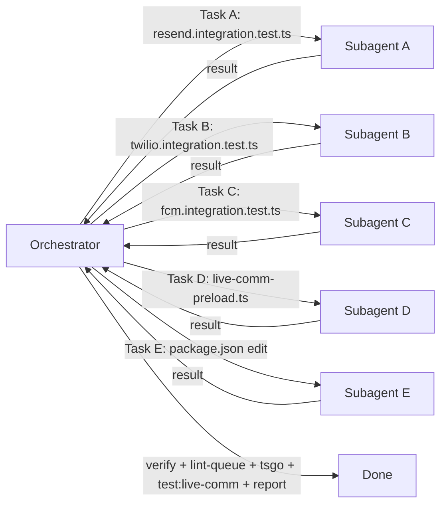

# communication_specs.md — Real-Provider Integration Tests Spec

> **MANDATORY READING for every agent at every nesting level.**
> This file is binding on the orchestrator, every Wave 1 subagent
> (A, B, C, D, E), every nested subagent they dispatch, every
> fix-round subagent, and every verification subagent. ANY agent at
> ANY level that touches a notification-channel integration test
> file, the live-comm preload, or the `package.json` `test:live-comm`
> script MUST read this file in full BEFORE doing any work, and
> re-read it after any fix round.
>
> The orchestrator's dispatch prompts MUST:
>   1. Reference this file by ABSOLUTE PATH:
>      `/home/ahmed/Projects/siraj/communication_specs.md`
>   2. Pass it via `file_attachments: ["communication_specs.md"]` to
>      the Task tool on EVERY dispatch.
>   3. Include the §10 summary-card inline at the top of each Task
>      prompt so the receiving subagent sees the contract before it
>      reads the file.
>   4. Instruct the receiving subagent to:
>      (a) read this file via the Read tool BEFORE its first action,
>      (b) re-read it after every fix round,
>      (c) reference it explicitly in any CROSS-FILE DEPENDENCY report,
>      (d) pass it down unchanged to ANY nested subagent it spawns
>          (with `file_attachments: ["communication_specs.md"]` and
>          the line `Read
>          /home/ahmed/Projects/siraj/communication_specs.md in full.
>          It binds you equally.`).
>
> Any rule in a higher-level plan file, AGENTS.md, or instruction file
> that appears to conflict with this document is OVERRIDDEN by this
> document — but ONLY to the extent of the conflict; everything else
> still applies (especially the lint queue server rule, the gitignore
> rule, and the no-sonar-scan rule).

---

## 0. The Five Inviolable Rules (recite before doing anything)

1. **Only six files may be modified** (5 NEW + 1 EDIT), per the §1
   ownership matrix: the three `*.integration.test.ts` files next to
   the adapters, `live-comm-preload.ts`, `package.json`, and the
   contract file itself (already authored by the orchestrator in
   Wave 0). Any agent that proposes editing an adapter source
   (`ResendEmailAdapter.ts`, `TwilioSmsAdapter.ts`, `FcmPushAdapter.ts`),
   an existing unit test (`backend/services/communication/test/*-channel.test.ts`),
   `.env` / `.env.test` / `.env.example`, `backend/lib/env.ts`, or any
   other file MUST emit a CROSS-FILE DEPENDENCY report (§7) and STOP.
   No "helpful" side-edits.

2. **Follow the FX precedent verbatim** — `test:live-fx` is the
   established pattern. Gating is per-channel `describe.skip` based on
   env-key presence (NOT a `RUN_REAL_PROVIDER_TESTS` flag). Tests live
   NEXT to the adapters they test (`backend/services/communication/channels/<channel>/<vendor>/*.integration.test.ts`),
   not in `backend/services/communication/test/`. The preload lives at
   `backend/services/communication/test/live-comm-preload.ts` and is
   invoked via `bun run test:live-comm` (defined in `package.json`).

3. **Idempotency is required**: if the target file already exists
   with content (for NEW files), the subagent MUST NOT overwrite. It
   MUST abort and report "already exists — no change made" (see §6 —
   Workflow). For `package.json`, if a `"test:live-comm"` script
   already exists, ABORT — already configured.

4. **No commit, no git operations**: Subagents MUST NOT `git add`,
   `git commit`, `git push`, or stage any file. The orchestrator does
   NOT auto-commit either — the user commits when they confirm.
   Subagents MUST NOT edit `.gitignore`. The orchestrator verifies
   with `git status --porcelain` afterward that only the 5 expected
   files appear as new/modified (R-self-check, see §5).

5. **No direct `bun run lint`, no sonar-scan, no codescene run by
   subagents**. The lint rule (AGENTS.md "Lint Queue Server") is
   binding: subagents MUST NOT run `bun run lint`, `bun lint`, or
   `bun run lint` directly on their files. The orchestrator submits
   all 5 files through the lint-queue client
   (`http://localhost:4777/lint`) in Wave 2. Subagents MAY run
   `bun tsgo` (read-only type check — safe to run concurrently). The
   `bun run test:live-comm` real-API run is performed ONCE by the
   orchestrator in Wave 2; subagents MUST NOT run it (costs money).

If you find yourself about to: edit an adapter source, add a
`RUN_REAL_PROVIDER_TESTS` flag, use `runInRollback`, run
`bun run lint` directly, `git add` your new file, `console.log`
a real API key, or modify a file outside the §1 matrix — **STOP. You
are about to violate the rules. Re-read sections 1-7 below.**

---

## 1. File ownership strict-mode matrix (no subagent edits files it doesn't own)

| Subagent | Owns (modifies ONLY this file) | Mode | Cooldown |
|---|---|---|---|
| **A** | `/home/ahmed/Projects/siraj/backend/services/communication/channels/email/resend/resend.integration.test.ts` | NEW | Solo writer. No other subagent touches this file. |
| **B** | `/home/ahmed/Projects/siraj/backend/services/communication/channels/sms/twilio/twilio.integration.test.ts` | NEW | Solo writer. No other subagent touches this file. |
| **C** | `/home/ahmed/Projects/siraj/backend/services/communication/channels/push/fcm/fcm.integration.test.ts` | NEW | Solo writer. No other subagent touches this file. |
| **D** | `/home/ahmed/Projects/siraj/backend/services/communication/test/live-comm-preload.ts` | NEW | Solo writer. No other subagent touches this file. |
| **E** | `/home/ahmed/Projects/siraj/package.json` | EDIT | Solo writer. Only the `scripts` block. Only the `test:live-comm` line. |

**Orchestrator (me)**:
- Authors `/home/ahmed/Projects/siraj/communication_specs.md` in Wave 0
  (this file — out of bounds for all subagents).
- Dispatches A, B, C, D, E in ONE parallel message (Multi-Task) — see §2.
- Reads each touched file AFTER all five subagents return
  (verification wave).
- Runs `bun tsgo` ONCE, the lint-queue client ONCE (5 files),
  `bun run test:live-comm` ONCE, and a-double-run leak check ONCE.
- Does NOT write to any of the five subagent-owned files itself.

**If you need to edit a file you do NOT own**: emit a CROSS-FILE
DEPENDENCY report (§7) and STOP. The orchestrator dispatches a
reconciliation subagent.

---

## 2. Execution model — PARALLEL subagents in a single message

Five file writes are independent (different files, no ordering
constraint, no shared state — the contract fixes the preload path and
the `package.json` script name up front, so Subagent E does not need
to wait for Subagent D), so they run as ONE parallel wave of five
`Task` invocations dispatched in a single assistant message:



- All five subagents receive the SAME §10 summary card inline at the
  top of their prompt; only the §1 target path and §4 matrix differ.
- All five start at the same wall-clock time and return independently.
- All five subagent prompts MUST pass
  `file_attachments: ["communication_specs.md"]` to the Task tool and
  include the line `Read
  /home/ahmed/Projects/siraj/communication_specs.md in full before
  your first action. It is binding on every nesting level.`

### Why `generalPurpose` and not `explore` or `shell`

The work requires file-write capability with Read + Write/StrReplace
tools. `generalPurpose` subagents have full tool access including
the Read, Write, and StrReplace tools. `explore` is read-only.
`shell` subagents would have to write via heredoc echo — which we
explicitly forbid (unreliable escaping for the JSON keys and types).

---

## 3. Imports / commands — what agents MAY and MAY NOT use

### Every subagent MAY:

1. `Read` the target file (for idempotency check + verify).
2. `Read` `/home/ahmed/Projects/siraj/communication_specs.md`
   (this file).
3. `Read` the adapter source it tests (read-only — for the test
   author to confirm method signatures, error code strings, return
   shapes):
   - A: `backend/services/communication/channels/email/resend/ResendEmailAdapter.ts`
   - B: `backend/services/communication/channels/sms/twilio/TwilioSmsAdapter.ts`
   - C: `backend/services/communication/channels/push/fcm/FcmPushAdapter.ts`
4. `Read` the FX precedent files (read-only):
   - `backend/services/fx/test/live-fx-preload.ts`
   - `backend/services/fx/providers/openexchangerates/openexchangerates.integration.test.ts`
   - `backend/services/fx/providers/fixer/fixer.integration.test.ts`
5. `Read` the existing channel unit tests (read-only — to mirror stub
   patterns and verify spy method names):
   - `backend/services/communication/test/email-channel.test.ts`
   - `backend/services/communication/test/sms-channel.test.ts`
   - `backend/services/communication/test/push-channel.test.ts`
6. `Read` the channel repo methods (read-only):
   - `backend/db/repo/notifications/notification.repository.ts`
7. `Read` `.env.example` (for env-var name reference ONLY; no edits).
8. Use `Write` (for NEW files) or `StrReplace` (for the `package.json`
   edit) — the file tools only, never heredoc echo for JSON/TS content.
9. Run `bun tsgo` (safe to run concurrently — read-only type check).
10. Run `wc -l` and `grep` on the target file via the Shell tool to
    report final line count and confirm signature lines.

### Every subagent MUST NOT:

1. **Run `bun run lint`, `bun lint`, `bun biome:check`,
   `bun sonar-scan`, `bun scripts/sonar-manager.ts`, `bun codescene`,
   or any side-effecting quality command on its file.** Lint goes
   through the orchestrator's lint-queue client in Wave 2.
2. **Run `bun run test:live-comm`** — this fires real API calls and
   costs money (~$0.05 USD). Only the orchestrator runs it, in Wave 2.
3. **Run `bun test` against the new file** — same reason (real APIs).
4. **Run `git add`, `git commit`, `git push`, `git stage`, or stage
   any file.** No git operations on the new/modified files.
5. Run `rm`, `mv`, or any destructive shell command on the target file.
6. Edit any adapter source file (read-only for tests).
7. Edit any existing unit test (`backend/services/communication/test/*-channel.test.ts`).
8. Edit `.env`, `.env.test`, `.env.example`, `.gitignore`,
   `backend/lib/env.ts`, or any other file outside §1.
9. Use `console.log` — the AGENTS.md rule applies. Use
   `import { testLogger } from "@/shared/lib/logger/testlogger"`
   and `testLogger.debug(...)` if logging is needed inside a test.
   Real API keys MUST NOT appear in test output.
10. Hardcode real API keys, real phone numbers, real email addresses,
    or real FCM device tokens in the test file. Tests read from
    `process.env` exclusively. Recipient values come from
    `process.env.RESEND_TEST_TO_EMAIL`,
    `process.env.TWILIO_VERIFIED_TEST_RECIPIENT`, and
    `process.env.FCM_TEST_DEVICE_TOKEN` — all optional env vars; if
    absent, the dependent test issues `test.skip("set <ENV_VAR> to
    run")`.
11. Introduce a `RUN_REAL_PROVIDER_TESTS` flag. Gating is per-channel
    `describe.skip` based on env-key presence — mirror FX precedent
    exactly (see §4).
12. Use `runInRollback`. Adapters do not accept a `tx` parameter; the
    repo writes would escape the test transaction. Stub
    `NotificationRepository` via `spyOn` instead (see §4 stub matrix).

---

## 4. The exact test matrix per channel (VERBATIM — do not alter)

Each subagent implements the matrix for its channel. The orchestrator
pastes the matrix inline in the subagent's Task prompt so the
subagent sees the contract even before it reads §4.

### 4.A — Subagent A (Resend / Email) — `resend.integration.test.ts`

**Gating**:
```typescript
const hasResend = Boolean(process.env.RESEND_API_KEY && process.env.RESEND_FROM_EMAIL);
const describeLive = hasResend ? describe : describe.skip;
```

**Imports**:
```typescript
import { describe, expect, spyOn, test } from "bun:test";
import { NotificationDeliveryStatus, NotificationEventType } from "@/backend/enum";
import { NotificationRepository } from "@/backend/db/repo";
import { ResendEmailAdapter } from "@/backend/services/communication/channels/email/resend/ResendEmailAdapter";
import { testLogger } from "@/shared/lib/logger/testlogger";
```

**Matrix** (per channel = Email):

| # | Test | Asserts |
|---|---|---|
| **E1** | `validateConfig()` returns true | Env vars wired |
| **E2** | `send({ to: process.env.RESEND_TEST_TO_EMAIL, subject, html })` → `{ success: true, providerMessageId: string }` | Real Resend accepts the email; `providerMessageId` matches `^[a-f0-9-]{36}$` (Resend message id format). If `RESEND_TEST_TO_EMAIL` unset → `test.skip("set RESEND_TEST_TO_EMAIL to run")`. |
| **E3** | `send({ to: "bounced@resend.dev" })` → Resend returns error → adapter returns `{ success: false, error }` AND `updateDeliveryStatus` spy called with `status: FAILED`, `failureReason` containing "bounced" (Resend docs: `bounced@resend.dev` simulates bounce) | Bounce flow wired |
| **E4** | `send({ to: "complained@resend.dev" })` → `{ success: false }` AND `updateDeliveryStatus` spy called with `FAILED` + "complained" in `failureReason` | Complaint flow wired |
| **E5** | `send({ to: "suppressed@resend.dev" })` → `{ success: false }` AND `updateDeliveryStatus` called with `FAILED` + "suppressed" in `failureReason` | Suppression flow wired |
| **E6** | Idempotency baseline: send same payload twice (different deliveries) → assert TWO different `providerMessageId` values. Comment on the assertion: `// REAL-PROVIDER-SPEC: adapter does not pass idempotencyKey (codifies today's non-idempotent behavior; will fail loudly if a future refactor adds idempotencyKey)` | Codifies current behavior |
| **E7** | After E2 success: spy `updateDeliveryStatus` called with `status: SENT`, `providerMessageId: <real Resend message id>` (same id Resend returned) | Delivery tracking wired for webhook reconciliation |
| **E8** | After all sends, sum total `createDelivery` calls equals the number of sends (no phantom writes) | No phantom delivery writes |

**Stubs** (in `beforeEach`):
```typescript
beforeEach(() => {
  spyOn(NotificationRepository, "createDelivery").mockResolvedValue({
    id: "delivery-uuid-test",
    userId: "test-user-id",
    channel: NotificationChannel.EMAIL,
    eventType: NotificationEventType.TEST_EVENT,
    recipient: "[REDACTED]",
    subject: "Test",
    body: "Test body",
    status: NotificationDeliveryStatus.PENDING,
    providerMessageId: null,
    failureReason: null,
    createdAt: new Date(),
    updatedAt: new Date(),
  });
  spyOn(NotificationRepository, "updateDeliveryStatus").mockResolvedValue({
    id: "delivery-uuid-test",
    status: NotificationDeliveryStatus.SENT,
    providerMessageId: null,
    failureReason: null,
    updatedAt: new Date(),
  } as any);
});
```

**Adapter construction** (per test, so singleton state is fresh):
`const adapter = new ResendEmailAdapter();`
Do NOT use the lazy `getEmailChannel()` singleton factory — that
injects a process-wide singleton; instantiate the adapter directly
like the FX tests do (`new OpenExchangeRatesAdapter()`).

### 4.B — Subagent B (Twilio / SMS) — `twilio.integration.test.ts`

**Gating**:
```typescript
const hasTwilio = Boolean(
  process.env.TWILIO_ACCOUNT_SID &&
  process.env.TWILIO_AUTH_TOKEN &&
  process.env.TWILIO_FROM_NUMBER
);
const describeLive = hasTwilio ? describe : describe.skip;
```

**Matrix** (per channel = SMS):

| # | Test | Asserts |
|---|---|---|
| **T1** | `validateConfig()` returns true | Env vars wired |
| **T2** | `send({ to: process.env.TWILIO_VERIFIED_TEST_RECIPIENT, body: "test", … })` → `{ success: true, providerMessageId: "SM…" }` (Twilio message SID format `^SM[a-f0-9]{30,}$`). If env var unset → `test.skip("set TWILIO_VERIFIED_TEST_RECIPIENT to run")`. | Real SMS dispatched; Trial account requires verified recipient |
| **T3** | `send({ to: "+15555550100" })` (North American dummy invalid) → adapter returns `{ success: false, error: … }`. Assert on the error message substring, NOT on a specific code (Trial returns 21608 "unverified"; Full returns 21211 "invalid"). `updateDeliveryStatus` spy called with `FAILED`. | Failure path + delivery tracking |
| **T4** | `send({ to: <test recipient or "+15555550100">, body: "" })` → adapter returns failure (or Twilio returns "Message body is required"); `updateDeliveryStatus` spy called with `FAILED`. If the adapter short-circuits before calling Twilio due to empty body, assert on the adapter's own validation error. | Validation failure path |
| **T5** | Rate limit: `spyOn(NotificationRepository, "getSmsCountInLastHour").mockResolvedValue(3)` (the hard cap) → `send(...)` → adapter short-circuits BEFORE calling Twilio → returns `{ success: false, rateLimited: true, error: "SMS rate limit exceeded: 3/3 in the last hour" }` (string from `TwilioSmsAdapter.ts:67-72`). Assert `updateDeliveryStatus` spy was NOT called (rate-limit short-circuit does not write a `FAILED` delivery). | Rate limit short-circuit, no money spent |
| **T6** | Just-under-rate-limit: `getSmsCountInLastHour` spy returns 2 → adapter proceeds → returns success with real `providerMessageId`. REQUIRES `TWILIO_VERIFIED_TEST_RECIPIENT` → else `test.skip`. **Costs ~$0.0079 USD per run.** | End-of-rate-limit boundary |
| **T7** | After T2 success: `updateDeliveryStatus` spy called with `status: SENT`, `providerMessageId: <real SM SID>` (same shape webhook payloads use to reconcile) | Delivery tracking wired for live SMS |

**Stubs** (`beforeEach` + per-test overrides):
```typescript
beforeEach(() => {
  spyOn(NotificationRepository, "createDelivery").mockResolvedValue({ ... } as any);
  spyOn(NotificationRepository, "updateDeliveryStatus").mockResolvedValue({ ... } as any);
  spyOn(NotificationRepository, "getSmsCountInLastHour").mockResolvedValue(0); // default; T5/T6 override
});
```

### 4.C — Subagent C (FCM / Push) — `fcm.integration.test.ts`

**Gating**:
```typescript
const hasFirebase = Boolean(
  process.env.FIREBASE_PROJECT_ID &&
  process.env.FIREBASE_PRIVATE_KEY &&
  process.env.FIREBASE_CLIENT_EMAIL
);
const describeLive = hasFirebase ? describe : describe.skip;
```

**Matrix** (per channel = Push):

| # | Test | Asserts |
|---|---|---|
| **P1** | `validateConfig()` returns true | Env vars wired |
| **P2** | `send({ userId, … })` with `getActiveDeviceTokensForUser` spy returning `[]` → adapter short-circuits → `{ success: true, successCount: 0, failureCount: 0 }`. Assert `createDeliveriesBatch` spy NOT called AND `updateDeliveryStatus` spy NOT called. | No-tokens path (no provider call, no delivery writes) |
| **P3** | `send({ … })` with a single **invalid** token (e.g. `"invalid-token-123"`) → FCM returns `messaging/invalid-registration-token` → adapter returns `{ success: false, successCount: 0, failureCount: 1 }` AND `deactivateDeviceToken` spy called once AND `updateDeliveryStatus` spy called with `FAILED` + failure reason containing `messaging/invalid-registration-token`. | Token deactivation on FCM invalid-token error (see `FcmPushAdapter.ts:188-205`) |
| **P4** | `send({ … })` with an **expired** token (e.g. a base64-like string with leading `eE2q…` that FCM accepts format-wise but rejects as stale) → FCM returns `messaging/registration-token-not-registered` → adapter deactivates token via `deactivateDeviceToken` spy + marks delivery `FAILED`. | Token-expired error path (`FCM_TOKEN_EXPIRED_ERROR` in `fcm.types.ts`) |
| **P5** | `send({ … })` with a **valid** test token — IF `process.env.FCM_TEST_DEVICE_TOKEN` is set — the adapter sends a real push, returns `{ success: true, successCount: 1, failureCount: 0 }`, `updateDeliveryStatus` called with `SENT` + real FCM `messageId`. If token absent → `test.skip("set FCM_TEST_DEVICE_TOKEN to run")`. | Real push happy-path |
| **P6** | Partial-failure multicast: two tokens, one valid (or the same `FCM_TEST_DEVICE_TOKEN` used twice — second use is OK), one invalid → `{ success: false, successCount: 1, failureCount: 1 }` (note `success` is `failureCount === 0` per `FcmPushAdapter.ts:155` — so `false`), `errors` array contains `deliveryFailedMessage("push")` exactly once, `deactivateDeviceToken` called once. If `FCM_TEST_DEVICE_TOKEN` absent → `test.skip`. | Partial multicast |
| **P7** | After live send (P5 or P6), `updateDeliveryStatus` spy called with `status: SENT, providerMessageId: <FCM messageId>`. The same `messageId` is what FCM webhooks use to reconcile. | Delivery tracking for live push |

**Stubs** (`beforeEach` + per-test overrides):
```typescript
beforeEach(() => {
  spyOn(NotificationRepository, "createDeliveriesBatch").mockResolvedValue([
    { id: "delivery-1", /* … */ } as any,
  ]);
  spyOn(NotificationRepository, "updateDeliveryStatus").mockResolvedValue({ ... } as any);
  spyOn(NotificationRepository, "deactivateDeviceToken").mockResolvedValue(undefined);
  spyOn(NotificationRepository, "getActiveDeviceTokensForUser").mockResolvedValue([]);
});

afterEach(async () => {
  // CRITICAL: firebase-admin singleton leak prevention
  if (getApps().length > 0) {
    await deleteApp(getApp());
  }
});
```

**CRITICAL test isolation**: `FcmPushAdapter` uses a process-wide
`firebase-admin` singleton (`getApps().length === 0 ? initializeApp(...) : getApp()`).
The suite's `afterEach` MUST call `await deleteApp(getApp())` when an
app exists, plus `await adapter.disconnect()` if a per-test
adapter was constructed. Mirror what
`backend/services/communication/test/push-channel.test.ts:84-92`
already does via `resetPushChannel()`. The integration tests
instantiate `new FcmPushAdapter()` directly (not via `pushChannel`)
so they manage `deleteApp` themselves. The orchestrator verifies
this by running `bun run test:live-comm` TWICE in Wave 2 and
asserting no "app already exists" error.

### 4.D — Subagent D — `live-comm-preload.ts`

**Target**: `/home/ahmed/Projects/siraj/backend/services/communication/test/live-comm-preload.ts`

**Content** (VERBATIM — mirror of `backend/services/fx/test/live-fx-preload.ts`):

```typescript
/**
 * Preload for `bun run test:live-comm`.
 * Bun auto-loads `.env` before tests; this script fails fast when none of
 * the three notification provider key triples is configured so the suite
 * cannot silently no-op.
 */
const hasResend = Boolean(process.env.RESEND_API_KEY && process.env.RESEND_FROM_EMAIL);
const hasTwilio = Boolean(
  process.env.TWILIO_ACCOUNT_SID &&
    process.env.TWILIO_AUTH_TOKEN &&
    process.env.TWILIO_FROM_NUMBER
);
const hasFirebase = Boolean(
  process.env.FIREBASE_PROJECT_ID &&
    process.env.FIREBASE_PRIVATE_KEY &&
    process.env.FIREBASE_CLIENT_EMAIL
);

if (!hasResend && !hasTwilio && !hasFirebase) {
  throw new Error(
    "test:live-comm requires at least one provider key triple in .env: RESEND_* and/or TWILIO_* and/or FIREBASE_*"
  );
}
```

### 4.E — Subagent E — `package.json` edit

**Target**: `/home/ahmed/Projects/siraj/package.json`

**Edit**: append the `test:live-comm` script immediately after the
existing `test:live-fx` line (currently line 35 in `package.json`).

Use the `StrReplace` tool, NOT a heredoc. The exact replacement:

Old:
```
    "test:live-fx": "bun test --preload ./backend/services/fx/test/live-fx-preload.ts backend/services/fx/providers/ --timeout=120000",
```

New (added line indented identically; comma after the `test:live-fx` line):
```
    "test:live-fx": "bun test --preload ./backend/services/fx/test/live-fx-preload.ts backend/services/fx/providers/ --timeout=120000",
    "test:live-comm": "bun test --preload ./backend/services/communication/test/live-comm-preload.ts backend/services/communication/channels/ --timeout=120000",
```

**Idempotency check**: BEFORE editing, run
`grep -c '"test:live-comm"' /home/ahmed/Projects/siraj/package.json`.
If result `>= 1`: ABORT. Report "already configured — no change made".

---

## 5. Forbidden patterns (self-check before reporting)

Each subagent MUST self-check these grep predicates against its
touched file before reporting completion.

| ID | Forbidden pattern | Self-check command |
|---|---|---|
| **R1** | `runInRollback` import or call anywhere in the test file | `grep -c 'runInRollback' <target>` → must be 0 |
| **R2** | `console.log` anywhere in the test file | `grep -c 'console\\.log' <target>` → must be 0 |
| **R3** | Any hardcoded real credential value (RESEND_API_KEY value, TWILIO_AUTH_TOKEN value, FIREBASE_PRIVATE_KEY value, phone numbers in literals) in the test file | `grep -c 're_EkiujeC6' <target>; grep -c 'c1d81f1cc' <target>; grep -c 'MIIEvgIB' <target>` → all must be 0 |
| **R4** | `RUN_REAL_PROVIDER_TESTS` flag anywhere | `grep -c 'RUN_REAL_PROVIDER_TESTS' <target>` → must be 0 |
| **R5** | `bun run lint`, `bun lint`, `bun biome:check`, `bun sonar-scan`, or `bun run test:live-comm` executed by the subagent | Subagent report must NOT mention these commands (orchestrator audits) |
| **R6** | Real recipient email/phone/device-token hardcoded as string literal (must always come from `process.env.*`) | `grep -E '"(\\+[0-9]{5,})"' <target>` (phone literals) and `grep -E '"[a-z0-9._%+-]+@[a-z0-9.-]+\\.[a-z]{2,}"' <target>` (email literals — but allow Resend simulator addresses `bounced@resend.dev`, `complained@resend.dev`, `suppressed@resend.dev` since those are documented test simulator addresses, not real recipient data) → review manually |
| **R7** | `git add`, `git commit`, `git push` executed by subagent | Subagent report must NOT mention these commands |
| **R8** | Adapter source file modified | `git diff --name-only \| grep -c -E '(ResendEmailAdapter\|TwilioSmsAdapter\|FcmPushAdapter)\\.tsx?'` → must be 0 |
| **R9** | Existing unit test file modified | `git diff --name-only \| grep -c -E 'backend/services/communication/test/.*-channel\\.test\\.ts'` → must be 0 |
| **R10** | ` getEmailChannel()` / `getSmsChannel()` / `getPushChannel()` singleton factory called (must use `new XxxAdapter()` directly) | `grep -c 'getEmailChannel\|getSmsChannel\|getPushChannel' <target>` → must be 0 |

The ONLY escape hatch for any of these is a comment on the offending
line:

| Comment | Permitted only when |
|---|---|
| `// COMMUNICATION-SPEC: <reason>` | Any deviation explicitly approved by the orchestrator in writing |

Comment clauses MUST be on the line immediately above the offending
declaration. The orchestrator greps over adjacent lines during
verification.

---

## 6. Workflow — every subagent's exact sequence

Each subagent (A, B, C, D, E) executes the same sequence, differing
only in the target file path and the §4 matrix:

1. **Pre-flight** (before any file write):
   - Read `/home/ahmed/Projects/siraj/communication_specs.md` in full.
   - Read the target file (for NEW files, expect "file not found" —
     proceed to create; for `package.json`, read to find
     `test:live-fx` line).
   - Idempotency check:
     - NEW files: if `target` exists AND is non-empty → ABORT. Report
       "already exists — no change made".
     - `package.json`: if `grep -c '"test:live-comm"' package.json`
       returns `>= 1` → ABORT. Report "already configured — no change
       made".
   - Read the §4 reference files listed in §3 MAY (adapter source,
     FX precedent, channel repo, existing unit test) — read-only.

2. **Construct the file content**:
   - For A, B, C: the test file with gating + imports + `beforeEach`
     stubs + the matrix test cases. Mirror the FX file structure
     (`backend/services/fx/providers/openexchangerates/openexchangerates.integration.test.ts`).
   - For D: VERBATIM the §4.D content.
   - For E: the `StrReplace` old/new pair from §4.E.

3. **Write the file**:
   - For A, B, C, D (NEW files): use the `Write` tool.
   - For E (`package.json` EDIT): use the `StrReplace` tool with the
     old/new pair from §4.E.

4. **Verify the write**:
   - `Read` the target file (full or last N lines) and confirm the
     expected content is present.
   - For E: confirm the new `test:live-comm` line is present between
     `test:live-fx` and the next script line.
   - Run `wc -l <target>` and report final line count.
   - Run the self-checks from §5 (R1-R10) and report each result.
   - Run `bun tsgo` ONCE (informational — safe to run concurrently).
     If tsgo reports errors that touch the new file, attempt a fix
     round (max 2 — see below).

5. **Report** using the format in §8.

### Fix-loop bounds

A subagent may run at most **2 fix rounds** on its file if the
verification step reveals any §5 violation or any tsgo error that
touches the new file. After round 2 with remaining violations, STOP
and report PARTIAL with CROSS-FILE DEPENDENCY entries explaining the
residual violations. The orchestrator dispatches a Wave 2
reconciliation subagent (which is also bound by this file).

---

## 7. CROSS-FILE DEPENDENCY — the report shape

If a subagent needs to do anything outside its ownership matrix
(in §1), it MUST NOT proceed. It MUST emit a report in this exact
shape:

```
CROSS-FILE DEPENDENCY:
  Target file: <this subagent's target file path>
  Blocked by: <other file path that needs changes, or "N/A — orchestrator decision needed">
  Rule violated: <R<n> from §5, or the exact rule name from §1/§3/§4>
  Required fix: <concrete description of the edits the other file needs
                 or the decision the orchestrator must make>
  Severity: <BLOCKING | NON-BLOCKING>
```

The orchestrator collects these and either:
- dispatches a Wave 2 reconciliation subagent (also bound by this
  file — orchestrator passes
  `file_attachments: ["communication_specs.md"]`), or
- makes a decision itself and reports it to the user.

### Examples most likely to occur

- Subagent A reads `ResendEmailAdapter.ts` and discovers the
  constructor requires an env var that is NOT listed in §4.A's
  imports/stubs → BLOCKING CROSS-FILE DEPENDENCY: "Target:
  resend.integration.test.ts, Blocked by: ResendEmailAdapter.ts,
  Rule: §1 (test must match adapter signature), Required fix:
  orchestrator decision — extend §4.A stub or instruct subagent to
  add the env var to `beforeEach` process.env setting"
- Subagent B finds `TwilioSmsAdapter` rate limit hard cap is NOT 3
  (it's a different value) → NON-BLOCKING CROSS-FILE DEPENDENCY:
  "Target: twilio.integration.test.ts, Blocked by:
  TwilioSmsAdapter.ts, Rule: §4.B T5 hard cap value, Required fix:
  subagent will read the actual cap value and adjust T5 to use it;
  request orchestrator confirmation that adjusting is acceptable"
- Subagent C reads `push-channel.test.ts:84-92` and finds the
  `resetPushChannel()` pattern differs from what §4.C describes →
  BLOCKING CROSS-FILE DEPENDENCY: "Target: fcm.integration.test.ts,
  Blocked by: push-channel.test.ts, Rule: §4.C afterEach, Required
  fix: orchestrator decision — adopt push-channel.test.ts's actual
  pattern or update §4.C"

---

## 8. Reporting format — every subagent's final message

```
SUBAGENT <id> — <PASS | PARTIAL | FAIL>

Target file: <absolute path>
Action: created | edited-package-json | skipped-idempotent | aborted-error
Final line count: <number>
Final `tail -n 20` snippet (test files) or new-script-section
  (package.json):
```
<last 20 lines of the file; for test files, REDACT any env-var
 values that appear in literals; package.json edit shows the 2-3
 surrounding script lines>
```

Self-check results (from §5):
- R1 (no runInRollback): PASS — evidence: <grep count>
- R2 (no console.log): PASS — evidence: <grep count>
- R3 (no hardcoded credentials): PASS — evidence: <grep counts>
- R4 (no RUN_REAL_PROVIDER_TESTS flag): PASS — evidence: <grep count>
- R5 (no bun lint / sonar / lint / test:live-comm run): PASS — N/A
  (subagent did not run those)
- R6 (recipient env-var sourced, except Resend simulators): PASS —
  evidence: <manual review>
- R7 (no git operations): PASS — N/A
- R8 (no adapter source modified): PASS — evidence: <git diff line>
- R9 (no existing unit test modified): PASS — evidence: <git diff
  line>
- R10 (no singleton factory call): PASS — evidence: <grep count>

bun tsgo result (informational):
- <PASS | FAIL — if FAIL, list only errors that touch <target>>:
  <error summary>

CROSS-FILE DEPENDENCIES (if any):
- <CROSS-FILE DEPENDENCY block per §7>

Notes / deviations: <none, or list with // COMMUNICATION-SPEC: <reason>>
```

The orchestrator consolidates all five subagent reports into a
single final summary for the user, including the security rotation
note (carried forward from `specs.env-wiring.md` §11).

---

## 9. Orchestrator's contract with subagents

The orchestrator:

- WILL NOT edit any of the five §1 subagent-owned files itself during
  Wave 1. Orchestrator edits to those files are forbidden by §1.
- WILL include this file's ABSOLUTE path
  (`/home/ahmed/Projects/siraj/communication_specs.md`) in every Task
  prompt it sends, with the line: `Read
  /home/ahmed/Projects/siraj/communication_specs.md in full before
  your first action. It is binding on every nesting level.`
- WILL pass this file as
  `file_attachments: ["communication_specs.md"]` on every Task
  invocation (relative path from workspace root).
- WILL NOT paraphrase or summarize this file; subagents read the
  original.
- WILL paste the §10 summary card at the top of every Task prompt.
- WILL re-include `communication_specs.md` in fix-round retries and
  Wave 2 reconciliation dispatches (the file may be updated between
  rounds — orchestrator's responsibility to re-attach the latest
  version).
- WILL run `git status --porcelain` after Wave 1 to verify only the
  5 expected files appear (R8 + R9 audit at orchestrator level).
- WILL run `bun tsgo` ONCE as a sanity check after all five
  subagents return. This is informational. Failure here is NOT a
  Wave 1 failure; it's reported to the user as a separate note if
  the run flags any TypeScript regression that touches the new test
  files.
- WILL run the lint-queue client ONCE with all 5 files in a single
  POST request:
  ```bash
  curl -s -X POST http://localhost:4777/lint \
    -H "Content-Type: application/json" \
    -d '{"id":"wave1-verify","files":["backend/services/communication/channels/email/resend/resend.integration.test.ts","backend/services/communication/channels/sms/twilio/twilio.integration.test.ts","backend/services/communication/channels/push/fcm/fcm.integration.test.ts","backend/services/communication/test/live-comm-preload.ts","package.json"]}'
  ```
- WILL run `bun run test:live-comm` ONCE (real API calls, ~$0.05 USD).
- WILL run `bun run test:live-comm` TWICE consecutively to detect
  firebase-admin singleton leaks (P-suite `afterEach` validation).
- WILL NOT run `bun run lint` directly, `bun sonar-scan`,
  `bun codescene`, or `bun scripts/sonar-manager.ts`.
- WILL NOT auto-commit. User commits when they confirm.

### Nested subagents

If a Wave 1 subagent MUST spawn a nested subagent (rare but possible
for retry-on-read-failure flows), the Wave 1 subagent MUST pass this
file down unchanged:

- Include this file's ABSOLUTE path in the nested Task prompt with
  the line: `Read
  /home/ahmed/Projects/siraj/communication_specs.md in full. It binds
  you equally.`
- Pass `file_attachments: ["communication_specs.md"]` on the nested
  Task invocation.
- Embedded nested-subagent prompt template MUST contain the §10
  summary card.
- The nested subagent inherits the SAME file ownership as its parent
  (subagent A's nested subagent still only touches
  `resend.integration.test.ts`, etc.).

---

## 10. One-page reminder (PASTE this at the top of every subagent prompt)

> **communication_specs.md summary card** — you are bound by
> `/home/ahmed/Projects/siraj/communication_specs.md`.
> Read it. Five top rules: (1) only the file in §1 may be edited
> (NEW for A/B/C/D, EDIT for E's `package.json`); (2) follow the FX
> precedent — `test:live-fx` gating pattern, per-channel
> `describe.skip` on env-key presence, tests live NEXT to adapters
> (NOT a `RUN_REAL_PROVIDER_TESTS` flag); (3) idempotency — abort if
> target exists (NEW) or `test:live-comm` script present
> (`package.json`); (4) no git operations; no auto-commit (5) no
> `bun run lint` / `bun sonar-scan` / `bun run test:live-comm` —
> orchestrator runs lint-queue client + live tests in Wave 2 only.
> Ten forbidden patterns R1-R10 self-check via shell + Read before
> reporting. R1: no `runInRollback` (adapters don't accept `tx`;
> stub repo via `spyOn` instead). R2: no `console.log` — use
> `testLogger`. R3: no hardcoded credentials. R4: no
> `RUN_REAL_PROVIDER_TESTS`. R10: no singleton factory call — use
> `new XxxAdapter()` per test. Adapter construction is per-test,
> not via the lazy singleton factory. For FCM (C): `afterEach` MUST
> call `await deleteApp(getApp())` to prevent the firebase-admin
> singleton leak — orchestrator runs `bun run test:live-comm` twice
> to verify. Recipients come from `process.env.RESEND_TEST_TO_EMAIL`,
> `process.env.TWILIO_VERIFIED_TEST_RECIPIENT`,
> `process.env.FCM_TEST_DEVICE_TOKEN` — all optional, dependent tests
> `test.skip("set <ENV_VAR> to run")` when absent. Resend simulator
> addresses (`bounced@resend.dev`, `complained@resend.dev`,
> `suppressed@resend.dev`) are documented test addresses and are OK
> as literals. Stick to your file from §1. Emit CROSS-FILE
> DEPENDENCY (§7 format) when blocked. Cap fix loops at 2 rounds.
> Rate `PASS/PARTIAL/FAIL` with the canonical report format from §8.
> Don't drift. Don't be helpful by editing files you don't own.
> Don't recycle env values into literals. Don't commit. Don't run
> lint directly. Don't run the live test suite (costs money).

---

## 11. Credential provenance (auditable, carried forward from `specs.env-wiring.md` §11)

| Credential | Source | Validation |
|---|---|---|
| `RESEND_API_KEY=re_EkiujeC6_F6FRiXp6CiVyy29dwxnKytca` | User-provided in chat | Resend dashboard |
| `RESEND_FROM_EMAIL=onboarding@resend.dev` | Resend docs + AI guardrails doc shared by user | `§4.2 rule 7` — allowed for testing |
| `TWILIO_ACCOUNT_SID=AC4179d82ae43563b255baf28ba3482605` | User-provided in chat | curl-validated HTTP 200 on `/Accounts/{SID}.json`, account `status: "active"`, balance `$14.35`, type `Trial` |
| `TWILIO_AUTH_TOKEN=c1d81f1cc4b6beba682ca4224ee67cba` | User-provided in chat | curl-validated (echoed back in account JSON response) |
| `TWILIO_FROM_NUMBER=+16055468514` | Derived from curl `GET /IncomingPhoneNumbers.json` | Account owns exactly this one number (SMS-capable, in-use). User-provided `+18777804236` returned HTTP 404 — rejected |
| `FIREBASE_PROJECT_ID=siraj-e901f` | User-pasted service-account JSON | From `project_id` field |
| `FIREBASE_PRIVATE_KEY=<full PEM>` | User-pasted service-account JSON | From `private_key` field, with literal `\n` escapes |
| `FIREBASE_CLIENT_EMAIL=firebase-adminsdk-fbsvc@siraj-e901f.iam.gserviceaccount.com` | User-pasted service-account JSON | From `client_email` field |

The real-API verification run will exercise these keys live. The
orchestrator's Wave 3 report surfaces the same rotation
recommendation as the env-wiring plan: rotate the Resend key, Twilio
Auth Token, and Firebase service-account private key before any
production deployment, since they were shared in plaintext in chat
history.

---

## 12. Out of scope

- Editing `.env`, `.env.test`, `.env.example` (done by the prior
  `specs.env-wiring.md` plan; gitignored).
- Editing adapter source files (`ResendEmailAdapter.ts`,
  `TwilioSmsAdapter.ts`, `FcmPushAdapter.ts`) — read-only for tests.
- Editing existing unit tests
  (`backend/services/communication/test/*-channel.test.ts`) — they
  stay unchanged.
- Editing `backend/lib/env.ts` — all env vars already wired through
  `getEnvironmentConfig()`.
- Editing `backend/db/repo/notifications/notification.repository.ts`
  — the repo is read-only for tests (we stub it via `spyOn`).
- Introducing `RUN_REAL_PROVIDER_TESTS` env-var flag (deliberately
  NOT — follows FX precedent of per-channel `describe.skip`).
- Browser push env vars (`NEXT_PUBLIC_FIREBASE_VAPID_PUBLIC_KEY`,
  `NEXT_PUBLIC_FIREBASE_SENDER_ID`) — not consumed by the FCM
  adapter's server-side path; out of scope.
- Refactoring adapters to accept `tx` injection — would let us use
  `runInRollback`, but deferred (stub-via-`spyOn` is the
  FX-precedent-compliant path).
- `git add` / `git commit` / `git push` — orchestrator will not
  auto-commit.
- Running `bun sonar-scan` — subagents never run it; orchestrator
  does not run it for this task.

---

## 13. Relation to other spec files

Three other spec/contract files exist at the repo root:

- `specs.env-wiring.md` — the binding contract for the env-key wiring
  task (PREVIOUS plan, COMPLETED). NOT in force for this task.
- `specs.md` — the binding contract for an unrelated notification
  **dispatch refactor** (historical S1-S8 subagent wave). NOT in
  force for this task.
- `AGENTS.md` (root) — applies to all agents at all times. In force.
  Where `AGENTS.md` and this file both apply, this file is more
  specific and wins ONLY to the extent of the conflict — but the
  `AGENTS.md` lint-queue-server rule, gitignore rule, no-sonar-scan
  rule, no-`console.log` rule, and path-alias rule all continue to
  apply.

This `communication_specs.md` is the SOLE binding contract for:

- The Resend integration test subagent (A)
- The Twilio integration test subagent (B)
- The FCM integration test subagent (C)
- The `live-comm-preload.ts` subagent (D)
- The `package.json` `test:live-comm` script subagent (E)
- The orchestrator's Wave 2 verification steps
- Any fix-round or reconciliation subagent spawned under this plan

Agents bound by `specs.env-wiring.md` or `specs.md` are NOT bound by
this file (different task) and vice versa — unless an agent is
dispatched for THIS task, in which case this file is the binding one.
