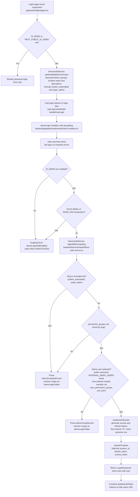

# Demo Authentication Mode

The demo login is a password-less fast-login path intended for preview and internal demo environments. When `NEXT_PUBLIC_IS_DEMO` or `IS_DEMO` is set, the login page server component calls `DemoAuthService.getAvailableDemoGroups` to list every permission group (excluding `system_automated` and `super_admin`) with localized names, and the login view renders one quick-login button per group. Clicking a button fires the `demoLogin` GraphQL mutation with the chosen `groupSlug`. The resolver first applies the shared auth rate limiter (fail-open, mirroring the normal login path), then enforces three guards: `IS_DEMO` must be truthy, and any Vercel deployment or production `NODE_ENV` hard-blocks the mutation even if `IS_DEMO` was misconfigured. Only then does `DemoAuthService.loginWithGroupSlug` run: it rejects excluded group slugs before touching the database, looks up the `permission_groups` row by slug, and selects a demo user — preferring the canonical `INTERNAL_DEMO_USERS` email for the group, else the earliest-created member joined through `user_permission_groups`. On success it calls `createAuthSession` to mint access/refresh tokens and a `sessions` row, then `setAuthCookies` writes the httpOnly cookies and the client redirects via the same safe-return-URL logic as a normal login. Edge cases (unknown slug, excluded slug, group without members) throw localized domain errors that the resolver wraps as a generic `demoLoginFailed` `UNAUTHENTICATED` GraphQL error, and a transient failure in `getAvailableDemoGroups` simply yields an empty quick-login list rather than failing the page.

Key sources:

- `backend/services/auth/demo-auth.service.ts` — `getAvailableDemoGroups`, `loginWithGroupSlug`, demo user selection
- `backend/graphql/mutation/auth/auth.mutation.ts` — `demoLogin` mutation resolver with rate-limit and environment guards
- `app/(auth)/login/page.tsx` — server component that loads demo groups when demo mode is on
- `frontend/views/auth/login/useLoginViewModel.ts` — `handleFastLogin` client flow and post-login redirect
- `backend/lib/env-config-keys.ts` — `IS_DEMO` env key registration (excluded from DB-managed config)

Standalone diagram: [demo-login.mmd](./demo-login.mmd)
