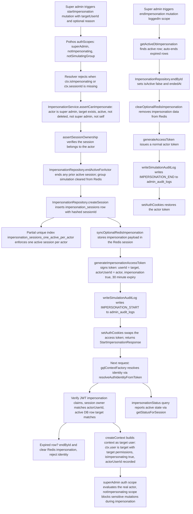

# Admin Impersonation Flow

A super admin can temporarily act as another user through an impersonation session started via the `startImpersonation` GraphQL mutation (guarded by `superAdmin`, `notImpersonating`, and `notSimulatingGroup` Pothos auth scopes). `ImpersonationService.assertCanImpersonate` rejects self-impersonation, missing, deleted, deactivated, or super-admin targets, and `assertSessionOwnership` ensures the actor owns the session before a row is inserted into `impersonation_sessions` — a partial unique index guarantees only one active session per actor. The service then mirrors an impersonation payload into the Redis session, signs an access token whose `userId` is the target (plus `actorUserId`, `impersonation: true`, and a 30-minute `impersonationExpiresAt`), writes an `IMPERSONATION_START` row to `admin_audit_logs`, and swaps the auth cookies. On every subsequent request, `gqlContextFactory` re-validates the token via `resolveAuthIdentityFromToken` against the session owner and the active DB row; expired rows are auto-ended and the Redis payload cleared. While impersonating, `createContext` builds the request context as the target user (target permissions apply), but the `superAdmin` auth scope still evaluates the real actor and `notImpersonating` scopes block sensitive mutations. Stopping via the `endImpersonation` mutation marks the DB row inactive, clears Redis, issues a normal actor token, writes an `IMPERSONATION_END` audit row, and restores cookies; attempting to end with no active session throws a localized `impersonationNotActive` error.

## Key sources

- `backend/services/auth/impersonation.service.ts` — `ImpersonationService` start/end/status, token identity resolution, Redis/DB sync, audit writes
- `backend/graphql/pothos/auth/impersonation.pothos.ts` — `startImpersonation` / `endImpersonation` mutations, `impersonationStatus` query, cookie handling
- `backend/graphql/gqlContextFactory.ts` — per-request identity resolution wiring
- `backend/graphql/gqlSchemaBuilder.ts` — `loggedIn` / `superAdmin` / `notImpersonating` / `notSimulatingGroup` auth scopes
- `backend/graphql/gqlContext.ts` — `createContext` building the impersonated request context
- `backend/services/auth/__shared__/simulationBase.ts` — `assertSessionOwnership`, `getSimulationExpiresAt`, `writeSimulationAuditLog` to `admin_audit_logs`
- `backend/db/schema/auth/impersonation.ts` — `impersonation_sessions` table with the one-active-per-actor partial unique index
- `backend/db/repo/auth/impersonation.repository.ts` — `ImpersonationRepository` create/find/end data access

## Diagram

[Diagram source](./impersonation.mmd)
