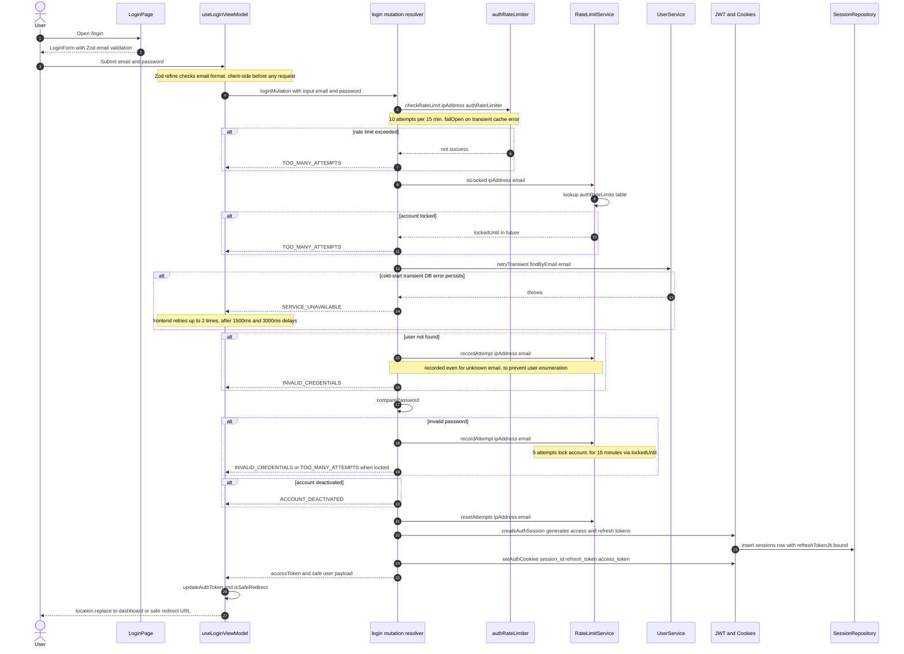

# User Login & Rate-Limit Protection

The login workflow starts at `app/(auth)/login/page.tsx`, a Server Component that renders the `LoginForm` client view (`frontend/views/auth/login`). The form validates the email shape and password presence with a Zod schema before any request leaves the browser, then `useLoginViewModel` dispatches the GraphQL `login` mutation. The resolver in `backend/graphql/mutation/auth/auth.mutation.ts` enforces two defense layers before touching credentials: an IP-scoped sliding-window limiter (`authRateLimiter`, 10 attempts per 15 minutes) and a DB-backed lockout on the `authRateLimits` table (`RateLimitService.isLocked`, 5 failures lock for 15 minutes via `recordAttempt`); both are wrapped in a `failOpen` helper so cold-start transient errors fail open while persistent cache failures still fail closed. The user lookup itself is retried with `retryTransient`, and a persistent cold-start failure surfaces as `SERVICE_UNAVAILABLE`, which the frontend self-heals by retrying up to two times after 1500ms and 3000ms back-off delays. Failed attempts are recorded even when the email is unknown (to prevent user enumeration) and wrong passwords return `INVALID_CREDENTIALS` (or `TOO_MANY_ATTEMPTS` once locked), while deactivated accounts return `ACCOUNT_DEACTIVATED`. On success, attempts are reset, `createAuthSession` issues access and refresh JWTs with the refresh-token JTI bound to the new `sessions` row, httpOnly `session_id`/`refresh_token`/`access_token` cookies are set, and the client stores the token and hard-redirects through `isSafeRedirect` to the dashboard (or the safe `redirect` query param). All error branches map to localized UI copy via `resolveLoginErrorMessage`, keyed on the GraphQL `extensions.code` rather than raw server text.

## Key sources

- `app/(auth)/login/page.tsx` — Server Component entry; demo-mode gating, renders `LoginContainer`
- `frontend/views/auth/login/useLoginViewModel.ts` — client orchestration: mutation, error-code mapping, cold-start retries, safe redirect
- `frontend/views/auth/login/schemas/loginSchema.ts` — Zod email/password validation (client-side)
- `backend/graphql/mutation/auth/auth.mutation.ts` — `login` mutation resolver (rate limits, credentials, session, cookies); also `demoLogin`, `refreshToken`, `logout`
- `backend/graphql/shared/auth-rate-limit.ts` — `requireAuthWithRateLimit` shared guard
- `backend/services/auth/rate-limit.service.ts` — thin wrapper over `RateLimitRepository`
- `backend/db/repo/shared/ratelimit.repository.ts` — `authRateLimits` table access (PG function `check_and_record_auth_attempt`, SQLite fallback)
- `backend/services/auth/session.service.ts` — `SessionService` validation/session creation used across auth flows
- `backend/lib/auth/createAuthSession.ts` — JWT issuance + session row with bound `refreshTokenJti`
- `backend/lib/auth/cookies.ts` — httpOnly `session_id` / `refresh_token` / `access_token` cookie handling
- `backend/lib/ratelimit.ts` — `authRateLimiter` (10 req / 15 min, fail-closed for auth)

## Diagram

Machine-checkable copy: [login-and-rate-limits.mmd](./login-and-rate-limits.mmd)
