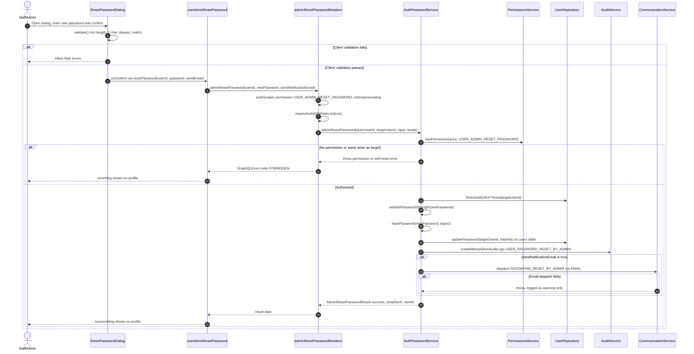

# Password Reset via Profile

A staff or admin user with the `USER_ADMIN_RESET_PASSWORD` permission can reset another user's password directly from that user's profile page. The `ResetPasswordDialog` collects the new password, validates it client-side (minimum length, at least two character classes, confirm-match), and hands it to the `useAdminResetPassword` hook, which fires the `adminResetPassword` GraphQL mutation. The Pothos mutation guards the field with `authScopes` (permission check plus `notImpersonating`) and `requireAuthWithRateLimit`, then delegates to `AuthPasswordService.adminResetPassword`. The service re-verifies the permission, rejects self-resets through this path, loads the target user, runs `validatePasswordStrength`, hashes the password, and persists it via `UserRepository.updatePassword` on the `users` table. It then writes a `USER_PASSWORD_RESET_BY_ADMIN` audit log and, when `sendNotificationEmail` is enabled (the default), dispatches a `PASSWORD_RESET_BY_ADMIN` email through `CommunicationService`; email failures are logged but never fail the reset. Permission and self-reset violations surface to the client as `FORBIDDEN` GraphQL errors, while unexpected failures are masked as `SERVICE_UNAVAILABLE`. Note: the current flow does **not** invalidate the target user's existing sessions — only the stored password hash changes.

## Key sources

- `frontend/common/views/dashboard/profile/shared/ResetPasswordDialog.tsx` — dialog UI and client-side validation
- `frontend/common/views/dashboard/profile/shared/useAdminResetPassword.ts` — Apollo mutation hook wired to the dialog's `onConfirm`
- `frontend/common/graphql/sharedDocuments/auth/auth.documents.ts` — `adminResetPasswordMutationDocument`
- `backend/graphql/mutation/auth/admin-password.mutation.ts` — Pothos mutation field, auth scopes, rate limiting, error mapping
- `backend/services/auth/auth-password.service.ts` — permission check, self-restriction, strength validation, hashing, audit log, email dispatch
- `backend/db/repo/users/user.repository.ts` — `updatePassword` / `findUserByIdOrThrow` on the `users` table

[Machine-readable diagram](./password-reset.mmd)
