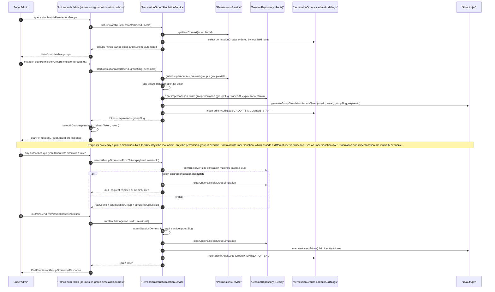

# Permission Group Simulation

Permission group simulation lets a super-admin preview the effective access of a permission group they do not belong to, without leaving their own identity behind. The flow starts with the `simulatablePermissionGroups` GraphQL query, which lists all `permissionGroups` rows minus the `system_automated` slug, the super-admin's own group, and (for non-super-admins) any group the actor already owns. Calling `startPermissionGroupSimulation(groupSlug)` runs `PermissionGroupSimulationService.startSimulation`: it guards that the actor is a super-admin who does not already hold the group, terminates any active impersonation (the two modes are mutually exclusive), writes a 30-minute session-scoped simulation record to Redis, and returns a special JWT embedding the simulated group slug that is also set as an auth cookie. On subsequent requests, `resolveGroupSimulationFromToken` re-validates the token against the server-side Redis record — mismatched slug, expired token (cleared lazily), or missing session ownership all cause the simulation to be dropped or the request rejected, so the client cannot claim a simulation the server does not confirm. Both start and end append `GROUP_SIMULATION_START`/`GROUP_SIMULATION_END` rows to `adminAuditLogs` with the actor's IP. The key difference from impersonation: impersonation adopts another *user's* identity via an impersonation JWT (`payload.impersonation` is explicitly excluded from simulation resolution), whereas group simulation keeps the admin's real identity and overlays only the permission group's access, so audit trails still attribute actions to the real admin.

## Key sources

- `backend/services/auth/permission-group-simulation.service.ts` — the service namespace (`listSimulatableGroups`, `startSimulation`, `endSimulation`, `resolveGroupSimulationFromToken`, `getStatusForSession`)
- `backend/graphql/pothos/permissions/permission-group-simulation.pothos.ts` — GraphQL queries/mutations, auth scopes (`superAdmin`, `notImpersonating`), and cookie wiring
- `backend/services/auth/__shared__/simulationBase.ts` — shared expiry/audit-log/session-ownership helpers
- `backend/graphql/gqlContextFactory.ts` — where `resolveGroupSimulationFromToken` feeds the per-request GraphQL context

Standalone diagram: [permission-group-simulation.mmd](./permission-group-simulation.mmd)
