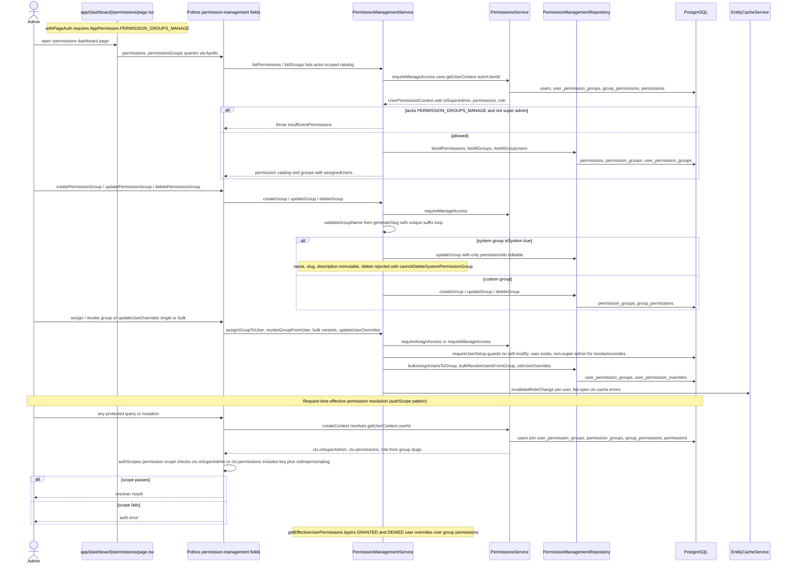

# Permission & Permission-Group Administration

The `/permissions` dashboard page lets privileged admins manage the catalog of seeded system permissions, custom permission groups, group-to-user assignments, and per-user GRANTED/DENIED overrides. Entry is gated twice: `withPageAuth` on `app/(dashboard)/permissions/page.tsx` requires `PERMISSION_GROUPS_MANAGE`, and every Pothos field in `permission-management.pothos.ts` declares `authScopes: { permission: ..., notImpersonating: true }` while `PermissionManagementService` re-checks the actor via `requireManageAccess` / `requireAssignAccess` before touching data. Group CRUD flows through `PermissionManagementRepository` into the `permissions`, `permission_groups`, and `group_permissions` tables, names are validated, slugified, and deduplicated with a suffix counter, while system groups are immutable except for their `permissionIds` and cannot be deleted. Assignments and overrides write to `user_permission_groups` / `user_permission_overrides` under guards that forbid modifying yourself, modifying super admins (for revoke/override paths), or acting on missing users, and each successful write calls `invalidateRoleChangeFailOpen` so cached contexts are evicted without failing the request. At request time, `createContext` calls `PermissionsService.getUserContext(userId)`, which joins `users → user_permission_groups → permission_groups / group_permissions → permissions`, grants super admins the full catalog, and derives `UserRole` from group slugs, Pothos `authScopes` then evaluates `ctx.isSuperAdmin || ctx.permissions.includes(key)` per field. `getEffectiveUserPermissions` additionally layers GRANTED/DENIED user overrides over the group-derived set when an admin inspects a user's effective permissions.

## Key sources

- `app/(dashboard)/permissions/page.tsx` — page entry, `withPageAuth([PERMISSION_GROUPS_MANAGE])` guard
- `backend/graphql/pothos/permissions/permission-management.pothos.ts` — Pothos query/mutation fields with `authScopes` (manager + assign permissions, `notImpersonating`)
- `backend/graphql/gqlSchemaBuilder.ts` — `buildAuthScopes` permission scope (`ctx.isSuperAdmin || ctx.permissions.includes(key)`), `authScopes: async ctx => buildAuthScopes(ctx)`
- `backend/services/auth/permission-management.service.ts` — admin CRUD, assignment, override, and effective-permission lifecycle with actor guards
- `backend/services/auth/permissions.service.ts` — `getUserContext` resolution (super-admin catalog, group join, `resolveRoleFromGroupSlugs`, batched `getUserContexts`)
- `backend/services/cache/EntityCacheService.ts` — `invalidateRoleChange` used by the fail-open invalidation helper
- Tables touched: `permissions`, `permission_groups`, `group_permissions`, `user_permission_groups`, `user_permission_overrides`, `users`

Machine-checkable copy: [permission-management.mmd](./permission-management.mmd)
