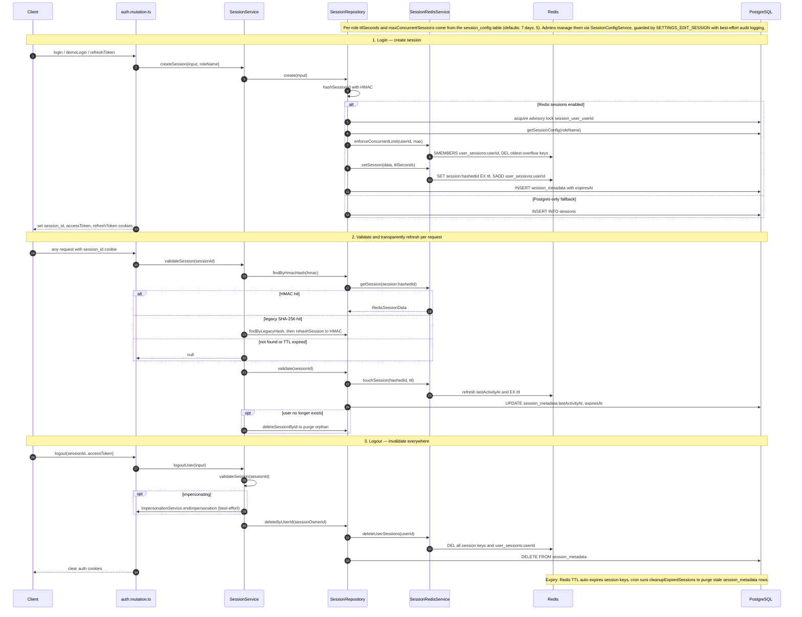

# Session Lifecycle & Redis Session Config

Sessions in Siraj are created by the Pothos auth mutations (`login`, `demoLogin`, `refreshToken`) in `auth.mutation.ts`, which call `SessionService.createSession` → `SessionRepository.create`. When Redis sessions are enabled (i.e. `cacheProvider !== "postgres"`), the raw session ID is HMAC-hashed, a per-role config row is read from the `session_config` table (fallback: 7-day TTL, 5 concurrent sessions), the concurrent limit is enforced by evicting the oldest Redis sessions, and the session is stored under `session:<hashedId>` with an `EX` TTL while a durable `session_metadata` row records device info and `expiresAt` in Postgres. Every authenticated request re-validates the session: `SessionService.validateSession` looks it up by HMAC hash (transparently migrating legacy SHA-256 hash records to HMAC), then `SessionRepository.validate` touches the session — refreshing `lastActivity` and re-arming the TTL in Redis and Postgres. Logout (`SessionService.logoutUser`) validates the session, best-effort ends any active impersonation, and deletes *all* of the owner's sessions from Redis plus the `session_metadata` rows, orphaned sessions whose user was deleted are purged on validation. Expiration is layered: Redis TTL auto-expires keys, and a cron-driven `cleanupExpiredSessions` removes stale metadata rows. Admins adjust per-role TTLs and concurrency caps through `SessionConfigService`, guarded by the `SETTINGS_EDIT_SESSION` permission with range validation (60 s–28 days, 1–50 sessions) and best-effort audit logging.

## Key sources

- `backend/services/auth/session.service.ts` — `SessionService.validateSession`, `createSession`, `logoutUser`, orphan purge
- `backend/services/redis/SessionRedisService.ts` — Redis key layout (`session:`, `user_sessions:`), `setSession`/`touchSession`/`deleteSession`/`enforceConcurrentLimit`
- `backend/services/redis/RedisServiceFactory.ts` — singleton `IRedisService` (local vs Upstash, DB-first env overrides)
- `backend/services/users/session-config.service.ts` — `SessionConfigService` guard, validation, audit for per-role configs
- `backend/db/repo/shared/session.repository.ts` — `SessionRepository` bridging Redis + `sessions`/`session_metadata`/`session_config` tables, defaults, legacy hash rehash
- `backend/graphql/mutation/auth/auth.mutation.ts` — `login`, `demoLogin`, `refreshToken`, `logout` resolvers
- `backend/graphql/gqlContext.ts` — per-request context carrying `sessionId`

## Diagram

Machine-checkable copy: [session-management.mmd](./session-management.mmd)
