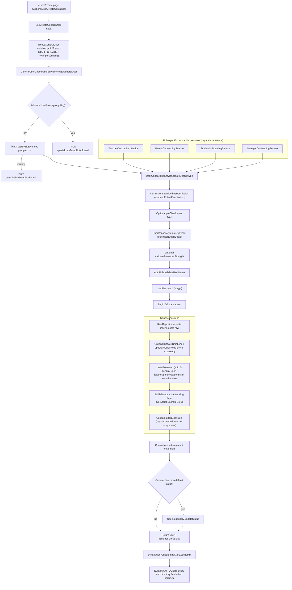

# General User Creation & Onboarding

General user creation is the generic entry point into the shared user-provisioning pipeline, used when a staff member creates an account that belongs to a non-specialized permission group (anything other than the student, teacher, or parent system groups). A staff admin submits the form at `app/(dashboard)/users/create/page.tsx` (guarded by `AppPermission.STAFF_CREATE`), which fires the `createGeneralUser` Pothos mutation via the `useCreateGeneralUser` hook. `GeneralUserOnboardingService.createGeneralUser` first rejects specialized group slugs via `isSpecializedGroup` — those types must go through their dedicated onboarding flows — and verifies the target group exists, then delegates to the shared `UserOnboardingService.createUserOfType` pipeline using the null-extension pattern (`createExtension: async () => undefined`), so no type-specific profile row is written. The shared pipeline, also used by the teacher, parent, student, and manager onboarding services with real extension rows, enforces the caller's permission, runs optional pre-checks, checks email uniqueness, optionally validates password strength, validates the name, and bcrypt-hashes the password before opening a DB transaction that inserts the `users` row, writes optional profile fields (timezone, phone, display currency), creates the extension, looks up the permission group by slug, and assigns the user via `bulkAssignUsersToGroup`. After the pipeline returns, the general flow honors a non-default requested `AccountStatus` via `UserRepository.updateStatus` (the schema default is `ACTIVATED`). On the client, the hook stores the result in `generalUserOnboardingStore` and evicts the `users` plus all directory queries from the Apollo `ROOT_QUERY` cache (followed by `cache.gc()`) so the new user appears in the correct directory tab. Key edge paths: specialized slug rejection, unknown group slug, duplicate email, weak password, and insufficient permissions all throw localized errors before or during the transaction.

## Key sources

- `backend/services/user/general-user-onboarding.service.ts` — `GeneralUserOnboardingService.createGeneralUser` (specialized-group filter, group verification, null-extension delegation, status override)
- `backend/services/user/user-onboarding.service.ts` — `UserOnboardingService.createUserOfType` shared pipeline (steps 1–11)
- `shared/constants/specialized-groups.constants.ts` — `SPECIALIZED_GROUP_SLUGS`, `isSpecializedGroup`
- `backend/graphql/mutation/shared/general-user-create.mutation.ts` — `createGeneralUser` mutation with `authScopes` (`STAFF_CREATE` + `notImpersonating`)
- `app/(dashboard)/users/create/page.tsx` — page route guarded by `withPageAuth([AppPermission.STAFF_CREATE])`
- `frontend/common/hooks/useCreateGeneralUser.ts` — mutation execution, result store, Apollo cache eviction
- `backend/services/teacher/teacher-onboarding.service.ts`, `backend/services/parent/parent-onboarding.service.ts`, `backend/services/student/student-onboarding.service.ts`, `backend/services/staff/manager-onboarding.service.ts` — role-specific callers of the same pipeline

[Diagram source](./user-creation.mmd)
