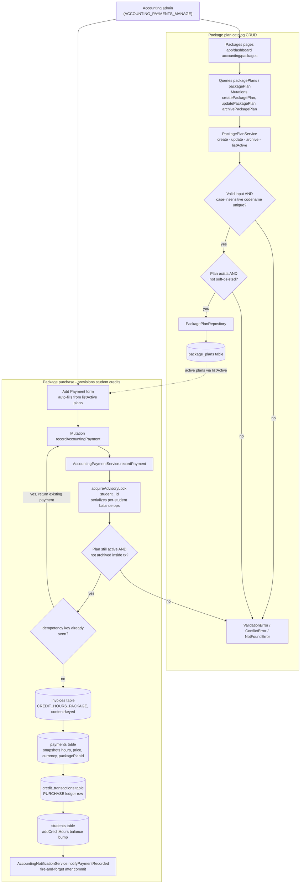

# Accounting Package Plans

Admins manage a catalog of predefined credit-hour package plans (`package_plans` table) from the `app/(dashboard)/accounting/packages` dashboard pages, which are guarded by `AppPermission.ACCOUNTING_PAYMENTS_VIEW` for reads and `ACCOUNTING_PAYMENTS_MANAGE` for creates, edits, and archives via the `createPackagePlan` / `updatePackagePlan` / `archivePackagePlan` GraphQL mutations. `PackagePlanService` validates each submission (non-empty codename and display name, positive hours and price, currency present), enforces case-insensitive codename uniqueness on top of the DB partial-unique index, and performs a soft-archive delete so historical payments keep their foreign key. A package plan is pure catalog config: at purchase time the hours, price, and currency are snapshotted onto the payment row, so later catalog edits never retroactively change existing payments. The Add Payment form pulls `listActive()` plans to auto-fill a purchase, and `AccountingPaymentService.recordPayment` then runs the whole provisioning in one transaction: it takes a per-student advisory lock, revalidates the plan is still active and not archived (archival-race guard), returns the existing row on idempotency-key replay, creates or reuses a content-keyed `CREDIT_HOURS_PACKAGE` invoice, inserts the `payments` row with the snapshot, writes a `PURCHASE` row to the `credit_transactions` ledger, and bumps the live `students` credit-hour balance. After commit, a fire-and-forget call to `AccountingNotificationService.notifyPaymentRecorded` notifies the family; validation failures surface as `ValidationError`, duplicate codenames as `ConflictError`, and missing or archived plans as `NotFoundError`.

## Key sources

- `app/(dashboard)/accounting/packages/page.tsx` — catalog list page, gated by `ACCOUNTING_PAYMENTS_VIEW`
- `app/(dashboard)/accounting/packages/new/page.tsx` — create page, gated by `ACCOUNTING_PAYMENTS_MANAGE`
- `app/(dashboard)/accounting/packages/[id]/edit/page.tsx` — edit page
- `backend/services/billing/package-plan.service.ts` — catalog CRUD, validation, codename uniqueness, soft-archive
- `backend/services/billing/accounting-payment.service.ts` — `recordPayment` purchase flow, idempotency, advisory lock, plan revalidation, ledger + balance writes, notification
- `backend/graphql/mutation/billing/accounting.mutation.ts` — `createPackagePlan`, `updatePackagePlan`, `archivePackagePlan`, `recordAccountingPayment`
- `backend/graphql/query/billing/accounting.query.ts` — `packagePlans`, `packagePlan` query fields
- `backend/db/repo/billing/package-plan.repository.ts` — package plan data access
- `backend/db/schema/billing/package-plans.ts` — `package_plans` catalog table, constraints, partial unique index

Machine-checkable diagram source: [accounting-packages.mmd](./accounting-packages.mmd)
