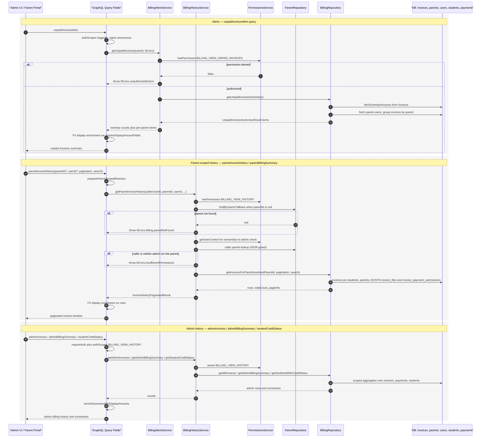

# Billing Alerts & History

This workflow covers how the platform assembles billing alerts (overdue/unpaid invoices) and the per-entity billing history timeline for admins and parents. Entry points are Pothos GraphQL query fields — `unpaidInvoicesAlert`, `parentInvoiceHistory`, `parentBillingSummary`, `adminInvoices`, `adminBillingSummary`, and `studentCreditStatus` — all gated by `authScopes` and re-checked inside the service layer. `BillingAlertsService.getUnpaidInvoices` requires `BILLING_VIEW_UNPAID_INVOICES`, then reads overdue invoices via `BillingRepository.getUnpaidInvoicesSummary`, groups them by parent, and joins parent users so the admin alert list shows who owes what. The history queries require `BILLING_VIEW_HISTORY`, parent-scoped ones additionally resolve a `parentId` (falling back to the caller's own parent record via `ParentRepository.findByUserId`) and enforce an ownership-vs-admin check added as an IDOR fix, throwing `parentNotFound` or `insufficientPermissions` on failure. Repository queries over `invoices`, joined with `students` and `parents`, carry `EXISTS` flags for `invoice_files` payment proofs and rejected `invoice_payment_submissions`, and support pagination plus a LIKE-based search. Edge cases include anonymous callers (rejected by `requireAuth`/auth scopes), missing parent profiles, and cross-tenant access attempts, before returning, resolvers enrich rows with FX display amounts via `resolveDisplayAmountFields`/`enrichSummaryWithDisplayAmounts`.

## Key sources

- `backend/services/billing/billing-alerts.service.ts`
- `backend/services/billing/billing-history.service.ts`
- `backend/graphql/query/billing/billing-alerts.query.ts`
- `backend/graphql/query/billing/billing-history.query.ts`
- `backend/db/repo/billing/billing.repository.ts`

## Diagram

Machine-readable copy: [billing-alerts-history.mmd](./billing-alerts-history.mmd)
