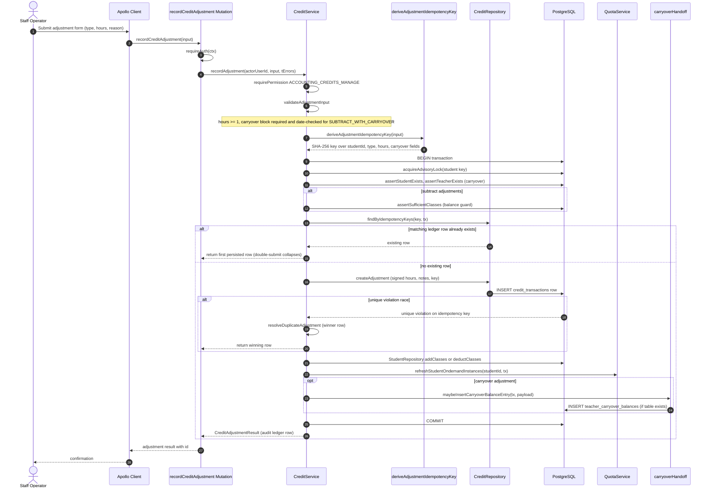

# Credit Adjustment with Idempotency

Accounting staff record corrective credit adjustments on a student's class-credit balance through the `recordCreditAdjustment` GraphQL mutation (invoked from the billing UI via the Apollo `recordCreditAdjustmentMutationDocument`). The resolver authenticates the caller, then `CreditService.recordAdjustment` enforces the `ACCOUNTING_CREDITS_MANAGE` permission and validates the input: hours must be a finite number of at least 1, and a subtract-with-carryover adjustment requires a complete carryover block (teacher, from/to dates, payment date not in the future). Every adjustment derives a deterministic SHA-256 idempotency key from the identifying fields (student, adjustment type, hours, carryover fields — deliberately excluding the free-text reason) via `deriveAdjustmentIdempotencyKey`, so a retried or double-submitted request collapses onto the same ledger row instead of double-writing. The adjustment executes in a single transaction: a per-student advisory lock serializes concurrent adjustments, the balance guard (`assertSufficientClasses`) rejects over-deductions under that lock, the idempotency check returns the first persisted row on a double-submit, and a unique-key race on `credit_transactions.idempotency_key` resolves to the winning row. A successful run inserts the signed ledger row (the audit entry, carrying the sanitized reason notes and the crediting user), adjusts the student's class count, refreshes on-demand quota instances, and — for carryover adjustments only — mirrors the entry into `teacher_carryover_balances` when that table exists.

## Key sources

- `backend/graphql/mutation/billing/credit-adjustment.mutation.ts` — Pothos `recordCreditAdjustment` mutation field, auth, resolver delegation
- `backend/services/billing/credit.service.ts` — `recordAdjustment`, `validateAdjustmentInput`, `executeAdjustmentTransaction`, `runAdjustment`, `assertSufficientClasses`, `resolveDuplicateAdjustment`
- `backend/services/billing/credit-adjustment.idempotency.ts` — `deriveAdjustmentIdempotencyKey` (SHA-256 over identifying fields)
- `backend/services/billing/carryover-handoff.ts` — `maybeInsertCarryoverBalanceEntry` (no-op until the payouts table ships)
- `backend/db/repo/billing/credit.repository.ts` — `createAdjustment`, `findByIdempotencyKeys`
- `backend/db/schema/billing/credit-transactions.ts` — `credit_transactions` table with unique `idempotency_key` index
- `frontend/common/graphql/sharedDocuments/billing/credit-adjustment.documents.ts` — client-side mutation document

## Diagram

[Machine-checkable copy: `docs/diagram/billing/credit-adjustment.mmd`](credit-adjustment.mmd)
