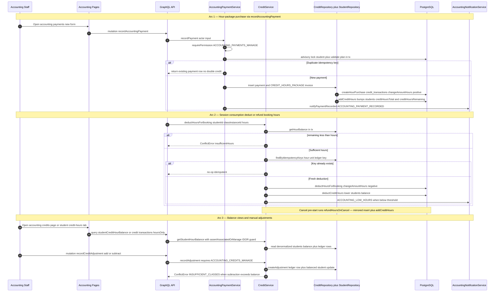

# Credit-Hours Accounting Flow

The hour-based parallel ledger lets accounting staff sell time to students as hour packages beside the existing class-quota system: every hour write lands in `credit_transactions.changeAmountHours` (XOR with the class-based `changeAmount`) and is mirrored onto the denormalized `students.creditHoursTotal` / `creditHoursRemaining` columns inside the same transaction. A staff member triggers a purchase from the accounting payments form, and `AccountingPaymentService.recordPayment` atomically records the payment and its `CREDIT_HOURS_PACKAGE` invoice, inserts the positive hour ledger row, and bumps the student's balance — all under a per-student advisory lock with content-derived idempotency keys, so double-submits and concurrent retries return the original row instead of double-crediting. Session consumption runs through `CreditService.deductHoursForBooking` (wired in production once the `student.billingMode` discriminator lands per deferred item D-1), which checks the hour balance, writes a negative ledger row under a unit-discriminated idempotency key, and decrements the student balance; cancelling an instance pre-start mirrors the flow through `refundHoursOnCancel`. Balances are exposed via the `studentCreditHourBalance` query (IDOR-guarded by `assertAssociatedOrManage`) and surface in the student profile credit-hours tab and the accounting credits list, where staff with `ACCOUNTING_CREDITS_MANAGE` can also post manual add/subtract adjustments through `CreditService.recordAdjustment` — subtractions are guarded by a sufficiency check inside the advisory-locked transaction, and subtract-with-carryover additionally writes a teacher payout carryover row. After a committed purchase, `AccountingNotificationService` fires a non-blocking `ACCOUNTING_PAYMENT_RECORDED` notification, and a low-hour `ACCOUNTING_LOW_HOURS` reminder goes out when the balance drops below the configured threshold.

## Key sources

- `app/(dashboard)/accounting/credits/page.tsx` — credits list route gated by `withPageAuth([ACCOUNTING_CREDITS_MANAGE])`
- `backend/services/billing/credit.service.ts` — hour ledger purchase/deduction/refund, adjustments, balances, idempotency keys
- `backend/services/billing/accounting-payment.service.ts` — `recordPayment` single-tx purchase flow (invoice, payment, hour credit, notification)
- `backend/db/repo/billing/credit.repository.ts` — `createHourPurchase`, `deductHoursForBooking`, `getHourBalance`, ledger queries
- `docs/billing/credit-hours-system.md` — canonical reference: data model, XOR CHECK, notifications, deferred items

## Diagram

Machine-checkable copy: [credit-hours-accounting.mmd](./credit-hours-accounting.mmd)
