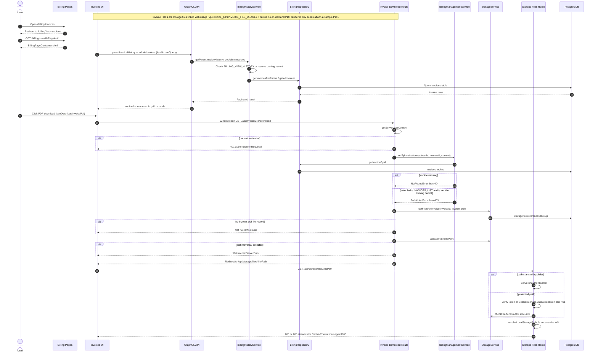

# Invoice Management & PDF Download

The legacy `/billing/invoices` page only redirects to the tabbed billing page (`/billing?tab=invoices`), which is guarded by `withPageAuth` and renders the invoices grid/cards. Listing data is fetched through the GraphQL `parentInvoiceHistory` (parents) or `adminInvoices` (staff) queries, which route through `BillingHistoryService` for permission/ownership checks before `BillingRepository` queries the `invoices` table. Staff create invoices and drive their lifecycle through the GraphQL mutations backstopped by `BillingManagementService` (create, submit/approve/reject payment proof, mark paid, delete, remind), with best-effort notification dispatches after each state change — but no on-demand PDF renderer exists: the downloadable PDF is simply a storage file linked to the invoice with usage type `invoice_pdf` (`INVOICE_FILE_USAGE`), which in dev comes from the seed attaching a sample PDF. Clicking download in the UI opens `/api/invoices/[id]/download` in a new tab, that route authenticates the session (401 otherwise), calls `BillingManagementService.verifyInvoiceAccess` so only super-admins, users holding `INVOICES_LIST`/`BILLING_VIEW_UNPAID_INVOICES`, or the invoice's owning parent pass (404 for a missing invoice, 403 for anyone else), then looks up the `invoice_pdf` file (404 `noPdfAvailable` when absent) and rejects traversal-unsafe paths (500) before redirecting to `/api/storage/files/<filePath>`. The storage route serves `public/` paths without authentication but requires a JWT or validated session plus a `StorageService.checkFileAccess` ACL for protected paths, resolves the file on disk (404 when missing), and streams it with range support and a `Cache-Control: public, max-age=3600` header.

## Key sources

- `app/(dashboard)/billing/invoices/page.tsx` — redirect-only page shim to `/billing?tab=invoices`
- `app/(dashboard)/billing/page.tsx` — `withPageAuth`-protected billing page rendering `BillingPageContainer`
- `frontend/common/views/dashboard/billing/tabs/invoices/InvoicesTab.tsx` — invoices tab mounting `ParentBillingContainer`
- `frontend/common/views/dashboard/billing/hooks/useDownloadInvoicePdf.ts` — opens `/api/invoices/[id]/download` in a new tab
- `frontend/common/graphql/sharedDocuments/parents/parent-billing-history.documents.ts` — `parentInvoiceHistory` / `adminInvoices` documents
- `backend/graphql/query/billing/billing-history.query.ts` — listing query field registrations
- `backend/services/billing/billing-history.service.ts` — listing permission/ownership checks and repo calls
- `backend/graphql/mutation/billing/billing-management.mutation.ts` — invoice lifecycle mutations
- `backend/services/billing/billing-management.service.ts` — invoice create/pay/delete logic and `verifyInvoiceAccess`
- `app/api/invoices/[id]/download/route.ts` — authenticated download route with ACL, PDF lookup, path validation, redirect
- `backend/services/storage/storage.service.ts` — `getFilesForInvoice`, `validatePath`, `checkFileAccess`
- `app/api/storage/files/[[...path]]/route.ts` — file streaming with auth/ACL, range responses, cache headers
- `shared/constants/billing/invoice-file-usage.ts` — `invoice_pdf` usage-type constant
- `backend/db/seeds/billing/seed-invoices.ts` — dev seed attaching the sample invoice PDF

## Diagram

Machine-checkable copy: [invoice-generation-download.mmd](./invoice-generation-download.mmd)
