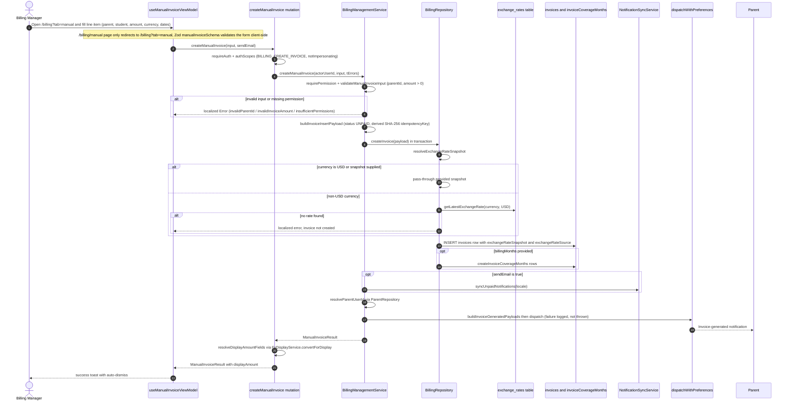

# Manual Invoice Creation

A staff member with the `BILLING_CREATE_INVOICE` permission creates a one-off invoice for a parent from the Manual tab of the Billing page (`/billing?tab=manual`, the legacy `/billing/manual` route only redirects there). The `useManualInvoiceViewModel` client hook validates the line item (parent, optional student, amount, currency, issue/due dates) with the Zod `manualInvoiceSchema`, then calls the GraphQL `createManualInvoice` mutation, which enforces auth, the `notImpersonating` scope, and argument constraints before delegating to `BillingManagementService.createManualInvoice`. The service re-checks permissions and input (non-empty parentId, positive amount), builds an insert payload with status `UNPAID` and a derived SHA-256 `idempotencyKey`, and inserts the `invoices` row inside a transaction. For non-USD currencies without an explicit snapshot, the repository resolves the latest recorded FX rate from the `exchange_rates` table and stores the `exchangeRateSnapshot`/`exchangeRateSource` on the invoice — if no rate exists, creation fails with a localized error, optional billing months are written to `invoiceCoverageMonths`. After commit, `NotificationSyncService.syncUnpaidNotifications` refreshes unpaid-invoice notifications when `sendEmail` was chosen, and an invoice-generated notification is dispatched to the parent (resolved via `ParentRepository`) through `dispatchWithPreferences`, notification failures are logged but never roll back the invoice. Finally, the resolver converts the amount to the viewer's display currency via `FxDisplayService.convertForDisplay` (`resolveDisplayAmountFields`), returning a `ManualInvoiceResult` whose `displayAmount` is shown in the UI alongside a success toast.

## Key sources

- `app/(dashboard)/billing/manual/page.tsx` — redirect-only route to `/billing?tab=manual`
- `frontend/common/views/dashboard/billing/manual/useManualInvoiceViewModel.ts` — RHF/Zod form, Apollo `useMutation(createManualInvoiceMutationDocument)`
- `frontend/common/views/dashboard/billing/manual/schemas/manualInvoiceSchema.ts` — client-side line-item validation
- `backend/graphql/mutation/billing/billing-management.mutation.ts` — `createManualInvoice` mutation field, auth scopes, `resolveDisplayAmountFields`
- `backend/services/billing/billing-management.service.ts` — permission check, input validation, payload building, coverage months, notification dispatch
- `backend/db/repo/billing/billing.repository.ts` — `createInvoice` transaction, `resolveExchangeRateSnapshot`, `createInvoiceCoverageMonths`
- `backend/graphql/pothos/billing/fx-display.pothos.ts` — FX conversion of the returned amount to the display currency

## Diagram

Machine-checkable copy: [manual-invoice.mmd](./manual-invoice.mmd)
