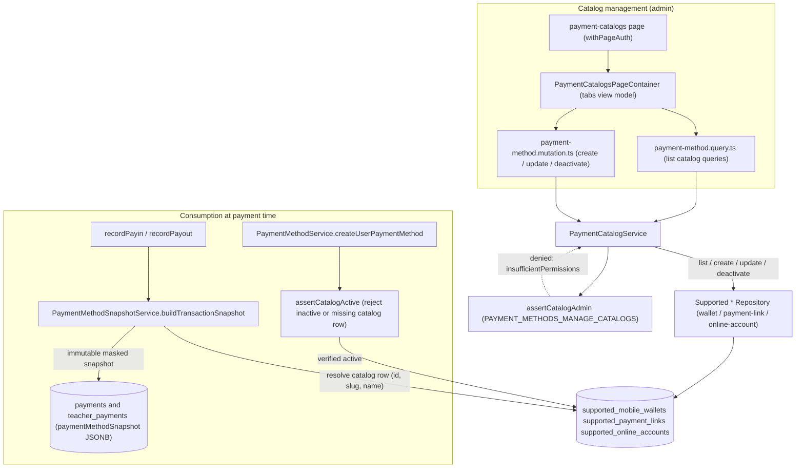

# Payment Method Catalog

The payment method catalog is the set of admin-managed templates (mobile wallets, payment links, online accounts) that the academy accepts at payment time. An admin with `PAYMENT_METHODS_MANAGE_CATALOGS` opens the `payment-catalogs` dashboard page, which renders `PaymentCatalogsPageContainer` and talks to the GraphQL layer (`payment-method.query.ts` for lists, `payment-method.mutation.ts` for create/update/deactivate). Every operation funnels through `PaymentCatalogService`, whose `assertCatalogAdmin` gate rejects callers lacking the permission with a localized `insufficientPermissions` error. Catalog CRUD is delegated to the three `Supported*Repository` implementations, which persist rows in the `supported_mobile_wallets`, `supported_payment_links`, and `supported_online_accounts` tables; listings default to active rows with optional direction/country filters. The catalog is consumed downstream in two ways: `PaymentMethodService.createUserPaymentMethod` runs `assertCatalogActive` so a user method cannot reference an inactive or deleted catalog entry, and `PaymentMethodSnapshotService.buildTransactionSnapshot` resolves the catalog row (id, slug, name) into an immutable masked/encrypted snapshot that `recordPayin`/`recordPayout` store on the payment record, so historical transactions survive later catalog edits or deactivation. Soft-deactivation (rather than hard delete) plus the snapshot keeps in-flight and past payments auditable while removed templates disappear from new selections.

## Key sources

- `app/(dashboard)/payment-catalogs/page.tsx`
- `frontend/common/views/dashboard/admin/payment-catalogs/PaymentCatalogsPageContainer.tsx`
- `backend/graphql/query/billing/payment-method.query.ts`
- `backend/graphql/mutation/billing/payment-method.mutation.ts`
- `backend/services/payment-method/payment-catalog.service.ts`
- `backend/services/payment-method/payment-method.service.ts`
- `backend/services/payment-method/payment-method-snapshot.ts`

Machine-checkable copy: [payment-methods.mmd](./payment-methods.mmd)
