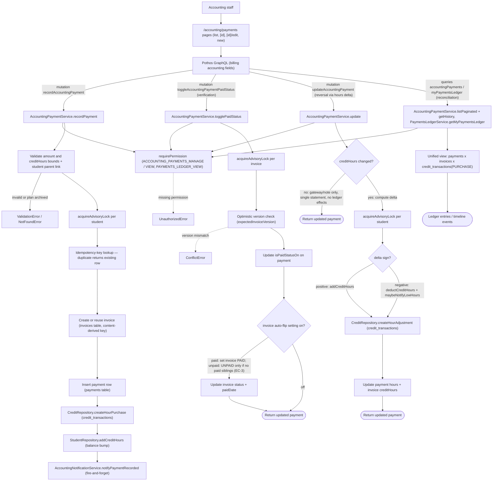

# Payments Ledger Back Office

Accounting staff manage the unified payments ledger through the `/accounting/payments` dashboard pages (list, detail, edit, new). Every action enters through Pothos GraphQL fields (`recordAccountingPayment`, `toggleAccountingPaymentPaidStatus`, `updateAccountingPayment`, plus the `accountingPayments`/`myPaymentsLedger` queries) and is gated by `ACCOUNTING_PAYMENTS_MANAGE`/`ACCOUNTING_PAYMENTS_VIEW` (staff) or `PAYMENTS_LEDGER_VIEW` (parents/students reading their own ledger via `PaymentsLedgerService.getMyPaymentsLedger`). Recording a payment runs inside a transaction guarded by a per-student advisory lock: an idempotency key makes replays return the existing row, an invoice is created or reused under a content-derived key, the payment row is inserted, an hour-purchase row lands in `credit_transactions`, and the student's credit-hours balance is bumped in the same transaction, followed by a fire-and-forget `notifyPaymentRecorded` notification. Verification is the paid-toggle flow: the invoice is locked and optimistic-version checked (`ConflictError` on mismatch), `isPaidStatusOn` flips on the payment, and the invoice cascades to `PAID`/`UNPAID` — dropping to `UNPAID` only when no other paid sibling payment remains (EC-3). Reversal/correction is modeled as editing `creditHours`: gateway/note-only edits touch no ledger rows, while hour changes compute a signed delta, add or deduct the student balance, write a `createHourAdjustment` ledger entry, and probe low-hours notification after deductions. Reconciliation surfaces through `getHistory` (derived timeline of payment, paid-mark, and hour-ledger events) and the read queries that join `payments` × `invoices` × `credit_transactions(PURCHASE)` into ledger entries. Edge cases include service-enforced amount/hour bounds (`@constraint` is SDL-only), archived package plans rejected inside the transaction, unique-violation races resolved by returning the winner's row, and empty ledgers for callers with no associated students.

## Key sources

- `backend/services/billing/accounting-payment.service.ts` — record, toggle (verification), update (adjustment/reversal), history
- `backend/services/payments-ledger/payments-ledger.service.ts` — read-only unified ledger (`getMyPaymentsLedger`)
- `backend/graphql/mutation/billing/accounting.mutation.ts` — `recordAccountingPayment`, `updateAccountingPayment`, `toggleAccountingPaymentPaidStatus`
- `backend/graphql/query/billing/accounting.query.ts` — `accountingPayments`, `accountingPayment`
- `backend/graphql/query/billing/payments-ledger.query.ts` — `myPaymentsLedger` field
- `backend/graphql/pothos/billing/payments-ledger.pothos.ts` — `PaymentLedgerEntry` object type
- `app/(dashboard)/accounting/payments/page.tsx` — staff entry page (withPageAuth)
- `app/(dashboard)/parent/payments/page.tsx` — parent-facing ledger page
- `frontend/common/graphql/sharedDocuments/billing/payments-ledger.documents.ts` — ledger query document

## Diagram

Machine-checkable copy: [payments-ledger-admin.mmd](./payments-ledger-admin.mmd)
