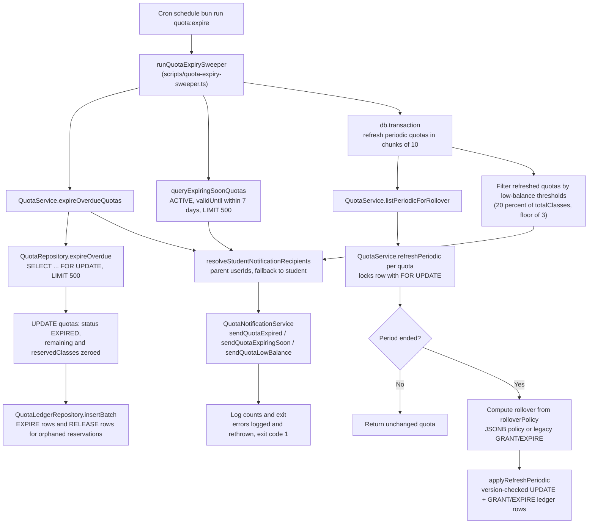

# Quota Expiry Sweeper Job

The quota expiry sweeper is a periodic cron job (invoked via `bun run quota:expire`) that keeps the quota ledger consistent as time passes. Its single entry point, `runQuotaExpirySweeper`, first expires overdue quotas: `QuotaRepository.expireOverdue` locks up to 500 overdue `ACTIVE` rows with `SELECT ... FOR UPDATE`, zeroes their remaining and reserved balances, and writes closing `EXPIRE` ledger rows (plus `RELEASE` rows for orphaned reserved classes) into the `quota_ledger` table in one batch. It next queries quotas whose `validUntil` falls within the following 7 days for "expiring soon" notices, then runs a transaction that refreshes every rollover-eligible PERIODIC quota in chunks of 10 — `QuotaService.refreshPeriodic` locks each row, skips it if the period has not ended, and otherwise computes the rollover from the quota's `rolloverPolicy` (a JSONB cap policy or legacy GRANT/EXPIRE string) before writing a version-checked update and GRANT/EXPIRE ledger rows. Refreshed quotas are filtered for low balance (remaining within 20% of `totalClasses`, floored at 3 classes) to flag low-balance notifications. After the transaction commits, notification recipients are resolved per quota — preferring the parent, falling back to the student — and `QuotaNotificationService` dispatches expired, expiring-soon, and low-balance notifications in parallel, skipping quotas with no affected users. Notifications are deliberately sent only after the transaction commits so a rollback never strands a false alert. Any error is logged and rethrown, causing the process to exit with code 1; the per-run row limit (500) means large backlogs drain over successive cron ticks. All writing operations are idempotent via derived idempotency keys, so re-running the sweeper on the same day is safe.

## Key sources

- `scripts/quota-expiry-sweeper.ts` — cron entry point, sweep orchestration, notification dispatch
- `backend/services/billing/quota.service.ts` — `expireOverdueQuotas`, `listPeriodicForRollover`, `refreshPeriodic` (period-end check, rollover computation)
- `backend/db/repo/billing/quota.repository.ts` — `expireOverdue` (FOR UPDATE lock, zeroing update, EXPIRE/RELEASE ledger batch)
- `backend/services/billing/quota-notification.service.ts` — `sendQuotaExpired`, `sendQuotaExpiringSoon`, `sendQuotaLowBalance`
- `scripts/lib/resolve-notification-recipients.ts` — parent/student recipient resolution

## Diagram

Machine-checkable copy: [quota-expiry-sweep.mmd](./quota-expiry-sweep.mmd)
