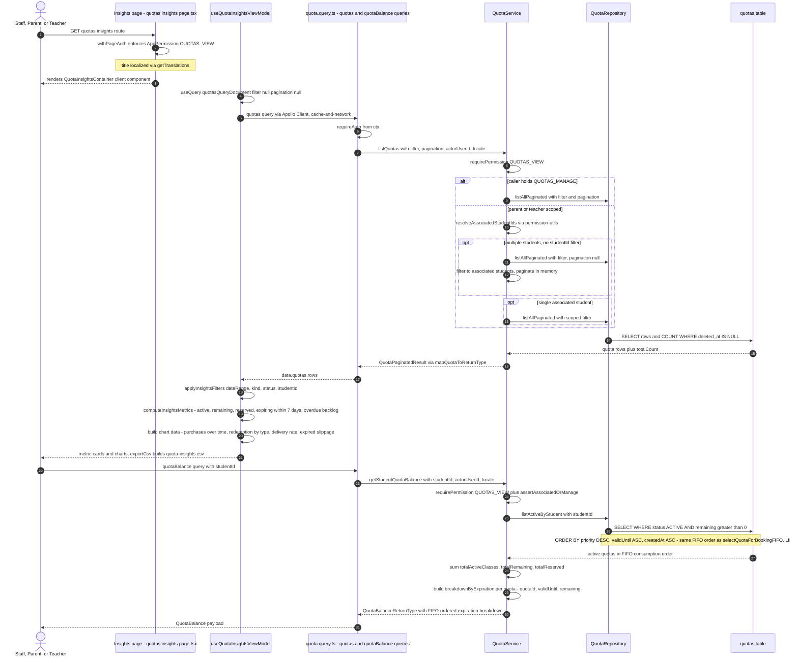

# Quota Insights & Balances

The `/quotas/insights` dashboard page is the analytics surface for the billing quota system. The server component in `app/(dashboard)/quotas/insights/page.tsx` wraps rendering in `withPageAuth(AppPermission.QUOTAS_VIEW)`, so only authenticated users with that permission reach the page, it then mounts the client-side `QuotaInsightsContainer`, which delegates to `useQuotaInsightsViewModel`. The view model issues the `quotas` GraphQL query (cache-and-network, no filter/pagination) via Apollo, the resolver in `backend/graphql/query/billing/quota.query.ts` requires auth and delegates to `QuotaService.listQuotas`. That service enforces `QUOTAS_VIEW` again and applies IDOR scoping: callers with `QUOTAS_MANAGE` see all quotas, while parents and teachers are restricted to their associated students via `resolveAssociatedStudentIds` — with multiple students and no explicit `studentId` filter, the full scoped set is fetched and filtered/paginated in memory so pagination operates only on authorized rows. Back on the client, the view model applies local filters (date range, kind, status, student), computes headline metrics (active count, total remaining, total reserved, quotas expiring within 7 days, and an overdue "pending backlog" of active quotas past `validUntil` with remaining classes), and builds the four chart series plus a CSV export. A separate `quotaBalance` query powers the per-student balance view: `QuotaService.getStudentQuotaBalance` gates with `QUOTAS_VIEW` plus `assertAssociatedOrManage`, loads active quotas through `QuotaRepository.listActiveByStudent` ordered by priority DESC, `validUntil` ASC, `createdAt` ASC — the exact FIFO ordering used by `selectQuotaForBookingFIFO` — and returns aggregated totals with a FIFO-ordered `breakdownByExpiration`, projecting which quota will drain first. Edge cases: callers with no associated students receive empty results rather than an error, and rows are only quotas that are not soft-deleted (and, for balances, ACTIVE with remaining > 0).

## Key sources

- `app/(dashboard)/quotas/insights/page.tsx` — server entry, `withPageAuth([AppPermission.QUOTAS_VIEW])`
- `frontend/common/views/dashboard/billing/quota/QuotaInsightsContainer.tsx` — client container, responsive mobile/desktop views
- `frontend/common/views/dashboard/billing/quota/useQuotaInsightsViewModel.ts` — Apollo query, filters, metrics, CSV export
- `frontend/common/views/dashboard/billing/quota/utils/quotaInsights.helpers.ts` — `computeInsightsMetrics` and chart builders
- `backend/graphql/query/billing/quota.query.ts` — `quotas` and `quotaBalance` query resolvers
- `backend/graphql/pothos/billing/quota.pothos.ts` — `Quota`, `QuotaBalance`, `QuotaExpirationBreakdown` object types
- `backend/services/billing/quota.service.ts` — `listQuotas` (IDOR scoping) and `getStudentQuotaBalance` (aggregation)
- `backend/db/repo/billing/quota.repository.ts` — `listAllPaginated`, `listActiveByStudent`, `selectQuotaForBookingFIFO` (FIFO ordering)

Machine-checkable copy: [quota-insights.mmd](./quota-insights.mmd)
