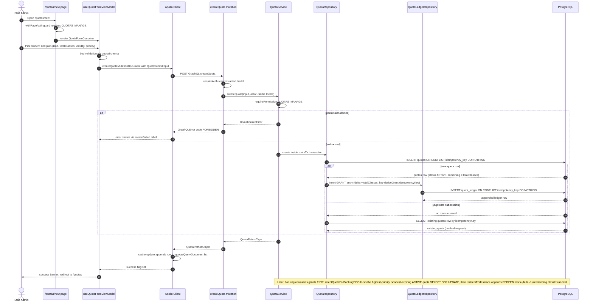

# Quota Purchase & Ledger Append

A staff admin with the `QUOTAS_MANAGE` permission opens `/quotas/new`, a page guarded by `withPageAuth`, and fills the quota form rendered by `QuotaFormContainer` — choosing a student, quota kind (PACKAGE or PERIODIC), total classes, validity window, and priority. The form view model validates the input client-side with a Zod schema, then issues the `createQuota` GraphQL mutation through Apollo; the resolver authenticates the caller and delegates to `QuotaService.createQuota`, which enforces the `QUOTAS_MANAGE` permission and opens a database transaction. Inside the transaction, `QuotaRepository.create` inserts the `quotas` row with status ACTIVE and `remaining = totalClasses`, guarded by `ON CONFLICT (idempotency_key) DO NOTHING` so duplicate submissions or retries return the existing row instead of double-granting. Immediately after, `QuotaLedgerRepository.insert` appends an idempotent GRANT entry (delta `+totalClasses`) to the append-only `quota_ledger` table, making the ledger the auditable source of truth for the new balance. On success the Apollo cache is updated in place and the user is redirected to the quotas list; permission failures surface as a localized FORBIDDEN error. Later, booking flows consume the grant via FIFO: `selectQuotaForBookingFIFO` row-locks the highest-priority, soonest-expiring active quota, and `redeemForInstance` appends REDEEM ledger entries linked to each class instance.

## Key sources

- `app/(dashboard)/quotas/new/page.tsx` — page entry, `withPageAuth([AppPermission.QUOTAS_MANAGE])` guard
- `frontend/common/views/dashboard/billing/quota/QuotaFormContainer.tsx` — form container wiring the view model to mobile/desktop views
- `frontend/common/views/dashboard/billing/quota/useQuotaFormViewModel.ts` — form state, Zod validation, `createQuotaMutationDocument` submission, cache update, redirect
- `frontend/common/graphql/sharedDocuments/billing/quota.documents.ts` — `createQuotaMutationDocument` GraphQL document
- `backend/graphql/mutation/billing/quota.mutation.ts` — `createQuota` mutation field, auth, error-code mapping
- `backend/services/billing/quota.service.ts` — `createQuota`, permission gate, transaction wrapper, FIFO `selectQuotaForBookingFIFO` / `redeemForInstance` consumption entry points
- `backend/db/repo/billing/quota.repository.ts` — idempotent quota INSERT, GRANT ledger append, FIFO selection ordering and row locking
- `backend/db/repo/billing/quota-ledger.repository.ts` — append-only ledger insert with idempotency-key conflict handling

Machine-checkable copy: [quota-purchase.mmd](quota-purchase.mmd)
