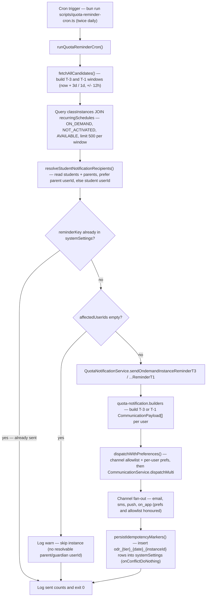

# Quota Smart Reminders (On-Demand T-3 / T-1)

`runQuotaReminderCron` in `scripts/quota-reminder-cron.ts` is a standalone Bun cron entry point (run once or twice daily) that scans for upcoming **on-demand** class instances and sends reminder notifications before they start. It queries `classInstances` joined to `recurringSchedules` for instances that are `SchedulingMode.ON_DEMAND`, `ClassExecutionState.NOT_ACTIVATED`, and `OnDemandStatus.AVAILABLE`, falling within a ±12-hour window around the T-3 (3-day) and T-1 (1-day) lead times, capped at 500 candidates per window. For each student it resolves notification recipients via `resolveStudentNotificationRecipients`, preferring the parent's `userId` and falling back to the student's own `userId`. Each candidate gets a deterministic idempotency key (`odr_{tier}_{UTC-date}_{instanceId}`); keys already present in `systemSettings` are skipped, so re-runs within the same calendar day are safe and never double-send. Reminders are dispatched through `QuotaNotificationService.sendOndemandInstanceReminderT3/T1`, which build per-user payloads and route them via `dispatchWithPreferences` — honouring the event/channel allowlist and each user's notification preferences before fan-out to email, SMS, push, and on-app channels. Successful dispatches are recorded by inserting the idempotency keys into `systemSettings` with `onConflictDoNothing`. Edge cases: instances with no resolvable parent/guardian user are skipped with a warning; `PENDING_CREDIT` instances are excluded by the filter; transient per-user dispatch failures are logged without breaking the run, while a top-level failure re-throws so the process exits non-zero.

## Key sources

- `scripts/quota-reminder-cron.ts` — cron entry point, window computation, candidate fetch, idempotency markers
- `scripts/lib/resolve-notification-recipients.ts` — batch student/parent recipient resolution
- `backend/services/billing/quota-notification.service.ts` — `sendOndemandInstanceReminderT3/T1` dispatch wrappers
- `backend/services/notification/quota-notification.builders.ts` — T-3/T-1 payload builders (referenced by the service)
- `backend/services/notification/notification-dispatch.helpers.ts` — `dispatchWithPreferences` allowlist/prefs/channel fan-out

Source: [quota-reminders.mmd](./quota-reminders.mmd)
