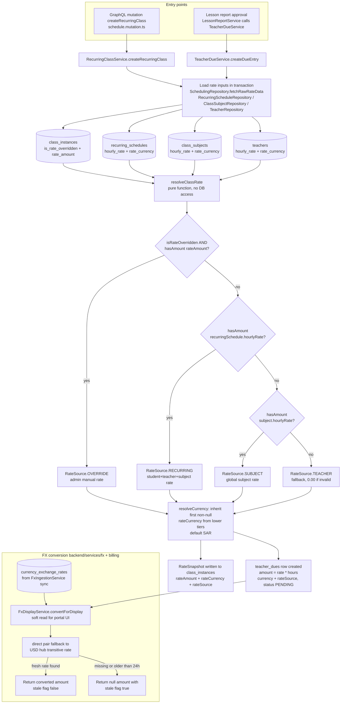

# Session Rate Resolution

Every class needs an effective monetary rate, and that rate is resolved by a strict 4-tier cascade implemented in the pure function `resolveClassRate` (`backend/services/pricing/rate-resolver.service.ts`). Two entry points drive it: the GraphQL `createRecurringClass` mutation (via `RecurringClassService`, which snapshots the resolved rate onto the generated `class_instances` rows) and the lesson-report approval path (via `TeacherDueService.createDueEntry`, which turns the resolved rate into a payable `teacher_dues` row: `amount = rate * hours`). Both callers first load the candidate rate rows — the class instance override, the recurring schedule, the subject, and the teacher — inside the surrounding transaction, then the cascade picks the first tier whose amount is a non-empty string that parses to a finite number greater than zero: `OVERRIDE` (admin manual rate on the class instance) > `RECURRING` (per student+teacher+subject) > `SUBJECT` (global per subject) > `TEACHER` (fallback, emitting `0.00` when even the teacher rate is invalid). Currency is decided independently by `resolveCurrency`, which inherits the first non-null `rateCurrency` walking down the tiers and falls back to `SAR`. Once a teacher due (or invoice/payment amount) is locked in its own currency, the FX side of billing takes over for any cross-currency need: `FxDisplayService.convertForDisplay` converts a locked amount into a display currency using the latest row in `currency_exchange_rates` (populated by `FxIngestionService` from USD-hub provider syncs), riding the direct pair when fresh and falling back to a transitive USD-hub rate otherwise, while rates missing or older than 24 hours return `stale: true` (and a `null` amount) so the UI degrades gracefully instead of quoting an outdated number. Financial insert paths use the stricter throw variant `getLatestExchangeRate` in `BillingRepository`, which fails the transaction rather than write with a stale rate.

## Key sources

- `backend/services/pricing/rate-resolver.service.ts` — pure 4-tier cascade (`OVERRIDE` / `RECURRING` / `SUBJECT` / `TEACHER`), `hasAmount` validation, and `resolveCurrency` inheritance with `SAR` default
- `backend/services/teacher/teacher-due.service.ts` — `createDueEntry`: loads inputs in-tx, resolves rate, computes `amount = rate * hours`, inserts `teacher_dues` with currency + `rateSource`
- `backend/services/schedule/recurring-class.service.ts` — recurring-class booking snapshot path: `fetchRawRateData` → `resolveClassRate` → `RateSnapshot` stored on class instances
- `backend/db/repo/scheduling/state-changes.ts` and `backend/db/repo/billing/billing.repository.ts` — transaction state changes and the `currency_exchange_rates` read/write + `exchangeRateSnapshot` logic (`getLatestExchangeRate` throw variant vs `getLatestExchangeRateForDisplay` soft variant)
- `backend/services/billing/fx-display.service.ts` — `convertForDisplay`: direct pair lookup, USD-hub transitive fallback, stale-rate contract
- `backend/services/fx/fx-ingestion.service.ts` and `backend/services/fx/fx-rate-query.service.ts` — provider sync writing both directions of USD-hub pairs into `currency_exchange_rates`, and stale-sync health computation (24h window)
- `backend/db/schema/billing/billing.ts` / `backend/db/schema/teachers/teacher-dues.ts` / `backend/enum/pricing/rate-source.enum.ts` — `currency_exchange_rates`, `teacher_dues` tables and the `RateSource` enum

Machine-checkable copy: [rate-resolution.mmd](./rate-resolution.mmd)
