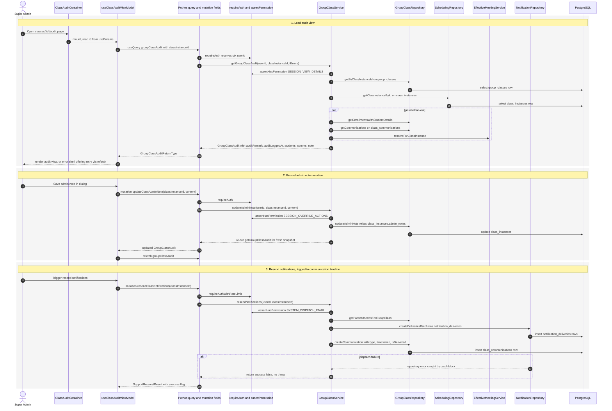

# Class Audit Trail

The class audit page at `app/(dashboard)/classes/[id]/audit/page.tsx` lets a super admin inspect the full recorded state of a class instance. When the view loads, `useClassAuditViewModel` issues the `groupClassAudit` query (Apollo `useQuery` with `classInstanceId`), and the Pothos field resolves the caller via `requireAuth` before delegating to `GroupClassService.getGroupClassAudit`, which asserts the `SESSION_VIEW_DETAILS` permission for actor attribution. The service reads the `group_classes` row (including the `audit_remark` / `audit_logged_at` snapshot columns written when the class record was provisioned), the `class_instances` row, and fans out in parallel for enrolled students, the `class_communications` log, and effective meeting info, then assembles a single `GroupClassAudit` payload. Two corrective actions are recorded as side effects visible in the view: `updateClassAdminNote` asserts `SESSION_OVERRIDE_ACTIONS`, writes `class_instances.admin_notes`, and returns a freshly re-queried audit; `resendClassNotifications` is rate-limited, asserts `SYSTEM_DISPATCH_EMAIL`, inserts `notification_deliveries` rows for the parents, and appends a timestamped `class_communications` entry so the resend appears on the timeline. Edge cases: a missing group class or class instance throws a translated `notFound` error, missing permissions yield an unauthorized error, the client renders an error shell with a retry that re-runs `refetch`, and notification dispatch failures are caught and surfaced as `success: false` instead of throwing. Note that this view does not read the generic `audit_logs` / `admin_audit_logs` tables managed by `AuditService` — class audit state lives directly on the class and communication tables.

## Key sources

- `app/(dashboard)/classes/[id]/audit/page.tsx`
- `frontend/common/views/dashboard/classes/audit/ClassAuditContainer.tsx`
- `frontend/common/views/dashboard/classes/audit/useClassAuditViewModel.ts`
- `backend/graphql/query/classes/group-class.query.ts`
- `backend/graphql/mutation/classes/group-class.mutation.ts`
- `backend/graphql/pothos/classes/group-class.pothos.ts`
- `backend/services/group-class/group-class.service.ts`
- `backend/services/system/audit.service.ts` (generic audit-log service; confirmed not used by this view)
- `backend/db/repo/classes/group-class.repository.ts`
- `backend/db/schema/classes/group-class.ts`

## Diagram

Editable copy: [audit-trail-review.mmd](audit-trail-review.mmd)
