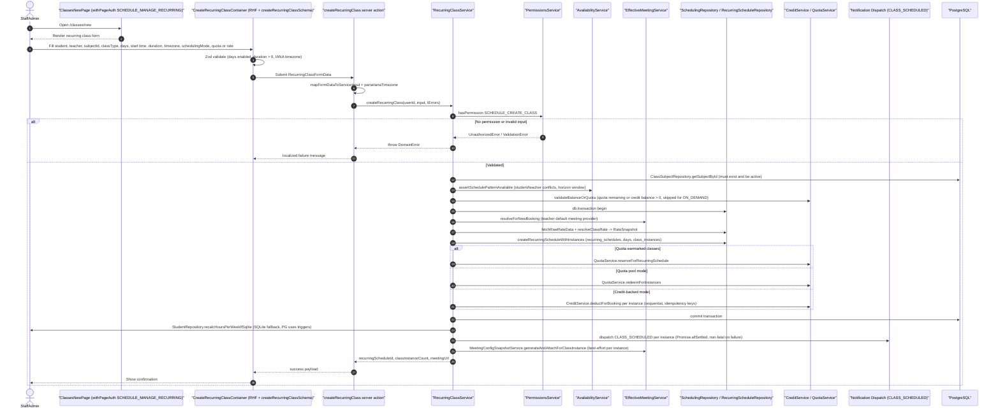

# Class Catalog Entry Creation

Creating a class at `/classes/new` registers a recurring class in the class catalog for a student–teacher–subject combination. The page (`app/(dashboard)/classes/new/page.tsx`) is gated by `withPageAuth` with `SCHEDULE_MANAGE_RECURRING` and renders `CreateRecurringClassContainer`, a react-hook-form + Zod form instantiating the compile-time `createRecurringClassSchema` (subject, classType `REGULAR`/`TRIAL`/`ADVANCE`, day-of-week pattern, default start time, duration, IANA timezone, scheduling mode, optional quota/rate overrides). On submit the `createRecurringClass` server action maps the form to a service input and calls `RecurringClassService.createRecurringClass`, which validates permission (`SCHEDULE_CREATE_CLASS`), the subject's active status, schedule-pattern conflicts via `AvailabilityService`, and credit balance or quota remaining (skipped for `ON_DEMAND` mode). Inside a single DB transaction it resolves the teacher's default meeting provider, computes a frozen rate snapshot, writes the `recurring_schedules` row, its day rows, and the generated `class_instances`, then reserves quota (earmark or pool redeem) or deducts credits per instance with idempotency keys. After commit, the service fires `CLASS_SCHEDULED` notifications per instance (failures are logged, never thrown) and best-effort generates meeting join URLs, so the class is immediately ready to be scheduled and attended, note the subject catalog itself (categories/subjects/resources) is bootstrapped separately via `ClassCatalogService` upserts in `backend/services/classes/class-catalog.service.ts`.

## Key sources

- `app/(dashboard)/classes/new/page.tsx` — page entry, `withPageAuth` gating, renders the recurring-class container
- `app/(dashboard)/classes/new/actions.ts` — `createRecurringClass` server action: input mapping, days check, localized error handling
- `frontend/common/views/dashboard/classes/recurring/recurringClassSchema.ts` — Zod schema for the form (subjectId, classType, days, duration, timezone, schedulingMode, quota/rate fields)
- `backend/services/schedule/recurring-class.service.ts` — `RecurringClassService.createRecurringClass`: validation, transaction, side effects
- `backend/services/classes/class-catalog.service.ts` — subject/category/resource catalog upserts used by seeders (read for the "catalog entry" framing, not called by the page)

## Diagram

Machine-checkable copy: [class-creation.mmd](./class-creation.mmd)
