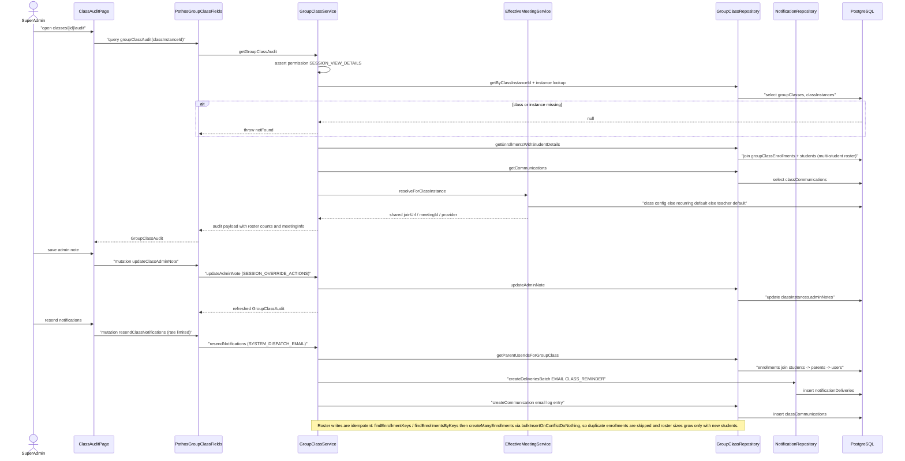

# Group Class Session Management

Group class sessions let one class instance serve many enrolled students at once. A super admin reviews a session from the audit page (`classes/[id]/audit`), which fires the Pothos `groupClassAudit` query into `GroupClassService.getGroupClassAudit`. The service checks the `SESSION_VIEW_DETAILS` permission, loads the `groupClasses` row and its `classInstances` parent (throwing a localized `notFound` error if either is missing), then assembles the multi-student roster from `groupClassEnrollments` joined to `students`, the communication log from `classCommunications`, and the shared meeting link from `EffectiveMeetingService.resolveForClassInstance`, which falls back class-level config → recurring-schedule default → teacher default so every student in the group shares one join URL. Roster writes are idempotent rather than capacity-capped: `findEnrollmentKeys` / `findEnrollmentsByKeys` detect existing `(groupClassId, studentId)` pairs and `createManyEnrollments` uses `bulkInsertOnConflictDoNothing`, so duplicate enrollments never inflate the roster. From the same UI an admin can persist an admin note (`updateClassAdminNote`, gated by `SESSION_OVERRIDE_ACTIONS`, writing `classInstances.adminNotes`) and resend class-reminder emails (`resendClassNotifications`, rate-limited and gated by `SYSTEM_DISPATCH_EMAIL`), which fans out to parent users — resolved from enrollments through `students` → `parents` → `users` — via `NotificationRepository.createDeliveriesBatch` and records an email entry in `classCommunications`.

## Key sources

- `app/(dashboard)/classes/[id]/page.tsx` — class details page entry point
- `app/(dashboard)/classes/[id]/audit/page.tsx` — audit page rendering `ClassAuditContainer`
- `backend/graphql/query/classes/group-class.query.ts` — `groupClassAudit` query field
- `backend/graphql/mutation/classes/group-class.mutation.ts` — `updateClassAdminNote` and `resendClassNotifications` mutations
- `backend/services/group-class/group-class.service.ts` — `GroupClassService` permission checks, audit assembly, roster fetch, notification resend
- `backend/db/repo/classes/group-class.repository.ts` — `GroupClassRepository` queries/writes against `groupClasses`, `groupClassEnrollments`, `classCommunications`, `classInstances`, `students`, `parents`, `users`
- `backend/services/meeting/class-meeting-config.service.ts` — `EffectiveMeetingService.resolveForClassInstance` shared-meeting-link fallback chain

[Machine-checkable diagram](./group-class-sessions.mmd)
