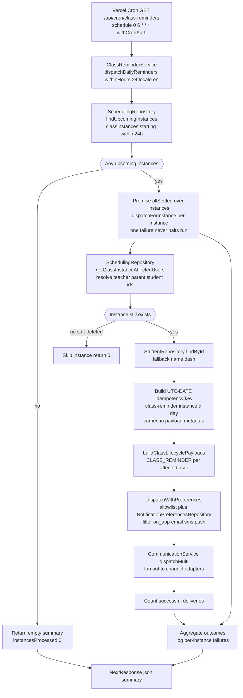

# Class Reminder Notifications

A Vercel cron job (`0 6 * * *`, 06:00 UTC) hits `GET /api/cron/class-reminders`, guarded by `withCronAuth` (CRON_SECRET header, GET-only). The route delegates to `ClassReminderService.dispatchDailyReminders` with a 24-hour lookahead window and an unauthenticated default locale of `en`. The service asks `SchedulingRepository.findUpcomingInstances` for `classInstances` rows starting within the window, then fans out with `Promise.allSettled` so one instance's failure never halts the run. Per instance it resolves the affected teacher/parent/student user ids via `SchedulingRepository.getClassInstanceAffectedUsers` (skipping silently if the instance was deleted mid-run), fetches the student name, and stamps a UTC-day idempotency key (`class-reminder-<instanceId>-<YYYY-MM-DD>`) into the payload metadata. `buildClassLifecyclePayloads` creates one `CLASS_REMINDER` payload per affected user, and `dispatchWithPreferences` filters payloads through the per-event channel allowlist plus each user's notification preferences before `CommunicationService.dispatchMulti` fans out to the on-app, email, SMS, and push channel adapters. The route finally returns a JSON summary of `instancesProcessed` and `deliveriesDispatched`; the whole-run failure path logs and returns `{ success: false }` with status 500.

## Key sources

- `app/api/cron/class-reminders/route.ts` — cron entry point, auth, JSON summary
- `backend/services/notification/class-reminder.service.ts` — orchestration, `dispatchForInstance`, idempotency key, failure isolation
- `backend/services/notification/notification-dispatch.helpers.ts` — `dispatchWithPreferences` channel allowlist + per-user preference filtering
- `backend/services/notification/notification-payloads.builders.ts` — `buildClassLifecyclePayloads`
- `backend/db/repo/scheduling/scheduling-queries.repository.findUpcoming.ts` — `findUpcomingInstances`

Diagram source: [class-reminders.mmd](./class-reminders.mmd)
