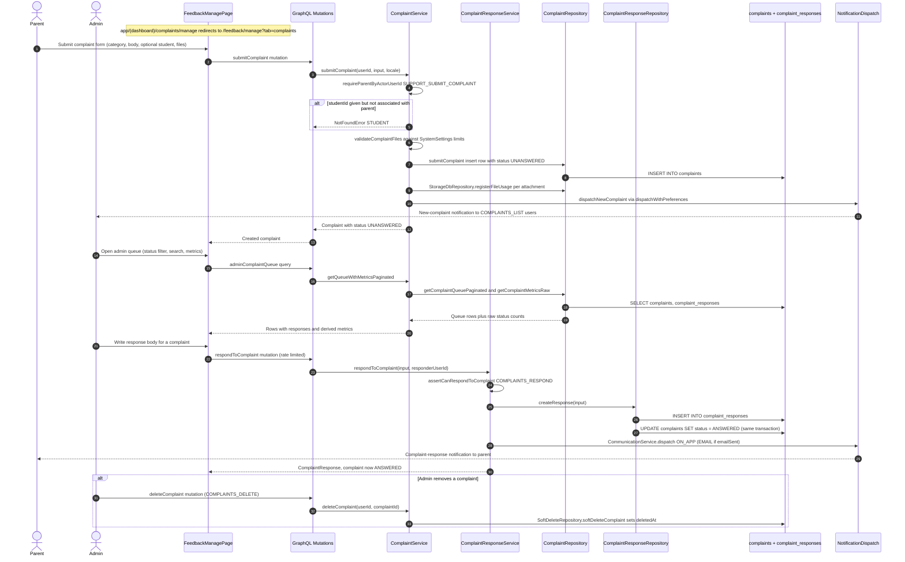

# Complaint Filing & Resolution

Parents file complaints through the support UI — the legacy `app/(dashboard)/complaints/manage` route simply redirects to `/feedback/manage?tab=complaints`, where the real admin and parent views live. Submission goes through the `submitComplaint` GraphQL mutation into `ComplaintService.submitComplaint`, which requires the `SUPPORT_SUBMIT_COMPLAINT` permission, optionally verifies the referenced student belongs to the parent, and validates attachments against configurable limits stored in system settings (`complaint_max_files_per_complaint`, `complaint_max_file_size_mb`). The complaint row is inserted with status `UNANSWERED`, attachments are registered via `StorageDbRepository.registerFileUsage`, and every user holding `COMPLAINTS_LIST` receives a new-complaint notification via `dispatchWithPreferences` (failures are logged, not thrown). Admins triage the queue through `getQueueWithMetricsPaginated`, which joins paginated complaints with per-complaint responses and derives metrics (unanswered/answered counts, average resolution hours). Resolution happens when an admin with `COMPLAINTS_RESPOND` calls `respondToComplaint`: `ComplaintResponseRepository.createResponse` inserts the response row and flips the complaint to `ANSWERED` in the same transaction, then `CommunicationService.dispatch` notifies the parent in-app (and by email when the response was flagged `emailSent`). Edge cases: an unknown/mis-associated student yields a `NotFoundError`, too many or disallowed files yield `ValidationError`, and admins with `COMPLAINTS_DELETE` can soft-delete complaints via `SoftDeleteRepository.softDeleteComplaint`, which sets `deletedAt` and removes them from all queue/metrics queries.

## Key sources

- `app/(dashboard)/complaints/manage/page.tsx` — redirect-only entry point to `/feedback/manage?tab=complaints`
- `backend/graphql/mutation/parents/complaint.mutation.ts` — `submitComplaint` and `deleteComplaint` mutations with auth scopes
- `backend/graphql/mutation/parents/complaintResponses.mutation.ts` — `respondToComplaint` mutation (rate-limited, `COMPLAINTS_RESPOND`)
- `backend/graphql/query/parents/complaint.query.ts` — parent history, admin queue, and complaint files queries
- `backend/services/communication/complaint.service.ts` — submission, queue, metrics, files, soft-delete orchestration
- `backend/services/communication/complaintResponses.service.ts` — response creation and parent notification dispatch
- `backend/db/repo/complaints/complaint.repository.ts` — inserts, queue pagination, metrics (`status` filter, `UNANSWERED` default)
- `backend/db/repo/complaints/complaint-response.repository.ts` — `createResponse` transaction that sets status `ANSWERED`
- `backend/db/schema/communications/communications.ts` — `complaints` and `complaint_responses` tables
- `backend/enum/complaints/complaint.enum.ts` — `ComplaintStatus` (`UNANSWERED`, `ANSWERED`)

## Diagram

[Machine-readable Mermaid copy](./complaints.mmd)
