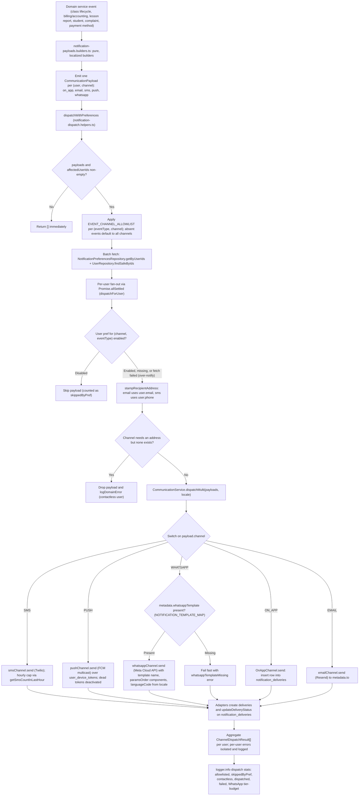

# Multi-Channel Notification Dispatch

When a domain service (schedule, billing, classes, student, complaint, payment-method, etc.) needs to notify users about an event, it first builds a `CommunicationPayload[]` fan-out — one payload per affected user per channel (`on_app`, `email`, `sms`, `push`, `whatsapp`) — using the pure, locale-aware builders in `notification-payloads.builders.ts`. It then hands that array, the `affectedUserIds`, and an optional locale to `dispatchWithPreferences`, the sole sanctioned dispatch entry point. That helper filters payloads against `EVENT_CHANNEL_ALLOWLIST` (events absent from the map default to all channels), batch-fetches each user's notification preferences (`user_notification_preferences` via `NotificationPreferencesRepository.getByUserIds`) and contact info (`users` via `UserRepository.findSafeByIds`), then processes users in parallel with `Promise.allSettled` so one user's failure never poisons the others. Per user it drops payloads the user disabled in prefs, stamps `metadata.to` from the user's email/phone (dropping address-less email/SMS payloads as "contactless"), and calls `CommunicationService.dispatchMulti`, which switches on the channel: `OnAppChannel` inserts a `notification_deliveries` row, the email adapter sends via Resend, the SMS adapter sends via Twilio (enforcing an hourly per-user SMS cap), the push adapter multicasts via FCM over `user_device_tokens` (deactivating dead tokens), and the WhatsApp adapter sends a Meta Cloud API template stamped by `NOTIFICATION_TEMPLATE_MAP` — failing fast if that template metadata is missing. Edge cases handled along the way: a prefs-fetch failure treats the user as all-enabled (safe over-notify), missing users drop their email/SMS payloads with a warning, every external adapter records and updates delivery rows in `notification_deliveries`, and WhatsApp send attempts consume tier budget even on failure. Aggregate results plus dispatch stats (allowlisted, skipped by pref, contactless, dispatched, failed) are logged and returned as `ChannelDispatchResult[]`.

## Key sources

- `backend/services/notification/notification-dispatch.helpers.ts` — `dispatchWithPreferences`, `EVENT_CHANNEL_ALLOWLIST`, per-user batching and recipient stamping
- `backend/services/notification/notification-payloads.builders.ts` — pure localized payload builders, `ALL_CHANNELS`, `NOTIFICATION_TEMPLATE_MAP`
- `backend/services/communication/communication.service.ts` — `CommunicationService.dispatchMulti` channel switch and result aggregation
- `backend/services/communication/channels/on-app.channel.ts` — in-app delivery insert via `NotificationRepository.createDelivery`
- `backend/services/communication/channels/email/` (Resend), `channels/sms/` (Twilio, hourly cap), `channels/push/` (FCM + `user_device_tokens`), `channels/whatsapp/cloud-api/` (Meta Cloud API templates) — channel adapters and delivery status persistence
- `backend/db/schema/communications/communications.ts` — `user_notification_preferences`, `user_device_tokens`, `notification_deliveries` tables
- `backend/services/communication/templates/sms-templates.ts` — locale-driven SMS body rendering
- Representative callers: `backend/services/notification/class-reminder.service.ts`, `backend/services/billing/accounting-notification.service.ts`, `backend/services/classes/lesson-report.service.ts`

## Diagram

Machine-checkable copy: [multi-channel-dispatch.mmd](./multi-channel-dispatch.mmd)
