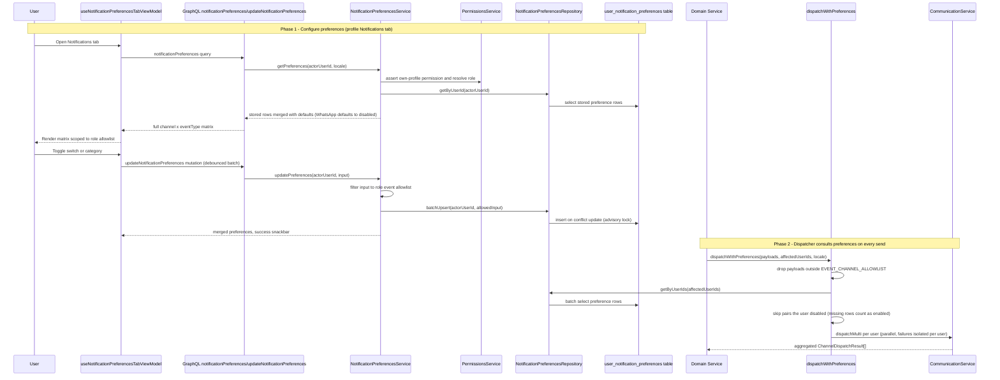

# Notification Preferences

A user manages per-channel, per-event notification preferences from the Notifications tab of their profile page (`NotificationPreferencesTab`, rendered for each role's profile, with desktop and mobile variants). The view model (`useNotificationPreferencesTabViewModel`) loads the full channel × event matrix via the `notificationPreferences` GraphQL query and renders local toggle state; every toggle (or whole-category toggle) is batched and saved through the `updateNotificationPreferences` mutation with a 500 ms debounce, surfacing success or failure in a snackbar. On the server, `NotificationPreferencesService` first asserts the actor may view their own profile (`PermissionsService`), then scopes the editable event types to a role-based allowlist from `shared/constants/notification-event-allowlists.ts` — student, parent, teacher, supervisor, staff, and admin each see only the events relevant to them. Reads merge stored rows from the `user_notification_preferences` table with defaults, where every channel defaults to enabled except WhatsApp, which is opt-in and defaults to disabled. Writes filter the submitted input to the role allowlist and `batchUpsert` under an advisory lock, silently dropping any event type the role may not configure. Downstream, the sole dispatch entry point `dispatchWithPreferences` (in `notification-dispatch.helpers.ts`) first applies the global `EVENT_CHANNEL_ALLOWLIST`, then batch-fetches the affected users' preference rows and skips any `(channel, eventType)` pair a user disabled; users with no stored rows are treated as all-enabled (safe over-notify), and per-user failures are caught so one user's error never poisons the others.

## Key sources

- `backend/services/notification/notification-preferences.service.ts` — getPreferences / updatePreferences / upsertManyPreferences, role allowlist resolution, merge-with-defaults (WhatsApp opt-in)
- `backend/services/notification/notification-dispatch.helpers.ts` — `dispatchWithPreferences`, `EVENT_CHANNEL_ALLOWLIST`, per-user preference filtering and isolation
- `backend/db/repo/notifications/notification-preferences.repository.ts` — `userNotificationPreferences` reads, batch fetch, advisory-locked `batchUpsert`
- `backend/graphql/query/notifications/notification-preferences.query.ts` — `notificationPreferences` query field
- `backend/graphql/mutation/notifications/notification-preferences.mutation.ts` — `updateNotificationPreferences` mutation field
- `backend/graphql/pothos/notifications/notification-preferences.pothos.ts` — `NotificationPreference` object and input types
- `frontend/common/views/dashboard/profile/core/notifications/useNotificationPreferencesTabViewModel.ts` — view model: debounced save, pending-changes batching, category toggles
- `frontend/common/views/dashboard/profile/core/notifications/NotificationPreferencesTab.tsx` — responsive tab entry (desktop/mobile variants)
- `shared/constants/notification-event-allowlists.ts` — per-role event allowlists shared by client and server

## Diagram

Machine-checkable copy: [notification-preferences.mmd](./notification-preferences.mmd)
