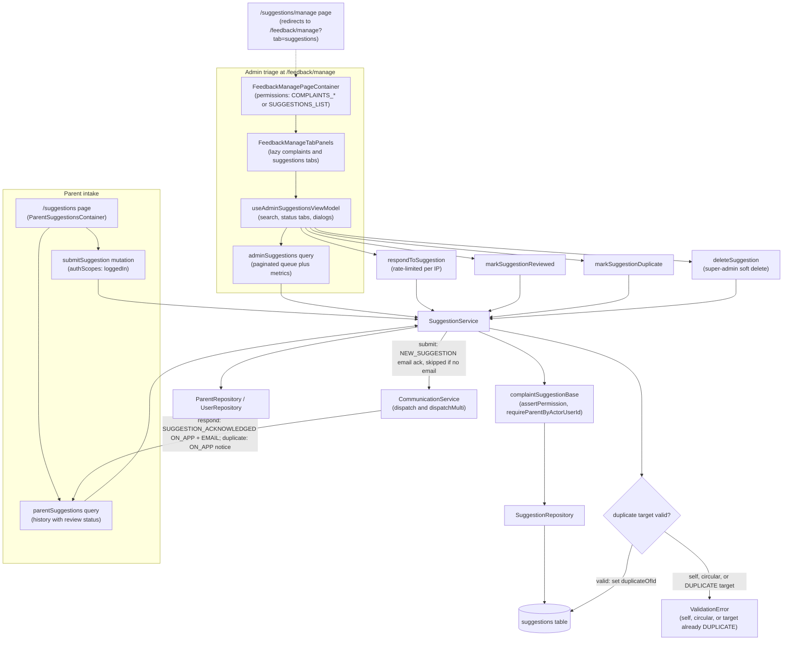

# Suggestions & Feedback Loops

Parents submit suggestions from the `/suggestions` page, which (for admins) redirects to the unified `/feedback/manage` triage hub that hosts lazy-loaded complaints and suggestions tabs behind `COMPLAINTS_*` / `SUGGESTIONS_LIST` permissions. Submission flows through the `submitSuggestion` GraphQL mutation into `SuggestionService`, which enforces permissions via the shared `complaintSuggestionBase` helpers (resolving the parent from the actor), persists the row in the `suggestions` table with status `PENDING`, and sends the submitter a `NEW_SUGGESTION` acknowledgement email through `CommunicationService` — skipped with a warning if the user has no email. Admins triage the queue through the `adminSuggestions` query (search, status tabs, and aggregate metrics) and act on each row: `markSuggestionReviewed` flips status to `REVIEWED`, `respondToSuggestion` (IP-rate-limited in the resolver) stores the admin response and notifies the parent via both ON_APP and EMAIL (`SUGGESTION_ACKNOWLEDGED`), and `markSuggestionDuplicate` links the row to a canonical suggestion with guards that throw `ValidationError` for self-references, circular links, or already-duplicate targets, then notifies the parent ON_APP. `deleteSuggestion` is restricted to super-admins and performs a soft delete via `SoftDeleteRepository`. Parents see updated statuses and responses through the `parentSuggestions` history query. Edge cases include `NotFoundError` when a suggestion id no longer exists, externalised i18n error/notification strings, and the legacy `/suggestions/manage` route redirecting to `/feedback/manage?tab=suggestions`.

## Key sources

- `app/(dashboard)/suggestions/page.tsx`
- `app/(dashboard)/suggestions/manage/page.tsx`
- `app/(dashboard)/feedback/manage/page.tsx`
- `backend/services/communication/suggestion.service.ts`
- `backend/services/communication/complaint.service.ts`
- `backend/graphql/pothos/parents/suggestion.pothos.ts`
- `backend/graphql/query/parents/suggestion.query.ts`
- `backend/graphql/mutation/parents/suggestion.mutation.ts`
- `frontend/common/views/dashboard/feedback/FeedbackManagePageContainer.tsx`
- `frontend/common/views/dashboard/feedback/FeedbackManageTabPanels.tsx`
- `frontend/common/views/dashboard/suggestions/useAdminSuggestionsViewModel.ts`
- `backend/db/schema/communications/communications.ts`
- `backend/enum/parents/suggestions.enum.ts`

Machine-checkable copy: [suggestions-feedback.mmd](./suggestions-feedback.mmd)
