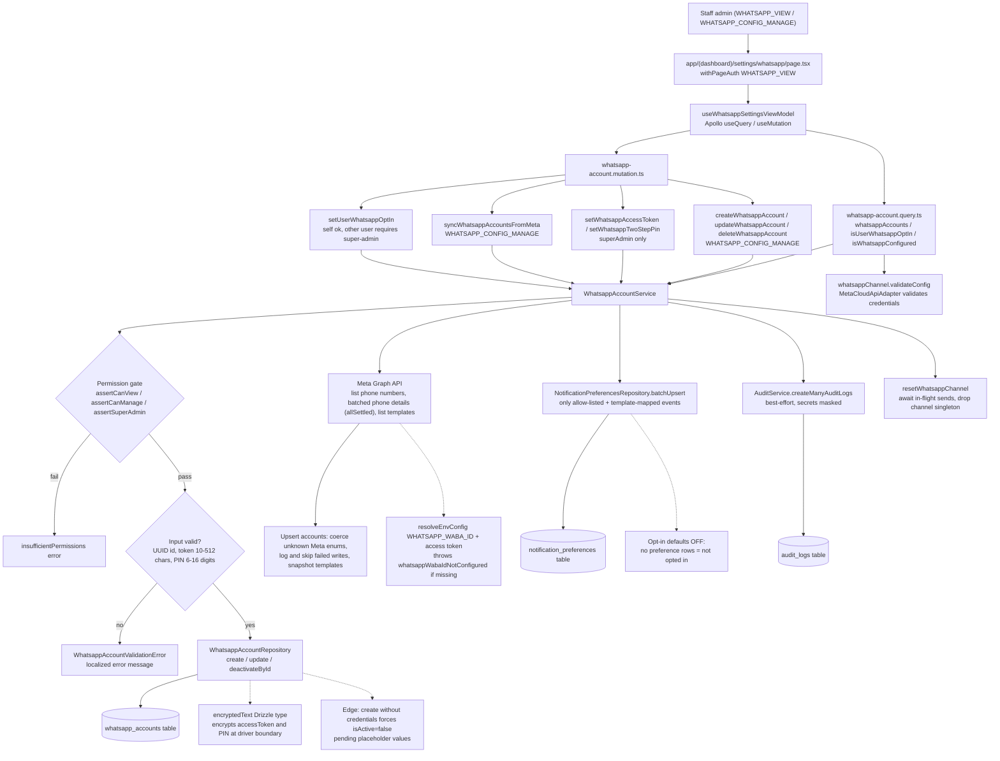

# WhatsApp Settings Administration

Staff admins manage WhatsApp Business API credentials from the settings page at `app/(dashboard)/settings/whatsapp/page.tsx`, which is gated by `withPageAuth` on `WHATSAPP_VIEW` and renders `WhatsappSettingsContainer` backed by `useWhatsappSettingsViewModel` (Apollo `useQuery` / `useMutation`). The UI reads through `whatsappAccounts`, `isWhatsappConfigured` (which runs `whatsappChannel.validateConfig` on the `MetaCloudApiAdapter`, a live check that credentials reach Meta's Graph API), and `isUserWhatsappOptIn`, and mutates through the fields in `whatsapp-account.mutation.ts`. Credential-sensitive operations are tiered: account CRUD and `syncWhatsappAccountsFromMeta` require `WHATSAPP_CONFIG_MANAGE`, while `setWhatsappAccessToken` / `setWhatsappTwoStepPin` additionally require super-admin, and every mutation passes a permission gate plus service-layer validation (UUID ids, token length 10–512, PIN 6–16 digits) that raises `WhatsappAccountValidationError` mapped to localized errors. Credentials are written through `WhatsappAccountRepository` into the `whatsapp_accounts` table, where the `encryptedText` custom Drizzle type encrypts tokens at the driver boundary; creating an account without credentials stores a `pending` placeholder and forces `isActive=false`. `syncWhatsappAccountsFromMeta` resolves `WHATSAPP_WABA_ID` and the access token from env config, lists phone numbers and message templates from the Meta Graph API, fetches per-phone details in bounded chunks with `Promise.allSettled` (individual failures are logged and skipped; an all-failed chunk aborts the sync), then upserts accounts and records a template snapshot. Opt-in management (`setUserWhatsappOptIn`) upserts `notification_preferences` rows only for events that are both channel-allowlisted and have a WhatsApp template mapping; WhatsApp opt-in defaults to OFF when no preference rows exist. Every change is audit-logged via `AuditService` with secrets masked, and account or credential mutations call `resetWhatsappChannel`, which drains in-flight sends and drops the channel singleton so the next send picks up new configuration.

## Key sources

- `app/(dashboard)/settings/whatsapp/page.tsx` — page entry, `withPageAuth(WHATSAPP_VIEW)`, renders `WhatsappSettingsContainer`
- `frontend/common/views/dashboard/settings/whatsapp/useWhatsappSettingsViewModel.ts` — Apollo queries (`whatsappAccounts`, `isWhatsappConfigured`, `isUserWhatsappOptIn`) and mutation wiring
- `backend/graphql/query/whatsapp/whatsapp-account.query.ts` — read-side fields and self-only opt-in check
- `backend/graphql/mutation/whatsapp/whatsapp-account.mutation.ts` — CRUD, credential setters, Meta sync, opt-in toggle with authScopes
- `backend/services/whatsapp/whatsapp-account.service.ts` — permission asserts, validation, repo calls, sync orchestration, audit, channel reset
- `backend/db/schema/whatsapp/whatsapp-accounts.ts` — `whatsapp_accounts` table, `encryptedText` encrypted columns
- `backend/services/communication/channels/whatsapp/WhatsappChannelFactory.ts` — `resetWhatsappChannel` / `validateConfig` singleton lifecycle
- `backend/services/communication/channels/whatsapp/cloud-api/MetaCloudApiAdapter.ts` — `validateConfig` credential check against Meta Graph API

## Diagram

Machine-checkable copy: [whatsapp-account-config.mmd](./whatsapp-account-config.mmd)
