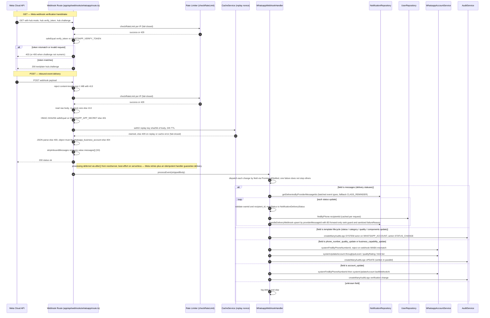

# WhatsApp Webhook Handling

The endpoint at `app/api/webhooks/whatsapp/route.ts` is the single entry point for Meta's WhatsApp Cloud API: `GET` answers Meta's subscription verification handshake (rate-limited per IP, `hub.verify_token` compared with `crypto.timingSafeEqual`, numeric-only `hub.challenge` echoed back as plain text), while `POST` ingests asynchronous events. The POST path enforces a 1 MB body cap, fail-closed per-IP rate limiting, constant-time HMAC-SHA256 verification against `app_secret`, and a 24h replay nonce in the cache (duplicate bodies within the window get 409). After JSON parsing and rejecting any payload whose `object` is not `whatsapp_business_account`, the route strips inbound `value.messages[]` (user message content is never stored), acknowledges with 200 immediately, and defers real work through `after()` from `next/server`. `WhatsappWebhookHandler.processEvent` then fans changes out in parallel (`Promise.allSettled`, one failure doesn't block others) by field: `messages` statuses are validated and mapped to `NotificationDeliveryStatus` and upserted via `NotificationRepository.handleDeliveryWebhook` — with a batch event-type lookup (CLASS_REMINDER fallback), per-request recipient phone→user caching, and a forward-only rank guard for idempotency, template lifecycle events become audit-log entries, `phone_number_quality_update` / `business_capability_update` / `account_update` update `whatsappAccounts` through `WhatsappAccountService` (with a WABA-ID match check) and are audited. Key edge behaviors: signature/replay/rate-limit failures log only safe metadata (never bodies or raw headers), and deferred work dropped on serverless is recovered through Meta retries because the handler is idempotent.

## Key sources

- `app/api/webhooks/whatsapp/route.ts` — GET verification and POST ingestion (rate limit, HMAC, replay nonce, JSON validation, message stripping, `after()` deferral)
- `backend/services/whatsapp/whatsapp-webhook.handler.ts` — `WhatsappWebhookHandler.processEvent`, per-field dispatch, status mapping, phone-number/account update helpers
- `backend/db/repo/notifications/notification.repository.ts` — `getDeliveriesByProviderMessageIds`, `handleDeliveryWebhook` (upsert + forward-only rank guard)
- `backend/db/repo/users/user.repository.ts` — `findByPhone` recipient resolution
- `backend/services/whatsapp/whatsapp-account.service.ts` — `systemFindByPhoneNumberId`, `systemUpdateAccount`
- `backend/services/system/audit.service.ts` — `createManyAuditLogs` for template lifecycle and account/quality events
- `backend/lib/ratelimit` and `cacheService` (`@/backend/services/cache/CacheServiceFactory`) — fail-closed rate limiting and the 24h replay nonce

Machine-checkable copy: [whatsapp-webhook-ingestion.mmd](./whatsapp-webhook-ingestion.mmd)
