# On-Demand Maintenance Jobs

Two ad-hoc operational scripts maintain on-demand scheduling hygiene around the quota system: the no-credits resolver and the teacher daily digest. Both run as standalone Bun entry points (`bun run ondemand:resolve` and `bun run ondemand:teacher-digest`, typically triggered by an external scheduler) and operate directly against PostgreSQL via Drizzle. The resolver runs a transactional sweep: it reads `systemSettings.ondemand_no_credits_resolution_lead_minutes` (default 240), locks up to 500 `class_instances` rows in `PENDING_CREDIT` status whose start time is within the lead window via `FOR UPDATE`, classifies them by each schedule's `ondemandNoCreditsOutcome` (auto-cancel, auto-absent, or remind-only), and applies batch status changes through `ClassSessionService.markNoCreditsBatch`, whose `PENDING_CREDIT` WHERE guard makes reruns idempotent. Reminder notifications are collected inside the transaction but dispatched via `QuotaNotificationService.sendOndemandInstancePendingCredit` only after commit, so external notification calls never hold the DB transaction open. The digest script reads `ondemand_teacher_digest_hour` (default 9), fetches pending on-demand instances, groups them per teacher, resolves each teacher's timezone with the fallback chain `recurring_schedules.timezone` → `teacher_availability_windows.timezone` → `UTC`, and sends `QuotaNotificationService.sendOndemandTeacherDailyDigest` only when the teacher's local hour matches — guarded by an atomic `ON CONFLICT DO NOTHING` idempotency-marker insert into `system_settings` per teacher per hour. Race losers and non-matching hours are skipped; any top-level error is logged and rethrown so the process exits non-zero. Edge cases include invalid setting values falling back to defaults, empty pending sets short-circuiting, and the 500-row per-run cap bounding unbounded SELECTs.

## Key sources

- `scripts/ondemand-no-credits-resolver.ts` — resolver entry point, cutoff computation, classification, transaction flow
- `scripts/ondemand-teacher-digest-cron.ts` — digest entry point, timezone resolution, idempotency marker, per-teacher send
- `backend/services/session/class-session.service.ts` — `markNoCreditsBatch` idempotent batch status update
- `backend/services/billing/quota-notification.service.ts` — `sendOndemandInstancePendingCredit` / `sendOndemandTeacherDailyDigest` dispatch
- `package.json` — `ondemand:resolve` / `ondemand:teacher-digest` script wiring
- `docs/billing/quota-system.md` — cron cadence reference

```mermaid
%% On-Demand Maintenance Jobs - no-credits resolver sweep and per-teacher daily digest
flowchart TB
    subgraph resolver["ondemand-no-credits-resolver.ts (hourly sweep)"]
        R0["bun run ondemand:resolve"] --> R1["runOndemandNoCreditsResolver"]
        R1 --> R2["Read systemSettings key ondemand_no_credits_resolution_lead_minutes"]
        R2 --> R3["computeCutoff: leadMinutes fallback 240 default"]
        R3 --> R4["SELECT classInstances JOIN recurringSchedules WHERE ondemandStatus = PENDING_CREDIT and scheduledStartAt lte cutoff (FOR UPDATE, limit 500)"]
        R4 --> R5{"Any pending instances?"}
        R5 -- "No" --> R6["Log and exit"]
        R5 -- "Yes" --> R7["classifyInstances by schedule.ondemandNoCreditsOutcome"]
        R7 --> R8["AUTO_CANCEL -> NO_CREDITS_CANCELLED"]
        R7 --> R9["AUTO_ABSENT_NO_CREDITS -> NO_CREDITS_ABSENT"]
        R7 --> R10["Remind-only -> collect student payload"]
        R8 --> R11["ClassSessionService.markNoCreditsBatch inside tx (PENDING_CREDIT WHERE guard)"]
        R9 --> R11
        R11 --> R12["Commit transaction"]
        R10 --> R13["After commit: QuotaNotificationService.sendOndemandInstancePendingCredit"]
        R12 --> R13
        R13 --> R14["On error: logger.error and rethrow, exit code 1"]
    end

    subgraph digest["ondemand-teacher-digest-cron.ts (daily digest)"]
        D0["bun run ondemand:teacher-digest"] --> D1["runOndemandTeacherDigestCron"]
        D1 --> D2["Read systemSettings key ondemand_teacher_digest_hour (default 9)"]
        D2 --> D3{"Valid hour?"}
        D3 -- "No" --> D4["Warn and skip run"]
        D3 -- "Yes" --> D5["SELECT PENDING_CREDIT instances JOIN recurringSchedules WHERE schedulingMode = ON_DEMAND (limit 500)"]
        D5 --> D6{"Any pending?"}
        D6 -- "No" --> D7["Log and exit"]
        D6 -- "Yes" --> D8["groupInstancesByTeacher"]
        D8 --> D9["resolveMissingTimezones: schedule.timezone then teacherAvailabilityWindows.timezone then UTC"]
        D9 --> D10["buildTeacherNameMap from users"]
        D10 --> D11{"Teacher local hour == target hour?"}
        D11 -- "No" --> D12["Skip teacher"]
        D11 -- "Yes" --> D13["tryInsertIdempotencyMarker into systemSettings ON CONFLICT DO NOTHING"]
        D13 --> D14{"Insert won race?"}
        D14 -- "No" --> D15["Skip (already sent this date/hour)"]
        D14 -- "Yes" --> D16["QuotaNotificationService.sendOndemandTeacherDailyDigest"]
        D16 --> D17["Log sent digest count"]
    end
```

Diagram source: [ondemand-maintenance-jobs.mmd](./ondemand-maintenance-jobs.mmd)
