# Cron Tick to Execute Pipeline

The cron system is driven by two authenticated HTTP entry points. The **ticker** route (`app/api/cron/ticker/route.ts`) is the single heartbeat Vercel Cron calls every minute: it runs three phases in order — `CronService.dispatchDueSchedules` finds `ACTIVE` schedules whose `nextRunAt` is due, atomically claims each one (inserting a `PENDING` row into `cron_runs` and advancing `nextRunAt` under an advisory lock, using `nextRunAt()` from `cron-scheduler.engine` for the cron expression math) and enqueues a job via the queue adapter (pg-boss by default); then `runDrainLoop` from the worker runtime drains the in-process queue, looking each job's `CronJobKind` up in the `JobHandlerRegistry`, marking the run `RUNNING`, writing heartbeats, and completing, retrying (exponential backoff via `computeBackoffSeconds`), or failing the run; finally `CronService.reconcileStuckRuns` marks `RUNNING` runs past their timeout as `FAILED`. The **execute** route (`app/api/cron/execute/route.ts`) serves per-schedule triggers: it validates the `scheduleId` query param as a UUID, then `CronService.dispatchScheduleById` verifies the schedule exists and is not paused/disabled, claims the run with `forceDue=true` inside a single advisory-locked transaction (eliminating the TOCTOU race against a concurrent ticker), and enqueues the job — returning `skipped=true` when the schedule's `SKIP` concurrency policy finds a run already in flight. Key edge cases: jobs with no registered handler are failed immediately, handler timeouts (`JobTimeoutError`) are never retried while `AbortError` shutdowns are, DB-first ordering on retry/fail prevents orphaned queue jobs, and both routes are wrapped in `withCronAuth` (Bearer `CRON_SECRET`) with a 300s `maxDuration`.

## Key sources

- `app/api/cron/ticker/route.ts` — Vercel heartbeat route: dispatch → drain → reconcile
- `app/api/cron/execute/route.ts` — per-schedule manual/Vercel-cron execute route with UUID validation
- `backend/services/cron/cron.service.ts` — `dispatchDueSchedules`, `dispatchScheduleById`, run lifecycle (`setRunRunning`, `completeRun`, `retryRun`, `failRun`), `reconcileStuckRuns`
- `backend/services/cron/cron-scheduler.engine.ts` — pure cron-expression validation, `nextRunAt`, `computeBackoffSeconds`
- `backend/services/cron/cron-worker.runtime.ts` — `runDrainLoop` drain loop, bounded-concurrency batches, heartbeat, error classification
- `backend/services/cron/job-handler-registry.ts` — `CronJobKind` → handler registry (idempotency contract)

## Diagram

```mermaid
%% Cron Tick to Execute Pipeline — Vercel ticker enqueues due jobs; worker runtime drains them via the handler registry
sequenceDiagram
    autonumber
    participant VC as VercelCron
    participant Tick as "TickerRoute /api/cron/ticker"
    participant Exec as "ExecuteRoute /api/cron/execute"
    participant Svc as CronService
    participant Repo as CronRepository
    participant DB as "DB cron_schedules + cron_runs"
    participant Q as "QueueAdapter pg-boss"
    participant Worker as "runDrainLoop worker runtime"
    participant Reg as JobHandlerRegistry

    VC->>Tick: "GET /api/cron/ticker (Bearer CRON_SECRET, every minute)"

    rect rgb(30, 30, 40)
    Note over Tick,Q: Phase 1 — dispatch due schedules
    Tick->>Svc: dispatchDueSchedules(now, VERCEL_TICKER)
    Svc->>Repo: listDueSchedules(now, batch)
    Repo->>DB: "SELECT ACTIVE schedules WHERE nextRunAt <= now"
    loop each due schedule
        Svc->>Svc: "nextRunAt(cronExpression, timezone) via cron-scheduler.engine"
        Svc->>Repo: claimNextRun(scheduleId, now, computedNextRunAt)
        Repo->>DB: "advisory-lock txn: INSERT cron_runs PENDING + advance nextRunAt"
        alt claim succeeds
            Svc->>Q: send(buildCronJobPayload)
        else already claimed or in-flight
            Svc-->>Tick: skipped
        end
    end
    end

    rect rgb(30, 30, 40)
    Note over Tick,Reg: Phase 2 — drain in-process queue
    Tick->>Worker: runDrainLoop(deadline = maxDuration - 30s margin)
    loop until deadline or queue empty
        Worker->>Q: fetch(batchSize)
        loop bounded-concurrency batches
            Worker->>Reg: getHandler(job.jobKind)
            alt no handler registered
                Worker->>Svc: failRun(runId, no handler)
            else handler found
                Worker->>Svc: setRunRunning(runId, workerId)
                Worker->>Svc: recordHeartbeat(runId, progress)
                alt handler succeeds
                    Worker->>Svc: completeRun(runId)
                    Worker->>Q: complete(queueJobId)
                else retryable failure, attempt within maxRetries
                    Worker->>Svc: retryRun(runId, computeBackoffSeconds, attempt+1)
                    Worker->>Q: retry(queueJobId, backoff)
                else timeout or retries exhausted
                    Worker->>Svc: failRun(runId, error)
                    Worker->>Q: fail(queueJobId)
                end
            end
        end
    end
    end

    rect rgb(30, 30, 40)
    Note over Tick,DB: Phase 3 — reconcile stuck runs
    Tick->>Svc: reconcileStuckRuns(now)
    Svc->>Repo: reconcileStuckRuns(now, batch)
    Repo->>DB: "UPDATE stuck RUNNING runs past timeout to FAILED"
    end

    Tick-->>VC: "200 counts: dispatched, processed, failed, retried, stuckRunsReconciled"

    Note over VC,Exec: Per-schedule explicit execution path
    VC->>Exec: "GET /api/cron/execute?scheduleId=uuid"
    Exec->>Exec: "validate scheduleId UUID (400 on missing or malformed)"
    Exec->>Svc: dispatchScheduleById(id, VERCEL_EXPLICIT)
    Svc->>Repo: assertScheduleExists + status check
    alt schedule PAUSED or DISABLED
        Svc-->>Exec: ForbiddenError
    else active
        Svc->>Repo: claimNextRun(id, forceDue=true)
        Repo->>DB: "advisory-lock txn bypasses due-check, avoids TOCTOU race"
        alt SKIP concurrency policy, run in flight
            Exec-->>VC: "200 skipped=true, inFlightRunId"
        else claimed
            Svc->>Q: send(buildCronJobPayload)
            Exec-->>VC: "200 dispatchedCount=1, runId, queueJobId"
        end
    end
```

Machine-checkable copy: [tick-execute-pipeline.mmd](./tick-execute-pipeline.mmd)
