# Cron Worker Runtime & Queue Adapters

The cron worker is a long-lived process (`scripts/cron-worker.ts`) that drains scheduled cron jobs outside the HTTP ticker route, looping `runDrainLoop` from `backend/services/cron/cron-worker.runtime.ts` with a 1-second pause between cycles until a SIGINT/SIGTERM stops it. Each drain cycle resolves the active queue backend via `queue-adapter.factory.getQueueAdapter()` — cached with a 5-minute TTL from `CRON_QUEUE_BACKEND` (env or DB-backed config), defaulting to pg-boss, with BullMQ-over-Postgres, BullMQ-over-Redis, and a custom-SQL adapter available behind lazy imports — and then repeatedly fetches job batches until either the deadline (default 270s with a 30s safety margin) or an empty queue ends the drain. Fetched jobs are dispatched in bounded-concurrency batches to handlers resolved from the `job-handler-registry`; each job is claimed in the database by `CronService.setRunRunning` (a false return means another worker won the race, so the job is skipped to avoid stuck PENDING runs) before the handler runs. While the handler executes, a non-overlapping `setTimeout` ticker — interval computed by the shared `computeHeartbeatMs` (`timeoutSeconds / 4`, capped at 60s) — records heartbeats into `cron_runs`, and the handler races a per-job timeout timer wired to an `AbortSignal`. On success the run is marked COMPLETED and the queue job completed; a `JobTimeoutError` permanently fails the run (timeouts are never retried), while other errors — including `AbortError` from worker shutdown — are retried with exponential backoff (`RETRYING` in the DB first, then re-queued) as long as attempts minus one remain under `maxRetries`. A job kind with no registered handler is failed immediately, and DB-first ordering on the retry/fail paths guarantees failures leave re-processable queue jobs rather than orphaned or stuck runs.

## Key sources

- `scripts/cron-worker.ts` — standalone worker entry point, env overrides, signal handling, 1s drain cycle
- `backend/services/cron/cron-worker.runtime.ts` — `runDrainLoop`, bounded-concurrency dispatch, timeout/heartbeat machinery, retry-vs-fail classification
- `backend/services/cron/queue-adapter.factory.ts` — backend resolution (TTL cache), lazy adapter loading, singleton lifecycle
- `backend/services/cron/cron-heartbeat.utils.ts` — shared `computeHeartbeatSeconds`/`computeHeartbeatMs` formula (timeout/4 capped at 60s)
- `backend/services/cron/queue-adapters/` — `pgboss.adapter.ts`, `bullmq-pg.adapter.ts`, `bullmq-redis.adapter.ts`, `custom-sql.adapter.ts` (the four `CronQueueAdapter` implementations exposing fetch/complete/fail/retry)

## Diagram

```mermaid
%% Cron Worker Runtime & Queue Adapters: long-lived worker draining cron jobs over pluggable queue backends with heartbeats
sequenceDiagram
    autonumber
    participant Script as "cron-worker.ts (standalone process)"
    participant RT as "runDrainLoop (cron-worker.runtime)"
    participant F as "queue-adapter.factory"
    participant QA as "CronQueueAdapter (pg-boss / BullMQ PG / BullMQ Redis / custom SQL)"
    participant REG as "job-handler-registry"
    participant SVC as "CronService"
    participant H as "CronJobHandler"
    participant DB as "PostgreSQL cron_runs table"

    Script->>Script: parse env overrides and register SIGINT/SIGTERM
    loop every drain cycle with 1s pause until signal
        Script->>RT: runDrainLoop(batchSize, maxDurationMs)
        RT->>F: getQueueAdapter()
        F->>F: resolveQueueBackend (CRON_QUEUE_BACKEND, 5min TTL, default PG_BOSS)
        F->>QA: lazy import + init()

        loop fetch batches until deadline or queue empty
            RT->>QA: fetch(batchSize)
            QA-->>RT: CronJobPayload[]

            loop bounded-concurrency batches
                RT->>REG: getHandler(jobKind)
                alt missing handler
                    RT->>SVC: failRun(runId, no-handler)
                    SVC->>DB: update cron_runs to FAILED
                    RT->>QA: fail(jobId)
                else handler found
                    RT->>SVC: setRunRunning(runId, workerId)
                    SVC->>DB: update cron_runs to RUNNING
                    Note over RT,DB: false result means another worker claimed the run, job skipped
                    RT->>RT: compute heartbeatMs via computeHeartbeatMs (timeout/4 capped at 60s)
                    RT->>H: handler(job, AbortSignal)
                    loop every heartbeatMs until done
                        RT->>SVC: recordHeartbeat(runId, workerId, progress)
                        SVC->>DB: update cron_runs heartbeat timestamp
                    end
                    alt success
                        H-->>RT: success result
                        RT->>SVC: completeRun(runId)
                        SVC->>DB: update cron_runs to COMPLETED
                        RT->>QA: complete(jobId)
                    else JobTimeoutError (not retryable)
                        RT->>SVC: failRun(runId)
                        SVC->>DB: update cron_runs to FAILED
                        RT->>QA: fail(jobId)
                    else other error or AbortError with retries remaining
                        RT->>SVC: retryRun(runId, backoff, attempt+1)
                        SVC->>DB: update cron_runs to RETRYING
                        RT->>QA: retry(jobId, backoffSeconds)
                    end
                end
            end
        end
        RT-->>Script: WorkerDrainResult (processed, failed, retried)
    end
```

Machine-checkable copy: [worker-runtime.mmd](./worker-runtime.mmd)
