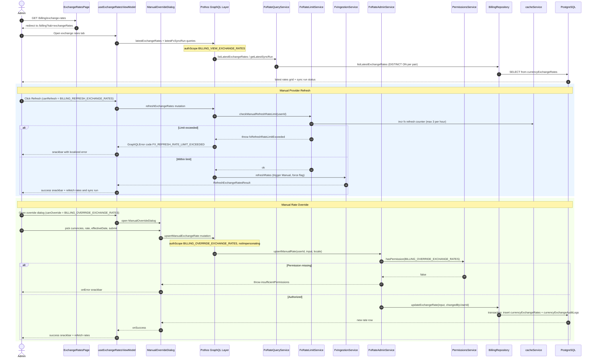

# Exchange Rates Administration

Admins manage foreign-exchange conversion rates from the billing dashboard: the route `app/(dashboard)/billing/exchange-rates/page.tsx` simply redirects to `/billing?tab=exchangeRates`, where the `useExchangeRatesViewModel` hook loads the latest rate per currency pair and the latest FX sync run via the `latestExchangeRates` and `latestFxSyncRun` GraphQL queries (both gated by `BILLING_VIEW_EXCHANGE_RATES` and served by `FxRateQueryService` over the `currencyExchangeRates` table). An admin with `BILLING_REFRESH_EXCHANGE_RATES` can trigger `refreshExchangeRates`, which first passes through `FxRateLimitService.checkManualRefreshRateLimit` — a `cacheService` counter allowing at most 3 refreshes per user per hour — before delegating to `FxIngestionService.refreshRates`, exceeding the limit surfaces a localized `FX_REFRESH_RATE_LIMIT_EXCEEDED` GraphQL error in a snackbar. An admin with `BILLING_OVERRIDE_EXCHANGE_RATES` can open `ManualOverrideDialog` to submit a currency pair, rate, and optional effective date to the `upsertManualExchangeRate` mutation, which `FxRateAdminService.upsertManualRate` re-checks via `PermissionsService` before `BillingRepository.updateExchangeRate` writes the new rate row plus an audit entry in `currencyExchangeAuditLogs` inside one transaction. Both mutations reject impersonated sessions (`notImpersonating` auth scope), and successful actions refetch the rates grid and show a localized success snackbar. Edge cases include permission-denied throws (`insufficientPermissions`), rate-limit exhaustion, empty rate input (blocked client-side), and stale-rate banners derived from the latest sync run.

Key sources:

- `app/(dashboard)/billing/exchange-rates/page.tsx`
- `frontend/common/views/dashboard/admin/billing/exchange-rates/useExchangeRatesViewModel.ts`
- `frontend/common/views/dashboard/admin/billing/exchange-rates/ManualOverrideDialog.tsx`
- `backend/graphql/query/billing/fx-ingestion.query.ts`
- `backend/graphql/mutation/billing/fx-ingestion.mutation.ts`
- `backend/services/fx/fx-rate-admin.service.ts`
- `backend/services/fx/fx-rate-limit.service.ts`
- `backend/db/repo/billing/billing.repository.ts` (`updateExchangeRate`, `writeExchangeRateWithAudit`, `listLatestExchangeRates`)

Machine-checkable copy: [exchange-rates-dashboard.mmd](./exchange-rates-dashboard.mmd)
