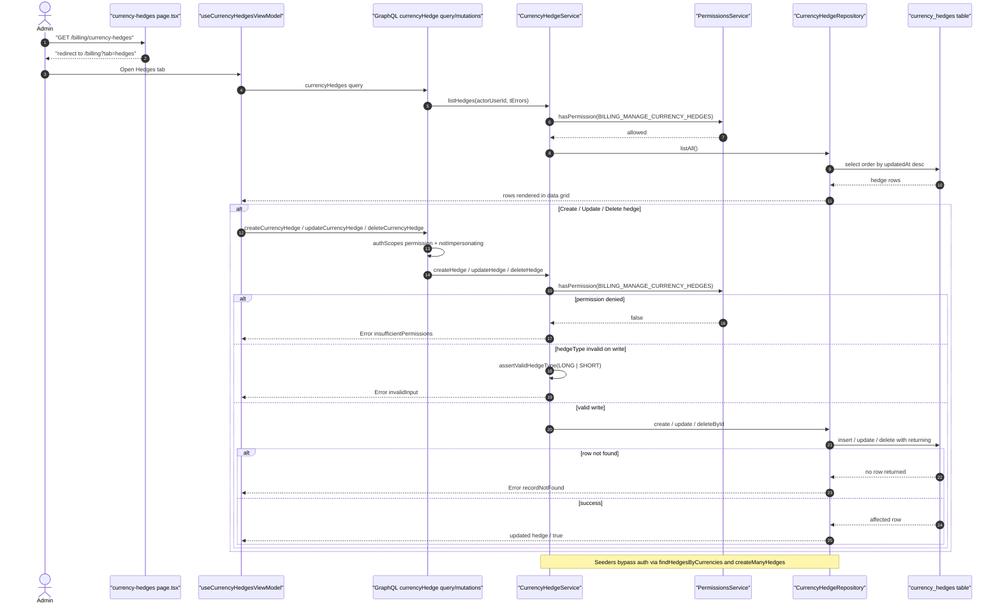

# Currency Hedge Management

Billing admins manage currency hedge positions that protect the academy against FX volatility on billed amounts. The legacy route `/billing/currency-hedges` (`app/(dashboard)/billing/currency-hedges/page.tsx`) now just redirects to the **Hedges** tab of the billing dashboard (`/billing?tab=hedges`), where `useCurrencyHedgesViewModel` loads positions via the Apollo `currencyHedges` query and drives add/edit/delete dialogs backed by the `createCurrencyHedge`, `updateCurrencyHedge`, and `deleteCurrencyHedge` mutations. Every GraphQL field is gated by the `BILLING_MANAGE_CURRENCY_HEDGES` authScope (mutations additionally require `notImpersonating`), and `CurrencyHedgeService` re-checks the permission through `PermissionsService` before touching data. On writes the service validates `hedgeType` against `LONG`/`SHORT` and delegates to `CurrencyHedgeRepository`, which performs Drizzle CRUD against the `currency_hedges` table (PostgreSQL/SQLite, `amount` stored as text for decimal precision). Failure paths are localized errors: `insufficientPermissions` when the permission check fails, `invalidInput` for a bad hedge type, `recordNotFound` when an update/delete targets a missing row, and `currencyHedgeCreateFailed` if an insert returns nothing. Seeders bypass auth entirely through the `findHedgesByCurrencies` and `createManyHedges` bootstrap functions.

## Key sources

- `app/(dashboard)/billing/currency-hedges/page.tsx` — redirect page to `/billing?tab=hedges`
- `frontend/common/views/dashboard/admin/billing/currency-hedges/useCurrencyHedgesViewModel.ts` — client ViewModel (query, dialog state, form state)
- `backend/graphql/query/billing/currency-hedge.query.ts` — `currencyHedges` query field
- `backend/graphql/mutation/billing/currency-hedge.mutation.ts` — create/update/delete mutations
- `backend/services/fx/currency-hedge.service.ts` — permission checks, hedge-type validation, seeder helpers
- `backend/db/repo/billing/currency-hedge.repository.ts` — Drizzle CRUD on the hedge table
- `backend/db/schema/billing/billing.ts` — `currencyHedges` table definition (`currency_hedges`)

## Diagram

Machine-checkable copy: [hedges-admin.mmd](./hedges-admin.mmd)
