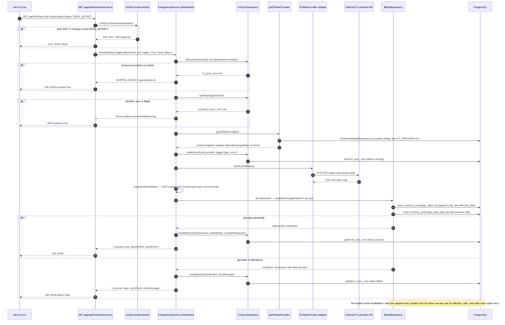

# FX Rate Refresh Cron Endpoint

A Vercel Cron job (`0 6 * * *` per `vercel.json`) hits `GET /api/fx/refresh`, which first runs `verifyCronSecretAuth` — a timing-safe Bearer `CRON_SECRET` check that rejects non-GET methods with 405 and bad/missing secrets with 401 (500 in production when the secret is unset). The route then calls `FxIngestionService.refreshRates` with `trigger: FxSyncTrigger.Cron` and `triggeredByUserId: null`, so the permission gate (used by the manual GraphQL `refreshExchangeRates` mutation) is skipped. The service enforces two guards: a 30-minute idempotency window (`FxSyncRepository.isRecentSuccess`) that short-circuits as a skipped success, and a concurrent-run check (`getRunningSyncRun`) that throws a localized `syncAlreadyRunning` error, which the route turns into a localized 500. It then resolves the configured provider via `getFxRateProvider` — `fx_provider` system setting first, else the `FX_PROVIDER` env var, defaulting to OpenExchangeRates — and lazily instantiates a singleton adapter (`OpenExchangeRatesAdapter` or `FixerAdapter`). A `fx_sync_runs` row is created in `running` status, `fetchLatestRates` pulls USD-hub rates, and `expandUsdHubRates` expands them into USD→target plus inverted target→USD pairs covering every `CurrencyCode`. All pairs are written in one database transaction via `BillingRepository.updateExchangeRateInTx`, appending a `currency_exchange_rates` row and a `currency_exchange_audit_logs` row per pair — on failure the whole transaction rolls back and the sync run is marked `failed` with the error message. There is no explicit cache invalidation: rates are append-only, readers resolve "latest" per pair by `effective_date`, and a 24-hour staleness rule (`FX_STALE_MS` in `fx-rate-query.service.ts`) flags outdated rates, so a newer row naturally supersedes old ones.

## Key sources

- `app/api/fx/refresh/route.ts` — Vercel Cron entry point, auth wiring, result/error responses
- `vercel.json` — cron schedule (`0 6 * * *`)
- `backend/services/fx/fx-ingestion.service.ts` — `refreshRates` orchestration, idempotency, concurrency guard, USD-hub expansion, transaction
- `backend/lib/cron-auth.ts` — `verifyCronSecretAuth` timing-safe secret check
- `backend/services/fx/providers/FxRateProviderFactory.ts` — provider resolution (system setting vs env) and lazy singleton adapter
- `backend/services/fx/providers/IFxRateProvider.ts` and `backend/services/fx/providers/openexchangerates/OpenExchangeRatesAdapter.ts` — provider contract and external fetch
- `backend/db/repo/fx-sync.repository.ts` — `fx_sync_runs` lifecycle rows (running → success/failed)
- `backend/db/repo/billing/billing.repository.ts` — `updateExchangeRateInTx` append-only rate + audit-log writes
- `backend/services/fx/fx-rate-query.service.ts` — 24h staleness rule replacing explicit cache invalidation

## Diagram

[Machine-checkable copy](./rate-ingestion-refresh.mmd)
