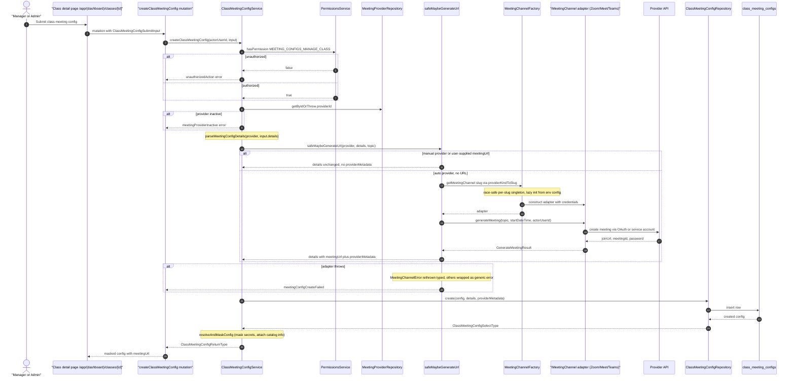

# Class Meeting Config & Auto URL Generation

A manager (or admin with the `MEETING_CONFIGS_MANAGE_CLASS` permission) attaches a meeting configuration to a class instance or recurring schedule from the class detail page (`app/(dashboard)/classes/[id]`), via the `createClassMeetingConfig` / `updateClassMeetingConfig` GraphQL mutations. `ClassMeetingConfigService` checks the permission, loads the `meeting_providers` row, and rejects inactive providers before validating the config details with `parseMeetingConfigDetails`. When the provider supports auto-generation and the submitter did not supply a manual `meetingUrl`, `safeMaybeGenerateUrl` delegates to `maybeGenerateUrl`, which resolves a provider adapter through `MeetingChannelFactory` — a race-safe, per-slug singleton that lazy-initializes the Zoom, Google Meet, or Microsoft Teams adapter from environment config — and calls `adapter.generateMeeting` to fetch a join URL, upstream meeting ID, and password. Typed `MeetingChannelError`s are re-thrown with provider-specific messages; unexpected failures are wrapped in a generic user-facing error. The generated URL and provider metadata are persisted to `class_meeting_configs` and returned as a secret-masked view. At class-session time, `EffectiveMeetingService.resolveForClassInstance` resolves the effective config on a cascade — class default, then recurring-schedule default, then the teacher's personal default, else `NONE` — while `MeetingConfigSnapshotService.generateAndAttachForClassInstance` can generate a booking-time URL with bounded retry (3 attempts, exponential backoff) and persist it onto `class_instances.meeting_join_url`; failures there are log-only so booking commits are never blocked.

## Key sources

- `backend/services/meeting/class-meeting-config.service.ts` — `ClassMeetingConfigService` CRUD + `EffectiveMeetingService` resolution cascade
- `backend/services/meeting/__shared__/meetingConfigHelpers.ts` — `safeMaybeGenerateUrl` error-handling wrapper
- `backend/services/meeting/utils/maybe-generate-url.ts` — manual-URL vs auto-generation decision
- `backend/services/meeting/meeting-config-snapshot.ts` — session snapshots, booking-time `generateAndAttachForClassInstance` (retry/backoff), cancel-time `deleteMeeting`
- `backend/services/meeting/channels/MeetingChannelFactory.ts` — adapter factory, `providerKindToSlug`, per-slug singleton
- `backend/graphql/mutation/meeting/meeting.mutation.ts` — `createClassMeetingConfig` / `updateClassMeetingConfig` mutations
- `backend/graphql/pothos/meeting/effective-meeting.pothos.ts` — `EffectiveMeeting` GraphQL type and resolver wiring
- `app/(dashboard)/classes/[id]/page.tsx` — class detail page entry (renders `ClassDetailsContainer`)

Machine-checkable copy: [class-meeting-config.mmd](./class-meeting-config.mmd)
