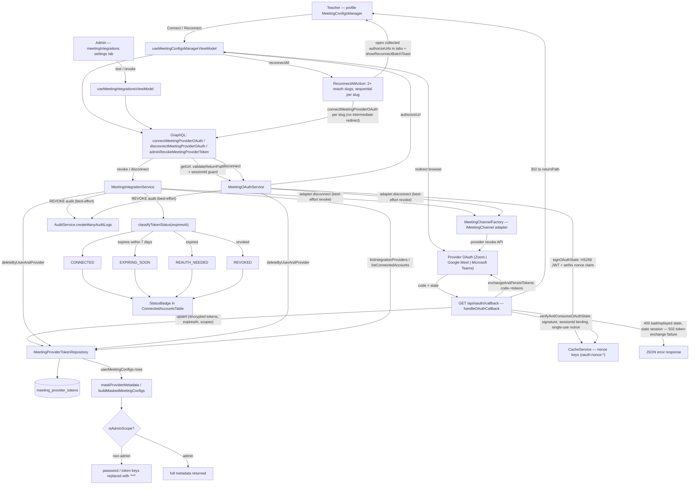

# Meeting Integration Account Lifecycle

Meeting providers (Zoom, Google Meet, Microsoft Teams) are connected per teacher through a self-service OAuth flow driven from the profile `MeetingConfigsManager` and its view model. The `connectMeetingProviderOAuth` mutation (backend `MeetingOAuthService`) mints a short-lived HS256 state JWT — bound to the caller's session and claimed via a single-use `setNx` nonce in the cache — and returns a provider authorize URL; the browser is redirected, consents, and lands on the shared `GET /api/oauth/<slug>/callback` handler, which verifies the state (signature, session binding, replay protection) and exchanges the code for tokens via `exchangeAndPersistTokens`, upserting encrypted credentials into `meeting_provider_tokens`. Errors on the return leg are explicit HTTP responses: `400` for bad/expired/replayed state or provider mismatch, `502` for token-exchange failure, and open redirects are blocked by `returnPath` validation. Disconnect is symmetric and best-effort: both the self-service `disconnectMeetingProviderOAuth` and the admin `adminRevokeMeetingProviderToken` (`MeetingIntegrationService.revokeToken`, permission `SETTINGS_EDIT_MEETING_INTEGRATIONS`) revoke at the provider via the channel adapter, delete the token row, and write a `REVOKE` audit log — adapter and audit failures never block deletion. When 2+ providers need re-auth, the frontend `ReconnectAllAction` runs reconnects sequentially (without mid-flow redirects, since that would abort the batch), collects each authorize URL, opens them in separate tabs, and reports a batch toast (success/warning/error). Status badges derive from `classifyTokenStatus(expiresAt)` (CONNECTED / EXPIRING_SOON within 7 days / REAUTH_NEEDED / REVOKED) rendered in the admin `ConnectedAccountsTable`, while account data returned to non-admin viewers is scrubbed by `maskProviderMetadata` / `buildMaskedMeetingConfigs`, replacing sensitive `providerMetadata` keys (`password`, `token`, `refreshToken`, `accessToken`) with `"***"` when `isAdminScope` is false. The legacy `app/(dashboard)/meeting-providers` page itself only redirects to `/payment-catalogs?tab=meetingProviders`; the real admin surface is the `meetingIntegrations` settings tab.

## Key sources

- `backend/services/meeting/integrations/meeting-integrations.service.ts` — admin provider health listing, `listConnectedAccounts`, `testConnection`, `revokeToken`, `classifyTokenStatus`
- `backend/services/meeting/integrations/meeting-oauth.service.ts` — self-service connect/disconnect, `signOAuthState`, `verifyAndConsumeOAuthState`, `exchangeAndPersistTokens`
- `app/api/oauth/shared/oauth-callback-handler.ts` (+ `app/api/oauth/{zoom,google-meet,microsoft-teams}/callback/route.ts`) — shared GET callback flow
- `backend/graphql/pothos/system/meeting-integrations.pothos.ts` — object/input types and permission guards for the GraphQL surface
- `frontend/common/views/dashboard/profile/shared/meeting-configs/useMeetingConfigsManagerViewModel.ts` — view model: connect, disconnect, reconnect, `reconnectAll`, OAuth callback handling, proactive expiry detection
- `frontend/common/views/dashboard/profile/shared/meeting-configs/ReconnectAllAction.tsx` — sequential batch reconnect UI
- `frontend/common/views/dashboard/settings/tabs/meetingIntegrations/useMeetingIntegrationsViewModel.ts` + `frontend/common/views/dashboard/settings/components/meetingIntegrations/connectedAccounts.helpers.ts` — admin tab, status badge labels/colors
- `backend/services/meeting/meeting-config-mask.ts` / `backend/services/meeting/meeting-config.service.ts` — `maskProviderMetadata` / `buildMaskedMeetingConfigs` (`isAdminScope` masking with `"***"`)
- `app/(dashboard)/meeting-providers/page.tsx` — redirect-only route to `/payment-catalogs?tab=meetingProviders`

Machine-checkable copy: [integration-account-management.mmd](./integration-account-management.mmd)
