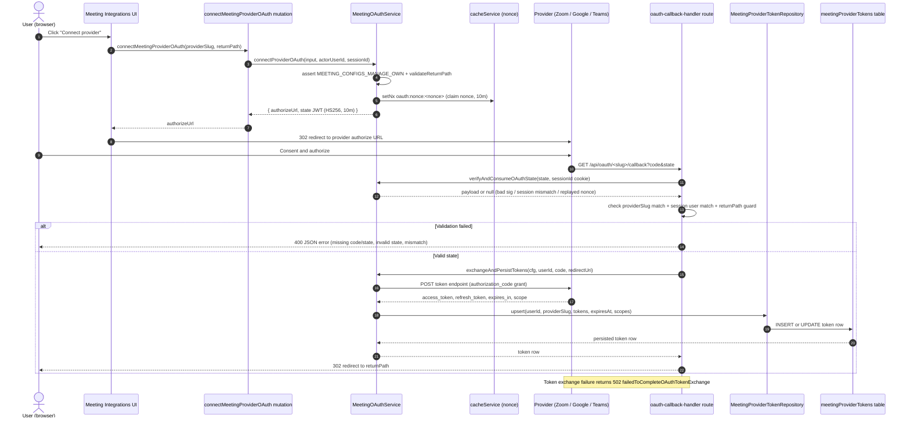

# Meeting Provider OAuth Connect

A logged-in user connects their own Zoom, Google Meet, or Microsoft Teams account so Siraj can create meetings on their behalf. From the meeting-integrations UI (settings tab or profile meeting configs), the user triggers the `connectMeetingProviderOAuth` GraphQL mutation, which runs `MeetingOAuthService.connectProviderOAuth`: it asserts the `MEETING_CONFIGS_MANAGE_OWN` permission, guards `returnPath` against open redirects, and mints a signed HS256 state JWT (`userId`, `providerSlug`, `returnPath`, `sessionId`, single-use nonce claimed via `cacheService.setNx`, 10-minute expiry), then returns the provider-specific authorize URL. The browser follows the provider's consent screen and lands back on `app/api/oauth/<provider>/callback`, where the shared `handleOAuthCallback` verifies and atomically consumes the state (session binding + nonce replay protection), checks the provider slug and session user match, and re-validates `returnPath`. On success it calls `MeetingOAuthService.exchangeAndPersistTokens`, which POSTs the authorization code to the provider's token endpoint and upserts the access/refresh tokens, expiry, and scopes into the `meetingProviderTokens` table, then 302-redirects to `returnPath`. Failures are explicit: 400 for missing `code`/`state`, invalid/expired/replayed state, slug or user mismatch, and invalid return paths; 502 when the provider token exchange fails. Note that `app/(dashboard)/meeting-providers/create` is the admin catalog page (guarded by `MEETING_PROVIDERS_MANAGE_CATALOG`) — the provider admin sets up there is separate from this per-user OAuth token flow.

## Key sources

- `app/api/oauth/zoom/callback/route.ts` (plus `google-meet` / `microsoft-teams` siblings — thin `GET` wrappers supplying provider config)
- `app/api/oauth/shared/oauth-callback-handler.ts` — shared callback GET flow (state verify, guards, error responses, final redirect)
- `backend/services/meeting/integrations/meeting-oauth.service.ts` — `connectProviderOAuth`, `verifyAndConsumeOAuthState`, `exchangeAndPersistTokens`, `disconnectProviderOAuth`, authorize-URL builders
- `backend/db/repo/meeting/meeting-provider-token.repository.ts` — `upsert` into the `meetingProviderTokens` table
- `app/(dashboard)/meeting-providers/create/page.tsx` — admin provider-catalog page (related but separate from the OAuth flow)
- `frontend/common/views/dashboard/settings/tabs/meetingIntegrations/useMeetingIntegrationsViewModel.ts` — UI-side connect entry point

Machine-checkable copy: [oauth-connect-provider.mmd](./oauth-connect-provider.mmd)
