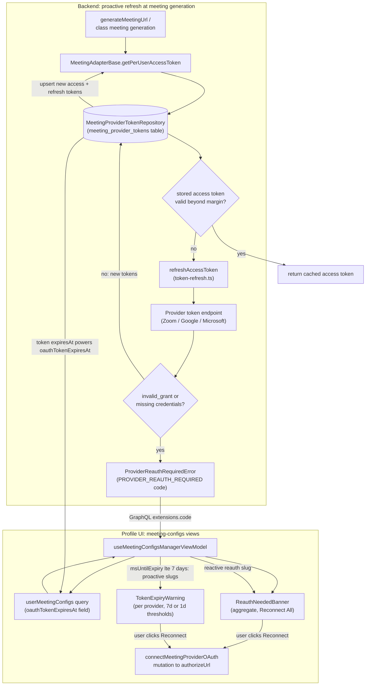

# Meeting Token Refresh & Expiry Warning

Per-user meeting-provider OAuth tokens (Zoom, Google Meet, Microsoft Teams) are refreshed proactively on the backend and surfaced to users on the frontend before they break meeting generation. On the backend, whenever a meeting is generated, `MeetingAdapterBase.getPerUserAccessToken` reads the stored token row via `MeetingProviderTokenRepository`; if the access token is still valid beyond the provider's refresh margin it is reused, otherwise `refreshAccessToken` exchanges the stored refresh token at the provider's token endpoint and the new access/refresh tokens are upserted back into `meeting_provider_tokens`. If the provider answers `invalid_grant` (expired/revoked refresh token) or credentials are missing, a `ProviderReauthRequiredError` is raised and propagated to the client as the GraphQL error code `PROVIDER_REAUTH_REQUIRED`; other endpoint failures throw a retryable generic error instead. On the frontend, `useMeetingConfigsManagerViewModel` combines two detection paths: a **proactive** one that flags any config whose `oauthTokenExpiresAt` is within 7 days, and a **reactive** one that adds a provider when a mutation fails with the reauth error code. These drive a per-provider `TokenExpiryWarning` (warning/critical/expired levels with a countdown clock and pulse animation under 1 day) and an aggregate `ReauthNeededBanner` with Reconnect / Reconnect All / Remind-later actions. Clicking Reconnect calls the `connectMeetingProviderOAuth` mutation and redirects the user through the provider OAuth flow, after which fresh tokens are stored and the warnings clear.

## Key sources

- `backend/services/meeting/integrations/token-refresh.ts` — RFC 6749 `refresh_token` exchange per provider, error mapping to `ProviderReauthRequiredError`
- `backend/services/meeting/channels/__shared__/meetingAdapterBase.ts` — `getPerUserAccessToken` fallback: cached-token margin check, refresh call, and token upsert
- `frontend/common/views/dashboard/profile/shared/meeting-configs/useMeetingConfigsManagerViewModel.ts` — proactive 7-day expiry derivation, reactive `PROVIDER_REAUTH_REQUIRED` handling, reconnect/reconnect-all orchestration
- `frontend/common/views/dashboard/profile/shared/meeting-configs/TokenExpiryWarning.tsx` — per-provider warning/critical/expired banner with reconnect CTA
- `frontend/common/views/dashboard/profile/shared/meeting-configs/reauth-needed-banner.tsx` (and `.types.ts`) — aggregate reauth banner, expiry-state labels, Reconnect All
- `backend/services/meeting/integrations/meeting-integrations.service.ts` — `classifyTokenStatus` (connected / expiring-soon / reauth-needed)
- `backend/graphql/pothos/meeting/meeting.pothos.ts` — `oauthTokenExpiresAt` field on `UserMeetingConfig`

## Diagram

Machine-checkable copy: [token-refresh.mmd](./token-refresh.mmd)
